<div align="center">



# Hey-JARVIS-by-RDJ

### A personal, voice-first AI assistant — documented from concept to evidence


[-22D3EE?style=for-the-badge)](https://github.com/raj-famu-dev)


### *Say it. Understand it. Act on it. Measure it.*

[About](#about) • [Goal](#the-goal) • [Review](#what-a-reviewer-can-verify) • [Interface](#interface-concept) • [Inspiration](#what-is-jarvis) • [Pipeline](#pipeline) • [Progress](#progress) • [Learn](#what-to-learn) • [Method](#method) • [Evidence](#evaluation-and-measured-results) • [Run It](#run-it-yourself) • [Roadmap](#roadmap-and-deadlines) • [Safety](#design-principles) • [Integrity](#integrity-and-naming) • [Structure](#structure) • [Log](#progress-log) • [Related Labs](#related-labs)

</div>

---

## About

This is Raj Patel's ("RDJ") plan for a personal, voice-first AI assistant, built as a Computer Science student at Florida A&M University. The idea is simple: say "Hey, JARVIS", ask for something, and get a useful spoken answer.

Today this folder holds a plan, not a working assistant. There is no implementation, runnable demo or measured result yet. The banner, interface and pipeline illustrations communicate the design; they are not evidence of functioning software. Each stage will be marked complete only when it runs and has supporting proof.

The prerequisite is the Python and FastAPI work in [Python Lab](../python-by-RDJ/README.md). This project belongs to the [AI Engineering](../ai-engineering-by-RDJ/README.md) track.

---

## The Goal

Build an original assistant inspired by the idea of JARVIS and judged by reproducible engineering evidence.

- Real engineering: connect speech, a language model, tools and evaluation in small, explainable steps.
- Public accountability: distinguish plans, implementation and verified results.
- Measured performance: publish evaluation methods, results and failure cases rather than treating a demo as proof.
- Safe scope: operate only on my own machine through explicitly allowed tools.
- Honest expectations: this will not be the movie JARVIS.

---

## What a Reviewer Can Verify

| Area | Current record | Evidence required before completion |
|---|---|---|
| Implementation | Concept only; 0 of 5 stages built | Runnable source and documented setup |
| Origin | Fictional inspiration is disclosed | Sources, licenses and assistance disclosed alongside future artifacts |
| Correctness | No test results published | Tests, actual outputs and failure cases |
| Safety | Allow-list and confirmation rules are planned | Refusal tests and action logs |
| Performance | No accuracy or latency claims | Evaluation inputs, method and reproducible measurements |

---

## Interface Concept

<div align="center">

</div>

This animated mockup sketches the dashboard I want to build: a listening core, pipeline stages, load gauges, microphone view, action console and allowed tools. Nothing shown is real telemetry or a working interface. Evaluation values remain `--` until a program measures them.

---

## What Is JARVIS?

JARVIS stands for "Just A Rather Very Intelligent System", the fictional AI assistant associated with Tony Stark / Iron Man in the Marvel Cinematic Universe.

| Detail | Context |
|---|---|
| Fictional role | Assists Stark with his home, lab and suits |
| Interaction | Spoken natural language |
| Personality inspiration | Calm, polite and dry-witted |
| Voice performer | Paul Bettany |
| Tony Stark's actor | Robert Downey Jr.; not the author of this software |

Here, RDJ means Raj Patel. This independent student project is not affiliated with or endorsed by Robert Downey Jr., Marvel or Disney.

---

## Pipeline

<div align="center">

</div>

| Stage | Planned responsibility |
|---|---|
| Wake | Detect "Hey, JARVIS" with an on-device keyword spotter |
| Listen | Detect speech boundaries and transcribe the request |
| Think | Use an LLM with a defined persona and short-term conversation history |
| Act | Invoke validated, allow-listed tools for tasks such as time, notes and local file search |
| Speak | Convert the response into spoken audio |

Pipeline order describes runtime behavior, not implementation order. Build the typed assistant first, then add speech output, speech input and finally wake-word detection.

---

## Progress

| # | Stage | Planned proof | Status |
|:---:|---|---|---|
| 1 | Wake phrase detection | Recorded clips, hit counts and false-trigger counts | Not started |
| 2 | Speech-to-text and text-to-speech | Round-trip demo and word error rate on a documented clip set | Not started |
| 3 | LLM conversation and persona | Versioned persona prompt and sample transcripts | Not started |
| 4 | Allow-listed tools | Unit tests, validation checks and refusal cases | Not started |
| 5 | Evaluation set | Published method, metrics and failure cases | Not started |

Status definitions: not started = planned only; in progress = implementation underway but proof incomplete; completed = runs, has documented evidence and can be checked. Documentation and visual mockups do not count as implemented stages.

---

## What to Learn

### 1. Python and Audio Foundations

- Python fundamentals, virtual environments and dependency management.
- Microphone capture and playback with candidates such as `sounddevice` or `PyAudio`.
- Sample rates, NumPy audio arrays, threads and `asyncio`.

### 2. Wake-Word Detection

- On-device keyword spotting and custom wake phrases.
- Evaluate candidates such as openWakeWord and Picovoice Porcupine; check current licensing and platform requirements before selecting one.
- Measure detection rate and false activations.

### 3. Speech-to-Text

- Voice activity detection with candidates such as Silero VAD or `webrtcvad`.
- Compare local transcription through `faster-whisper` with a cloud STT API.
- Measure word error rate on a documented set of recordings.

### 4. Language Model and Conversation

- Call a model API or a local model through Ollama.
- Define the persona, response length and conversation-history limits.
- Learn tool calling: the model requests an operation, but application code validates and executes it.

### 5. Tools and Safety

- Write small Python functions with clear inputs and testable outputs.
- Validate arguments, enforce an allow-list and request confirmation for consequential actions.
- Never pass raw model output into a shell; keep tool execution separate from generated text.

### 6. Text-to-Speech

- Explore `pyttsx3`, Piper or a cloud TTS API.
- Evaluate voice quality, streaming behavior, latency and privacy before choosing a backend.

### 7. Evaluation and Service Engineering

- Use `pytest` for unit tests and refusal cases.
- Measure wake detection, transcription, tool selection and end-to-end response time.
- Consider FastAPI only if a web or phone interface becomes necessary.

These are learning topics and candidate technologies, not installed dependencies or final stack decisions.

---

## Method

1. Write: implement one small, runnable component.
2. Run: execute it locally and retain the actual output.
3. Break: test noisy input, invalid arguments, unavailable services and unsafe requests.
4. Explain: document how it works, why decisions were made and where it fails.
5. Ship: commit the implementation, tests and walkthrough; update status only when the evidence supports it.

For future implementation files, disclose authorship and AI assistance where applicable. A walkthrough should distinguish observed behavior from expectations, and a successful demo should not be presented as comprehensive evaluation.

---

## Evaluation and Measured Results

No measurements have been published. The following is the evaluation plan, not a results table.

| Measure | Planned reporting method | Current result |
|---|---|---|
| Wake detection | Correct detections / positive clips; false activations on negative audio with duration stated | Not measured |
| Transcription | Word error rate against reference transcripts | Not measured |
| Tool-call accuracy | Correct tool and arguments on a labeled request set | Not measured |
| Refusal behavior | Outcomes on requests that must not execute | Not measured |
| End-to-end latency | Define timing boundaries and report hardware, backend and repeated-run timings | Not measured |

Publish the input set, configuration, commands, observed results and known failures together. Do not replace missing results with illustrative numbers.

---

## Run It Yourself

There is no runnable assistant yet. This section will gain verified installation and execution commands after the foundation milestone produces working code.

You can inspect the current documentation and design assets:

```bash
git clone https://github.com/raj-famu-dev/code-with-RDJ.git
cd code-with-RDJ/Hey-JARVIS-by-RDJ
```

Read this README and the [roadmap project](./projects/project-01-roadmap-and-deadlines/README.md). These commands retrieve the project; they do not start an assistant.

Before claiming a runnable release, document the supported Python version, operating system, audio requirements, dependency installation, configuration, startup command and test command. Keep credentials out of source control and explain which data leaves the machine.

---

## Roadmap and Deadlines

The [roadmap project](./projects/project-01-roadmap-and-deadlines/README.md) contains eight milestones, tasks and proofs of completion. Planning began November 5, 2026; the target finish is March 14, 2027. Dates are targets, not completed deliverables.

| Milestone | Target deadline |
|---|---|
| M0 — Foundation | November 22, 2026 |
| M1 — Typed assistant | December 6, 2026 |
| M2 — Tools and safety | December 20, 2026 |
| M3 — Text-to-speech | January 3, 2027 |
| M4 — Speech-to-text and VAD | January 24, 2027 |
| M5 — Wake word | February 7, 2027 |
| M6 — Evaluation set and results | February 28, 2027 |
| M7 — Polish, demo and write-up | March 14, 2027 |

If a target slips, update the planning record honestly rather than changing a status without proof.

---

## Design Principles

1. Allow-list, not deny-list: execute only explicitly supported tools.
2. Confirm consequential actions: deleting, sending or spending requires explicit approval.
3. Local first: retain audio locally where possible and disclose external processing.
4. Auditable behavior: plan request, tool-call and outcome logging with sensitive-data handling defined before use.
5. Test refusals: verify that disallowed requests do not cause execution.
6. Own systems only: do not target machines, files or accounts without authorization.

These are intended design requirements. No safety implementation has been verified yet.

---

## Integrity and Naming

- Inspiration: the fictional JARVIS name and concept are acknowledged as Marvel-related inspiration.
- Original implementation: future code, prompts and voice assets must have their origins and applicable licenses documented.
- No copied film material: do not include film scripts, audio, logos or artwork.
- No impersonation: RDJ refers to Raj Patel, not Robert Downey Jr.
- No inflated comparison: this project does not claim to match or replace the fictional assistant.

---

## Structure

The current documentation identifies `README.md`, `LICENSE`, `assets/` and the roadmap project as existing materials. Implementation directories below remain planned.

```text
Hey-JARVIS-by-RDJ/
├── README.md          Project overview, status and evidence requirements
├── LICENSE            MIT license
├── assets/            Banner, pipeline and interface-concept illustrations
├── projects/
│   └── project-01-roadmap-and-deadlines/
│       └── README.md  Milestones, dates and proofs of completion
├── src/               Planned: wake, speech, assistant and tools
├── tests/             Planned: unit, validation and refusal tests
└── eval/              Planned: evaluation inputs, methods and results
```

---

## Progress Log

- November 5, 2026: Concept defined: README, naming and integrity notes, pipeline plan, learning topics and eight dated milestones. No implementation.
- November 6, 2026: Added the animated interface concept and pipeline illustration. Design only; no implementation.
- November 6, 2026: Expanded README organization to match the Java Lab's documentation approach: explicit title, complete navigation, reviewer checklist, method, evaluation plan, run-status guidance and consistent author footer. Documentation only; stages remain 0 of 5.

*Update this log after each session, including incomplete work and limitations—not only successful outcomes.*

---

## A Note to Whoever Is Reading This

If you are a recruiter, hiring manager or fellow engineer: thank you for taking the time. This is an idea I am excited about, and I would rather show an honest plan than a polished claim. When a stage is marked complete, there should be code you can run, documentation you can follow and evidence you can inspect.

— Raj Patel (RDJ), Tallahassee, Florida

---

## Related Labs

| Lab | Connection |
|---|---|
| [AI Engineering](../ai-engineering-by-RDJ/README.md) | Parent track: services, RAG, agents and evaluation |
| [Python Lab](../python-by-RDJ/README.md) | Language and service foundations for the assistant |
| [Java Lab](../java-by-RDJ/README.md) | Companion documentation model: write, run, break, explain and ship |
| [Cybersecurity](../cybersecurity-by-RDJ/README.md) | Authorized systems, explicit boundaries and safety-minded engineering |

---

<div align="center">

### Built and owned by Raj Patel (RDJ)

Computer Science undergraduate at Florida A&M University · Tallahassee, Florida

[GitHub: raj-famu-dev](https://github.com/raj-famu-dev) · [Instagram: @rdj_369](https://instagram.com/rdj_369)

<sub>Status: concept only — 0 of 5 stages implemented. Visuals are design mockups, not functioning software or measured results. Completion requires runnable code and documented evidence. JARVIS is fictional; this independent project is unaffiliated with Marvel, Disney or Robert Downey Jr. RDJ means Raj Patel.</sub>

[Back to the repository](../README.md) · [AI Engineering](../ai-engineering-by-RDJ/README.md) · [Python Lab](../python-by-RDJ/README.md) · [Java Lab](../java-by-RDJ/README.md) · [Back to top](#hey-jarvis-by-rdj)

© 2026 Raj Patel (RDJ). Released under the [MIT License](./LICENSE).

</div>
