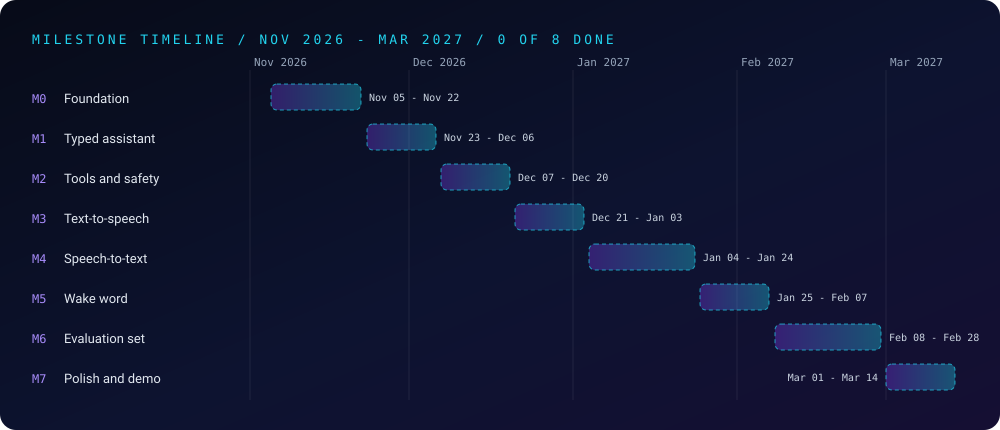

 

### *Roadmap and deadlines for Hey-JARVIS-by-RDJ*

[Parent project](../../README.md) •
[Milestones](#-milestones) •
[Dates](#-deadline-table) •
[Rules](#-how-deadlines-work) •
[Risks](#-risks-and-buffers) •
[Log](#-milestone-log)

---

## 👋 About

This is the planning project for [`Hey-JARVIS-by-RDJ`](../../README.md). It turns the build into **8 milestones**, each with a deadline, tasks and a **proof of done**, so progress is checkable instead of felt.

**The dates are targets I set on November 5, 2026, not promises.** They assume a student schedule (classes, finals, breaks), and they are meant to be edited when reality changes. When a date moves, the log at the bottom says why.

---

## 🗺️ Milestones

### M0: Foundation (Nov 5 to Nov 22, 2026)
- **Learn:** Python environments and packages, reading and writing audio as NumPy arrays, FastAPI basics
- **Tasks:** set up the project folder and virtual environment; record 5 seconds from the mic and play it back; write one "hello" FastAPI endpoint
- **Proof of done:** a script that records and plays audio, and a FastAPI endpoint with one passing test

### M1: Typed assistant (Nov 23 to Dec 6, 2026)
- **Learn:** calling an LLM API, system prompts and persona, conversation history
- **Tasks:** command-line chat loop; JARVIS persona prompt that keeps replies short; history trimming
- **Proof of done:** a saved transcript of at least 10 turns, with the persona prompt committed
- **Buffer:** finals fall in this window, so this milestone is deliberately small

### M2: Tools and safety (Dec 7 to Dec 20, 2026)
- **Learn:** tool / function calling, input validation, allow-list design, logging
- **Tasks:** tools for time, notes and file search; one confirm-before-acting tool; a request log
- **Proof of done:** unit tests pass, **including tests where the assistant must refuse** a request

### M3: Text-to-speech (Dec 21, 2026 to Jan 3, 2027)
- **Learn:** local TTS (`pyttsx3`, then Piper), streaming replies
- **Tasks:** speak the typed assistant's replies; start speaking before the full answer is ready
- **Proof of done:** a recorded demo clip, and a measured time-to-first-sound

### M4: Speech-to-text and VAD (Jan 4 to Jan 24, 2027)
- **Learn:** voice activity detection, Whisper (`faster-whisper`), word error rate (WER)
- **Tasks:** detect when I stop talking; transcribe the request; wire it to the assistant
- **Proof of done:** WER measured on a small recorded clip set, with the clips and method in `eval/`

### M5: Wake word (Jan 25 to Feb 7, 2027)
- **Learn:** keyword spotting (openWakeWord or Porcupine), hit rate vs. false triggers
- **Tasks:** always-listening loop that fires only on "Hey, JARVIS"; tune the threshold
- **Proof of done:** hit and false-trigger counts on recorded test clips, including background noise

### M6: Evaluation set and results (Feb 8 to Feb 28, 2027)
- **Learn:** building an eval set, metrics, honest failure analysis
- **Tasks:** 50 or more test requests; measure tool-call accuracy and end-to-end latency; list the failures
- **Proof of done:** a results table and a written failure-case section in the parent README

### M7: Polish, demo and write-up (Mar 1 to Mar 14, 2027)
- **Tasks:** README run instructions, a short demo video, one public technical write-up
- **Proof of done:** a fresh clone runs from the README alone, and the write-up has a published URL

---

## 📅 Deadline Table

| # | Milestone | Start | Deadline | Status |
|:-:|---|---|---|:-:|
| M0 | Foundation | Nov 5, 2026 | **Nov 22, 2026** | ⬜ Not Started |
| M1 | Typed assistant | Nov 23, 2026 | **Dec 6, 2026** | ⬜ Not Started |
| M2 | Tools and safety | Dec 7, 2026 | **Dec 20, 2026** | ⬜ Not Started |
| M3 | Text-to-speech | Dec 21, 2026 | **Jan 3, 2027** | ⬜ Not Started |
| M4 | Speech-to-text and VAD | Jan 4, 2027 | **Jan 24, 2027** | ⬜ Not Started |
| M5 | Wake word | Jan 25, 2027 | **Feb 7, 2027** | ⬜ Not Started |
| M6 | Evaluation set and results | Feb 8, 2027 | **Feb 28, 2027** | ⬜ Not Started |
| M7 | Polish, demo and write-up | Mar 1, 2027 | **Mar 14, 2027** | ⬜ Not Started |

**Status key:** ✅ done (proof committed) · 🔄 in progress · ⬜ not started · ⚠️ late (new date and reason in the log)

---

## 📏 How Deadlines Work

1. **Done means proof.** A milestone turns ✅ only when its "proof of done" is committed and runs.
2. **Order matters.** The wake word comes last on purpose: the typed assistant must work before audio makes debugging harder.
3. **Slip honestly.** If a deadline is missed, mark it ⚠️, set a new date and write why in the log. Never quietly edit the old one.
4. **Cut scope, not proof.** If time runs out, drop a feature (for example, streaming TTS), not the tests or the evaluation.

---

## ⚠️ Risks and Buffers

| Risk | Plan |
|---|---|
| Finals (early to mid December) | M1 is small, and M2 can slip a week into the winter break |
| Wake-word false triggers | Tune on recorded clips, and keep a push-to-talk fallback |
| API cost or rate limits | Support a local model through Ollama as a fallback |
| Microphone or driver problems across machines | Record test clips once and test against files, not live audio |
| Scope creep | Anything not in a milestone goes on a "later" list in this README |

---

## 📈 Milestone Log

- **November 5, 2026:** ⬜ Roadmap written. Nothing started yet.

*This log is updated when a milestone starts, finishes or slips, to keep the record honest.*

---

### 👨‍💻 Built and owned by Raj Patel (RDJ)

Computer Science undergraduate at **Florida A&M University** · Tallahassee, Florida · GitHub [`raj-famu-dev`](https://github.com/raj-famu-dev)

[⬅ Back to Hey-JARVIS-by-RDJ](../../README.md) · [Back to the repository](../../../README.md)

**© 2026 Raj Patel (RDJ).** Released under the [MIT License](../../LICENSE).

