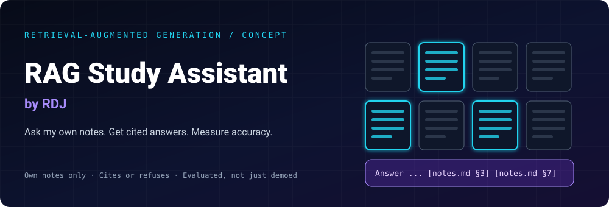
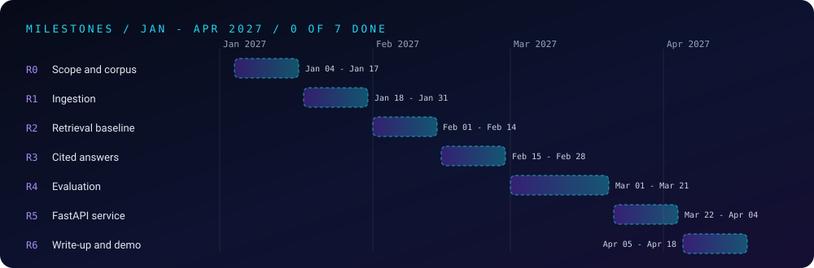

<div align="center">



<br/>


[](https://github.com/users/raj-famu-dev/projects/4)
[-22D3EE?style=for-the-badge)](https://github.com/raj-famu-dev)


### *Ask my notes. Cite the source. Say "not found" when it isn't there.*

[About](#-about) •
[Goal](#-the-goal) •
[Pipeline](#-pipeline) •
[Milestones](#-milestones) •
[Board](#-project-board) •
[Metrics](#-what-gets-measured) •
[Integrity](#-integrity) •
[Structure](#-structure) •
[Log](#-progress-log)

</div>

---

## 👋 About

A study assistant for **my own notes**. I ask a question in plain English, it finds the most relevant passages from my write-ups (for example the Java and networking study notes in this repository), and an LLM answers **only from those passages**, with citations. If the notes don't contain the answer, it says so.

This is a **separate project** from the other folders in this repository. It is the "RAG project with an evaluation set" target of the [AI engineering track](../ai-engineering-by-RDJ/README.md).

**Today this folder holds the plan only.** No code, demo or result exists yet, and every status below says so.

---

## 🎯 The Goal

- **Grounded answers:** every claim points to a source chunk, or the assistant refuses.
- **Measured, not claimed:** an evaluation set with retrieval and answer metrics, plus a written list of failures.
- **Real engineering:** ingestion, chunking, embeddings, vector search, an API and tests, each written and explained by me.
- **Honest scope:** it answers questions about my notes only; it is not a general chatbot.

---

## 🧭 What a Reviewer Can Verify

- **Status is honest:** every milestone is ⬜ until its proof is committed.
- **Numbers come from programs:** no accuracy or latency figure appears until a script prints it.
- **Failures are published:** the evaluation section lists what went wrong, not only what worked.
- **Own data only:** the corpus is my own writing, and its list is committed in `data/`.

---

## 🔬 Pipeline

1. **Ingest:** load Markdown and PDF notes and clean them.
2. **Chunk:** split into overlapping passages, keeping file and heading as metadata.
3. **Embed and index:** turn chunks into vectors and store them in a vector index.
4. **Retrieve:** embed the question and fetch the top-k chunks.
5. **Answer:** an LLM answers from those chunks only, citing sources, or replies "not found".
6. **Serve and evaluate:** a FastAPI `/ask` endpoint, and an evaluation script that scores it.

---

## 🗺️ Milestones

<div align="center">

</div>

| # | Milestone | Start | Deadline | Status |
|:-:|---|---|---|:-:|
| R0 | Scope and corpus | Jan 4, 2027 | **Jan 17, 2027** | ⬜ Not Started |
| R1 | Ingestion and chunking | Jan 18, 2027 | **Jan 31, 2027** | ⬜ Not Started |
| R2 | Embeddings and retrieval baseline | Feb 1, 2027 | **Feb 14, 2027** | ⬜ Not Started |
| R3 | Cited answers | Feb 15, 2027 | **Feb 28, 2027** | ⬜ Not Started |
| R4 | Evaluation set and metrics | Mar 1, 2027 | **Mar 21, 2027** | ⬜ Not Started |
| R5 | FastAPI service and tests | Mar 22, 2027 | **Apr 4, 2027** | ⬜ Not Started |
| R6 | Failure analysis, demo and write-up | Apr 5, 2027 | **Apr 18, 2027** | ⬜ Not Started |

**Status key:** ✅ done (proof committed) · 🔄 in progress · ⬜ not started · ⚠️ late (new date and reason in the log)

### R0: Scope and corpus (Jan 4, 2027 to Jan 17, 2027)
- **Tasks:** Pick the notes to index; define 30 sample questions
- **Proof of done:** Corpus list and 30 questions committed

### R1: Ingestion and chunking (Jan 18, 2027 to Jan 31, 2027)
- **Tasks:** Load Markdown and PDFs, split into chunks with metadata
- **Proof of done:** Ingest script and tests; chunk stats printed

### R2: Embeddings and retrieval baseline (Feb 1, 2027 to Feb 14, 2027)
- **Tasks:** Embed chunks, store in a vector index, top-k search
- **Proof of done:** Search demo returning ranked chunks with scores

### R3: Cited answers (Feb 15, 2027 to Feb 28, 2027)
- **Tasks:** LLM answers only from retrieved chunks and cites sources; says 'not found' otherwise
- **Proof of done:** Transcript of 10 answers with citations plus 5 refusals

### R4: Evaluation set and metrics (Mar 1, 2027 to Mar 21, 2027)
- **Tasks:** 50+ labelled questions; measure retrieval hit rate and answer correctness
- **Proof of done:** Results table and method committed in eval/

### R5: FastAPI service and tests (Mar 22, 2027 to Apr 4, 2027)
- **Tasks:** Wrap it as an API with /ask and /health, plus pytest
- **Proof of done:** Service runs locally; tests pass

### R6: Failure analysis, demo and write-up (Apr 5, 2027 to Apr 18, 2027)
- **Tasks:** Study the failures, fix the top one, record a demo, publish a write-up
- **Proof of done:** Failure section, demo clip and published write-up URL

*Dates are targets set on November 5, 2026, placed after finals and sequenced so they don't compete with other projects. They will be edited honestly when they slip.*

---

## 📋 Project Board

Planned work is tracked on the GitHub Project board: **[https://github.com/users/raj-famu-dev/projects/4](https://github.com/users/raj-famu-dev/projects/4)**.

[`board/BOARD.md`](./board/BOARD.md) holds the proposed columns and one card per task, and [`board/create-cards.sh`](./board/create-cards.sh) can add them to the board with the GitHub CLI.

---

## 📏 What Gets Measured

| Metric | What it shows |
|---|---|
| **Retrieval hit rate @k** | How often the right chunk is in the top k |
| **Answer correctness** | Graded against a written reference on 50+ labelled questions |
| **Citation accuracy** | Whether cited chunks really support the claim |
| **Refusal rate on out-of-scope questions** | Whether it says "not found" when it should |
| **Latency** | Time from question to answer |

---

## ⚖️ Integrity

- **Original work:** code, prompts and evaluation data are written by me, with any outside library or model named.
- **Own notes only:** no copyrighted books or third-party material goes into the corpus.
- **No overclaiming:** results are reported with the method and the failures.

---

## 📂 Structure

Planned layout (only `README.md`, `LICENSE`, `assets/` and `board/` exist today):

```text
RAG-Study-Assistant-by-RDJ/
├── README.md          this file
├── LICENSE            MIT
├── assets/            banner and timeline
├── board/             project-board columns and cards
├── data/              (planned) corpus list
├── src/               (planned) ingest, chunk, index, retrieve, answer, api
├── tests/             (planned) unit tests
└── eval/              (planned) labelled questions and results
```

---

## 📈 Progress Log

- **November 5, 2026:** ⬜ Concept defined: README, 7 dated milestones, board cards. No code yet.

*This log is updated when a milestone starts, finishes or slips.*

---

<div align="center">

### 👨‍💻 Built and owned by Raj Patel (RDJ)

Computer Science undergraduate at **Florida A&M University** · Tallahassee, Florida · GitHub [`raj-famu-dev`](https://github.com/raj-famu-dev)

<sub>Status: concept only. This README exists so the plan is public before the work is.</sub>

[⬅ Back to the repository](../README.md) · [AI Engineering](../ai-engineering-by-RDJ/README.md) · [Python Lab](../python-by-RDJ/README.md)

**© 2026 Raj Patel (RDJ).** Released under the [MIT License](./LICENSE).

</div>
