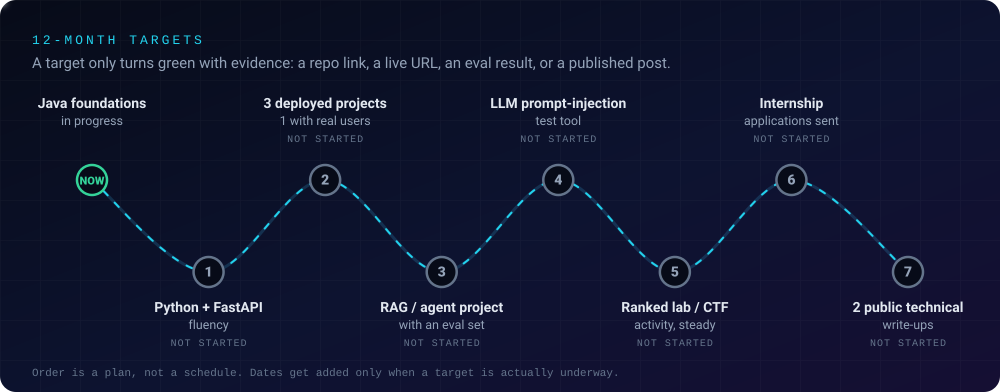

 

### *What can one disciplined CS student prove, in public, in 12 months?*

[About](#-about) •
[Snapshot](#-snapshot) •
[Tracks](#-tracks) •
[Targets](#-12-month-targets) •
[Method](#-how-i-learn) •
[Integrity](#-integrity-what-is-mine-and-what-is-not) •
[Recruiters](#-for-recruiters) •
[Ethics](#-ethics)

---

## 👤 About

I'm **Raj Patel** ("RDJ"; GitHub: `raj-famu-dev`), a Computer Science undergraduate at **Florida A&M University** in **Tallahassee, Florida**. This repository is my public lab: every module, project and write-up on the way to an **AI engineering** role lives here, with its status stated honestly.

- **Direction:** AI engineering first, security second, computer science fundamentals and math underneath.
- **Foundation language:** Java. **Next:** Python and FastAPI, then RAG and agent projects with evaluation sets.
- **Where I am:** no industry experience yet. What I can offer is evidence: code you can run, explanations I wrote, and a clear record of what is mine and what is not.

---

## 📊 Snapshot

*As of 2026-11-03. Source of truth: the folder READMEs.*

| | |
|---|---|
| **Education** | B.S. Computer Science (in progress), Florida A&M University, Tallahassee, FL |
| **Java** | 108 files, about 17,500 lines. **28 written by me**, 80 written with Claude (each says so in its first line) |
| **Java modules** | 15 planned: **11 completed**, 4 not started |
| **Python** | 57 files, about 8,600 lines. **11 written by me** (`01-basics`), 46 written with Claude. **5 of 5 modules and 3 of 3 projects completed**, 231 pytest tests passing |
| **C** | C17 learning lab scaffold: 5 modules and 40 topics designed with paired source examples and walkthroughs, plus 2 project starters. Module and project READMEs in place; code pending local verification |
| **C++** | 72 files, about 8,100 lines, all written with Claude. **6 of 6 modules and 3 of 3 projects completed**, 159 project checks passing, clean under AddressSanitizer and UndefinedBehaviorSanitizer |
| **Computer Networks** | 70 topics, each a runnable `.py` (about 14,300 lines) plus a `.md` study note (about 11,300 lines), all written with Claude. **7 of 7 modules completed**, all 70 demos run clean with exit 0, including inside a loopback-only network namespace |
| **Java projects finished** | 1 of 8 planned (`project-04-grade-manager`) |
| **Deployed projects** | 0. Target: 3 |
| **Ranked CTF or lab activity** | None yet. No ranking claims until there is a named ranking, a number and a source |

---

## 🧭 Tracks

| Track | Folder | State |
|---|---|---|
| ☕ **Java** | [`java-by-RDJ`](./java-by-RDJ) | **Active.** OOP, collections, concurrency, generics, streams, design patterns, data structures from scratch |
| 🐍 **Python** | [`python-by-RDJ`](./python-by-RDJ) | **Core completed.** 5 modules (OOP, file I/O and JSON, sockets, NumPy/Pandas) and 3 projects, all run and tested. FastAPI is next and not started |
| 🤖 **AI engineering** | [`ai-engineering-by-RDJ`](./ai-engineering-by-RDJ) | **Next.** Placeholder folder. Starts after Python and FastAPI |
| 🛡️ **Security** | [`cybersecurity-by-RDJ`](./cybersecurity-by-RDJ) | **Queued.** Placeholder folder. Own systems and legal labs only |
| 🧩 **C programming** | [`c-by-RDJ`](./c-by-RDJ) | **Scaffold, design complete.** 5 modules and 40 topics designed (basics, pointers and memory, structs and modularity, files and systems, data structures), plus 2 project starters (grade manager port, hash table). Code pending |
| ⚙️ **C++ systems** | [`cpp-by-RDJ`](./cpp-by-RDJ) | **Core completed.** 6 modules and 3 projects (data structures, memory-safety lab, thread pool), sanitizer-checked |
| 🌐 **Computer networks** | [`computer-network-by-RDJ`](./computer-network-by-RDJ) | **Core completed.** 7 modules and 70 topics: the six chapters of a full CN course (introduction, data link, network, transport, session and presentation, application) plus wireless, security and tools. Each topic has a runnable simulator and a detailed study note. No projects yet |

---

## 🎯 12-Month Targets

A target turns green only with **proof**. Nothing here is checked off yet, and that is deliberate.

| # | Target | Proof that counts | Status |
|:-:|---|---|:-:|
| 1 | Fluent Python and FastAPI | A FastAPI service in a public repo, with tests | ⬜ |
| 2 | 3 deployed projects, at least 1 with real users | Live URLs plus repo links | ⬜ |
| 3 | A RAG or agent project with an evaluation set | Repo plus eval method, metrics and failure cases | ⬜ |
| 4 | A tool that tests LLM apps for prompt injection | Repo plus test cases, run only against apps I own | ⬜ |
| 5 | Steady ranked activity on a legal lab or CTF platform | Public profile link, platform name, rank and date | ⬜ |
| 6 | Internship applications sent | The count, logged here | ⬜ |
| 7 | 2 public technical write-ups | Published URLs | ⬜ |

---

## 🔬 How I Learn

A green checkmark is not free. A topic turns **completed** (green) only when the code is written, runs for real, has had its traps hit on purpose, and has a line-by-line walkthrough with real output. Anything else stays ⬜.

---

## 🧾 Integrity: What Is Mine and What Is Not

I use AI as a tutor and to help write code, and I say so on the page instead of hiding it.

- **Written by me:** Java `01-basics`, `02-oop`, `04-exceptions/_1`, `project-04-grade-manager`, and Python `01-basics`.
- **Written with Claude (Sonnet 5.5), then run and verified:** Java concept folders `03` to `09`, `13` and `14` (80 files), Python `02` to `05` the three Python projects, the initial C lab scaffold (generated with ChatGPT; local verification pending), the whole C++ lab (6 modules, 3 projects), and the whole Computer Network lab (7 modules, 70 topics). Each file starts with a header line saying so, and each walkthrough opens with a note.
- **What "completed" means:** written, run and explained in a walkthrough. It describes the artifact. It does not claim I could reproduce it from memory, and nothing here claims a skill level or a ranking.
- **Checkable, not claimed:** the Java programs are deterministic and run on JDK 21; the Python files run on Python 3.13 and the projects pass their pytest suites, the C++ builds clean under `-Wall -Wextra -Wpedantic` and the sanitizers, and the 70 networking demos run on Python 3.13 with only loopback sockets, so you can reproduce all of it yourself.

---

## 💼 For Recruiters

A 60-second tour, in the order that is most useful:

1. **[`java-by-RDJ`](./java-by-RDJ)**: module map, honest status, and measured results from the data-structure programs.
2. **My own work:** [`project-04-grade-manager`](./java-by-RDJ/projects/project-04-grade-manager), [`concepts/02-oop`](./java-by-RDJ/concepts/02-oop), [`python-by-RDJ/concepts/01-basics`](./python-by-RDJ/concepts/01-basics).
3. **Python and security tooling:** [`python-by-RDJ`](./python-by-RDJ), especially [`project-02-network-scanner`](./python-by-RDJ/projects/project-02-network-scanner) (refuses public hosts, tested) and [`project-03-perceptron-from-scratch`](./python-by-RDJ/projects/project-03-perceptron-from-scratch).
4. **C foundations:** [`c-by-RDJ`](./c-by-RDJ) introduces C17, pointers, manual memory management and file I/O; the curriculum (5 modules, 40 topics, 2 project starters) is fully designed, with code pending.
5. **Systems fluency:** [`cpp-by-RDJ`](./cpp-by-RDJ), especially [`project-02-memory-safety-lab`](./cpp-by-RDJ/projects/project-02-memory-safety-lab) (toy bugs caught by sanitizers, then fixed) and [`project-03-thread-pool`](./cpp-by-RDJ/projects/project-03-thread-pool).
6. **Networking fundamentals:** [`computer-network-by-RDJ`](./computer-network-by-RDJ), especially [`03-network-layer`](./computer-network-by-RDJ/concepts/03-network-layer) (subnetting, routing and ICMP simulators) and [`04-transport-layer`](./computer-network-by-RDJ/concepts/04-transport-layer) (TCP state machine, congestion control, sockets on loopback).
7. **How I think about correctness:** [`14-dsa-in-java`](./java-by-RDJ/concepts/14-dsa-in-java) builds each structure without the JDK collections, then checks it against the JDK class on thousands of seeded random operations.

**Looking for:** AI engineering or software engineering internships and junior roles. **Based in:** Tallahassee, Florida. **Contact:** through my GitHub profile, [`raj-famu-dev`](https://github.com/raj-famu-dev), or on Instagram, [`@rdj_369`](https://instagram.com/rdj_369).

---

## 🔒 Ethics

Security work is done **only** on systems I own, in legal training labs, and on CTF platforms. No real-world targets, no stolen data, and no malware outside a lab.

---

## 📜 License

[MIT](./LICENSE) © 2026 Raj Patel (RDJ), `raj-famu-dev`

*Evidence over claims. Updated 2026-11-03.*

