<div align="center">



<br/>


[-22D3EE?style=for-the-badge)](https://github.com/raj-famu-dev)
[](https://www.famu.edu)
[](https://instagram.com/rdj_369)
[](./LICENSE)

### *No garbage collector. No classes. No safety net — just you, the heap, and the sanitizer.*

[About](#-about) •
[The Goal](#-the-goal) •
[Progress](#-progress) •
[Memory](#-memory-at-a-glance) •
[Structure](#-structure) •
[Method](#-method) •
[Run It](#-run-it-yourself) •
[Integrity](#-integrity) •
[Notes](./notes.md) •
[Structure](#-structure) •
[Log](#-progress-log)

</div>

---

## 🧩 About

This is the C lab: **C17 fundamentals, arrays, pointers, manual memory management, structs, file I/O, and data structures built from nothing but `malloc`.**

It exists for one reason — everything else in this repo sits on top of C's world:

- Java and Python hide memory behind a runtime and a GC; C makes you manage every byte yourself.
- The C++ lab already teaches RAII and smart pointers; this lab is the layer *underneath* — where `delete` doesn't exist and `free()` is a discipline, not a keyword.
- Operating systems, kernels, and the runtimes of Java, Python and C themselves are written in C. Reading C fluently is reading the foundations.

**Status: concepts complete.** All 5 modules and 40 topics are written and verified — every `.c` compiles with zero warnings under `-std=c17 -Wall -Wextra -Wpedantic`, runs with exit 0, and each has a paired `.md` walkthrough in the `java-by-RDJ` style (Concept → Code → Line-by-Line Breakdown). Module 02 and 05 files are additionally clean under AddressSanitizer + UndefinedBehaviorSanitizer. The two projects remain starters.

---

## 🎯 The Goal

**Working fluency in C17**, proven by artifacts:

1. Explain pointers, arrays and the stack/heap distinction without hand-waving — and debug all three classic memory bugs (use-after-free, buffer overflow, leak) from a real sanitizer report.
2. Build a dynamic array, linked list, stack, queue and hash table from scratch — no libraries — and prove them with tests and sanitizers.
3. Read and modify a multi-file C project: headers, `extern`, `static`, Makefiles.
4. Port a complete Java application (the grade manager) to idiomatic C, with file persistence.

---

## 🧭 What a Reviewer Can Verify

- **Run the completed files:** GCC 13, `-std=c17`, no build tool or dependency.
- **Origin is disclosed:** the first line of every file states who wrote it.
- **Status is honest:** ✅ means written, run and explained. Anything not started stays ⬜.
- **Memory safety is tested, not asserted:** the deliberate-bug demos in [`02-pointers-and-memory`](./concepts/02-pointers-and-memory) are caught by ASan/UBSan, then fixed.

---

## 📈 Progress

<div align="center">

</div>

| Module | Topics | Status |
|---|:-:|:---:|
| [`concepts/01-basics`](./concepts/01-basics) | 9 | ✅ Complete |
| [`concepts/02-pointers-and-memory`](./concepts/02-pointers-and-memory) | 8 | ✅ Complete |
| [`concepts/03-structs-and-modularity`](./concepts/03-structs-and-modularity) | 8 | ✅ Complete |
| [`concepts/04-files-and-systems`](./concepts/04-files-and-systems) | 8 | ✅ Complete |
| [`concepts/05-data-structures-in-c`](./concepts/05-data-structures-in-c) | 7 | ✅ Complete |

| Project | Status |
|---|:---:|
| [`projects/project-01-grade-manager-c`](./projects/project-01-grade-manager-c) | ⬜ Not started |
| [`projects/project-02-hash-table-c`](./projects/project-02-hash-table-c) | ⬜ Not started |

**Totals: 40 of 40 topics written and verified · 0 of 2 projects complete (starters).**

---

## 🧠 Memory at a Glance

<div align="center">

</div>

The stack cleans up after itself — the heap does not. `malloc` hands you a block nobody will ever free for you; `free` returns it; and after `free(p)` the pointer must be treated as poison until it is set to `NULL`. The diagram is an **illustrative schedule**. [`02-pointers-and-memory`](./concepts/02-pointers-and-memory) runs the real thing, including the deliberate-bug sanitizer demos that prove the runtime catches what C itself will not.

---

## 📂 Structure

- **[`concepts/`](./concepts)**: one topic per file pair — a runnable `_N_Name.c` and a matching `_N_Name.md` explaining it line by line (same format as `java-by-RDJ`, `python-by-RDJ` and `cpp-by-RDJ`).
- **[`projects/`](./projects)**: complete programs with a Makefile and tests, combining several modules.
- **[`notes.md`](./notes.md)**: consolidated study notes covering every completed module and topic with detailed explanations.

Every concept file follows the established repo conventions:

```c
// Tags: #C #Pointers #MemoryManagement #Malloc | @rdj_369 | C17 (gcc 13)
// Completed and verified (gcc 13, -std=c17 -Wall -Wextra -Wpedantic). Authorship disclosed.
```

---

## 🔬 Method

<div align="center">

</div>

The same method as every other lab here — **write, run, break, explain, ship** — with one C-specific addition, **sanitizer-first**:

1. **Write** the smallest complete example of the concept.
2. **Run** it with `gcc -std=c17 -Wall -Wextra -Wpedantic -O0 -g`.
3. **Break it** — deliberately trigger the failure (the C++ lab's memory-safety lab is the model: bug, sanitizer report, fix).
4. **Read the sanitizer output** — ASan and UBSan reports are a skill, not an error message to paste.
5. **Explain** the concept in plain English in the paired `.md`.
6. **Ship** — commit with the disclosure header.

---

## 🚀 Run It Yourself

```bash
# every file, always:
gcc -std=c17 -Wall -Wextra -Wpedantic -O0 -g -o demo _N_Name.c && ./demo

# memory-heavy files, additionally:
gcc -std=c17 -Wall -Wextra -Wpedantic -g -fsanitize=address,undefined -o demo _N_Name.c && ./demo

# projects: make test / make sanitize (same targets as cpp-by-RDJ)
```

**Toolchain:** GCC 13 (`gcc --version`), C17 (`-std=c17`), zero warnings under `-Wall -Wextra -Wpedantic`, clean under AddressSanitizer and UndefinedBehaviorSanitizer.

---

## 🤝 Integrity

- This folder's **design** (curriculum, module READMEs, topic lists) was drafted with Claude, and **all 40 concept topic files were written with Claude (Sonnet 5.5)** — then compiled warning-free, run-verified (exit 0) and explained by me. Each file carries the same per-file disclosure used across this repo — hand-written by RDJ, or written with Claude — stated per file, never hidden.
- No security tool here will ever target a system I don't own. The security rule is the same one the network scanner enforces in code: loopback and my own hosts only.

---

## 📈 Progress Log

| Date | Entry |
|---|---|
| 2026-11-03 | Scaffold created: 5 modules and 2 project starters fully designed (READMEs and topic lists), code not started |
| 2026-11-03 | All 40 concept topics written, compiled warning-free and run-verified (exit 0); Module 02 and 05 clean under ASan + UBSan |

---

## 🔗 Related Labs

| Lab | What it covers |
|---|---|
| ☕ [Java Lab](../java-by-RDJ/README.md) | The foundation language; [`14-dsa-in-java`](../java-by-RDJ/concepts/14-dsa-in-java) builds the same structures this lab rebuilds with `malloc`. |
| 🐍 [Python Lab](../python-by-RDJ/README.md) | The language used for the networking demos; its [`04-network-sockets`](../python-by-RDJ/concepts/04-network-sockets) module is the hands-on sockets companion. |
| ⚙️ [C++ Lab](../cpp-by-RDJ/README.md) | The layer above: RAII, smart pointers, threads. Its [`project-02-memory-safety-lab`](../cpp-by-RDJ/projects/project-02-memory-safety-lab) is the model for this lab's sanitizer demos. |
| 🌐 [Computer Network Lab](../computer-network-by-RDJ/README.md) | How the network stack works, protocol by protocol, with runnable simulators. |

---

<div align="center">

### 👨‍💻 Built and owned by Raj Patel (RDJ)

Computer Science undergraduate at **Florida A&M University** · Tallahassee, Florida · GitHub [`raj-famu-dev`](https://github.com/raj-famu-dev) · Instagram [`@rdj_369`](https://instagram.com/rdj_369)

<sub>Completed means written, run and explained in a walkthrough. The design and all 40 concept topic files were written with Claude (Sonnet 5.5), disclosed per file, then compiled and verified by me. The two projects are still starters.</sub>

[⬅ Back to the repository](../README.md) · [Java Lab](../java-by-RDJ/README.md) · [Python Lab](../python-by-RDJ/README.md) · [C++ Lab](../cpp-by-RDJ/README.md) · [Computer Network Lab](../computer-network-by-RDJ/README.md)

**© 2026 Raj Patel (RDJ).** Released under the [MIT License](./LICENSE).

</div>
