<div align="center">



<br/>


### *Know what happens between pressing Enter and the page loading.*

[About](#-about) •
[The Goal](#-the-goal) •
[Video Map](#-video-map) •
[What a Reviewer Can Verify](#-what-a-reviewer-can-verify) •
[Progress](#-progress) •
[Structure](#-structure) •
[Topic Index](#-topic-index) •
[Run It Yourself](#-run-it-yourself) •
[Progress Log](#-progress-log)

[⬅ Back to the repository](../README.md) · [Java Mastery Lab](../java-by-RDJ/README.md) · [Python Lab](../python-by-RDJ/README.md) · [C++ Lab](../cpp-by-RDJ/README.md)

</div>

---

## 👋 About

This is **Raj Patel's** ("RDJ") record of learning computer networks as a Computer Science student at Florida A&M University in Tallahassee, Florida. Every concept in a standard semester course (layers, addressing, routing, TCP, DNS, HTTP, security) is written up as a detailed study note and backed by a small Python program that runs the idea on real numbers: CRC remainders, subnet tables, routing convergence, TCP handshakes, DNS messages on the wire. AI engineering and security work both sit on top of this stack, so I want to understand it from the bits up.

---

## 🎯 The Goal

- **Cover the whole syllabus:** the six chapters of the video below (Introduction, Data Link, Network, Transport, Session and Presentation, Application), plus a seventh module for wireless, security and tools.
- **Run every idea:** no topic is only a definition. Each has a program that prints the worked example and checks its own answer (against `zlib`, `ipaddress`, `struct` or a textbook result where one exists).
- **Detailed notes:** each topic's `.md` holds the theory, formulas, header layouts, comparison tables, a line-by-line breakdown with real output, a worked exam-style problem and a gotchas list.
- **Security foundation:** attacks are explained as in-memory simulations next to their defences. Nothing here touches a real host.

---

## 🎬 Video Map

The curriculum follows the six chapters of [Complete CN Computer Networks in One Shot, 10 Hours (Hindi)](https://www.youtube.com/watch?v=1V9mhVgVH3A) by 5 Minutes Engineering (published 2024-04-12). Click a chapter to open the video at that timestamp.

| Video chapter | Starts | Module | Topics it covers |
|---|:-:|---|---|
| [Introduction](https://www.youtube.com/watch?v=1V9mhVgVH3A&t=0s) | 0:00:00 | [`01-introduction-and-physical-layer`](./concepts/01-introduction-and-physical-layer) | network types, topologies, switching, OSI and TCP/IP models, transmission media, signals, multiplexing, delay |
| [Data Link Layer](https://www.youtube.com/watch?v=1V9mhVgVH3A&t=6040s) | 1:40:40 | [`02-data-link-layer`](./concepts/02-data-link-layer) | framing, error detection and correction, ARQ protocols, ALOHA and CSMA, Ethernet, switches, VLAN, HDLC/PPP, ARP |
| [Network Layer](https://www.youtube.com/watch?v=1V9mhVgVH3A&t=20445s) | 5:40:45 | [`03-network-layer`](./concepts/03-network-layer) | IPv4 and IPv6, subnetting, VLSM and CIDR, fragmentation, routing algorithms and protocols, ICMP, NAT, congestion control, multicast |
| [Transport Layer](https://www.youtube.com/watch?v=1V9mhVgVH3A&t=31425s) | 8:43:45 | [`04-transport-layer`](./concepts/04-transport-layer) | ports and sockets, UDP, TCP segments, connection management, reliability, flow control, congestion control, socket programming |
| [Session & Presentation Layer](https://www.youtube.com/watch?v=1V9mhVgVH3A&t=35706s) | 9:55:06 | [`05-session-and-presentation-layer`](./concepts/05-session-and-presentation-layer) | sessions, data representation, compression, cryptography, key exchange, hashing, TLS |
| [Application Layer](https://www.youtube.com/watch?v=1V9mhVgVH3A&t=36590s) | 10:09:50 | [`06-application-layer`](./concepts/06-application-layer) | DNS, HTTP, email, FTP/TFTP/Telnet/SSH, DHCP, SNMP, P2P and streaming |
| *(not in the video)* | - | [`07-wireless-security-and-tools`](./concepts/07-wireless-security-and-tools) | Wi-Fi, cellular, firewalls, attacks and defences, packet dissection, VPN, tools, data center and SDN |

> **Honest scope note:** I could read the video's title, description and chapter list, but **not its transcript or sub-topic timestamps**. The topics inside each module therefore follow the standard computer-networks semester syllabus for those chapter names. They are not a minute-by-minute mapping of what the video says, and I do not claim the video covers every topic listed. Module 07 is extra by design.

---

## 🧭 What a Reviewer Can Verify

- **Every demo runs:** all 70 `.py` files run with exit code 0, no input, no stderr and stable output (labelled measurements aside), on Python 3.13 with the standard library only.
- **Loopback only:** all 70 also pass inside a network namespace that has only a loopback interface and no route to the outside, so none of them depends on or contacts an outside host.
- **Self-checking:** the programs cross-check their own results: CRC-32 against `zlib`, the RFC 1071 checksum example, subnet tables against `ipaddress`, packed headers against `struct`.
- **Origin is disclosed:** every file was written with Claude (Sonnet 5.5), then run and verified, and its first line says so.
- **Completed means:** written, run and explained in a walkthrough. It describes the artifact, not how well I could reproduce it from memory, and it is not a claim that the notes are free of mistakes. Corrections are welcome.
- **Safe by construction:** sockets bind `127.0.0.1` with timeouts. Attack topics are in-memory simulations shown with the defence, no raw sockets, no live capture, no scanning of real hosts.
- **Size:** 70 topics, about 14,315 lines of Python and 11,276 lines of walkthrough text.

---

## 📈 Progress

<div align="center">

</div>

---

## 📂 Structure

- **[`concepts/`](./concepts)**: one topic per file pair, a runnable `_N_Name.py` and a matching study note `_N_Name.md`.
- **[`assets/`](./assets)**: the animated banner, progress card and per-module banners.

| Module | Topics | Focus | Status |
|---|:-:|---|:---:|
| [`concepts/01-introduction-and-physical-layer`](./concepts/01-introduction-and-physical-layer) | 10 | Network types, topologies, switching, OSI and TCP/IP, media, signals, multiplexing, delay, devices | ✅ Completed |
| [`concepts/02-data-link-layer`](./concepts/02-data-link-layer) | 12 | Framing, parity, checksum, CRC, Hamming, stop-and-wait, Go-Back-N, Selective Repeat, ALOHA, CSMA, Ethernet, bridges, VLAN, HDLC, PPP, ARP | ✅ Completed |
| [`concepts/03-network-layer`](./concepts/03-network-layer) | 13 | IPv4, subnetting, VLSM, CIDR, header and fragmentation, IPv6, Dijkstra, distance vector, link state, RIP/OSPF/BGP, ICMP, NAT, QoS, multicast | ✅ Completed |
| [`concepts/04-transport-layer`](./concepts/04-transport-layer) | 9 | Ports, UDP, TCP header, handshake and close, reliability, flow control, congestion control, QUIC and SCTP overview, sockets | ✅ Completed |
| [`concepts/05-session-and-presentation-layer`](./concepts/05-session-and-presentation-layer) | 7 | Sessions, encoding, compression, ciphers, RSA and Diffie-Hellman, hashing and MAC, TLS | ✅ Completed |
| [`concepts/06-application-layer`](./concepts/06-application-layer) | 11 | Client-server, DNS, HTTP, cookies and caching, HTTP/2 and 3, SMTP/POP3/IMAP, FTP, TFTP, SSH, DHCP, SNMP, P2P | ✅ Completed |
| [`concepts/07-wireless-security-and-tools`](./concepts/07-wireless-security-and-tools) | 8 | Wi-Fi, cellular, firewalls, attacks and defences, packet dissection, VPN, tools, data center and SDN | ✅ Completed |

**Status key:** ✅ completed (written, run and explained in a walkthrough) · 🔄 in progress · ⬜ not started

**Suggested study order:** read modules in numeric order (they follow the layers from the bottom up). For each topic: read the `.md` concept section, run the `.py`, change one input and predict the output, then answer the module's Exit Test from memory.

---

## 📇 Topic Index

Every topic, with its one-line takeaway. Open a module to see its list.

<details>
<summary><b>Module 01: Introduction</b> (10 topics)</summary>

| # | Topic | Takeaway |
|---|---|---|
| 1 | [`_1_NetworkTypesAndUses`](./concepts/01-introduction-and-physical-layer/_1_NetworkTypesAndUses.md) ✅ | PAN/LAN/MAN/WAN reach, Internet vs intranet vs extranet, client-server vs P2P and unicast/broadcast/multicast/anycast are different axes of classification. |
| 2 | [`_2_NetworkTopologies`](./concepts/01-introduction-and-physical-layer/_2_NetworkTopologies.md) ✅ | A full mesh needs n(n-1)/2 cables while star and ring need n, and the failure analysis (hub, backbone, single cut) is what separates the topologies. |
| 3 | [`_3_SwitchingTechniques`](./concepts/01-introduction-and-physical-layer/_3_SwitchingTechniques.md) ✅ | Packet switching pipelines small packets so delay is (k+P-1) packet times, far below message switching's k full transmissions, and datagram networks may reorder where virtual circuits do not. |
| 4 | [`_4_OsiModel`](./concepts/01-introduction-and-physical-layer/_4_OsiModel.md) ✅ | Each layer adds its own header going down and strips it going up, and talks logically only to its peer layer on the other host. |
| 5 | [`_5_TcpIpModelAndEncapsulation`](./concepts/01-introduction-and-physical-layer/_5_TcpIpModelAndEncapsulation.md) ✅ | Ethernet 14 + IPv4 20 + TCP 20 bytes (+4 FCS) wrap your data, giving MSS 1460 on a 1500 MTU, and the Internet checksum verifies to zero. |
| 6 | [`_6_TransmissionMedia`](./concepts/01-introduction-and-physical-layer/_6_TransmissionMedia.md) ✅ | Twisted pair, coax and fibre trade cost against reach and noise immunity, with twisting cancelling common-mode noise and dB losses adding up along the path. |
| 7 | [`_7_SignalsAndEncoding`](./concepts/01-introduction-and-physical-layer/_7_SignalsAndEncoding.md) ✅ | Nyquist gives the noiseless limit 2B log2 L, Shannon gives the noisy limit B log2(1+SNR), and line codes like Manchester and 4B/5B guarantee the transitions a receiver needs. |
| 8 | [`_8_Multiplexing`](./concepts/01-introduction-and-physical-layer/_8_Multiplexing.md) ✅ | FDM needs guard bands, synchronous TDM wastes idle slots, statistical TDM reuses them at the price of addresses, and spread spectrum trades bandwidth for robustness. |
| 9 | [`_9_DelayAndThroughput`](./concepts/01-introduction-and-physical-layer/_9_DelayAndThroughput.md) ✅ | Transmission delay depends on rate while propagation depends on distance, throughput is capped by the bottleneck and window, and bandwidth x RTT is the data needed in flight. |
| 10 | [`_10_NetworkDevicesAndCabling`](./concepts/01-introduction-and-physical-layer/_10_NetworkDevicesAndCabling.md) ✅ | Hubs share one collision domain, switches give one per port, only routers split broadcast domains, and like devices need crossover cables. |

</details>

<details>
<summary><b>Module 02: Data Link Layer</b> (12 topics)</summary>

| # | Topic | Takeaway |
|---|---|---|
| 1 | [`_1_DataLinkLayerAndFraming`](./concepts/02-data-link-layer/_1_DataLinkLayerAndFraming.md) ✅ | Stuff extra bits or bytes into the data so the flag pattern can only ever be a real boundary. |
| 2 | [`_2_ParityAndChecksum`](./concepts/02-data-link-layer/_2_ParityAndChecksum.md) ✅ | Parity misses even numbers of flips and the checksum misses swapped or compensating words, which is why links use a CRC. |
| 3 | [`_3_CyclicRedundancyCheck`](./concepts/02-data-link-layer/_3_CyclicRedundancyCheck.md) ✅ | Send data plus the remainder of data*x^r divided by G(x); any burst up to r bits leaves a nonzero remainder. |
| 4 | [`_4_HammingCode`](./concepts/02-data-link-layer/_4_HammingCode.md) ✅ | The syndrome is the position of the error, and an overall parity bit (SEC-DED) also flags double errors. |
| 5 | [`_5_StopAndWait`](./concepts/02-data-link-layer/_5_StopAndWait.md) ✅ | One-bit sequence numbers and a timer give reliability, but utilisation is only 1/(1+2a). |
| 6 | [`_6_GoBackN`](./concepts/02-data-link-layer/_6_GoBackN.md) ✅ | Cumulative ACKs and a receiver window of 1 make it simple, but a loss resends the whole window and the window must be at most 2^m - 1. |
| 7 | [`_7_SelectiveRepeat`](./concepts/02-data-link-layer/_7_SelectiveRepeat.md) ✅ | Receiver buffering and individual ACKs avoid wasted retransmissions, but a window above 2^(m-1) lets old frames pass as new. |
| 8 | [`_8_ChannelAllocationAndAloha`](./concepts/02-data-link-layer/_8_ChannelAllocationAndAloha.md) ✅ | Pure ALOHA tops out at 18.4 percent (G = 0.5) and slotted ALOHA at 36.8 percent (G = 1), derived and then checked by simulation. |
| 9 | [`_9_CsmaFamily`](./concepts/02-data-link-layer/_9_CsmaFamily.md) ✅ | Listen first; CSMA/CD needs frames of at least 2*Tp*B bits and uses exponential backoff, while Wi-Fi avoids collisions with backoff and RTS/CTS. |
| 10 | [`_10_EthernetAndMacAddressing`](./concepts/02-data-link-layer/_10_EthernetAndMacAddressing.md) ✅ | A 14-byte header, 46-1500 payload and a CRC-32 FCS make 64-1518 bytes, and the first byte of a MAC carries the multicast and local bits. |
| 11 | [`_11_SwitchesBridgesAndVlan`](./concepts/02-data-link-layer/_11_SwitchesBridgesAndVlan.md) ✅ | Switches learn from source addresses and flood unknowns, STP blocks redundant ports from the lowest-ID root, and 802.1Q tags separate broadcast domains. |
| 12 | [`_12_HdlcPppAndArp`](./concepts/02-data-link-layer/_12_HdlcPppAndArp.md) ✅ | HDLC uses bit stuffing and PPP byte stuffing with LCP/NCP set-up, while ARP broadcasts a request and caches the reply until it times out. |

</details>

<details>
<summary><b>Module 03: Network Layer</b> (13 topics)</summary>

| # | Topic | Takeaway |
|---|---|---|
| 1 | [`_1_NetworkLayerServicesAndIpv4Addressing`](./concepts/03-network-layer/_1_NetworkLayerServicesAndIpv4Addressing.md) ✅ | Datagram networks forward per packet using a lookup table, and an IPv4 address splits into network and host parts by class, with special ranges (loopback, private, APIPA, broadcast) you must recognise. |
| 2 | [`_2_Subnetting`](./concepts/03-network-layer/_2_Subnetting.md) ✅ | Borrow n host bits for 2^n subnets, leaving 2^h - 2 usable hosts each, and watch the off-by-two and subnet-zero traps. |
| 3 | [`_3_VlsmAndCidr`](./concepts/03-network-layer/_3_VlsmAndCidr.md) ✅ | Allocate largest blocks first, write prefixes as /n, aggregate only aligned power-of-two blocks, and route by the longest matching prefix. |
| 4 | [`_4_Ipv4HeaderAndFragmentation`](./concepts/03-network-layer/_4_Ipv4HeaderAndFragmentation.md) ✅ | The 20-byte header carries TTL, flags and a checksum, and fragments carry offsets in 8-byte units that only the destination reassembles. |
| 5 | [`_5_Ipv6`](./concepts/03-network-layer/_5_Ipv6.md) ✅ | IPv6 uses 128-bit compressible addresses and a fixed 40-byte header with extension headers, no checksum and no router fragmentation. |
| 6 | [`_6_RoutingBasicsAndDijkstra`](./concepts/03-network-layer/_6_RoutingBasicsAndDijkstra.md) ✅ | Dijkstra repeatedly fixes the closest unfixed node and relaxes its neighbours, and the predecessors give the path and the first hop. |
| 7 | [`_7_DistanceVectorRouting`](./concepts/03-network-layer/_7_DistanceVectorRouting.md) ✅ | Routers exchange vectors using Bellman-Ford, good news spreads fast and bad news slowly, and split horizon, poison reverse and hold-down limit the damage. |
| 8 | [`_8_LinkStateRouting`](./concepts/03-network-layer/_8_LinkStateRouting.md) ✅ | Routers flood sequence-numbered LSAs, all hold the same database, and each runs SPF locally, which reconverges fast without count-to-infinity. |
| 9 | [`_9_InternetRoutingProtocols`](./concepts/03-network-layer/_9_InternetRoutingProtocols.md) ✅ | IGPs like RIP (max 15 hops) and OSPF (cost) find best paths inside an AS, while BGP path-vector routing between ASes is driven by policy and loop-checked AS paths. |
| 10 | [`_10_IcmpAndTools`](./concepts/03-network-layer/_10_IcmpAndTools.md) ✅ | ICMP carries errors and echoes inside IP, and traceroute works by sending increasing TTLs and reading the Time Exceeded replies. |
| 11 | [`_11_NatAndPat`](./concepts/03-network-layer/_11_NatAndPat.md) ✅ | PAT multiplexes hosts onto one public IP using port numbers in a translation table, saving addresses but breaking end-to-end addressing. |
| 12 | [`_12_CongestionControlAndQos`](./concepts/03-network-layer/_12_CongestionControlAndQos.md) ✅ | Leaky buckets smooth traffic to a constant rate while token buckets allow bursts, and closed-loop methods like choke packets and load shedding react to overload. |
| 13 | [`_13_MulticastIgmpAndMobileIp`](./concepts/03-network-layer/_13_MulticastIgmpAndMobileIp.md) ✅ | Multicast uses class D addresses, IGMP membership and RPF trees to reach groups efficiently, and Mobile IP tunnels packets from a home agent to a care-of address so a roaming host keeps its address. |

</details>

<details>
<summary><b>Module 04: Transport Layer</b> (9 topics)</summary>

| # | Topic | Takeaway |
|---|---|---|
| 1 | [`_1_TransportLayerServicesAndPorts`](./concepts/04-transport-layer/_1_TransportLayerServicesAndPorts.md) ✅ | IP delivers to a host but ports deliver to a process; a TCP connection is identified by its 5-tuple, and servers use well-known ports while clients get ephemeral ones. |
| 2 | [`_2_UdpProtocol`](./concepts/04-transport-layer/_2_UdpProtocol.md) ✅ | UDP is an 8-byte header with ports, length and a pseudo-header checksum that keeps datagram boundaries but gives no reliability, ordering or congestion control. |
| 3 | [`_3_TcpHeaderAndSegments`](./concepts/04-transport-layer/_3_TcpHeaderAndSegments.md) ✅ | TCP numbers bytes (not segments) with sequence and ACK numbers in a 20 to 60 byte header, so receivers get ordered bytes but no message boundaries. |
| 4 | [`_4_TcpConnectionManagement`](./concepts/04-transport-layer/_4_TcpConnectionManagement.md) ✅ | A three-way handshake exchanges ISNs, a four-way close ends each direction separately, and the active closer waits in TIME_WAIT, all captured by an 11-state machine. |
| 5 | [`_5_TcpReliabilityAndRetransmission`](./concepts/04-transport-layer/_5_TcpReliabilityAndRetransmission.md) ✅ | Cumulative ACKs plus 3 duplicate ACKs trigger fast retransmit, otherwise a timeout from SRTT + 4 x RTTVAR fires, and Karn rules out ambiguous RTT samples. |
| 6 | [`_6_TcpFlowControl`](./concepts/04-transport-layer/_6_TcpFlowControl.md) ✅ | The receiver advertises its free buffer as rwnd, the sender keeps unacked data within it, and zero-window probes, silly-window avoidance and Nagle/delayed-ACK awareness keep it efficient. |
| 7 | [`_7_TcpCongestionControl`](./concepts/04-transport-layer/_7_TcpCongestionControl.md) ✅ | Slow start doubles cwnd per RTT, congestion avoidance adds 1 MSS per RTT, loss halves it (Reno) or resets it (Tahoe), and this AIMD sawtooth converges to fair shares. |
| 8 | [`_8_TcpVsUdpAndModernTransport`](./concepts/04-transport-layer/_8_TcpVsUdpAndModernTransport.md) ✅ | TCP gives ordered reliability at the cost of head-of-line blocking, UDP leaves everything to the app, and QUIC and SCTP offer independent streams (QUIC over UDP with built-in TLS and 0-RTT). |
| 9 | [`_9_SocketProgramming`](./concepts/04-transport-layer/_9_SocketProgramming.md) ✅ | Follow socket/bind/listen/accept/connect, never assume recv returns a whole message, add length-prefix framing, use timeouts, and clean up threads and sockets. |

</details>

<details>
<summary><b>Module 05: Session and Presentation</b> (7 topics)</summary>

| # | Topic | Takeaway |
|---|---|---|
| 1 | [`_1_SessionLayer`](./concepts/05-session-and-presentation-layer/_1_SessionLayer.md) ✅ | The session layer controls who talks, who holds the token and where to resume after a crash; TCP/IP leaves this to the application (cookies, TLS, RPC). |
| 2 | [`_2_DataRepresentationAndEncoding`](./concepts/05-session-and-presentation-layer/_2_DataRepresentationAndEncoding.md) ✅ | Both ends must agree on encoding and byte order (network order is big-endian); binary is smallest, XML largest, and wrong decoding gives mojibake. |
| 3 | [`_3_CompressionTechniques`](./concepts/05-session-and-presentation-layer/_3_CompressionTechniques.md) ✅ | Compression exploits redundancy (Huffman gave 23 bits for ABRACADABRA); random data does not compress and RLE can double data with no runs. |
| 4 | [`_4_CryptographyFundamentals`](./concepts/05-session-and-presentation-layer/_4_CryptographyFundamentals.md) ✅ | Classical ciphers are toys with tiny key spaces, real security rests on the key (Kerckhoffs), and reusing an XOR key leaks the plaintexts. |
| 5 | [`_5_PublicKeyCryptoAndKeyExchange`](./concepts/05-session-and-presentation-layer/_5_PublicKeyCryptoAndKeyExchange.md) ✅ | DH and RSA use modular exponentiation; tiny keys are factored instantly, textbook RSA needs OAEP/PSS padding, and only vetted libraries should be used. |
| 6 | [`_6_HashingMacAndDigitalSignatures`](./concepts/05-session-and-presentation-layer/_6_HashingMacAndDigitalSignatures.md) ✅ | A hash detects accident, HMAC and signatures detect deliberate tampering; use constant-time compare, salted slow KDFs, and certificate chains to trust public keys. |
| 7 | [`_7_TlsSslAndSecureChannels`](./concepts/05-session-and-presentation-layer/_7_TlsSslAndSecureChannels.md) ✅ | TLS combines certificates, key exchange, symmetric encryption and integrity; keep verification on, use TLS 1.2 or 1.3, and know IPsec works at the network layer. |

</details>

<details>
<summary><b>Module 06: Application Layer</b> (11 topics)</summary>

| # | Topic | Takeaway |
|---|---|---|
| 1 | [`_1_ApplicationLayerAndClientServer`](./concepts/06-application-layer/_1_ApplicationLayerAndClientServer.md) ✅ | Application protocols define message syntax, semantics and timing on top of TCP or UDP, and TCP is a byte stream so messages must be framed. |
| 2 | [`_2_DnsFundamentals`](./concepts/06-application-layer/_2_DnsFundamentals.md) ✅ | DNS is a cached, delegated hierarchy (root, TLD, authoritative) with a 12-byte header, TTL-based caching and compressed names. |
| 3 | [`_3_DnsServerOnLoopback`](./concepts/06-application-layer/_3_DnsServerOnLoopback.md) ✅ | A DNS client must match the transaction ID, honour TTLs and handle truncation, because UDP replies can be forged or cut. |
| 4 | [`_4_HttpBasics`](./concepts/06-application-layer/_4_HttpBasics.md) ✅ | HTTP is a stateless text request-response protocol where GET is safe, PUT/DELETE are idempotent and Content-Length must be exact. |
| 5 | [`_5_HttpHeadersCookiesAndCaching`](./concepts/06-application-layer/_5_HttpHeadersCookiesAndCaching.md) ✅ | Cookies carry a session key, ETag with 304 saves bandwidth, and Cache-Control, content negotiation and redirects are all controlled by headers. |
| 6 | [`_6_HttpVersionsAndWebArchitecture`](./concepts/06-application-layer/_6_HttpVersionsAndWebArchitecture.md) ✅ | Persistent connections, multiplexing and QUIC cut round trips and head-of-line blocking, while caches and load balancers scale the web. |
| 7 | [`_7_EmailSmtpPop3Imap`](./concepts/06-application-layer/_7_EmailSmtpPop3Imap.md) ✅ | SMTP pushes mail with a fixed command and reply-code dialogue, MIME wraps attachments in base64, and POP3 or IMAP pull it. |
| 8 | [`_8_FtpTftpAndTelnetSsh`](./concepts/06-application-layer/_8_FtpTftpAndTelnetSsh.md) ✅ | FTP uses separate control and data connections, TFTP is stop-and-wait over UDP, and Telnet and FTP are cleartext while SSH is encrypted. |
| 9 | [`_9_DhcpAndBootstrapping`](./concepts/06-application-layer/_9_DhcpAndBootstrapping.md) ✅ | DHCP gives a leased address through Discover-Offer-Request-Ack, renews at T1 and T2, and needs snooping to resist rogue servers and starvation. |
| 10 | [`_10_SnmpNetworkManagementAndOtherProtocols`](./concepts/06-application-layer/_10_SnmpNetworkManagementAndOtherProtocols.md) ✅ | SNMP reads a tree of numeric OIDs from agents with Get, GetNext, Set and Trap, and v1 and v2c send the community string in cleartext. |
| 11 | [`_11_PeerToPeerAndStreaming`](./concepts/06-application-layer/_11_PeerToPeerAndStreaming.md) ✅ | P2P adds upload capacity with every peer, DHT lookups cost log N steps, and adaptive bitrate and WebSocket handshakes are both built on HTTP. |

</details>

<details>
<summary><b>Module 07: Wireless and Security</b> (8 topics)</summary>

| # | Topic | Takeaway |
|---|---|---|
| 1 | [`_1_WirelessLansAndWifi`](./concepts/07-wireless-security-and-tools/_1_WirelessLansAndWifi.md) ✅ | 802.11 avoids collisions with CSMA/CA, ACKs and optional RTS/CTS because radios cannot detect them, and security moved from broken WEP to AES-based WPA2 and SAE-based WPA3. |
| 2 | [`_2_MobileAndCellularNetworks`](./concepts/07-wireless-security-and-tools/_2_MobileAndCellularNetworks.md) ✅ | Hexagonal clusters of N cells reuse channels at distance D/R = sqrt(3N), handoff with hysteresis avoids ping-pong, and home/visitor registers or Mobile IP tunnels track mobile users. |
| 3 | [`_3_FirewallsAndAccessControl`](./concepts/07-wireless-security-and-tools/_3_FirewallsAndAccessControl.md) ✅ | ACLs are first-match-wins with default deny, stateful firewalls allow only replies to inside-started flows, and proxies, DMZs and IPS add content checks and containment. |
| 4 | [`_4_CommonNetworkAttacksExplained`](./concepts/07-wireless-security-and-tools/_4_CommonNetworkAttacksExplained.md) ✅ | Most attacks exploit missing authentication or limited state (SYN backlog, ARP cache, DNS guessing), and each is countered by a matching control such as SYN cookies, DAI, randomisation or rate limiting. |
| 5 | [`_5_PacketDissectionAndHeaders`](./concepts/07-wireless-security-and-tools/_5_PacketDissectionAndHeaders.md) ✅ | Every header field is plain bytes you can build and parse with struct, and the Internet checksum is a ones-complement sum that verifies to zero. |
| 6 | [`_6_VpnTunnelingAndNetworkSecurityModels`](./concepts/07-wireless-security-and-tools/_6_VpnTunnelingAndNetworkSecurityModels.md) ✅ | Tunnelling wraps a packet in another (costing MTU), IPsec ESP adds encryption while AH only authenticates, and modern security verifies every request instead of trusting the perimeter. |
| 7 | [`_7_NetworkToolsAndTroubleshooting`](./concepts/07-wireless-security-and-tools/_7_NetworkToolsAndTroubleshooting.md) ✅ | Work bottom-up with the tool that tests each layer, remembering that ping, closed ports and traceroute stars each mean something narrower than they seem. |
| 8 | [`_8_DataCenterCloudAndSdn`](./concepts/07-wireless-security-and-tools/_8_DataCenterCloudAndSdn.md) ✅ | Leaf-spine and fat-tree fabrics give many equal-cost paths, load balancers and security groups shape traffic in the cloud, and SDN programs match-action tables from a central controller. |

</details>

---

## 🚀 Run It Yourself

Requires Python 3.13 (3.10 or newer should work; the files were verified on 3.13) and nothing else.

```bash
cd computer-network-by-RDJ/concepts/03-network-layer
python3 _2_Subnetting.py

cd ../04-transport-layer
python3 _4_TcpConnectionManagement.py
```

Run the whole lab from `concepts/`:

```bash
for d in */; do for f in "$d"_*.py; do (cd "$d" && python3 "$(basename "$f")" > /dev/null) || echo "FAIL $f"; done; done
```

> **Ethics:** every program touches only `127.0.0.1` servers it starts itself. Do not point any technique here at networks you do not own or have written permission to test.

---

## 📝 Progress Log

- **`01-introduction-and-physical-layer`:** ✅ Completed: 10 topics, each with a walkthrough, all run
- **`02-data-link-layer`:** ✅ Completed: 12 topics, each with a walkthrough, all run
- **`03-network-layer`:** ✅ Completed: 13 topics, each with a walkthrough, all run
- **`04-transport-layer`:** ✅ Completed: 9 topics, each with a walkthrough, all run
- **`05-session-and-presentation-layer`:** ✅ Completed: 7 topics, each with a walkthrough, all run
- **`06-application-layer`:** ✅ Completed: 11 topics, each with a walkthrough, all run
- **`07-wireless-security-and-tools`:** ✅ Completed: 8 topics, each with a walkthrough, all run
- **Verification:** all 70 demos re-run on 2026-11-03 with exit 0 and no stderr, including inside a loopback-only network namespace. One socket demo (`07/_7`) was flaky under load, was fixed by serving each connection in its own thread, and then passed 40 of 40 runs.

*This log is updated after every session to maintain an honest, public commit trail.*

---

## 🔗 Related Labs

| Lab | What it covers |
|---|---|
| ☕ [Java Mastery Lab](../java-by-RDJ/README.md) | OOP, collections, concurrency, data structures. The language foundation. |
| 🐍 [Python Lab](../python-by-RDJ/README.md) | The language used for the networking demos; its [`04-network-sockets`](../python-by-RDJ/concepts/04-network-sockets) module is the hands-on sockets companion. |
| ⚙️ [C++ Lab](../cpp-by-RDJ/README.md) | Memory, threads and systems; its [`06-concurrency-and-systems`](../cpp-by-RDJ/concepts/06-concurrency-and-systems) module has loopback sockets in C++. |

---

<div align="center">

### 👨‍💻 Built and owned by Raj Patel (RDJ)

Computer Science undergraduate at **Florida A&M University** · Tallahassee, Florida · GitHub [`raj-famu-dev`](https://github.com/raj-famu-dev)

This is my personal learning lab and portfolio. I build it, I maintain it, and I am accountable for what it claims.

<sub>Completed means written, run and explained in a walkthrough. Every file in this lab was written with Claude (Sonnet 5.5) and says so in its first line.</sub>

[⬅ Back to the repository](../README.md) · [Java Mastery Lab](../java-by-RDJ/README.md) · [Python Lab](../python-by-RDJ/README.md) · [C++ Lab](../cpp-by-RDJ/README.md)

**© 2026 Raj Patel (RDJ).** Released under the [MIT License](../LICENSE).

</div>
