<div align="center">



<br/>


-22D3EE?style=for-the-badge)


*Models, topologies, switching, media, signals*

[Overview](#-overview) •
[Topics](#-topics) •
[Concept Notes](#-concept-notes) •
[Exit Test](#-exit-test) •
[Run It](#-run-it) •
[Status Note](#-status-note)

[Computer Network Lab](../../README.md) · [Module 02](../02-data-link-layer/) ➡

</div>

---

## 🎯 Overview

**Focus:** the big picture and the physical layer: what a network is, how it is shaped, how data is switched, how the layer models organise the work, and how bits travel as signals.

Convention: one `_N_Name.py` plus one `_N_Name.md` per topic. The `.py` is a runnable simulator or loopback demo with worked numbers, and the `.md` is the full study note: theory, line-by-line breakdown, a worked exam-style example and a gotchas list.

**Video chapter:** [Introduction (0:00:00)](https://www.youtube.com/watch?v=1V9mhVgVH3A&t=0s) in *Complete CN Computer Networks in One Shot* (5 Minutes Engineering).

**Module status:** ✅ Completed: written, run and explained (written with Claude, disclosed).

**Authorship:** Written with Claude (Sonnet 5.5), then run and verified. The first line of every file states its origin.

## 📚 Topics

| # | File | Question the file answers | Status |
|---|---|---|:---:|
| 1 | [`_1_NetworkTypesAndUses.py`](./_1_NetworkTypesAndUses.py) | How are networks classified by size, access, architecture and number of receivers? | ✅ |
| 2 | [`_2_NetworkTopologies.py`](./_2_NetworkTopologies.py) | How do bus, star, ring, mesh, tree and hybrid topologies differ in cabling and failure impact? | ✅ |
| 3 | [`_3_SwitchingTechniques.py`](./_3_SwitchingTechniques.py) | How do circuit, message and packet switching move data, and what are their delays? | ✅ |
| 4 | [`_4_OsiModel.py`](./_4_OsiModel.py) | What are the seven OSI layers, their PDUs and devices, and how does encapsulation work? | ✅ |
| 5 | [`_5_TcpIpModelAndEncapsulation.py`](./_5_TcpIpModelAndEncapsulation.py) | How does TCP/IP compare with OSI, and what do the real headers look like on the wire? | ✅ |
| 6 | [`_6_TransmissionMedia.py`](./_6_TransmissionMedia.py) | What physical media carry signals, and how do attenuation and interference limit them? | ✅ |
| 7 | [`_7_SignalsAndEncoding.py`](./_7_SignalsAndEncoding.py) | How are bits turned into signals, and what limits the data rate of a channel? | ✅ |
| 8 | [`_8_Multiplexing.py`](./_8_Multiplexing.py) | How can many signals share one link using frequency, time or wavelength? | ✅ |
| 9 | [`_9_DelayAndThroughput.py`](./_9_DelayAndThroughput.py) | How long does a packet take, and how much data can actually be moved? | ✅ |
| 10 | [`_10_NetworkDevicesAndCabling.py`](./_10_NetworkDevicesAndCabling.py) | Which device works at which layer, what do collision and broadcast domains look like, and which cable joins what? | ✅ |

## 📖 Concept Notes

A short explanation of every topic. The linked walkthrough has the full theory, the line-by-line breakdown with real output, a worked example and the gotchas.

### 1. Network Types And Uses

A computer network is a set of independent devices (hosts) connected by links so they can exchange data and share resources. Networks are classified by size (PAN, LAN, MAN, WAN), by who may use them (Internet, intranet, extranet), by how the machines relate (client-server or peer-to-peer) and by how many receivers a message has (unicast, broadcast, multicast, anycast).

**Goals of networking.** Resource sharing (printers, files, a database server), reliability (data replicated on several machines), cost saving (one big server instead of a big computer per user), scalability (add machines gradually), communication medium (email, video calls, messaging) and remote access.

**Applications.** Web browsing, email, file transfer, video streaming, online banking, e-commerce, IoT, cloud computing and, for you, serving machine-learning models over HTTP.

**Classification by scale.**

| Type | Full name | Typical reach | Example | Notes |
|------|-----------|---------------|---------|-------|
| PAN | Personal Area Network | about 1-10 m | Bluetooth headset, phone tethering | one person's devices |
| LAN | Local Area Network | up to a few km | home Wi-Fi, office, lab | privately owned, high speed, Ethernet/Wi-Fi |
| MAN | Metropolitan Area Network | a city, tens of km | cable TV network, city-wide fibre ring | e.g. DQDB, FDDI in old textbooks |
| WAN | Wide Area Network | country/world | the Internet, bank branch links | uses leased lines, telecom carriers, routers |

The reaches are rules of thumb, not a standard; exams expect the ordering PAN < LAN < MAN < WAN.

**Internet, intranet, extranet.** The *Internet* (capital I) is the global public network of networks running TCP/IP. An *intranet* is a private network of one organisation that uses Internet technology (web servers, email) but is only open to its own staff. An *extranet* is an intranet extended to selected outsiders such as suppliers or customers, usually behind a login or VPN. The label depends on who has access, not on the wires. An *internetwork* (lowercase *internet*) is any set of networks joined by routers.

**Client-server vs peer-to-peer.**

| Point | Client-server | Peer-to-peer (P2P) |
|-------|---------------|--------------------|
| Roles | fixed: server provides, client requests | every node is both client and server |
| Control | centralised, easy to secure, back up, administer | decentralised, hard to control |
| Failure | server is a single point of failure | no single point of failure |
| Scaling | server load grows with the number of clients | capacity grows as peers join |
| Cost | server hardware is expensive | cheap, no dedicated server |
| Examples | web, email, banking | BitTorrent, small office file sharing |

Kurose-Ross give the time to distribute a file of F bits to N peers: client-server `D_cs = max(N*F/u_s, F/d_min)`, peer-to-peer `D_p2p = max(F/u_s, F/d_min, N*F/(u_s + sum(u_i)))`, where `u_s` is the server upload rate, `u_i` each peer's upload rate and `d_min` the slowest download rate.

**Transmission (casting) modes.**

| Mode | Receivers | Example |
|------|-----------|---------|
| Unicast | exactly one | a normal TCP connection, a web request |
| Broadcast | every host on the network/segment | ARP request, DHCP discover (Ethernet destination `ff:ff:ff:ff:ff:ff`) |
| Multicast | a chosen group that joined | IPTV, routing protocol hellos, IPv4 range 224.0.0.0/4 |
| Anycast | one member of a group, the nearest | root DNS servers, CDN front doors, IPv6 anycast |

Do not confuse the last two: multicast reaches *all* group members, anycast reaches *one*. IPv6 dropped broadcast and uses multicast instead.

**Typical exam questions.** Differentiate LAN/MAN/WAN; differentiate intranet and extranet; compare client-server with P2P; list network goals/applications; define unicast, multicast, broadcast.

📄 [`_1_NetworkTypesAndUses.py`](./_1_NetworkTypesAndUses.py) · 📝 [walkthrough](./_1_NetworkTypesAndUses.md)

### 2. Network Topologies

A network topology is the arrangement of devices and links. The *physical* topology is how cables and devices are really laid out; the *logical* topology is how data flows (a physical star with a hub can behave as a logical bus). Topology decides cost, how easily the network grows, and what happens when something breaks.

**The six topologies.**

| Topology | Layout | Cables for n nodes | Advantages | Disadvantages |
|----------|--------|--------------------|------------|---------------|
| Bus | all nodes tap one shared backbone cable, terminated at both ends | 1 backbone + n drop lines | cheap, little cable, easy to install | backbone fault stops everyone; collisions; limited length and nodes; hard to troubleshoot |
| Star | every node cabled to a central hub or switch | n | easy to add or remove nodes, one cable fault affects one node, easy to find faults | the central device is a single point of failure; needs more cable than a bus |
| Ring | each node connected to exactly two neighbours, forming a closed loop | n | orderly access (token passing), no collisions, equal access | one break stops a unidirectional ring; adding a node disrupts the ring; dual ring fixes this |
| Mesh | every node linked directly to every other node | n(n-1)/2 | no traffic sharing, very robust, private links | enormous cabling and n-1 ports per node; costly |
| Tree | hierarchy of stars: a root with branches | n-1 links between n nodes | scalable, easy to manage in groups | root or upper-level failure splits the network; more cabling |
| Hybrid | a combination such as star-of-stars or star-bus | depends | flexible, takes the best of each | complex design, expensive |

**Formulas to memorise.**
- Full mesh links: `n(n-1)/2`. Ports (NICs) per node: `n-1`. Total ports: `n(n-1)`. Note that `n(n-1)` counts each cable twice, once from each end; this is the classic exam trap. `n(n-1)` would only be the right link count if every direction (simplex) were a separate link; for ordinary duplex cables it is `n(n-1)/2`.
- Star: `n` cables, one hub or switch with `n` ports.
- Ring: `n` links for `n` nodes. Bus: `n` drop lines plus one backbone.
- Tree with n nodes: `n-1` links (any tree). A complete binary tree of depth d has `2^(d+1) - 1` nodes.

**Failure behaviour.** Bus: a backbone break splits it in two and breaks signal termination; star: only the cut node is lost unless the hub dies; ring: one break kills a one-way ring but a bidirectional or dual ring heals itself; mesh: survives many failures because many alternative paths exist.

**Typical exam questions.** Compare bus/star/ring/mesh; compute the number of cables and ports for n devices in a mesh; state the effect of a link or hub failure; name the topology of Ethernet (physical star, logical bus when a hub is used); which topology gives the best fault tolerance (mesh).

📄 [`_2_NetworkTopologies.py`](./_2_NetworkTopologies.py) · 📝 [walkthrough](./_2_NetworkTopologies.md)

### 3. Switching Techniques

Switching is how a network moves data from a source to a destination through intermediate nodes instead of wiring every pair of hosts together. There are three classic techniques: circuit switching (reserve a path first), message switching (store and forward whole messages) and packet switching (store and forward small packets). The Internet uses packet switching.

**Circuit switching.** Three phases: (1) circuit establishment (signalling reserves a dedicated path or channel on every link), (2) data transfer over the reserved path with no waiting at switches, (3) circuit teardown. Resources are dedicated for the whole call, even during silence, so utilisation is low for bursty data. Delay: `set-up + L/R + total propagation`. Used in the telephone network. Implemented with space-division switches (crossbars) or time-division switches.

**Message switching.** No path is reserved. A whole message is passed from node to node, stored fully at each node, then forwarded (store-and-forward). It needs big buffers (often disk), gives long delays and cannot support interactive traffic well, but allows speed/format conversion and avoids set-up. Delay over k links of rate R: `k*(L/R) + k*propagation` (ignoring queuing).

**Packet switching.** The message is cut into packets (header + payload). Each switch stores a packet, then forwards it; because packets are small, the second packet can start crossing link 1 while the first crosses link 2 (pipelining). With P packets, k links, packet time `t = (payload+header)/R`: delay = `(k + P - 1) * t + k * propagation`. Packet size is a trade-off: very small packets waste bits in headers, very large ones lose pipelining. Statistical multiplexing lets many users share links, which is why packet switching suits bursty traffic; the price is queuing delay and possible loss when queues overflow.

Two packet-switching modes:

| Point | Datagram network | Virtual-circuit network |
|-------|------------------|-------------------------|
| Set-up | none | yes, a virtual path is set up first |
| Header carries | full destination address | short VC identifier (VCI) |
| Routing decision | per packet, from a forwarding table | once at set-up; later by VCI table lookup |
| Order | packets may arrive out of order | arrive in order on the same path |
| Failure | packets simply take another route | circuit must be re-established |
| State in switches | none per connection | per-connection table entry |
| Examples | IP | X.25, Frame Relay, ATM, MPLS-style labels |

A virtual circuit is "virtual" because it is a logical path over shared links; no bandwidth is dedicated, unlike a real circuit.

**Comparison summary.**

| | Circuit | Message | Packet |
|---|---------|---------|--------|
| Set-up | needed | not needed | not needed (datagram) / needed (VC) |
| Dedicated path | yes | no | no |
| Unit forwarded | continuous stream | whole message | packet |
| Efficiency for bursty data | poor | medium | high |
| Delay variation | none after set-up | high | varies with queues |

**Typical exam questions.** Compute total delay for a message across k hops under each technique; compare datagram with virtual circuit; explain why packets can arrive out of order.

📄 [`_3_SwitchingTechniques.py`](./_3_SwitchingTechniques.py) · 📝 [walkthrough](./_3_SwitchingTechniques.md)

### 4. Osi Model

The OSI (Open Systems Interconnection) model is a seven-layer reference model, published by ISO, that splits network communication into layers so each layer has one job and talks only to the layer above and below. It exists so different vendors' equipment can interoperate and so problems can be located ("is it a layer 1 cable fault or a layer 7 application bug?").

**Principles.** Each layer offers a *service* to the layer above and uses the service of the layer below. Each layer talks logically to its *peer* layer on the other machine using a *protocol*; the actual data goes down the sender's stack, across the medium and up the receiver's stack. The unit of data at a layer is its PDU (protocol data unit). Going down, each layer adds a header (the data-link layer also adds a trailer): this is encapsulation. Going up, each layer strips its header: decapsulation.

**The seven layers (top to bottom).**

| # | Layer | PDU | Main responsibilities | Examples | Device |
|---|-------|-----|-----------------------|----------|--------|
| 7 | Application | data | interface for user programs: web, mail, file transfer, directory | HTTP, SMTP, FTP, DNS | gateway |
| 6 | Presentation | data | translation (character sets), encryption, compression | JPEG, ASCII/Unicode, TLS (placement debated) | gateway |
| 5 | Session | data | establish, maintain, terminate sessions; dialog control (half/full duplex), synchronisation checkpoints | RPC, NetBIOS | gateway |
| 4 | Transport | segment (TCP), user datagram (UDP) | process-to-process delivery via ports, segmentation, flow control, error control, connection management | TCP, UDP | gateway, firewall |
| 3 | Network | packet | logical (IP) addressing, routing, fragmentation, congestion control | IP, ICMP, OSPF, BGP | router |
| 2 | Data Link | frame | framing, physical (MAC) addressing, hop-to-hop error detection, flow control, medium access | Ethernet, PPP, 802.11 | switch, bridge, NIC |
| 1 | Physical | bit | signals, voltages, connectors, data rate, topology, transmission mode | RJ45, fibre, DSL | hub, repeater, cable |

**Mnemonics.** Bottom to top: "Please Do Not Throw Sausage Pizza Away" (Physical, Data link, Network, Transport, Session, Presentation, Application). Top to bottom: "All People Seem To Need Data Processing".

**Key ideas and distinctions.**
- Layers 1-3 are the *network support* layers; 5-7 are *user support* layers; 4 links the two.
- Data link = hop to hop (MAC addresses, change at every hop); network = host to host across networks (IP addresses, usually unchanged end to end); transport = process to process (port numbers).
- The data-link layer is often split into LLC and MAC sublayers.
- Session and presentation are not separate layers in the TCP/IP model; their jobs are done by the application.
- OSI is a *reference* model; the Internet runs TCP/IP. Exams ask for both.

**Typical exam questions.** List layers with functions; name the PDU at each layer; which layer does routing / error detection / encryption; which device works at which layer; explain encapsulation; what is peer-to-peer communication.

📄 [`_4_OsiModel.py`](./_4_OsiModel.py) · 📝 [walkthrough](./_4_OsiModel.md)

### 5. Tcp Ip Model And Encapsulation

The TCP/IP model is the four-layer (sometimes five-layer) protocol suite the Internet actually runs: Application, Transport, Internet (Network) and Network Access. As data moves down the stack each layer wraps it in its own header (encapsulation), so the bytes on the wire are Ethernet header + IP header + TCP header + data + Ethernet trailer.

**TCP/IP layers.**

| TCP/IP layer | Job | Protocols | PDU | OSI equivalent |
|--------------|-----|-----------|-----|----------------|
| Application | user-facing protocols, data representation, sessions | HTTP, DNS, SMTP, FTP, TLS | message / data | 7, 6, 5 |
| Transport | process-to-process delivery | TCP (reliable, stream), UDP (unreliable, datagram) | segment / user datagram | 4 |
| Internet | addressing and routing between networks | IP, ICMP, IGMP, routing protocols | packet (datagram) | 3 |
| Network access | delivery on one link, physical signalling | Ethernet, Wi-Fi, PPP | frame / bits | 2, 1 |

Many books use a five-layer hybrid: Application, Transport, Network, Data Link, Physical.

**OSI vs TCP/IP.**

| Point | OSI | TCP/IP |
|-------|-----|--------|
| Layers | 7 | 4 (or 5) |
| Development | model first, protocols later (ISO) | protocols first, model described later (DARPA) |
| Session/presentation | separate layers | part of application |
| Connection-oriented and connectionless | both at network layer, connection-oriented at transport | connectionless at the Internet layer, both at transport |
| Reputation | reference and troubleshooting vocabulary | the real Internet |

**Headers and their real sizes** (no options):
- Ethernet II header: 14 bytes = destination MAC (6) + source MAC (6) + EtherType (2, 0x0800 means IPv4). Trailer FCS: 4 bytes (CRC-32). Minimum frame 64 bytes (including FCS), maximum standard frame 1518 bytes. The 8-byte preamble and start delimiter precede the frame but are not counted in it.
- IPv4 header: 20 bytes = version/IHL (1), type of service/DSCP (1), total length (2), identification (2), flags + fragment offset (2), TTL (1), protocol (1: 6 = TCP, 17 = UDP, 1 = ICMP), header checksum (2), source address (4), destination address (4). IHL counts 32-bit words, so 5 means 20 bytes; maximum 15 words = 60 bytes.
- TCP header: 20 bytes = source port (2), destination port (2), sequence number (4), acknowledgement number (4), data offset (4 bits) + reserved + flags (URG, ACK, PSH, RST, SYN, FIN) (2 bytes), window (2), checksum (2), urgent pointer (2). Offset 5 words = 20 bytes; up to 60 with options.
- UDP header: 8 bytes = source port, destination port, length, checksum.

**Key size rules.** MTU = largest IP packet a link carries (1500 for Ethernet). TCP MSS = MTU - IP header - TCP header = 1460. UDP max payload without fragmentation = 1500 - 20 - 8 = 1472. Frame on the wire = MTU + 14 + 4 = 1518.

**The Internet checksum (RFC 1071).** Add all 16-bit words using one's-complement addition (carry out wraps around to the low bit), then take the one's complement. A receiver adds everything including the checksum; a valid result is 0 after complementing. TCP and UDP checksums also cover a *pseudo-header* (source IP, destination IP, zero byte, protocol, length) so misdelivered segments are detected. The Ethernet FCS is a different, stronger check (CRC-32).

**Encapsulation walk-through.** Application writes data. TCP adds a header to form a segment. IP adds a header to form a packet. Ethernet adds a header and a trailer to form a frame; the NIC sends bits. The receiver reverses each step and the EtherType, IP protocol and TCP port fields tell each layer which protocol to hand data to (demultiplexing).

**Typical exam questions.** Compare OSI and TCP/IP; name layer protocols; compute header overhead or efficiency; compute number of segments; find the checksum of a header; explain MTU and MSS.

📄 [`_5_TcpIpModelAndEncapsulation.py`](./_5_TcpIpModelAndEncapsulation.py) · 📝 [walkthrough](./_5_TcpIpModelAndEncapsulation.md)

### 6. Transmission Media

Transmission media are the physical paths that carry signals between devices: *guided* media (a cable that channels the signal) and *unguided* media (the signal travels through air or space). The medium sets the achievable bandwidth, the distance before the signal must be regenerated, the cost and how exposed the signal is to noise and eavesdropping. It belongs to the Physical layer (layer 1).

**Guided media.**

*Twisted pair.* Two insulated copper wires twisted together; the twist makes interference hit both wires almost equally so a differential receiver cancels it. UTP (unshielded) is cheap and common; STP adds a foil or braid shield for noisy places. Connector: RJ45 (8P8C). Ethernet runs 100 m per segment.

| Category | Typical use / rated speed |
|----------|---------------------------|
| Cat 3 | 10 Mbps Ethernet, telephones |
| Cat 5 | 100 Mbps |
| Cat 5e | 1 Gbps |
| Cat 6 | 1 Gbps; 10 Gbps over short runs (about 55 m) |
| Cat 6a | 10 Gbps up to 100 m |

*Coaxial cable.* A centre copper conductor, insulation, a braided shield and an outer jacket. Better shielding and bandwidth than twisted pair, so it lasted in cable TV and early Ethernet (10BASE5 thick, 10BASE2 thin). Bulkier and harder to install than UTP; connectors BNC/F-type.

*Optical fibre.* A glass (or plastic) core inside cladding of lower refractive index; light stays in the core by total internal reflection. *Multimode* fibre has a wide core (50 or 62.5 micrometres) so light takes many paths, causing modal dispersion and limiting distance to hundreds of metres or a few km. *Single-mode* fibre has a core of about 9 micrometres, one path, very low loss and reaches tens of km or more but needs laser sources. Advantages: huge bandwidth, low attenuation, immune to electromagnetic interference, hard to tap, light weight. Disadvantages: cost, fragile, specialised installation and splicing, unidirectional per strand (two strands needed for duplex).

**Unguided media (wireless).** Signals radiate through the air using the electromagnetic spectrum. Textbooks give approximate bands: *radio waves* about 3 kHz to 1 GHz (omnidirectional, pass through walls; AM/FM radio); *microwaves* about 1 to 300 GHz (unidirectional, line of sight, towers, satellite links, Wi-Fi at 2.4 and 5 GHz, cellular); *infrared* about 300 GHz to 400 THz (short range, blocked by walls, TV remotes). Wavelength = c / f, so higher frequencies have shorter wavelengths and more directional behaviour. Wireless gives mobility but the medium is shared and can be intercepted, so encryption matters. Unlicensed ISM bands such as 2.4 GHz are crowded.

**Impairments.**
- *Attenuation:* signal power falls with distance, measured in decibels `dB = 10 log10(P_out / P_in)`. Losses in dB add; a halving of power is about -3 dB. Fixed with amplifiers (analog) or repeaters (digital).
- *Distortion:* different frequencies travel at different speeds, so the shape changes.
- *Noise:* thermal, induced (motors, appliances), crosstalk (one pair leaking into another), impulse noise (lightning, switching).
- *EMI (electromagnetic interference):* external electromagnetic fields inducing unwanted voltage; twisting, shielding and fibre fight it.

**Guided vs unguided.**

| Point | Guided | Unguided |
|-------|--------|----------|
| Path | physical cable | air / space |
| Security | harder to tap | easy to intercept |
| Mobility | none | yes |
| Installation | cabling cost | antennas, licences |
| Interference | EMI, crosstalk | other transmitters, weather, obstacles |

**Typical exam questions.** Compare UTP, coax and fibre; difference between single-mode and multimode; why are wires twisted; define attenuation and compute dB; advantages of fibre; name the wireless bands and uses.

📄 [`_6_TransmissionMedia.py`](./_6_TransmissionMedia.py) · 📝 [walkthrough](./_6_TransmissionMedia.md)

### 7. Signals And Encoding

Data must be turned into signals to cross a medium. A signal can be analog (any value in a range) or digital (a few discrete levels), and *line coding* is the rule that maps data bits to voltage levels. How fast bits can be sent is limited by the channel's bandwidth (Nyquist for a noiseless channel) and by noise (Shannon), and the choice of line code decides synchronisation, bandwidth use and error-detecting ability.

**Analog vs digital.** Analog signals vary continuously (sound waves, AM radio) and their bandwidth is measured in hertz. Digital signals have discrete levels and are described by bit rate (bits per second). Digital signals can be regenerated by repeaters so noise does not accumulate; analog signals need amplifiers that also amplify noise. Periodic signals are described by amplitude, frequency (cycles per second, Hz) and phase; a composite signal is a sum of sine waves (Fourier), and its *bandwidth* is `f_high - f_low`.

**Bit rate vs baud rate.** One *signal element* (symbol) can carry several bits when there are more than 2 levels: `bits per element = log2(L)`, and `baud rate = bit rate / log2(L)`. Baud measures elements per second.

**Capacity limits.**
- *Nyquist (noiseless):* `C = 2 * B * log2(L)` bits per second for bandwidth B hertz and L signal levels. Doubling the levels adds only one bit per element, and more levels need a cleaner channel.
- *Shannon (noisy):* `C = B * log2(1 + SNR)` where SNR is the plain power ratio (not dB): `SNR_dB = 10 log10(SNR)`, so `SNR = 10^(SNR_dB/10)`. It is a theoretical ceiling that no coding can exceed; capacity grows only logarithmically with signal power but linearly with bandwidth.
- To use both, take the Shannon figure as the upper limit and then use Nyquist to find the number of levels needed.
- *Nyquist sampling theorem:* sample at least twice the highest frequency. A 4 kHz voice channel sampled 8000 times per second at 8 bits gives 64 kbps PCM.

**Line coding goals.** Self-synchronisation (enough transitions for the receiver's clock), no DC component, low bandwidth, error detection and immunity to noise. Conventions below are the ones used in this file; some textbooks invert the polarity, so always follow your course's convention.

| Scheme | Rule | Levels | Pros | Cons |
|--------|------|--------|------|------|
| NRZ-L | 1 = high, 0 = low (level encodes bit) | 2 | simplest | long same-bit runs give no transitions; DC component |
| NRZ-I | 1 = invert at start of bit, 0 = keep | 2 | encodes by change, so polarity-proof | long runs of 0s have no transition |
| RZ | 1 = high then zero, 0 = low then zero | 3 | transition every bit | needs 2x bandwidth, three levels |
| Manchester | mid-bit transition always: 1 = low-to-high, 0 = high-to-low | 2 | self-clocking, no DC | 2x bandwidth; used by classic 10 Mbps Ethernet |
| Differential Manchester | mid-bit transition always; 0 = extra transition at start of bit, 1 = none | 2 | self-clocking, polarity-proof | 2x bandwidth; used by token ring |
| AMI (bipolar) | 0 = zero volts, 1s alternate +/- | 3 | no DC, alternation allows error detection | long 0 runs lose sync |
| 4B/5B | each 4 data bits mapped to a 5-bit code with at most 3 zeros in a row, then sent as NRZ-I | 2 | only 25% overhead, guarantees transitions | 80% efficiency |

Other names to recognise: B8ZS and HDB3 (scrambling for AMI to avoid zero runs), 8B/10B, MLT-3 (100BASE-TX), PAM-5 (1000BASE-T).

**Typical exam questions.** Draw the waveform of a bit string in NRZ-L/NRZ-I/Manchester/Differential Manchester/AMI; compute Nyquist or Shannon capacity; convert SNR in dB; find baud rate from bit rate; state which scheme is self-clocking.

📄 [`_7_SignalsAndEncoding.py`](./_7_SignalsAndEncoding.py) · 📝 [walkthrough](./_7_SignalsAndEncoding.md)

### 8. Multiplexing

Multiplexing combines several signals so they share one link, and demultiplexing separates them at the far end. It exists because a high-capacity cable or fibre is costly, so one link is divided among many users, either by frequency (FDM), by time (TDM) or by light colour (WDM).

**Frequency-division multiplexing (FDM).** The link bandwidth is divided into non-overlapping frequency bands; each source modulates its own carrier and all are sent simultaneously. *Guard bands* separate channels to prevent interference. Minimum bandwidth for n channels of width W with guard G: `n*W + (n-1)*G`. Example: 5 channels of 100 kHz with 10 kHz guards need 540 kHz. Used in radio/TV broadcasting, analog telephone trunks (12 voice channels of 4 kHz form a 48 kHz "group") and cable TV. Problems: crosstalk and intermodulation, and bandwidth wasted when a channel is idle.

**Time-division multiplexing (TDM).** The link is shared in time: each source gets a repeating time slot. Digital technique. Two kinds:
- *Synchronous TDM:* slot k is permanently assigned to source k, in every frame, used or not. A *frame* is one round of slots (one slot from each source). No addresses are needed because the position identifies the source. Idle slots are wasted. Output rate = n x input rate (plus framing bits). Frame rate equals the data rate per source in units. Synchronisation is kept with framing bits. Variations: multilevel, multiple-slot allocation, pulse stuffing for unequal input rates. Slot size may be 1 bit (bit interleaving) or a byte/character (character interleaving).
- *Statistical (asynchronous) TDM:* slots are given only to sources that have data, so the link can be smaller than the sum of the inputs. Because position no longer identifies the source, every slot carries an *address* plus data, and a buffer queues bursts. Better utilisation; costs address overhead, buffering delay and possible loss if overloaded.

**Wavelength-division multiplexing (WDM).** FDM for optical fibre: each signal uses a different light wavelength; a prism or grating combines them and splits them at the far end. *CWDM* uses wide 20 nm spacing (cheap), *DWDM* packs many channels on a 50 or 100 GHz grid (many tens of channels, long haul). Multiplies a fibre's capacity without laying new cable: `total = channels x rate per channel`.

**Spread spectrum.** Instead of saving bandwidth, deliberately spread the signal over a much wider band than needed. Benefits: resistance to jamming, interference and eavesdropping, and allowing several users to share the band (code-division). Two main methods:
- *FHSS (frequency hopping):* the carrier hops between many channels in a pseudo-random pattern known to both ends (classic Bluetooth: 79 one-megahertz channels).
- *DSSS (direct sequence):* each data bit is replaced by a longer chip sequence (802.11 originally used an 11-chip Barker code); the receiver correlates against the same code and so tolerates many corrupted chips. Bandwidth grows by the spreading factor.

**Comparison table.**

| | FDM | Sync TDM | Statistical TDM | WDM |
|---|-----|----------|-----------------|-----|
| Shares | frequency | time slots (fixed) | time slots (on demand) | wavelength |
| Signal | analog | digital | digital | optical |
| Address needed | no | no | yes | no |
| Idle capacity | wasted | wasted | reused | wasted |
| Needs guard | guard bands | framing bits | buffers | channel spacing |

**Typical exam questions.** Compute FDM total bandwidth; synchronous TDM frame size, frame rate, output rate and bit/slot duration; efficiency of synchronous vs statistical; T1 rate; define guard bands; FHSS vs DSSS.

📄 [`_8_Multiplexing.py`](./_8_Multiplexing.py) · 📝 [walkthrough](./_8_Multiplexing.md)

### 9. Delay And Throughput

Network performance is described mainly by delay (how long a bit or packet takes), throughput (how many bits per second actually arrive) and the relationship between them. Delay on one hop is the sum of processing, queuing, transmission and propagation delay; the bandwidth-delay product tells you how much data must be in flight to fill a link.

**The four delays.**
- *Processing delay:* examining the header, checking errors, choosing the output link; microseconds or less.
- *Queuing delay:* waiting in the output buffer; zero on an idle link and growing without bound as load approaches capacity.
- *Transmission delay* `= L / R`: time to push all L bits of a packet onto a link of rate R bps. Depends on packet size and *bandwidth*.
- *Propagation delay* `= d / s`: time for a signal to cross distance d at speed s (about 2 x 10^8 m/s in copper or fibre, up to 3 x 10^8 m/s in free space). Depends on distance, not on rate.

Total nodal delay `= d_proc + d_queue + d_trans + d_prop`.

**RTT** (round-trip time) is the time for a packet to reach the destination and its reply to return; with negligible transmission and queuing it is `2 x d_prop`. Tools such as `ping` measure it.

**Bandwidth-delay product (BDP)** `= bandwidth x RTT` (bits). It is the volume of data "in the pipe" at once. For full utilisation the sender window must be at least BDP. A "long fat network" (high bandwidth and high RTT) has a large BDP.

**Throughput vs bandwidth.** Bandwidth (link rate) is the capacity; throughput is the achieved rate, always at most the slowest link on the path (the bottleneck), further reduced by protocol overhead, losses, window limits and competing traffic. *Goodput* counts only useful application bytes.

**Utilisation.** Fraction of time a resource is busy. For stop-and-wait: `U = t_frame / (t_frame + RTT)` (ignoring ACK size); a sliding window of N frames gives `U = min(1, N x t_frame / (t_frame + RTT))`, so the window needed to fill the link is about `1 + RTT / t_frame`.

**Queuing theory (M/M/1 model).** With traffic intensity `rho = (arrival rate x average packet size) / link rate`, the mean time waiting in the queue is `rho / (1 - rho) x service_time`. It is a model (Poisson arrivals, exponential service) but captures the key lesson: delay climbs sharply as rho approaches 1.

**Jitter** is the variation of delay between packets, for example the mean absolute difference between consecutive delays, or the standard deviation. Real-time voice and video need low jitter; receivers use a playout buffer.

**Typical exam questions.** Compute transmission and propagation delay for a given packet, rate and distance; total delay over several hops; RTT; BDP and required window; link utilisation of stop-and-wait; throughput over several links.

📄 [`_9_DelayAndThroughput.py`](./_9_DelayAndThroughput.py) · 📝 [walkthrough](./_9_DelayAndThroughput.md)

### 10. Network Devices And Cabling

Network devices are the boxes that connect hosts and networks; each works at a particular OSI layer and so decides how far a signal, a frame or a broadcast travels. Knowing which device splits a *collision domain* and which splits a *broadcast domain* is one of the most common exam questions in networking, along with which cable (straight-through or crossover) joins which devices.

**Devices.**

| Device | Layer | What it does | Collision domains | Broadcast domains |
|--------|-------|--------------|-------------------|-------------------|
| Repeater | 1 | regenerates a weakened signal bit by bit to extend a segment; no filtering | extends | extends |
| Hub | 1 | multiport repeater; every bit arriving on a port is sent out of all other ports; half duplex, shared bandwidth | one domain for all ports | one |
| Bridge | 2 | connects two LAN segments, learns which MAC addresses are on each side, forwards only when needed, can join different LAN types | one per port (segment) | one |
| Switch | 2 | multiport bridge with hardware forwarding; MAC address table; supports full duplex and VLANs | one per port | one (per VLAN) |
| Router | 3 | forwards packets between different networks using IP addresses and a routing table; decrements TTL; blocks broadcasts | one per interface | one per interface |
| Gateway | up to 7 | converts between protocols or architectures (e.g. a mail gateway, VoIP gateway); in everyday use "default gateway" means the router's address | separates | separates |
| NIC | 1-2 | the adapter with the host's MAC address; frames, medium access | - | - |
| Modem | 1 | modulator-demodulator: converts digital data to analog (and back) for telephone, cable or DSL lines | - | - |
| Access point | 1-2 | connects Wi-Fi clients to the wired LAN; wireless clients share the air (half duplex, CSMA/CA) | shared air | joins |

**Collision domain** = set of devices whose frames can collide because they share a medium (hubs, repeaters, shared Wi-Fi channel). **Broadcast domain** = set of devices that receive a Layer-2 broadcast (destination `ff:ff:ff:ff:ff:ff`) sent by any one of them. Rules: hub or repeater ports share one collision domain; every switch or bridge port is its own collision domain; routers separate broadcast domains; switches do not (unless VLANs are configured, in which case each VLAN is a separate broadcast domain).

**Switch operation.** A switch builds a MAC address table by *learning*: it records the source MAC of every frame against the port it arrived on. For each frame it then *forwards* (destination known, other port), *filters* (destination on the same port), or *floods* (destination unknown or broadcast: all ports but the incoming one). Entries *age out* after a timeout. Cut-through switches start forwarding after reading the destination address; store-and-forward switches receive the whole frame and check the FCS first.

**Cabling.** Twisted-pair Ethernet cables use RJ45 connectors with two wiring standards for the colour order, T568A and T568B. A *straight-through* cable has the same standard on both ends and connects *unlike* devices (PC to switch, PC to hub, router to switch). A *crossover* cable has T568A on one end and T568B on the other, which swaps pins 1,2 with 3,6, and connects *like* devices (PC to PC, switch to switch, hub to switch, PC to router). For 10/100BASE-T a PC or router (MDI) transmits on pins 1 and 2 and receives on pins 3 and 6; a hub or switch (MDI-X) does the reverse. Modern ports detect and fix the mismatch themselves (auto-MDI/MDI-X), and Gigabit Ethernet uses all four pairs. A *rollover* (console) cable is a different thing, used for device configuration.

**Typical exam questions.** Which device works at which layer; count collision and broadcast domains in a diagram; hub vs switch; bridge vs switch; router vs switch; which cable joins which devices; how a switch learns.

📄 [`_10_NetworkDevicesAndCabling.py`](./_10_NetworkDevicesAndCabling.py) · 📝 [walkthrough](./_10_NetworkDevicesAndCabling.md)

## 🧪 Exit Test

*(answer from memory, no code open)*

1. List the seven OSI layers with the PDU name and one protocol or device for each.
2. How many links does a full mesh of n nodes need, and why is that a scaling problem?
3. What is the difference between circuit, message and packet switching, and when does each win?
4. A 1 Gbps link is 4000 km long (signal speed 2x10^8 m/s). What is its bandwidth-delay product?

## 🚀 Run It

From the repository root (Python 3.13, standard library only):

```bash
cd computer-network-by-RDJ/concepts/01-introduction-and-physical-layer
python3 _1_NetworkTypesAndUses.py
```

Swap the file name for any other `_N_Name.py`. Every demo needs no input and no internet. Where a demo uses sockets, it binds `127.0.0.1` on an OS-assigned port, sets timeouts and shuts down cleanly. No outside host is ever contacted.

## 🧾 Status Note

**Key:** ✅ completed (written, run and explained in a walkthrough) · 🔄 in progress · ⬜ not started.

✅ = completed: the `.py` file and its `.md` walkthrough are written, the file runs with exit code 0, no input and no stderr, its output is stable between runs (labelled measurements aside), and every demo also passes inside a network namespace that has only a loopback interface. Each file's first line states who wrote it.

---

<div align="center">

### 👨‍💻 Built and owned by Raj Patel (RDJ)

Computer Science undergraduate at **Florida A&M University** · Tallahassee, Florida · GitHub [`raj-famu-dev`](https://github.com/raj-famu-dev) · Instagram [`@rdj_369`](https://instagram.com/rdj_369)

This is my personal learning lab and portfolio. I build it, I maintain it, and I am accountable for what it claims.

<sub>Completed means written, run and explained in a walkthrough. These files were written with Claude (Sonnet 5.5) and say so in their first line.</sub>

[Computer Network Lab](../../README.md) · [Module 02](../02-data-link-layer/) ➡

**© 2026 Raj Patel (RDJ).** Released under the [MIT License](../../../LICENSE).

</div>
