<div align="center">



<br/>


-22D3EE?style=for-the-badge)


*Framing, errors, ARQ, MAC, Ethernet, switches*

[Overview](#-overview) •
[Topics](#-topics) •
[Concept Notes](#-concept-notes) •
[Exit Test](#-exit-test) •
[Run It](#-run-it) •
[Status Note](#-status-note)

⬅ [Module 01](../01-introduction-and-physical-layer/) · [Computer Network Lab](../../README.md) · [Module 03](../03-network-layer/) ➡

</div>

---

## 🎯 Overview

**Focus:** getting frames across one link reliably: framing, detecting and correcting errors, ARQ windows, sharing a medium, and how Ethernet and switches work.

Convention: one `_N_Name.py` plus one `_N_Name.md` per topic. The `.py` is a runnable simulator or loopback demo with worked numbers, and the `.md` is the full study note: theory, line-by-line breakdown, a worked exam-style example and a gotchas list.

**Video chapter:** [Data Link Layer (1:40:40)](https://www.youtube.com/watch?v=1V9mhVgVH3A&t=6040s) in *Complete CN Computer Networks in One Shot* (5 Minutes Engineering).

**Module status:** ✅ Completed: written, run and explained (written with Claude, disclosed).

**Authorship:** Written with Claude (Sonnet 5.5), then run and verified. The first line of every file states its origin.

## 📚 Topics

| # | File | Question the file answers | Status |
|---|---|---|:---:|
| 1 | [`_1_DataLinkLayerAndFraming.py`](./_1_DataLinkLayerAndFraming.py) | How does the data link layer mark where a frame starts and ends, even when the data contains the marker? | ✅ |
| 2 | [`_2_ParityAndChecksum.py`](./_2_ParityAndChecksum.py) | How do parity bits and the Internet checksum detect errors, and which errors do they miss? | ✅ |
| 3 | [`_3_CyclicRedundancyCheck.py`](./_3_CyclicRedundancyCheck.py) | How does a CRC use polynomial division to detect errors and why does it catch bursts? | ✅ |
| 4 | [`_4_HammingCode.py`](./_4_HammingCode.py) | How can extra parity bits at power-of-two positions locate and correct a single flipped bit? | ✅ |
| 5 | [`_5_StopAndWait.py`](./_5_StopAndWait.py) | How does Stop-and-Wait ARQ survive lost frames, lost ACKs and early timeouts, and how efficient is it? | ✅ |
| 6 | [`_6_GoBackN.py`](./_6_GoBackN.py) | How does Go-Back-N keep the link busy with a window and what does one loss cost? | ✅ |
| 7 | [`_7_SelectiveRepeat.py`](./_7_SelectiveRepeat.py) | How does Selective Repeat resend only lost frames and why must the window be at most half the sequence space? | ✅ |
| 8 | [`_8_ChannelAllocationAndAloha.py`](./_8_ChannelAllocationAndAloha.py) | How much of a shared channel can pure and slotted ALOHA actually use? | ✅ |
| 9 | [`_9_CsmaFamily.py`](./_9_CsmaFamily.py) | How do CSMA, CSMA/CD and CSMA/CA share a channel and what sets the minimum frame size? | ✅ |
| 10 | [`_10_EthernetAndMacAddressing.py`](./_10_EthernetAndMacAddressing.py) | What exactly is inside an Ethernet frame and how is a MAC address structured? | ✅ |
| 11 | [`_11_SwitchesBridgesAndVlan.py`](./_11_SwitchesBridgesAndVlan.py) | How do switches learn addresses, how does Spanning Tree remove loops and what do VLANs change? | ✅ |
| 12 | [`_12_HdlcPppAndArp.py`](./_12_HdlcPppAndArp.py) | How do HDLC and PPP frame data on a point-to-point link and how does ARP map an IP address to a MAC address? | ✅ |

## 📖 Concept Notes

A short explanation of every topic. The linked walkthrough has the full theory, the line-by-line breakdown with real output, a worked example and the gotchas.

### 1. Data Link Layer And Framing

The data link layer (layer 2) moves frames between two machines that are directly connected by one link or one shared medium. Its first job is framing: the physical layer delivers an unstructured stream of bits, so the data link layer must wrap each packet in a frame with clear start and end boundaries that the receiver can find even when the data itself looks like a boundary marker.

**Services of the data link layer.** Framing; physical (MAC) addressing of the next hop; error control (detect with CRC or checksum, correct with codes such as Hamming, or recover by retransmission with ARQ); flow control (stop a fast sender swamping a slow receiver); and, on shared media, access control (the MAC sublayer decides who may transmit). The layer is often split into LLC (logical link control, talks to layer 3) and MAC (medium access control, talks to the medium). Typical services offered upward are unacknowledged connectionless (Ethernet), acknowledged connectionless (Wi-Fi) and acknowledged connection-oriented (HDLC, PPP in reliable mode).

**Four classic framing methods.**

| Method | Idea | Weakness |
|---|---|---|
| Character (byte) count | First byte says how many bytes the frame has | One corrupted count loses every later boundary; the receiver cannot resynchronise |
| Flag bytes with byte stuffing | Frame starts and ends with a FLAG byte; if FLAG or ESC occurs in the data, the sender inserts an ESC before it | Tied to 8-bit characters; every FLAG/ESC in the data costs one extra byte |
| Flag bits with bit stuffing | Frame starts and ends with the flag `01111110`; after five consecutive 1s in the data the sender inserts a 0 | Output length depends on the data |
| Physical layer coding violations | Use signal patterns that never occur in data (for example Manchester code has a mid-bit transition in every bit, so "no transition" marks a boundary) | Only works if the line code has spare symbols |

Bit stuffing rule in one line: sender, after five 1s insert a 0; receiver, after five 1s remove the following 0. Because the stuffed body can never contain six 1s in a row, `01111110` can only be a real flag. Byte stuffing example (PPP-style, FLAG = 0x7E, ESC = 0x7D): data `41 7E 42 7D 43` is sent as `7E 41 7D 7E 42 7D 7D 43 7E`. Exam questions usually give a bit string and ask for the stuffed result, or give a stuffed string and ask for the original, or ask the maximum overhead (1 stuffed bit per 5 data bits for an all-ones payload, so 20 percent).

Advantages and disadvantages: character count is simple but fragile; byte stuffing is simple and robust but byte oriented; bit stuffing works with any bit stream (used by HDLC); coding violations cost nothing in bandwidth but constrain the physical layer.

📄 [`_1_DataLinkLayerAndFraming.py`](./_1_DataLinkLayerAndFraming.py) · 📝 [walkthrough](./_1_DataLinkLayerAndFraming.md)

### 2. Parity And Checksum

Error detection adds redundant bits so the receiver can tell whether a frame was damaged in transit. Parity bits, two-dimensional parity and the Internet checksum are the simple schemes; they are cheap but each misses some error patterns, which is why links use a CRC instead.

**Single (even) parity.** Append one bit so the total number of 1s is even (odd parity: odd). The receiver counts the 1s. It detects every odd number of flipped bits (1, 3, 5...) and misses every even number (2, 4...). Overhead is 1 bit per block; it cannot correct anything.

**Two-dimensional (block) parity.** Arrange data in rows, add a parity bit to each row and a parity row for the columns. A single-bit error makes exactly one row and one column fail, and their intersection is the bad bit, so 2D parity corrects one error and detects any 1, 2 or 3 errors. It misses a rectangle of four flips (same two rows, same two columns) because every row and column parity stays even.

**Internet checksum (RFC 1071).** Used in IP, ICMP, UDP and TCP. Treat the data as 16-bit words, add them with one's complement arithmetic (any carry out of bit 16 is added back in, called end-around carry), then complement the sum. The sender puts the result in the checksum field. The receiver adds all words including the checksum; the result must be all ones (`0xFFFF`). An odd-length message is padded with a zero byte for the calculation only. Exam style with k-bit words: add the words, wrap carries, complement.

| Scheme | Overhead | Always detects | Misses |
|---|---|---|---|
| Single parity | 1 bit | any odd number of bit errors | any even number of bit errors |
| 2D parity | r + c + 1 bits | 1, 2, 3 errors; corrects 1 | some patterns of 4 or more (rectangles) |
| Internet checksum | 16 bits | most single and burst errors | swapped 16-bit words, +x/-x compensating errors, inserted or deleted zero words |
| CRC (next file) | r bits | all bursts up to r bits | about 1 in 2^r random patterns |

Advantages of the checksum: very cheap in software. Disadvantage: weak against reordering and compensating errors, so link layers add a CRC while IP and TCP keep the checksum as an end-to-end safety net.

📄 [`_2_ParityAndChecksum.py`](./_2_ParityAndChecksum.py) · 📝 [walkthrough](./_2_ParityAndChecksum.md)

### 3. Cyclic Redundancy Check

A cyclic redundancy check (CRC) treats the frame as one huge binary polynomial, divides it by an agreed generator polynomial using modulo-2 arithmetic, and sends the remainder as extra bits. The receiver divides again; a nonzero remainder means the frame was damaged. CRCs catch burst errors far better than parity or checksums and are cheap in hardware, so Ethernet, Wi-Fi, HDLC, PPP, USB and storage all use them.

**Procedure (sender).** Pick a generator G(x) of degree r (r+1 bits, highest and lowest bit 1). (1) Append r zeros to the data. (2) Divide by G using modulo-2 division, which is XOR with no borrows. (3) The r-bit remainder is the CRC. (4) Transmit data followed by the CRC. This is the same as sending T(x) = D(x)*x^r + R(x), which is exactly divisible by G(x).

**Procedure (receiver).** Divide the whole received frame by G. A zero remainder means accept; anything else means reject.

**Mod-2 division by hand.** Line up G under the leftmost 1 of the current bits, XOR, drop the leading zero, bring down the next bit. If the leading bit is 0, do not XOR, just shift. Exam example: data `100100`, G = `1101` (x^3 + x^2 + 1), r = 3, padded data `100100000`, remainder `001`, transmitted `100100001`.

**What a CRC detects.** If E(x) is the error pattern, the receiver sees T(x) + E(x) and the remainder is E(x) mod G(x). Detection fails only if G(x) divides E(x). Consequences: all single-bit errors if G has at least two terms; all double errors for suitable G; all odd numbers of errors if G has the factor (x+1); every burst of length up to r; bursts of length r+1 are missed with probability 2^-(r-1) and longer ones with probability about 2^-r. The unavoidable undetected pattern: any E(x) that is a multiple of G(x), including G(x) itself.

| Name | Width | Generator (hex, normal form) | Typical use |
|---|---|---|---|
| CRC-16-CCITT | 16 | 0x1021 | HDLC/X.25 (as reflected variant), others |
| CRC-32 | 32 | 0x04C11DB7 | Ethernet FCS, zip, PNG |

Real implementations add conventions that must match on both ends: bit reflection (least significant bit first), initial register value (all ones for CRC-32), and a final XOR (all ones). The reflected form of CRC-32's polynomial is `0xEDB88320`, the constant used in the code.

📄 [`_3_CyclicRedundancyCheck.py`](./_3_CyclicRedundancyCheck.py) · 📝 [walkthrough](./_3_CyclicRedundancyCheck.md)

### 4. Hamming Code

A Hamming code is an error-correcting code: it adds just enough parity bits to a data word that the receiver can compute which single bit is wrong and flip it back, with no retransmission. It matters where retransmission is impossible or costly, such as memory (ECC RAM), satellite and storage.

**How many redundancy bits?** For m data bits and r parity bits, the r bits must be able to name any of the m + r bit positions or "no error": `2^r >= m + r + 1`. Examples: m = 4 needs r = 3 (7,4 code); m = 7 needs r = 4 (11 bits total); m = 11 needs r = 4 (15,11 code).

**Where the parity bits go.** Number positions from 1. Parity bits sit at positions that are powers of two (1, 2, 4, 8...); data bits fill the other positions. Parity bit P_k (at position 2^k) covers every position whose binary index has bit k set. So P1 covers 1,3,5,7,9,11...; P2 covers 2,3,6,7,10,11...; P4 covers 4,5,6,7,12...; P8 covers 8-15. With even parity each group must contain an even number of 1s.

**Decoding by syndrome.** Recompute each parity check; write the failed checks as a binary number (P8 P4 P2 P1). That number, the syndrome, is the position of the flipped bit (0 means no error). Flip it back. A neat equivalent: the XOR of the positions of all 1 bits is the syndrome.

**Hamming distance.** The Hamming distance between two words is the number of positions in which they differ. The minimum distance d of a code decides its power: it detects up to d-1 errors and corrects up to floor((d-1)/2). Hamming codes have d = 3: correct 1, detect 2 (but cannot tell the two cases apart).

**SEC-DED.** Add one overall parity bit across the whole codeword to reach d = 4: single-error correct, double-error detect. Decode: syndrome 0 and overall OK = no error; overall parity wrong = single error (correct it, syndrome 0 means the overall bit itself); syndrome nonzero and overall OK = double error, report uncorrectable.

| Code | d | Corrects | Detects |
|---|---|---|---|
| Single parity | 2 | 0 | 1 |
| Hamming (7,4) | 3 | 1 | 2 |
| SEC-DED (8,4) | 4 | 1 | 2 (and corrects 1) |

📄 [`_4_HammingCode.py`](./_4_HammingCode.py) · 📝 [walkthrough](./_4_HammingCode.md)

### 5. Stop And Wait

Stop-and-Wait is the simplest ARQ (Automatic Repeat reQuest) protocol: the sender transmits one frame, starts a timer and waits for an acknowledgement (ACK) before sending the next. If the timer expires first, it retransmits. It provides both flow control (the receiver is never flooded) and error control (lost or damaged frames are repeated), at the price of poor efficiency on long or fast links.

**Why it needs a timer and sequence numbers.** Three things can go wrong. (1) The data frame is lost or corrupted: no ACK comes back, the sender times out and resends; harmless. (2) The ACK is lost: the sender times out and resends a frame the receiver already has; without sequence numbers the receiver would accept it as new data (a duplicate). (3) The timeout is too short (premature timeout): the sender resends while the original ACK is still in flight, causing duplicates and stale ACKs. A sequence number in each frame lets the receiver discard duplicates; a one-bit number (0 and 1, alternating) is enough in Stop-and-Wait because only one frame is outstanding. The ACK carries the number of the frame it confirms (or the next expected frame) so the sender can ignore stale ACKs.

**Timeout rule.** The timeout must exceed the round-trip time: RTT = Tt + 2*Tp (plus receiver processing time and the ACK transmission time, which is usually ignored in exam questions).

**Efficiency (utilisation).** In each cycle the sender is busy for Tt (transmit time = L/B) but the cycle lasts Tt + 2*Tp.
U = Tt / (Tt + 2Tp) = 1 / (1 + 2a), where a = Tp / Tt.
Throughput = U * B. Efficiency falls as a grows: on a long fat link the sender mostly waits. Window size 1 is the reason; sliding window protocols (next two files) fix it.

With frame loss probability p each way, a transmission cycle succeeds only if the frame and its ACK both arrive, so the average number of transmissions per frame is about 1/(1-p)^2 when losses are independent and ACKs also suffer the same loss rate.

| Event | What the sender sees | What happens |
|---|---|---|
| Data frame lost | no ACK, timer expires | retransmit; receiver gets it once |
| ACK lost | no ACK, timer expires | retransmit; receiver discards duplicate by sequence number, re-ACKs |
| Timeout too short | ACK arrives after the retransmission | duplicate sent; stale ACK ignored thanks to sequence numbers |

Advantages: trivial, little buffer. Disadvantages: low efficiency when a is large, only one frame in flight.

📄 [`_5_StopAndWait.py`](./_5_StopAndWait.py) · 📝 [walkthrough](./_5_StopAndWait.md)

### 6. Go Back N

Go-Back-N (GBN) is a sliding-window ARQ protocol: the sender may have up to N unacknowledged frames in flight (pipelining), the receiver accepts only the next frame it expects, and after a loss the sender goes back and retransmits the lost frame and everything after it. It keeps the link busy, unlike Stop-and-Wait, with a very simple receiver.

**Windows.** With m-bit sequence numbers (0 to 2^m - 1) the sender window may be at most 2^m - 1. The receiver window is 1: it keeps only the variable "next expected sequence number". The sender keeps `base` (oldest unacked frame) and `nextseq`, and one timer for the oldest unacked frame.

**Receiver behaviour.** If a frame arrives with the expected number it is delivered and acknowledged; any other frame (out of order, duplicate) is discarded and the receiver re-sends the ACK for the last in-order frame. ACKs are cumulative: ACK k means "all frames up to and including k arrived". So a lost ACK is often harmless: a later ACK covers it.

**Sender behaviour.** Send while nextseq < base + N. On ACK k, slide base to k+1 and restart the timer. On timeout of the oldest frame, resend base, base+1, ..., nextseq-1 (go back N).

**Why the window must be at most 2^m - 1.** If N = 2^m, a whole window could be received and all ACKs lost; the retransmitted frame 0 then carries the same number as the next new frame 0 and the receiver cannot tell old from new. The program demonstrates this.

**Throughput.** U = N/(1+2a) for N < 1 + 2a, and U = 1 when N >= 1 + 2a, where a = Tp/Tt. To fill the pipe the window must be at least 1 + 2a frames, so the sequence space must be larger than that. With loss probability p, Go-Back-N wastes bandwidth because one lost frame forces N retransmissions; Selective Repeat (next file) resends only the lost frame.

Advantages: simple receiver, no buffering, good link utilisation. Disadvantages: wasteful when errors are frequent or the window is large; discards correctly received frames.

📄 [`_6_GoBackN.py`](./_6_GoBackN.py) · 📝 [walkthrough](./_6_GoBackN.md)

### 7. Selective Repeat

Selective Repeat (SR) is a sliding-window ARQ protocol that retransmits only the frames that were actually lost or damaged. The receiver accepts and buffers out-of-order frames inside its window, acknowledges each frame individually, and delivers frames to the network layer in order once the gap is filled. It is the most efficient of the three ARQ protocols and the most complex.

**Windows.** With m-bit sequence numbers the sender window and the receiver window are both at most 2^(m-1), half of the sequence space. The receiver window is bigger than 1, so it needs a buffer for out-of-order frames.

**Sender.** Keeps one timer per outstanding frame. When the timer of frame k expires, only frame k is resent. ACKs are individual; the window slides forward past the leading run of acknowledged frames.

**Receiver.** Frames inside [rcv_base, rcv_base + N - 1] are accepted even when out of order and buffered; frames below rcv_base are old duplicates that are re-acknowledged (so the sender can move on) but not delivered again. When the frame at rcv_base arrives, it and any consecutive buffered frames are delivered and the window slides.

**Why the window must be at most half the sequence space.** Suppose m = 2 (numbers 0..3) and the window is 3. The sender sends 0,1,2; all arrive; the receiver's window slides to [3,0,1]; all ACKs are lost. The sender times out and resends frame 0. The receiver sees number 0, which lies inside its new window, and accepts it as a NEW frame: duplicate data delivered as if new. With window 2 the new receive window is [2,3] and the old 0 is correctly recognised as a duplicate. General rule: the old and new windows must not overlap, so N + N <= 2^m.

**Comparison of the three ARQ protocols.**

| Feature | Stop-and-Wait | Go-Back-N | Selective Repeat |
|---|---|---|---|
| Sender window | 1 | 2^m - 1 | 2^(m-1) |
| Receiver window | 1 | 1 | 2^(m-1) |
| Receiver buffering | no | no | yes |
| ACK type | per frame | cumulative | individual |
| On loss, resend | that frame | whole window | that frame only |
| Efficiency | 1/(1+2a) | N/(1+2a) | N/(1+2a) |
| Sequence-number bits for window N | 1 | about log2(N+1) | about log2(2N) |

**Pipelining** means sending several frames before the first acknowledgement returns, so the link stays busy during the round trip. **Piggybacking** means putting the ACK of received data inside a data frame travelling the other way instead of sending a separate ACK frame, saving frames and header overhead; if no reverse data is ready, the receiver waits briefly for a ride and then sends a stand-alone ACK.

📄 [`_7_SelectiveRepeat.py`](./_7_SelectiveRepeat.py) · 📝 [walkthrough](./_7_SelectiveRepeat.md)

### 8. Channel Allocation And Aloha

When many stations share one channel, something must decide who transmits when. Channel allocation can be static (each station gets a fixed slice) or dynamic (stations compete or take turns). ALOHA is the oldest random-access protocol: just transmit when you have data and retransmit after a random delay if there is a collision. Analysing it gives the classic throughput formulas and the famous 18.4 percent and 36.8 percent limits.

**Static allocation.** FDM (frequency slices) or TDM (time slots) gives each of N users 1/N of the capacity. It is efficient only for steady traffic. For bursty traffic, a slice sits idle while others queue; queueing theory shows the mean delay of N sub-channels is N times the delay of one shared channel with the same total capacity (T = 1/(mu*C - lambda)). So we prefer dynamic allocation.

**Dynamic allocation assumptions.** Independent stations, single channel, collisions are the only errors, time continuous or slotted, carrier sense or not.

**Pure ALOHA.** Stations send whenever they like. A frame of duration T collides if any other frame starts within one frame time before or after it: the vulnerable (vacuum) period is 2T. If the offered load is G frames per frame time (Poisson), P(no other start in 2T) = e^(-2G), so throughput S = G * e^(-2G). S is maximal at G = 0.5, S = 1/(2e) = 0.184, 18.4 percent. Beyond that, more load means more collisions and less throughput.

**Slotted ALOHA.** Time is divided into slots equal to the frame time and stations may start only at slot boundaries (synchronisation needed). The vulnerable period halves to T, so S = G * e^(-G), maximum at G = 1: S = 1/e = 0.368, 36.8 percent. Of all slots about 36.8 percent are successes, 36.8 percent are empty and 26.4 percent collide.

| | Pure ALOHA | Slotted ALOHA |
|---|---|---|
| Vulnerable period | 2T | T |
| Throughput | G e^(-2G) | G e^(-G) |
| Max throughput | 18.4 percent at G = 0.5 | 36.8 percent at G = 1 |
| Needs synchronisation | no | yes |

Carrier-sensing protocols (next file) beat these numbers because stations listen before sending.

📄 [`_8_ChannelAllocationAndAloha.py`](./_8_ChannelAllocationAndAloha.py) · 📝 [walkthrough](./_8_ChannelAllocationAndAloha.md)

### 9. Csma Family

CSMA (Carrier Sense Multiple Access) improves on ALOHA by listening before talking: a station senses the channel and transmits only if it seems idle. Collisions can still happen because of propagation delay, so CSMA is extended with collision detection (CSMA/CD, wired Ethernet) or collision avoidance (CSMA/CA, Wi-Fi).

**Persistence strategies (what to do when the channel is busy).**

| Method | Busy channel | Idle channel | Trade-off |
|---|---|---|---|
| 1-persistent | keep sensing | send with probability 1 | lowest delay; certain collision if two stations wait |
| Non-persistent | wait a random time, sense again | send immediately | fewer collisions; longer delay, wasted idle time |
| p-persistent (slotted) | wait until idle | send with probability p, else defer one slot | tunable; best p is about 1/n for n waiting stations |

**CSMA/CD.** The station listens while transmitting. If it detects a collision it stops, sends a short jam signal so everybody notices, and backs off. For the sender to hear the collision, it must still be transmitting when the signal returns: Tt >= 2*Tp, i.e. minimum frame size L_min = 2 * Tp * B, where Tp is the one-way propagation delay between the two farthest stations and B the bandwidth. Classic 10 Mbps Ethernet: slot time 51.2 microseconds, 512 bits = 64 bytes. Exam rearrangements: maximum distance d = (L/B)/2 * v for a given minimum frame; or the minimum frame for a given distance.

**Binary exponential backoff (BEB).** After the n-th collision on a frame, wait K slot times with K chosen uniformly from 0 .. 2^min(n,10) - 1 (slot time 51.2 microseconds in 10 Mbps Ethernet); after 16 failed attempts give up and report an error. The range doubles each time so contention among more stations resolves automatically.

**CSMA/CA.** Radios cannot detect collisions while sending (the transmitter overwhelms the receiver) and the hidden terminal problem exists, so Wi-Fi avoids collisions. Rules: wait for the channel to be idle for DIFS, pick a random backoff counter from a contention window (CW), count down only while the channel is idle, freeze while someone transmits, send, and the receiver replies with an ACK after the shorter SIFS (no ACK means assume collision and double CW). **RTS/CTS:** the sender sends a short Request To Send; the receiver answers Clear To Send. Stations hearing the CTS set their network allocation vector (NAV) and keep quiet for the announced time, solving the hidden terminal (A and C both reach B but cannot hear each other). Cost: extra overhead, so it is used for long frames.

| | CSMA/CD | CSMA/CA |
|---|---|---|
| Medium | wired, half-duplex Ethernet | wireless |
| Collisions | detected, then backoff | avoided with backoff, ACK, optional RTS/CTS |
| Min frame rule | 2*Tp*B | none; ACK confirms |

📄 [`_9_CsmaFamily.py`](./_9_CsmaFamily.py) · 📝 [walkthrough](./_9_CsmaFamily.md)

### 10. Ethernet And Mac Addressing

Ethernet (IEEE 802.3) is the dominant wired LAN technology: it defines a frame format, a 48-bit MAC address scheme and the rules for sharing or switching a link. Every frame carries the destination and source MAC addresses so that a switch or a NIC can decide whether the frame is for it.

**Frame layout (802.3 / Ethernet II).**

| Field | Size (bytes) | Purpose |
|---|---|---|
| Preamble | 7 | 10101010 repeated; lets receiver clocks synchronise |
| SFD | 1 | 10101011; marks the start of the frame proper |
| Destination MAC | 6 | receiver address (unicast, multicast or broadcast) |
| Source MAC | 6 | sender address |
| Type / Length | 2 | value >= 1536 (0x0600) is an EtherType (0x0800 IPv4, 0x0806 ARP, 0x86DD IPv6, 0x8100 VLAN tag); value <= 1500 is a payload length (802.3) |
| Payload | 46-1500 | data from the network layer; padded with zeros if shorter than 46 |
| FCS | 4 | CRC-32 over destination, source, type and payload |

The minimum frame is 64 bytes (14 + 46 + 4) and the maximum 1518 bytes (14 + 1500 + 4); preamble and SFD are not counted. The minimum exists so that CSMA/CD can detect collisions (previous file); the 1500-byte maximum payload is the MTU. An interframe gap of 96 bit times separates frames. Link efficiency with a 1500-byte payload is 1500/1538 = 97.5 percent; with the 46-byte minimum payload it is only 54.8 percent.

**MAC addresses.** 48 bits, written as six hex pairs. The first 24 bits are the OUI (Organizationally Unique Identifier) assigned by the IEEE to a vendor; the last 24 bits are assigned by the vendor per NIC. Two bits in the first byte have meaning: the least significant bit (I/G) is 0 for unicast and 1 for group (multicast) addresses; the next bit (U/L) is 0 for universally administered (vendor) and 1 for locally administered addresses. Broadcast is `ff:ff:ff:ff:ff:ff`. IPv4 multicast addresses map into `01:00:5e:xx:xx:xx`. Because the data link address is flat and burned in by the vendor (but can be changed by software), it identifies an interface, not a location.

**Speeds.** 10BASE-T (10 Mbps, Manchester coding, CSMA/CD, hubs), 100BASE-TX Fast Ethernet (100 Mbps, same frame format), 1000BASE-T Gigabit (1 Gbps over four pairs). Modern switched links are full duplex and need no CSMA/CD, but the frame format and minimum size are unchanged.

**FCS.** The sender computes CRC-32 over everything from destination to payload and appends it, low byte first. The receiver recomputes; mismatch means silent discard. Receiving a frame including its own good FCS gives the constant CRC residue `0x2144DF1C` for the usual implementation.

📄 [`_10_EthernetAndMacAddressing.py`](./_10_EthernetAndMacAddressing.py) · 📝 [walkthrough](./_10_EthernetAndMacAddressing.md)

### 11. Switches Bridges And Vlan

A bridge or layer-2 switch connects LAN segments and forwards frames based on MAC addresses, learning where each address lives so it does not need configuring. Redundant links make it fault tolerant but create loops, which the Spanning Tree Protocol (STP) removes. VLANs split one physical switch into several logical LANs.

**Transparent (learning) bridge.** Keeps a forwarding table of MAC address, port and age. For every frame: (1) LEARN: record source MAC against the arrival port. (2) Look up the destination. If the destination is unknown or broadcast: FLOOD out all ports except the arrival port. If the destination is on the arrival port: FILTER (drop) because the receiver already saw it. Otherwise FORWARD only out the destination port. Entries age out (typically around 300 seconds, configurable) so stale addresses disappear and moved hosts relearn.

**Hub vs bridge vs switch vs router.** A hub repeats bits to all ports (one collision domain). A bridge/switch filters by MAC, giving each port its own collision domain. A router separates broadcast domains and forwards by IP.

**Loops and broadcast storms.** Ethernet frames have no TTL. If switches form a loop, a broadcast or unknown-destination frame circulates forever and copies multiply; the network collapses, and forwarding tables flap because the same source appears on different ports.

**Spanning Tree Protocol (IEEE 802.1D).** Switches exchange BPDUs and: (1) elect a ROOT BRIDGE: lowest bridge ID wins, where bridge ID = priority (default 32768) then MAC address, so equal priorities are broken by the lowest MAC; (2) each non-root bridge picks a ROOT PORT, the port with the lowest cost to the root (cost by bandwidth: 10 Mbps = 100, 100 Mbps = 19, 1 Gbps = 4 in the classic 802.1D scale; ties go to the lower sender bridge ID); (3) each segment gets one DESIGNATED PORT, on the bridge with the lowest cost to the root (ties: lower bridge ID); (4) all other ports go to BLOCKING. The result is a loop-free tree; if a link fails, a blocked port is unblocked.

**VLAN (IEEE 802.1Q).** A VLAN is a separate broadcast domain defined in software. 802.1Q inserts a 4-byte tag after the source MAC: TPID 16 bits = 0x8100, then PCP 3 bits (priority), DEI 1 bit (drop eligible), VID 12 bits (VLAN ID). Usable VIDs are 1 to 4094. The maximum tagged frame becomes 1522 bytes. An ACCESS port belongs to one VLAN and carries untagged frames to end hosts. A TRUNK port carries many VLANs between switches, with tags to tell them apart. Hosts in different VLANs need a router (or layer-3 switch) to communicate.

| Device | Collision domains | Broadcast domains |
|---|---|---|
| Hub (n ports) | 1 | 1 |
| Switch (n ports) | n (one per port) | 1 (without VLANs) |
| Switch with k VLANs | n | k |
| Router (n interfaces) | n | n |

📄 [`_11_SwitchesBridgesAndVlan.py`](./_11_SwitchesBridgesAndVlan.py) · 📝 [walkthrough](./_11_SwitchesBridgesAndVlan.md)

### 12. Hdlc Ppp And Arp

HDLC and PPP are point-to-point data link protocols that frame data on serial and dial-up style links, and ARP is the small protocol that lets a host find the MAC address that goes with an IP address on the same LAN. Together they show how layer 2 delimits frames, negotiates a link and binds to layer 3.

**HDLC (High-level Data Link Control).** Bit-oriented, synchronous. Frame: Flag (01111110) | Address (8 bits) | Control (8 bits) | Information | FCS (16 bits, CRC-CCITT/X.25) | Flag. Bit stuffing keeps the flag out of the data. Control field kinds: I-frames (data; N(S) send sequence, N(R) receive sequence for piggybacked ACK, P/F poll/final), S-frames (supervisory: RR receive ready, RNR receive not ready, REJ go-back-N reject, SREJ selective reject) and U-frames (unnumbered: link set-up and teardown, e.g. SABM, UA, DISC). Three-bit sequence numbers give a window of up to 7 (modulo 8).

**PPP (Point-to-Point Protocol, RFC 1661).** Used for dial-up, DSL and many tunnels. Frame: Flag 0x7E | Address 0xFF | Control 0x03 | Protocol (2 bytes) | Payload | FCS | Flag. PPP uses BYTE stuffing: 0x7E and 0x7D inside the data become 0x7D followed by the byte XOR 0x20. Protocol field: 0x0021 IPv4, 0xC021 LCP, 0x8021 IPCP, 0xC023 PAP, 0xC223 CHAP.

PPP phases: Link Dead -> Link Establishment (LCP negotiates options such as MRU and authentication) -> Authentication (optional PAP or CHAP) -> Network-Layer (an NCP per protocol, IPCP for IPv4) -> Open -> Termination. **PAP** sends the password in cleartext once; **CHAP** uses a challenge and a hash response (MD5 of identifier + secret + challenge), so the secret never crosses the link, and it can re-challenge later.

**ARP (RFC 826).** Resolves IPv4 address to MAC address on one LAN. A host broadcasts an ARP request ("who has IP X? tell Y") in an Ethernet frame with type 0x0806; the owner of X replies unicast with its MAC; the asker caches the answer for a few minutes (timeout). The 28-byte packet for IPv4/Ethernet:

| Field | Bytes | Value |
|---|---|---|
| Hardware type | 2 | 1 = Ethernet |
| Protocol type | 2 | 0x0800 = IPv4 |
| HLEN / PLEN | 1 / 1 | 6 / 4 |
| Operation | 2 | 1 request, 2 reply (3/4 RARP) |
| Sender MAC (SHA) | 6 | |
| Sender IP (SPA) | 4 | |
| Target MAC (THA) | 6 | zeros in a request |
| Target IP (TPA) | 4 | |

Variants: **RARP** maps MAC to IP (obsolete, replaced by BOOTP and DHCP); **proxy ARP** lets a router answer for hosts behind it with its own MAC; **gratuitous ARP** has sender IP equal to target IP and announces or refreshes a binding (also used to detect duplicate addresses). ARP has no authentication, which is why ARP spoofing exists; defences include static entries and switch ARP inspection. For a destination outside the subnet, the host ARPs for its default gateway, not for the far host.

📄 [`_12_HdlcPppAndArp.py`](./_12_HdlcPppAndArp.py) · 📝 [walkthrough](./_12_HdlcPppAndArp.md)

## 🧪 Exit Test

*(answer from memory, no code open)*

1. Bit-stuff the data `0111111011111` for the flag `01111110`, then unstuff it.
2. Compute the CRC remainder for data `1101011011` with generator `10011`.
3. Why must a Selective Repeat window be at most half the sequence space?
4. How does a CSMA/CD station decide how long to wait after its third collision?

## 🚀 Run It

From the repository root (Python 3.13, standard library only):

```bash
cd computer-network-by-RDJ/concepts/02-data-link-layer
python3 _1_DataLinkLayerAndFraming.py
```

Swap the file name for any other `_N_Name.py`. Every demo needs no input and no internet. Where a demo uses sockets, it binds `127.0.0.1` on an OS-assigned port, sets timeouts and shuts down cleanly. No outside host is ever contacted.

## 🧾 Status Note

**Key:** ✅ completed (written, run and explained in a walkthrough) · 🔄 in progress · ⬜ not started.

✅ = completed: the `.py` file and its `.md` walkthrough are written, the file runs with exit code 0, no input and no stderr, its output is stable between runs (labelled measurements aside), and every demo also passes inside a network namespace that has only a loopback interface. Each file's first line states who wrote it.

---

<div align="center">

### 👨‍💻 Built and owned by Raj Patel (RDJ)

Computer Science undergraduate at **Florida A&M University** · Tallahassee, Florida · GitHub [`raj-famu-dev`](https://github.com/raj-famu-dev)

This is my personal learning lab and portfolio. I build it, I maintain it, and I am accountable for what it claims.

<sub>Completed means written, run and explained in a walkthrough. These files were written with Claude (Sonnet 5.5) and say so in their first line.</sub>

⬅ [Module 01](../01-introduction-and-physical-layer/) · [Computer Network Lab](../../README.md) · [Module 03](../03-network-layer/) ➡

**© 2026 Raj Patel (RDJ).** Released under the [MIT License](../../../LICENSE).

</div>
