<div align="center">



<br/>


-22D3EE?style=for-the-badge)


*IP, subnetting, routing, ICMP, NAT*

[Overview](#-overview) •
[Topics](#-topics) •
[Concept Notes](#-concept-notes) •
[Exit Test](#-exit-test) •
[Run It](#-run-it) •
[Status Note](#-status-note)

⬅ [Module 02](../02-data-link-layer/) · [Computer Network Lab](../../README.md) · [Module 04](../04-transport-layer/) ➡

</div>

---

## 🎯 Overview

**Focus:** addressing and routing between networks: IPv4 and IPv6, subnetting, how routers choose paths, and the support protocols (ICMP, NAT, QoS).

Convention: one `_N_Name.py` plus one `_N_Name.md` per topic. The `.py` is a runnable simulator or loopback demo with worked numbers, and the `.md` is the full study note: theory, line-by-line breakdown, a worked exam-style example and a gotchas list.

**Video chapter:** [Network Layer (5:40:45)](https://www.youtube.com/watch?v=1V9mhVgVH3A&t=20445s) in *Complete CN Computer Networks in One Shot* (5 Minutes Engineering).

**Module status:** ✅ Completed: written, run and explained (written with Claude, disclosed).

**Authorship:** Written with Claude (Sonnet 5.5), then run and verified. The first line of every file states its origin.

## 📚 Topics

| # | File | Question the file answers | Status |
|---|---|---|:---:|
| 1 | [`_1_NetworkLayerServicesAndIpv4Addressing.py`](./_1_NetworkLayerServicesAndIpv4Addressing.py) | How does the network layer deliver packets, and how do you classify any IPv4 address? | ✅ |
| 2 | [`_2_Subnetting.py`](./_2_Subnetting.py) | How do you split one network into subnets and count subnets and hosts? | ✅ |
| 3 | [`_3_VlsmAndCidr.py`](./_3_VlsmAndCidr.py) | How do VLSM, CIDR, aggregation and longest-prefix match save addresses and routing table space? | ✅ |
| 4 | [`_4_Ipv4HeaderAndFragmentation.py`](./_4_Ipv4HeaderAndFragmentation.py) | What is in an IPv4 header and how is a datagram fragmented to fit an MTU? | ✅ |
| 5 | [`_5_Ipv6.py`](./_5_Ipv6.py) | How does IPv6 differ from IPv4 in addresses, header and fragmentation? | ✅ |
| 6 | [`_6_RoutingBasicsAndDijkstra.py`](./_6_RoutingBasicsAndDijkstra.py) | How do routers pick shortest paths, and how does Dijkstra's algorithm work step by step? | ✅ |
| 7 | [`_7_DistanceVectorRouting.py`](./_7_DistanceVectorRouting.py) | How does distance-vector routing converge, and why does count-to-infinity happen? | ✅ |
| 8 | [`_8_LinkStateRouting.py`](./_8_LinkStateRouting.py) | How does link-state routing build a full map and compute routes at every router? | ✅ |
| 9 | [`_9_InternetRoutingProtocols.py`](./_9_InternetRoutingProtocols.py) | How do RIP, OSPF and BGP divide routing inside and between autonomous systems? | ✅ |
| 10 | [`_10_IcmpAndTools.py`](./_10_IcmpAndTools.py) | How do ICMP, ping and traceroute report errors and measure paths? | ✅ |
| 11 | [`_11_NatAndPat.py`](./_11_NatAndPat.py) | How do NAT and PAT let many private hosts share public addresses, and what do they break? | ✅ |
| 12 | [`_12_CongestionControlAndQos.py`](./_12_CongestionControlAndQos.py) | How do networks prevent and react to congestion, and what are leaky and token buckets? | ✅ |
| 13 | [`_13_MulticastIgmpAndMobileIp.py`](./_13_MulticastIgmpAndMobileIp.py) | How do multicast groups, IGMP and Mobile IP extend plain unicast delivery? | ✅ |

## 📖 Concept Notes

A short explanation of every topic. The linked walkthrough has the full theory, the line-by-line breakdown with real output, a worked example and the gotchas.

### 1. Network Layer Services And Ipv4 Addressing

The network layer (layer 3) moves packets from a source host to a destination host across many networks, using a logical address (the IP address) that is independent of the physical hardware. It exists because the data link layer only delivers frames within one local network; something has to choose a path across the whole internet.

**Services and functions.** Packetizing (wrapping transport data in a datagram), logical addressing, routing (choosing paths), forwarding (moving each packet to the right outgoing link), fragmentation, and congestion/error reporting (ICMP). Two service models exist:

| | Datagram (connectionless) | Virtual circuit (connection-oriented) |
|---|---|---|
| Set-up | none | a path is set up first |
| Each packet carries | full destination address | a short VC number |
| Router state | forwarding table keyed by destination | per-connection table (in-VC -> out-VC) |
| Packets of one flow | may take different paths, may arrive out of order | all follow the same path, in order |
| Router failure | only packets in flight are lost; routes re-converge | all circuits through it break |
| Example | the Internet (IP) | X.25, Frame Relay, ATM |

**Forwarding vs routing.** Forwarding is the local, per-packet action inside one router: look up the destination in the forwarding table and push the packet out the right port (data plane, nanoseconds to microseconds). Routing is the network-wide process (RIP, OSPF, BGP) that computes the table contents (control plane, seconds).

**IPv4 address.** A 32-bit number written as four decimal octets (dotted decimal), e.g. `192.168.10.77`. It has two parts: a network id (identifies the network) and a host id (identifies the machine in it). Total space is 2^32 = 4,294,967,296 addresses.

**Classful addressing** (historic, still asked in exams) chooses the split by the leading bits of the first octet:

| Class | Leading bits | First octet | Default mask | Network bits | Host bits |
|---|---|---|---|---|---|
| A | 0 | 0-127 | 255.0.0.0 (/8) | 8 | 24 |
| B | 10 | 128-191 | 255.255.0.0 (/16) | 16 | 16 |
| C | 110 | 192-223 | 255.255.255.0 (/24) | 24 | 8 |
| D | 1110 | 224-239 | none (multicast) | - | - |
| E | 1111 | 240-255 | none (reserved) | - | - |

Hosts per network are 2^h - 2 because the all-0 host part is the network address and the all-1 host part is the broadcast address. Class A has 126 usable networks in the classic answer (0.x.x.x and 127.x.x.x are special).

**Special addresses.**
- `127.0.0.0/8` loopback (`127.0.0.1` = "this machine"), never leaves the host.
- `0.0.0.0` unspecified / "this host"; `0.0.0.0/8` is "this network".
- Private (RFC 1918): `10.0.0.0/8`, `172.16.0.0/12` (172.16.0.0 to 172.31.255.255), `192.168.0.0/16`. Not routable on the public Internet; use NAT to reach it.
- APIPA / link-local `169.254.0.0/16`: self-assigned by a host when DHCP fails.
- Limited broadcast `255.255.255.255`: all hosts on the local network, never forwarded by routers.
- Directed broadcast: network id + all-1 host bits (e.g. `192.168.10.255`); addresses all hosts of a specific, possibly remote, network.

Typical exam questions: "Find the class, network id and host id of X", "How many hosts in a class B network?", "Is 172.20.1.1 private?", "Datagram vs virtual circuit".

📄 [`_1_NetworkLayerServicesAndIpv4Addressing.py`](./_1_NetworkLayerServicesAndIpv4Addressing.py) · 📝 [walkthrough](./_1_NetworkLayerServicesAndIpv4Addressing.md)

### 2. Subnetting

Subnetting splits one IP network into several smaller networks (subnets) by borrowing bits from the host part of the address and using them as extra network bits. It exists to match network size to real needs, reduce broadcast traffic, give each department or link its own network, and avoid wasting addresses.

**Subnet mask.** A 32-bit number of 1s followed by 0s. A 1 means "this bit belongs to the network/subnet part", a 0 means "host part". Written dotted (`255.255.255.224`) or as a prefix length (`/27` = 27 ones). The network address of any host is `IP AND mask`.

**Borrowing bits.** Start from the default prefix (class C = /24). To get at least S subnets borrow n bits where 2^n >= S. The new prefix is old + n. The host bits left are h = 32 - new prefix.

**Formulas (fixed-length subnetting):**
- Number of subnets = 2^n (modern); 2^n - 2 under the old RFC 950 rule that forbade subnet zero and the all-ones subnet.
- Hosts per subnet = 2^h - 2 (network address and broadcast address are not assignable).
- Block size (increment) = 2^h in the interesting octet, e.g. 32 for /27.
- Subnet n starts at n x block size.

**Per-subnet addresses.** Network address = host bits all 0; first host = network + 1; last host = broadcast - 1; broadcast = host bits all 1.

**Common masks** (last octet): /25 = 128 (126 hosts), /26 = 192 (62), /27 = 224 (30), /28 = 240 (14), /29 = 248 (6), /30 = 252 (2).

**Fixed-length weakness.** Every subnet has the same size, so a 2-host serial link wastes a /27. That is the motivation for VLSM (next topic).

Typical exam questions: "Subnet 192.168.10.0/24 into 6 subnets: give mask, hosts per subnet, ranges", "Which subnet does 192.168.10.77/27 belong to?", "How many hosts are on a /28?".

📄 [`_2_Subnetting.py`](./_2_Subnetting.py) · 📝 [walkthrough](./_2_Subnetting.md)

### 3. Vlsm And Cidr

VLSM (Variable Length Subnet Masking) lets you carve one address block into subnets of different sizes, and CIDR (Classless Inter-Domain Routing) drops the A/B/C class boundaries so any prefix length /0 to /32 is allowed. Together they stop address waste and, through aggregation (supernetting), keep the global routing table small.

**CIDR notation.** `a.b.c.d/p` means the first p bits are the network prefix. The block has 2^(32-p) addresses. Example: `200.10.20.0/22` has 1024 addresses (200.10.20.0 to 200.10.23.255). CIDR was introduced (RFC 1519, later RFC 4632) because classful allocation exhausted class B space and exploded routing tables.

**VLSM procedure (exam method):**
1. List requirements and sort largest first.
2. For each, find the smallest block with 2^h - 2 >= hosts (h host bits; prefix = 32 - h).
3. Allocate sequentially from the start of the block; each block starts right after the previous one.
4. Largest-first guarantees every block starts on a multiple of its own size (alignment). Smallest-first does not.
5. Point-to-point links get /30 (2 usable hosts).

**Supernetting / route aggregation.** Several contiguous networks are advertised as one shorter prefix. Conditions: the number of blocks is a power of two, they are contiguous, and the first block's address is divisible by the total size. The summary prefix = the number of leading bits all the networks share. Example: 200.10.0.0/24 to 200.10.3.0/24 aggregate to 200.10.0.0/22.

**Longest prefix match (LPM).** A router may match several table entries; it must choose the one with the longest prefix (most specific). The default route 0.0.0.0/0 matches everything but is the least specific. This is what lets an organisation punch a more specific route inside an aggregate.

**Comparison.**

| | Fixed-length subnetting | VLSM |
|---|---|---|
| Subnet sizes | all equal | different per need |
| Waste | high when needs differ | low |
| Routing protocol must carry the mask | no | yes (classless: RIPv2, OSPF, BGP) |

Typical exam questions: "Allocate 192.168.1.0/24 to departments needing 100, 50, 25, 10 hosts and two links", "Aggregate these four /24 routes", "Which interface does 200.10.1.200 go out of?".

📄 [`_3_VlsmAndCidr.py`](./_3_VlsmAndCidr.py) · 📝 [walkthrough](./_3_VlsmAndCidr.md)

### 4. Ipv4 Header And Fragmentation

The IPv4 header is the 20-to-60-byte control block that every IP datagram carries so routers know where it goes, how long it may live and how to reassemble it. Fragmentation exists because different links have different Maximum Transmission Units (MTU); a datagram bigger than the next link's MTU is cut into pieces that are reassembled only at the destination.

**Header layout (fixed 20 bytes, options optional):**

| Field | Bits | Meaning |
|---|---|---|
| Version | 4 | 4 for IPv4 |
| IHL | 4 | header length in 32-bit words; min 5 (20 B), max 15 (60 B) |
| DSCP / ToS | 8 | priority / service class (DSCP + ECN in modern use) |
| Total length | 16 | header + data in bytes; max 65,535 |
| Identification | 16 | same value on all fragments of one datagram |
| Flags | 3 | bit 0 reserved, DF (Don't Fragment), MF (More Fragments) |
| Fragment offset | 13 | where this fragment's data starts, in units of 8 bytes |
| TTL | 8 | hop limit, decremented by every router |
| Protocol | 8 | upper layer: 1 ICMP, 6 TCP, 17 UDP |
| Header checksum | 16 | covers the header only |
| Source / Destination | 32 + 32 | IPv4 addresses |
| Options + padding | 0-320 | rarely used (record route, timestamp...) |

**Header checksum.** Split the header into 16-bit words, add them with one's-complement arithmetic (carry out of bit 16 is added back in), and take the complement. The sender puts the checksum field as zero while computing. The receiver sums all words including the checksum; the result must be 0xFFFF (complement 0). Because TTL changes at every hop, each router must recompute it. IPv6 dropped the header checksum for this reason.

**TTL.** Set by the source (commonly 64, 128 or 255). Each router subtracts 1; when it reaches 0 the packet is discarded and an ICMP Time Exceeded message is returned. It prevents infinite loops and is what `traceroute` uses.

**Fragmentation rules.**
- Each fragment is a complete IP datagram with its own header (20 bytes).
- Data in every fragment except the last must be a multiple of 8 bytes, because the offset counts 8-byte units.
- Offset field = (byte position of the fragment's data) / 8.
- MF = 1 on all fragments except the last; the last has MF = 0. The first has offset 0.
- Identification is copied to all fragments; reassembly is done only by the destination (routers do not, because fragments may take different paths).
- If DF = 1 and the packet is too big, the router drops it and returns ICMP "Fragmentation needed". Path MTU Discovery uses this to find the smallest MTU on the path.
- Losing any one fragment means the whole datagram is lost (reassembly times out), so fragmentation hurts reliability.

Typical exam question: "A 4000-byte datagram crosses a link with MTU 1500. Give the total length, MF and offset of every fragment."

📄 [`_4_Ipv4HeaderAndFragmentation.py`](./_4_Ipv4HeaderAndFragmentation.py) · 📝 [walkthrough](./_4_Ipv4HeaderAndFragmentation.md)

### 5. Ipv6

IPv6 is the successor to IPv4: it uses 128-bit addresses (about 3.4 x 10^38 of them) so the Internet never runs out of addresses, and a simpler fixed 40-byte header so routers can forward faster. It was designed because IPv4's 2^32 addresses are exhausted and NAT breaks the end-to-end model.

**Address notation.** Eight groups of four hex digits separated by colons: `2001:0db8:0000:0000:0000:ff00:0042:8329`. Two compression rules:
1. Leading zeros in each group may be dropped (`0042` -> `42`; `0000` -> `0`).
2. One run of consecutive all-zero groups (at least two, and the longest run; the first if tied) may be replaced by `::`. It may appear only once, otherwise the length of each gap is ambiguous. Result: `2001:db8::ff00:42:8329`.
To expand, count the groups present and insert enough zero groups at `::` to reach eight.

**Address types.**

| Type | Prefix / form | Notes |
|---|---|---|
| Unicast, global | `2000::/3` | routable on the Internet |
| Unicast, link-local | `fe80::/10` | on every interface, never routed; used for Neighbor Discovery |
| Unique local | `fc00::/7` (in practice `fd..`) | like IPv4 private space |
| Loopback | `::1` | like 127.0.0.1 |
| Unspecified | `::` | like 0.0.0.0 |
| Multicast | `ff00::/8` | 4-bit scope field: `ff02::1` all nodes on link, `ff02::2` all routers on link |
| Anycast | taken from the unicast space | same address on several nodes; delivery to the nearest |
| IPv4-mapped | `::ffff:a.b.c.d` | represents an IPv4 address inside IPv6 |

There is no broadcast in IPv6; multicast does that job.

**Base header: 40 bytes, fixed.**

| Field | Bits | Meaning |
|---|---|---|
| Version | 4 | 6 |
| Traffic class | 8 | like DSCP/ToS |
| Flow label | 20 | identifies a flow for special handling |
| Payload length | 16 | bytes after the 40-byte header (extension headers included) |
| Next header | 8 | type of the next header (like IPv4's Protocol): 6 TCP, 17 UDP, 58 ICMPv6, 44 Fragment... |
| Hop limit | 8 | like TTL |
| Source / Destination | 128 + 128 | |

Removed vs IPv4: header checksum, IHL, identification/flags/offset (moved to an extension header), options (moved to extension headers).

**Extension headers** form a chain: each begins with a Next Header byte. Common: Hop-by-Hop (0), Routing (43), Fragment (44), ESP (50), AH (51), Destination Options (60). Only Hop-by-Hop is examined by every router.

**No router fragmentation.** Only the source may fragment (using the Fragment header). A router that cannot forward a packet because it exceeds the link MTU drops it and returns ICMPv6 Packet Too Big, and the source adjusts (Path MTU Discovery). Every IPv6 link must support an MTU of at least 1280 bytes.

**Other changes.** Auto-configuration (SLAAC) lets hosts build their own address from the router's advertised prefix; ARP is replaced by Neighbor Discovery (ICMPv6); IPsec is part of the design.

**Transition mechanisms.** Dual stack (run both), tunneling (IPv6 packet inside an IPv4 packet, protocol number 41), translation (NAT64/DNS64 converts between the two).

Typical exam questions: "Compress this address", "Header size and fields of IPv6", "Why no checksum?", "IPv4 vs IPv6 table", "Explain tunneling".

📄 [`_5_Ipv6.py`](./_5_Ipv6.py) · 📝 [walkthrough](./_5_Ipv6.md)

### 6. Routing Basics And Dijkstra

Routing is the process of choosing the path a packet takes from source to destination through a network of routers; the routing algorithm fills each router's forwarding table. Dijkstra's algorithm is the standard way to compute the least-cost path from one node to all others when link costs are known, and it is the engine inside link-state protocols such as OSPF.

**Classification of routing algorithms.**

| | Non-adaptive (static) | Adaptive (dynamic) |
|---|---|---|
| Decision | routes fixed in advance, by hand | recomputed as topology/traffic changes |
| Overhead | none | update messages, CPU |
| Fault tolerance | none | self-healing |
| Examples | static routes, default route | RIP, OSPF, BGP |

Other axes: centralised vs distributed, global (full topology: link state) vs decentralised (neighbour information only: distance vector), flat vs hierarchical.

**Optimality principle.** If router R lies on the best path from I to J, the best path from R to J lies on the same route. Consequence: the best routes to one destination form a tree (sink tree) rooted at that destination.

**Flooding.** Each router sends every incoming packet out on all links except the one it came in on. Needs a damping method: a hop counter (decrement at each router, discard at 0), or sequence numbers so each router forwards a given packet only once. Pros: simple, extremely robust, always uses the shortest path as one of its copies, needs no topology knowledge. Cons: huge duplicate traffic. Uses: link-state advertisement distribution, broadcast, military networks.

**Dijkstra's algorithm.**
1. Set dist(source) = 0 and all others infinity; no node permanent.
2. Pick the non-permanent node u with the smallest tentative distance and make it permanent.
3. For every neighbour v of u: if dist(u) + cost(u,v) < dist(v), update dist(v) and set predecessor(v) = u (relaxation).
4. Repeat until all nodes are permanent.
5. Path to any node: follow predecessors backwards from the destination, then reverse.
Complexity O(V^2) with an array, O((V+E) log V) with a binary heap. It requires non-negative edge costs.

Typical exam question: "Apply Dijkstra from node A on this graph, show each step, give the shortest path to F and the routing table of A."

📄 [`_6_RoutingBasicsAndDijkstra.py`](./_6_RoutingBasicsAndDijkstra.py) · 📝 [walkthrough](./_6_RoutingBasicsAndDijkstra.md)

### 7. Distance Vector Routing

In distance-vector routing each router keeps a table of the best known distance to every destination and periodically sends that table (its "vector") to its direct neighbours; each router then recomputes its own table with the Bellman-Ford equation. It is simple and needs no global map, which is why RIP uses it, but it converges slowly and suffers from the count-to-infinity problem.

**Bellman-Ford update.** For router x and destination y:

`D_x(y) = min over neighbours v of [ c(x, v) + D_v(y) ]`

The neighbour v that gives the minimum becomes the next hop. Initially a router knows only itself (cost 0) and its direct links. After k rounds of exchange it knows the best routes using at most k hops, so the number of rounds to converge is about the network diameter.

**Algorithm steps (per router):**
1. Initialise: 0 to self, cost of direct links to neighbours, infinity to others.
2. Periodically (RIP: every 30 s) send the whole vector to each neighbour.
3. On receiving neighbour v's vector, for each destination compute c(x,v) + D_v(y); if smaller than the current entry, or if it comes from the current next hop (so news about it must be believed even when worse), update the table.
4. Repeat; stop when no table changes (converged).

**Properties.** Good news travels fast (a new, shorter route spreads one hop per round). Bad news travels slowly: this is the root of count-to-infinity.

**Count-to-infinity problem.** Suppose the link to A fails. B loses its route, but C and D still advertise "A is 2 hops away" (via B!). B believes it, sets A = 3 via C, then C sets A = 4 via B, and so on: the metric rises round by round and packets loop between routers until the metric reaches the protocol's "infinity" (RIP: 16).

**Fixes.**
- Define a small infinity (RIP: 16, so usable paths are at most 15 hops).
- Split horizon: do not advertise a route out of the interface from which it was learned. Cures two-router loops.
- Poison reverse: advertise that route back with infinity, an explicit statement "do not use me to reach A". Costs bigger updates.
- Hold-down timer: when a route is declared unreachable, ignore new finite offers for it for a period, so stale rumours cannot revive it. Price: slower recovery.
- Triggered updates: send an update immediately when a metric changes instead of waiting for the next period.
- Neither split horizon nor poison reverse stops loops that include three or more routers; that needs hold-down, triggered updates or a bounded infinity.

**Distance vector vs link state:** see the table in section 5 and the next topic.

Typical exam questions: "Show the tables of each router after each exchange", "Explain count-to-infinity with an example", "How does split horizon help?".

📄 [`_7_DistanceVectorRouting.py`](./_7_DistanceVectorRouting.py) · 📝 [walkthrough](./_7_DistanceVectorRouting.md)

### 8. Link State Routing

In link-state routing every router learns the entire network map: each one floods a small advertisement describing its own links to all other routers, so all routers end up holding the same database, and each then runs Dijkstra's shortest-path-first (SPF) algorithm on it independently. It converges faster and without count-to-infinity, at the price of more memory, CPU and flooding; OSPF and IS-IS work this way.

**The five steps of link state:**
1. Discover neighbours (Hello packets) and learn the cost of each link.
2. Build a link-state advertisement (LSA / LSP): who I am, a sequence number, and my list of (neighbour, cost).
3. Flood the LSA to every router.
4. Every router stores all LSAs in its link-state database (LSDB); all databases are identical.
5. Each router runs SPF with itself as root and fills its forwarding table (destination -> first hop).

**Reliable flooding.** The sequence number is the key: a router installs an LSA only if its sequence number is higher than what it stores, then forwards it on all links except the arrival link. Old or duplicate copies are dropped, so flooding terminates. (Real protocols also use an age field to expire stale LSAs.) Flooding is triggered by changes and also refreshed periodically.

**When a link fails:** the two routers on its ends originate new LSAs with a higher sequence number; they are flooded; every router updates its LSDB and re-runs SPF. No router relies on another router's computed result, so there is no rumour-spreading and no count-to-infinity.

**OSPF overview.**
- A link-state IGP carried directly over IP (protocol number 89). Link cost is based on interface bandwidth (reference bandwidth divided by the interface bandwidth).
- Areas: a large AS is divided into areas to limit flooding and LSDB size. Area 0 is the backbone and all other areas attach to it. Area Border Routers (ABRs) summarise routes between areas. Autonomous System Boundary Routers (ASBRs) inject external routes.
- Designated Router (DR) and Backup DR (BDR): on a multi-access network (e.g. Ethernet) routers form adjacencies only with the DR/BDR rather than with every neighbour, reducing a full mesh of n(n-1)/2 adjacencies to 2(n-2)+1. Election: highest router priority wins, ties broken by the highest router ID; priority 0 means never eligible.
- Supports VLSM/CIDR, authentication and equal-cost multipath.

**Distance vector vs link state.**

| | Distance vector (RIP) | Link state (OSPF) |
|---|---|---|
| Knowledge | neighbours' vectors only | whole topology |
| Algorithm | Bellman-Ford | Dijkstra |
| Messages | whole table to neighbours | own links, flooded to all |
| Convergence | slow; count-to-infinity | fast |
| Resources | low | more CPU and memory |
| Scale | small | large, using areas |

Typical exam questions: "Explain link-state routing", "Build the LSDB and the routing table for router X", "Compare with distance vector", "Role of DR/BDR and areas in OSPF".

📄 [`_8_LinkStateRouting.py`](./_8_LinkStateRouting.py) · 📝 [walkthrough](./_8_LinkStateRouting.md)

### 9. Internet Routing Protocols

The Internet is a network of networks called autonomous systems (AS); inside an AS the owner runs an Interior Gateway Protocol (IGP) such as RIP or OSPF to find the best paths, and between ASes the Internet runs the Exterior Gateway Protocol BGP, which chooses routes by policy and business relationships rather than only by shortest distance. Splitting routing this way makes the Internet scale and lets every organisation control its own internal routing.

**Autonomous system.** A collection of IP networks and routers under one administrative authority presenting a common routing policy to the Internet. Each has an AS number (ASN). Examples of ASN ranges: 64512 to 65534 are private; 64496 to 64511 are reserved for documentation (RFC 5398), which is why the simulation uses 64501-64505.

**IGP vs EGP.**

| | IGP (interior) | EGP (exterior) |
|---|---|---|
| Scope | inside one AS | between ASes |
| Goal | best path, fast convergence | policy, stability, scalability |
| Examples | RIP, OSPF, IS-IS, EIGRP | BGP |

**RIP (Routing Information Protocol).**
- Distance vector, metric = hop count. 16 means unreachable, so the maximum usable distance is 15 hops (a limit on network size).
- Updates every 30 seconds; a route not refreshed within 180 seconds is invalid, advertised with metric 16 and removed after a 120-second garbage-collection time (RFC 2453 defaults; implementations also expose hold-down and flush timers, so check vendor docs).
- RIPv1 (classful, broadcast), RIPv2 (carries subnet masks, multicasts to 224.0.0.9, supports authentication), RIPng for IPv6. Runs over UDP port 520.
- Uses split horizon, poison reverse and triggered updates to limit count-to-infinity.

**OSPF.** Link state, over IP protocol 89, cost = reference bandwidth / interface bandwidth, areas with Area 0 as backbone. (See topic 8.)

**BGP (Border Gateway Protocol, BGP-4, RFC 4271).**
- Path-vector: each route announcement carries the list of ASes it has crossed (AS_PATH). A router prepends its own ASN when advertising to an external peer, and rejects any route whose AS_PATH already contains its own ASN. That kills routing loops without count-to-infinity.
- Runs over TCP port 179 between configured peers. eBGP between ASes, iBGP between routers of the same AS.
- Policy-based. Typical attributes: LOCAL_PREF (higher is preferred, the main tool to express "use this provider"), AS_PATH length (shorter preferred), ORIGIN, MED, and so on. A simplified decision order: highest local preference, then shortest AS path, then other tie-breakers. Real implementations have a longer, vendor-defined list.
- Carries prefixes in CIDR form and supports aggregation.
- Weaknesses: it trusts what peers announce (route leaks and prefix hijacks happen); mitigations include prefix filters and RPKI origin validation.

**Administrative distance.** When one prefix is learned from several sources, the router first prefers the source with the lowest administrative distance (AD), and only compares metrics among routes from the same protocol. Common Cisco IOS defaults: connected 0, static 1, eBGP 20, OSPF 110, RIP 120, iBGP 200. Other vendors use different values.

Typical exam questions: "Differentiate IGP and EGP", "Why is RIP limited to 15 hops?", "Explain BGP path vector and how loops are avoided", "Why does the AS-path with fewer hops sometimes lose?".

📄 [`_9_InternetRoutingProtocols.py`](./_9_InternetRoutingProtocols.py) · 📝 [walkthrough](./_9_InternetRoutingProtocols.md)

### 10. Icmp And Tools

ICMP (Internet Control Message Protocol, RFC 792) is the network layer's error-reporting and diagnostic protocol: routers and hosts use it to tell a sender that a packet could not be delivered, that its TTL expired, or to answer a "are you there?" query. IP itself is best-effort and silent about failures, so ICMP is the feedback channel; `ping` and `traceroute` are built on it.

**Where it lives.** An ICMP message is carried inside an IP datagram (IP protocol number 1) but is considered part of the network layer, not a transport protocol; it has no ports.

**Message format.**

| Byte offset | Field | Size |
|---|---|---|
| 0 | Type | 1 byte |
| 1 | Code | 1 byte (sub-type) |
| 2 | Checksum | 2 bytes, Internet checksum over the whole ICMP message |
| 4 | Rest of header | 4 bytes; for echo: 2-byte identifier + 2-byte sequence number |
| 8 | Data | echo: arbitrary payload; errors: original IP header + first 8 bytes of the original data |

**Common types and codes.**

| Type | Code | Meaning |
|---|---|---|
| 8 / 0 | 0 | Echo Request / Echo Reply (ping) |
| 3 | 0 / 1 / 3 / 4 | Destination Unreachable: network / host / port / fragmentation needed with DF set |
| 11 | 0 / 1 | Time Exceeded: TTL expired in transit / fragment reassembly timeout |
| 5 | 0-3 | Redirect: a better first-hop router exists on the same network |
| 12 | 0 | Parameter Problem |

(Source Quench, type 4, was an old congestion hint and is deprecated.)

**Rules.** No ICMP error is generated about an ICMP error message, about multicast/broadcast destinations, or for non-first fragments; this prevents error storms. ICMP does not make IP reliable; it only reports.

**ping.** Sends Echo Requests with an identifier and sequence number; the target returns an Echo Reply with the same identifier, sequence and data. The sender measures round-trip time (RTT) and counts losses. Real ping needs a raw socket or special privilege, so this lesson only builds and parses the messages and simulates the path.

**traceroute.** Sends probes with TTL = 1, 2, 3, ... Each router that decrements the TTL to 0 drops the probe and sends back ICMP Time Exceeded, revealing its address and giving a per-hop RTT. When the probe finally reaches the destination, the destination answers (Port Unreachable for UDP probes aimed at a closed port, Echo Reply for ICMP probes), ending the trace. Limitations: routers may rate-limit or filter ICMP (shown as `* * *`), and different probes can take different paths.

**Checksum.** 16-bit one's complement of the one's complement sum of all 16-bit words of the message (checksum field zero while computing). If the length is odd, a zero byte is appended for the calculation only.

Typical exam questions: "Which ICMP message does traceroute rely on?", "Give the format of an ICMP message", "What does Destination Unreachable (type 3) code 4 mean?", "How does ping work?".

📄 [`_10_IcmpAndTools.py`](./_10_IcmpAndTools.py) · 📝 [walkthrough](./_10_IcmpAndTools.md)

### 11. Nat And Pat

Network Address Translation (NAT) lets many hosts that use private IP addresses share one or a few public addresses: a border router rewrites the source address (and, with PAT, the port) of outgoing packets and reverses the rewrite for replies. It was invented to stretch the exhausted IPv4 address space and to let a site renumber without touching internal hosts.

**Private vs public.** Private (RFC 1918) ranges `10.0.0.0/8`, `172.16.0.0/12`, `192.168.0.0/16` can be reused by anyone but are never routed on the public Internet, so they must be translated to reach it.

**Types of NAT.**

| Type | Mapping | Needs | Use |
|---|---|---|---|
| Static NAT | one private <-> one public, permanent | one public address per mapped host | servers that must be reachable from outside |
| Dynamic NAT | one private <-> one public from a pool, temporary | pool at least as big as the number of simultaneous hosts | rarely used today |
| PAT / NAT overload / NAPT | many private <-> ONE public, told apart by port | one public address | home and office routers, the usual meaning of "NAT" |

**PAT operation.**
1. Inside host `192.168.1.10:51000` sends to `198.51.100.9:80`.
2. The router picks an unused public port (say 1024), stores (inside IP:port <-> public IP:port, remote) in the translation table and sends `203.0.113.1:1024 -> 198.51.100.9:80`. Two inside hosts may use the same source port; they get different public ports.
3. The reply to `203.0.113.1:1024` is looked up in the table and rewritten to `192.168.1.10:51000`.
4. The entry expires after a period of inactivity (or when a TCP connection closes).
5. A packet from outside with no table entry is dropped, which is why inbound connections need static mappings (port forwarding).

Terminology (Cisco style): inside local = private address of the inside host, inside global = the public address that represents it, outside global = remote host's address. Checksums (IP header, and TCP/UDP checksums that cover addresses) must be recalculated after rewriting.

**Advantages.** Saves public IPv4 addresses; hides the internal structure; changing ISP only needs a new public address on the router; gives a basic block on unsolicited inbound traffic (a side effect, not a replacement for a firewall).

**Disadvantages.** Breaks the end-to-end principle (a host's address is no longer globally meaningful); inbound connections, peer-to-peer, VoIP and some tunnelling need workarounds (port forwarding, STUN-type techniques, ALGs); protocols that carry IP addresses in their payload (active FTP, SIP) need an ALG to rewrite them; per-flow state limits scale and adds latency; port exhaustion; harder logging and auditing because many users share one address.

**Relation to IPv6.** IPv6 has enough addresses to give each device a global one, restoring end-to-end connectivity, so NAT is unnecessary for address conservation. Translators such as NAT64 exist only to bridge IPv6-only and IPv4-only parts.

Typical exam questions: "Fill in the NAT translation table", "How does PAT let 1000 hosts share one IP?", "Why does NAT break end-to-end?", "NAT vs IPv6".

📄 [`_11_NatAndPat.py`](./_11_NatAndPat.py) · 📝 [walkthrough](./_11_NatAndPat.md)

### 12. Congestion Control And Qos

Congestion happens when more packets are offered to a router or link than it can forward, so queues grow, delay rises and packets are dropped; congestion control is the set of techniques that prevent or relieve this, and Quality of Service (QoS) makes sure important traffic gets the bandwidth, delay and loss it needs. They exist because retransmitting dropped packets adds more load and can drive a network into congestion collapse, where throughput falls even as offered load rises.

**Causes.** Bursty traffic; slow links or processors; too little buffer memory; many input lines feeding one output line; retransmissions after loss.

**Flow control vs congestion control.** Flow control is a point-to-point matter (sender must not overrun the receiver). Congestion control is a global matter (all senders together must not overrun the network).

**Open loop vs closed loop.**

| | Open loop | Closed loop |
|---|---|---|
| Idea | prevent congestion by design, no feedback | detect congestion, feed back, adjust |
| Techniques | admission control, traffic shaping (leaky bucket, token bucket), policing, scheduling | choke packets, backpressure, load shedding, explicit congestion notification, TCP window adjustment |

**Leaky bucket.** Arriving packets are put in a finite queue (the bucket with a hole) that is drained at a constant rate. Output is smooth no matter how bursty the input; a full bucket discards new arrivals. Rate of output is fixed.

**Token bucket.** Tokens are generated at a constant rate up to a bucket size. To be sent, a packet (or byte) must take a token. If the bucket is full of saved tokens an idle source can later send a burst up to the bucket size, then falls back to the token rate. Burst length: S = C / (M - rho) where C = bucket size, M = maximum output rate, rho = token rate. Example: C = 250 KB, M = 25 MB/s, rho = 2 MB/s gives S = 250 / 23 = about 10.87 ms.

| | Leaky bucket | Token bucket |
|---|---|---|
| Output | constant rate | allows bursts up to bucket size |
| Idle periods | credit lost | credit saved as tokens |
| Overflow | packets discarded | packets wait (shaping) or are dropped (policing) |

**Traffic shaping vs policing.** Shaping buffers and delays excess traffic so it conforms (done on the sending side; adds delay). Policing checks traffic against the contract and drops or re-marks the excess (done at the network edge; no buffering).

**Closed-loop techniques.**
- Choke packet: a router measures utilisation (for example u = a x u + (1 - a) x f); above a threshold it sends a choke packet to the source, which reduces its rate. Hop-by-hop choke packets relieve each router along the path (backpressure).
- Load shedding: when routers are flooded they discard packets. Policy "wine" (old packets are worth more than new: file transfer) vs "milk" (new is better than old: real-time media). Random Early Detection (RED) drops packets randomly before the queue is full so TCP senders slow down early.
- Explicit Congestion Notification (ECN) marks packets instead of dropping them.

**QoS techniques.** Overprovisioning; buffering; shaping; resource reservation and admission control; packet scheduling (FIFO, priority queuing, weighted fair queuing). Architectures: Integrated Services (IntServ, per-flow reservation using RSVP) and Differentiated Services (DiffServ, packets marked with a class in the DSCP field of the IP header, treated per hop). QoS parameters: bandwidth, delay, jitter, loss.

Typical exam questions: "Explain leaky bucket with an example", "Compare leaky and token bucket", "Open loop vs closed loop", "What is a choke packet?", "Traffic shaping vs policing".

📄 [`_12_CongestionControlAndQos.py`](./_12_CongestionControlAndQos.py) · 📝 [walkthrough](./_12_CongestionControlAndQos.md)

### 13. Multicast Igmp And Mobile Ip

IP multicast sends one packet to a group of interested receivers, with routers copying it only where the delivery tree branches, using class D addresses (224.0.0.0/4) and IGMP so hosts can tell their local router which groups they want. Mobile IP lets a device keep its permanent home address while it roams to other networks, by having a home agent forward its traffic through a tunnel to a temporary care-of address. Both extend plain unicast IP to cases it cannot handle efficiently (one-to-many) or at all (a host that moves).

### Part A: Multicast
**Addressing.** Class D: first bits `1110`, range 224.0.0.0 to 239.255.255.255 (224.0.0.0/4), about 2^28 groups. A group address can only be a destination. Well-known groups: 224.0.0.1 all hosts on the subnet, 224.0.0.2 all routers, 224.0.0.5/6 OSPF, 224.0.0.9 RIPv2; 224.0.0.0/24 is link-local (never forwarded by routers); 239.0.0.0/8 is administratively scoped (private use).

**Ethernet mapping.** IPv4 multicast maps to MAC `01:00:5e` + the low 23 bits of the group address. Five bits are lost, so 32 groups share a MAC, and the IP layer must filter.

**IGMP (Internet Group Management Protocol).** Runs between hosts and their directly connected router, carried directly in IP (protocol number 2). The router periodically sends a General Membership Query to 224.0.0.1; hosts answer with Membership Reports for each group they have joined (a host that hears another report for its group may suppress its own). IGMPv1 had no leave (membership just timed out), IGMPv2 added Leave Group and group-specific queries for fast leave, IGMPv3 adds source filtering. IGMP tells the last-hop router which groups have members on a link; it does not build the tree between routers (DVMRP, PIM do).

**ICMP vs IGMP.**

| | ICMP | IGMP |
|---|---|---|
| Purpose | error reporting and diagnostics (ping, unreachable, TTL exceeded) | group membership management for multicast |
| Between | any host/router and any other | host and its directly attached router |
| IP protocol number | 1 | 2 |

**Multicast routing: from flooding to trees.**
- Naive flooding duplicates packets endlessly in a network with loops.
- Reverse Path Forwarding (RPF): a router accepts a packet only if it arrived on the interface it would itself use to send unicast packets to the source; it then forwards to all other interfaces; otherwise it drops it. This yields a loop-free tree rooted at the source, without storing per-packet state.
- Flood and prune (DVMRP, PIM dense mode): flood using RPF, then routers with no group members downstream send Prune messages back up. Good when most subnets have receivers.
- Shared tree (PIM sparse mode, CBT): receivers explicitly send Join messages toward a rendezvous point or core; good for sparse groups across a wide area.

Advantages: sender bandwidth and router load do not grow with receivers. Used for IPTV, software distribution, financial feeds and routing protocol hellos. Limits: best-effort UDP-style delivery, difficult to deploy across the Internet.

### Part B: Mobile IP
**Problem.** An IP address is both identity and location. If a laptop moves to another network its address no longer matches the subnet, yet its TCP connections should survive.

**Entities.** Mobile node (MN) with a permanent home address on its home network; Home Agent (HA), a router on the home network that tracks the MN; Foreign Agent (FA), a router on the visited network; care-of address (CoA), the temporary address where the MN can currently be reached (the FA's address, or a co-located address the MN acquired itself); Correspondent node (CN), the peer.

**Operation.**
1. Agent discovery: HA/FA broadcast agent advertisements (an extension of ICMP router discovery); MN works out whether it is at home or away and learns a CoA.
2. Registration: MN (via the FA) registers the CoA with its HA, creating a binding with a lifetime (UDP port 434).
3. Packets for the home address reach the home network; the HA intercepts them and tunnels them (IP-in-IP encapsulation, protocol 4) to the CoA.
4. The FA (or the MN itself for a co-located CoA) decapsulates and delivers to the MN.
5. The MN replies directly to the CN with its home address as source (triangle routing): inbound goes CN -> HA -> FA -> MN, outbound MN -> CN. Route optimisation lets the CN learn the CoA and tunnel directly.
6. On returning home the MN deregisters.

Typical exam questions: "Explain Mobile IP with a diagram", "Define home agent, foreign agent, care-of address", "What is triangle routing?", "IGMP vs ICMP", "How does RPF work?".

📄 [`_13_MulticastIgmpAndMobileIp.py`](./_13_MulticastIgmpAndMobileIp.py) · 📝 [walkthrough](./_13_MulticastIgmpAndMobileIp.md)

## 🧪 Exit Test

*(answer from memory, no code open)*

1. Split `192.168.10.0/24` into 4 equal subnets and list each network, range and broadcast address.
2. How does a router pick between routes `10.0.0.0/8` and `10.1.0.0/16` for destination `10.1.2.3`?
3. What is count-to-infinity and which two fixes reduce it?
4. A 4000-byte IP datagram crosses an MTU of 1500. What are the fragment sizes, offsets and MF flags?

## 🚀 Run It

From the repository root (Python 3.13, standard library only):

```bash
cd computer-network-by-RDJ/concepts/03-network-layer
python3 _1_NetworkLayerServicesAndIpv4Addressing.py
```

Swap the file name for any other `_N_Name.py`. Every demo needs no input and no internet. Where a demo uses sockets, it binds `127.0.0.1` on an OS-assigned port, sets timeouts and shuts down cleanly. No outside host is ever contacted.

## 🧾 Status Note

**Key:** ✅ completed (written, run and explained in a walkthrough) · 🔄 in progress · ⬜ not started.

✅ = completed: the `.py` file and its `.md` walkthrough are written, the file runs with exit code 0, no input and no stderr, its output is stable between runs (labelled measurements aside), and every demo also passes inside a network namespace that has only a loopback interface. Each file's first line states who wrote it.

---

<div align="center">

### 👨‍💻 Built and owned by Raj Patel (RDJ)

Computer Science undergraduate at **Florida A&M University** · Tallahassee, Florida · GitHub [`raj-famu-dev`](https://github.com/raj-famu-dev)

This is my personal learning lab and portfolio. I build it, I maintain it, and I am accountable for what it claims.

<sub>Completed means written, run and explained in a walkthrough. These files were written with Claude (Sonnet 5.5) and say so in their first line.</sub>

⬅ [Module 02](../02-data-link-layer/) · [Computer Network Lab](../../README.md) · [Module 04](../04-transport-layer/) ➡

**© 2026 Raj Patel (RDJ).** Released under the [MIT License](../../../LICENSE).

</div>
