<div align="center">



<br/>


-22D3EE?style=for-the-badge)


*UDP, TCP, flow and congestion control, sockets*

[Overview](#-overview) •
[Topics](#-topics) •
[Concept Notes](#-concept-notes) •
[Exit Test](#-exit-test) •
[Run It](#-run-it) •
[Status Note](#-status-note)

⬅ [Module 03](../03-network-layer/) · [Computer Network Lab](../../README.md) · [Module 05](../05-session-and-presentation-layer/) ➡

</div>

---

## 🎯 Overview

**Focus:** process-to-process delivery: UDP and TCP in detail, the TCP state machine, reliability, flow control, congestion control and real socket programming on loopback.

Convention: one `_N_Name.py` plus one `_N_Name.md` per topic. The `.py` is a runnable simulator or loopback demo with worked numbers, and the `.md` is the full study note: theory, line-by-line breakdown, a worked exam-style example and a gotchas list.

**Video chapter:** [Transport Layer (8:43:45)](https://www.youtube.com/watch?v=1V9mhVgVH3A&t=31425s) in *Complete CN Computer Networks in One Shot* (5 Minutes Engineering).

**Module status:** ✅ Completed: written, run and explained (written with Claude, disclosed).

**Authorship:** Written with Claude (Sonnet 5.5), then run and verified. The first line of every file states its origin.

## 📚 Topics

| # | File | Question the file answers | Status |
|---|---|---|:---:|
| 1 | [`_1_TransportLayerServicesAndPorts.py`](./_1_TransportLayerServicesAndPorts.py) | How does the transport layer get data to the right process, and what do ports, sockets and the 5-tuple identify? | ✅ |
| 2 | [`_2_UdpProtocol.py`](./_2_UdpProtocol.py) | What does UDP add on top of IP, and what does it deliberately not do? | ✅ |
| 3 | [`_3_TcpHeaderAndSegments.py`](./_3_TcpHeaderAndSegments.py) | What does every field of the TCP header do, and why is TCP a byte stream rather than a message service? | ✅ |
| 4 | [`_4_TcpConnectionManagement.py`](./_4_TcpConnectionManagement.py) | How does TCP open and close a connection, and what are the states in between? | ✅ |
| 5 | [`_5_TcpReliabilityAndRetransmission.py`](./_5_TcpReliabilityAndRetransmission.py) | How does TCP detect and repair loss, and how does it choose its retransmission timeout? | ✅ |
| 6 | [`_6_TcpFlowControl.py`](./_6_TcpFlowControl.py) | How does TCP stop a fast sender from overwhelming a slow receiver? | ✅ |
| 7 | [`_7_TcpCongestionControl.py`](./_7_TcpCongestionControl.py) | How does TCP find and share network capacity using cwnd and ssthresh? | ✅ |
| 8 | [`_8_TcpVsUdpAndModernTransport.py`](./_8_TcpVsUdpAndModernTransport.py) | When should I use TCP, UDP, SCTP or QUIC, and what is head-of-line blocking? | ✅ |
| 9 | [`_9_SocketProgramming.py`](./_9_SocketProgramming.py) | How do I write correct TCP client and server code with sockets? | ✅ |

## 📖 Concept Notes

A short explanation of every topic. The linked walkthrough has the full theory, the line-by-line breakdown with real output, a worked example and the gotchas.

### 1. Transport Layer Services And Ports

The transport layer (Layer 4) gives applications process-to-process communication: IP delivers a packet to the right machine, and the transport layer delivers the data to the right program on that machine. It does this with 16-bit port numbers, and it offers two main services: TCP (connection-oriented, reliable byte stream) and UDP (connectionless, best-effort datagrams).

**Why a new layer?** The network layer (IP) only knows hosts. A laptop runs a browser, a chat app and a music streamer at once, all sharing one IP address. Something has to say which incoming packet belongs to which program. That something is the port number carried in the transport header.

**Services the transport layer can provide**
- Process-to-process delivery (host-to-host is the network layer's job).
- Multiplexing at the sender and demultiplexing at the receiver.
- Segmentation and reassembly of application data (TCP).
- Error checking (both TCP and UDP have a checksum).
- Optionally: reliability, ordering, flow control, congestion control (TCP only).
- Connection management (TCP only).

**Port numbers (16 bits, 0 to 65535)**

| Range | Name | Use |
|---|---|---|
| 0 - 1023 | Well-known (system) ports | Standard services: HTTP 80, HTTPS 443, SSH 22, SMTP 25, DNS 53, FTP 20/21, DHCP 67/68, POP3 110, IMAP 143, NTP 123 |
| 1024 - 49151 | Registered (user) ports | Applications registered with IANA, e.g. MySQL 3306, alt-HTTP 8080 |
| 49152 - 65535 | Dynamic / private / ephemeral | Temporary client ports, chosen by the OS |

Real operating systems choose their own ephemeral range. Linux's default is 32768 to 60999, which does not match IANA's 49152 to 65535. An exam answers with the IANA ranges; real debugging needs the OS range.

**Socket and socket address.** A socket address is `IP address : port`, for example `127.0.0.1:5000`. A TCP connection is identified by the **5-tuple**: (protocol, source IP, source port, destination IP, destination port). Two browser tabs talking to the same web server use the same destination IP and port, but different source ports, so their 5-tuples differ and the server can keep them apart.

**Multiplexing and demultiplexing**
- Multiplexing (sender): many application processes hand data to the transport layer; each piece gets a header with the source and destination port, and everything goes down to one IP layer.
- Demultiplexing (receiver): the transport layer reads the destination port in the header and hands the data to the process that owns that port.
- UDP demultiplexes using only (destination IP, destination port). All senders to that port land in one socket.
- TCP demultiplexes using the full 4-tuple plus protocol: each connection gets its own socket on the server.

**Connection-oriented vs connectionless**

| | Connection-oriented (TCP) | Connectionless (UDP) |
|---|---|---|
| Setup | Three-way handshake before data | None; just send |
| Reliability | ACKs, retransmission | None |
| Ordering | Guaranteed | Not guaranteed |
| Boundaries | Byte stream, boundaries not kept | Each datagram is kept whole |
| Overhead | 20-byte header minimum, state at both ends | 8-byte header, no state |
| Examples | HTTP, SSH, SMTP, FTP | DNS queries, DHCP, streaming, games |

**Typical exam questions:** list the three port ranges; define socket address; explain multiplexing/demultiplexing; why does a client not need a well-known port; difference between a host-to-host and a process-to-process delivery; what identifies a TCP connection uniquely.

📄 [`_1_TransportLayerServicesAndPorts.py`](./_1_TransportLayerServicesAndPorts.py) · 📝 [walkthrough](./_1_TransportLayerServicesAndPorts.md)

### 2. Udp Protocol

UDP (User Datagram Protocol, RFC 768) is the simplest transport protocol: it adds only port numbers and an optional-looking checksum on top of IP, and nothing else. There is no handshake, no acknowledgement, no retransmission, no ordering and no congestion control, which makes it fast, light (8-byte header) and perfect for traffic that prefers fresh data over perfect data.

**Characteristics**
- Connectionless: each datagram is independent; the sender keeps no state.
- Unreliable (best effort): a datagram can be lost, duplicated or reordered and UDP will never tell you.
- Message oriented: one `sendto` becomes exactly one datagram and one `recvfrom` returns exactly one datagram. Boundaries are preserved.
- Small header: 8 bytes (TCP is at least 20).
- Supports broadcast and multicast (TCP cannot).
- No flow control and no congestion control: a fast sender can overwhelm a slow receiver or a congested network.

**The UDP header (8 bytes = 64 bits)**

| Field | Size | Meaning |
|---|---|---|
| Source port | 16 bits | Sender's port (optional in theory; 0 if unused) |
| Destination port | 16 bits | Receiver's port, picks the process |
| Length | 16 bits | Header + data in bytes; minimum 8 |
| Checksum | 16 bits | Covers pseudo-header + header + data |

**The checksum and the pseudo-header.** The Internet checksum is the 16-bit one's-complement of the one's-complement sum of all 16-bit words. For UDP and TCP the sum also covers a *pseudo-header* that is never transmitted: source IP (4 bytes), destination IP (4 bytes), a zero byte, the protocol number (17 for UDP, 6 for TCP) and the UDP length (2 bytes). Including it means a segment delivered to the wrong host or wrong protocol fails verification, even though the transport header itself is intact. Steps:
1. Build pseudo-header + UDP header (checksum field set to 0) + data, padded with a zero byte if the length is odd (the pad is not sent).
2. Add all 16-bit words; whenever a carry goes past 16 bits, add it back at the bottom (end-around carry).
3. Take the one's complement (flip every bit). That is the checksum. If it computes to 0x0000, send 0xFFFF, because 0 means "no checksum".
4. Receiver adds everything including the received checksum; a good segment gives 0xFFFF (so its complement is 0).

In IPv4 the UDP checksum is optional (a value of 0 means unused). In IPv6 it is mandatory, because IPv6 has no header checksum of its own. The checksum detects most accidental corruption, but it is weak; it is not security.

**Who uses UDP:** DNS queries (port 53), DHCP (67 and 68), NTP (123), TFTP (69), SNMP, VoIP and live video, online games, and QUIC (the transport under HTTP/3). The common theme: small request/response exchanges where a handshake would double the cost, or real-time media where a retransmitted old packet is worthless.

**TCP vs UDP at a glance** is covered fully in topic 8. **Typical exam questions:** draw the UDP header and give field sizes; why is UDP called unreliable and connectionless; what is the pseudo-header and why is it used; compute a UDP checksum; why does DNS prefer UDP; what is the minimum value of the length field (8).

📄 [`_2_UdpProtocol.py`](./_2_UdpProtocol.py) · 📝 [walkthrough](./_2_UdpProtocol.md)

### 3. Tcp Header And Segments

TCP (Transmission Control Protocol, RFC 9293, originally RFC 793) turns the unreliable IP network into a reliable, ordered, full-duplex byte stream between two processes. Everything it needs to do that (ports, sequence numbers, acknowledgements, flags, window size) lives in a header of at least 20 bytes in front of each segment's data.

**The TCP header**

| Field | Size | Purpose |
|---|---|---|
| Source port | 16 bits | Sender's process |
| Destination port | 16 bits | Receiver's process |
| Sequence number | 32 bits | Byte number of the first data byte in this segment (or the ISN on a SYN) |
| Acknowledgment number | 32 bits | Next byte the sender of this segment expects to receive (valid if ACK set) |
| Data offset (header length) | 4 bits | Header size in 32-bit words (5 to 15, so 20 to 60 bytes) |
| Reserved | 4 bits | Zero (the old NS flag lived here) |
| Flags | 8 bits | CWR, ECE, URG, ACK, PSH, RST, SYN, FIN |
| Window size | 16 bits | Receiver's advertised free buffer in bytes (flow control) |
| Checksum | 16 bits | Covers pseudo-header + header + data (mandatory) |
| Urgent pointer | 16 bits | Offset of urgent data if URG is set |
| Options | 0 to 40 bytes | MSS, window scale, SACK, timestamps... |

Fixed part = 160 bits = 20 bytes. Because the data offset is 4 bits, the largest header is 15 x 4 = 60 bytes, leaving 40 bytes for options. Many textbook diagrams show 6 reserved bits and 6 flags (URG ACK PSH RST SYN FIN); modern TCP uses 4 bits and 8 flags (CWR and ECE were added for explicit congestion notification). The layout is the same.

**Flags**
- **SYN**: synchronise sequence numbers; used to open a connection.
- **ACK**: the acknowledgment field is valid. Set on every segment after the first SYN.
- **FIN**: the sender has no more data (graceful close).
- **RST**: abort the connection immediately (error, or segment for a non-existent connection).
- **PSH**: push; deliver buffered data to the application now.
- **URG**: the urgent pointer field is meaningful (rarely used today).
- **CWR / ECE**: congestion window reduced / ECN echo, used with explicit congestion notification.

**Sequence and acknowledgment numbers are byte offsets, not segment counts.** The initial sequence number (ISN) is chosen at connection start. A SYN and a FIN each consume one sequence number even though they carry no data. If a segment has sequence number `S` and carries `n` bytes, the receiver replies with ACK `S + n`, meaning "I have everything before byte S+n; send that one next". ACKs are cumulative. Sequence arithmetic is modulo 2^32.

**Options**
- **MSS** (kind 2, length 4): the largest data chunk the sender is willing to receive in one segment. On Ethernet, MTU 1500 minus 20 (IP) minus 20 (TCP) = 1460. Exchanged only in SYN segments.
- **Window scale** (kind 3, length 3): the 16-bit window caps at 65535, which is too small for fast, long paths. A shift count `s` multiplies the advertised window by 2^s (RFC 7323). Negotiated in the SYNs only.
- **SACK-permitted** (kind 4), **timestamps** (kind 8) and **NOP** (kind 1, padding) are also common. Options are padded to a multiple of 4 bytes.

**Byte stream, not messages.** TCP promises that the bytes arrive complete and in order. It does NOT promise that a receiver's `recv()` call returns what one `send()` call sent. Two sends may arrive as one read; one send may arrive as two reads. Applications must add their own message framing.

**Segmentation.** The application hands TCP a stream; TCP chops it into segments no larger than the MSS, numbering each by the offset of its first byte. The receiver reassembles by sequence number.

**TCP vs UDP header:** 20+ bytes vs 8 bytes. The extra bytes buy reliability, ordering, flow control and congestion control.

**Typical exam questions:** draw the TCP header with sizes; what is the minimum and maximum header length (20 and 60); what is the purpose of the data offset; which flags are set in each step of the handshake; given a segment with seq and length, what is the ACK; why window scaling exists; why does TCP need a checksum when IP has a header checksum (IP's covers only its header; TCP's covers the data too).

📄 [`_3_TcpHeaderAndSegments.py`](./_3_TcpHeaderAndSegments.py) · 📝 [walkthrough](./_3_TcpHeaderAndSegments.md)

### 4. Tcp Connection Management

TCP is connection-oriented: before any data flows, the two ends set up shared state (initial sequence numbers, windows, options) with a three-way handshake, and when finished they tear it down with a four-way close. Each end tracks where it is in this life cycle with a finite state machine of about eleven states, defined in RFC 9293.

**Three-way handshake (connection establishment)**
1. Client -> Server: `SYN`, seq = x (client's ISN). Client enters SYN_SENT.
2. Server -> Client: `SYN+ACK`, seq = y (server's ISN), ack = x + 1. Server (which was in LISTEN) enters SYN_RCVD.
3. Client -> Server: `ACK`, seq = x + 1, ack = y + 1. Both ends are ESTABLISHED.

Why three, not two? Each side must (a) announce its own ISN and (b) have it acknowledged; the middle message does both of those for the server in one segment. Two messages would leave the server unsure that the client really received its ISN, and would let delayed duplicate SYNs from old connections create phantom connections. The ISN is chosen unpredictably (not always starting at 0) so that stray old segments are not confused with a new connection and so that off-path attackers cannot guess sequence numbers.

**Four-way close (connection termination).** Each direction is closed independently:
1. Active closer sends `FIN` (FIN_WAIT_1).
2. Passive side sends `ACK` (CLOSE_WAIT). The active side moves to FIN_WAIT_2. The passive side may still send data.
3. Passive side, when finished, sends `FIN` (LAST_ACK).
4. Active side sends `ACK` and enters TIME_WAIT; the passive side closes on receiving it.

It is four segments because the two directions close separately. Sometimes the passive side's ACK and FIN are combined in one segment (three segments).

**TIME_WAIT.** After the last ACK, the active closer waits 2 x MSL (Maximum Segment Lifetime) before releasing the connection. Reasons: the last ACK may be lost and the peer will retransmit its FIN, and delayed duplicates from this connection must expire before the same 5-tuple is reused. The length is OS-specific (Linux: 60 seconds). Practical consequence: a server that closes first and is restarted immediately may fail to bind its port with "Address already in use" unless it sets `SO_REUSEADDR`.

**Half-close.** `shutdown(SHUT_WR)` sends a FIN but keeps the receiving direction open. It means "I have no more data to send, but I am still listening". It is how a client signals the end of a request and still reads the full reply.

**RST (reset).** An immediate abort. Sent when a segment arrives for a port nobody listens on (connection refused), when a connection is not recognised, or when an application aborts deliberately. No handshake, no TIME_WAIT. The peer sees "connection reset".

**Simultaneous open and close.** If both ends send SYN at the same time, each goes SYN_SENT to SYN_RCVD to ESTABLISHED: two segments crossing, still one connection. If both send FIN at once, each goes FIN_WAIT_1 to CLOSING to TIME_WAIT.

**The state machine in brief**

| State | Meaning |
|---|---|
| CLOSED | No connection |
| LISTEN | Server waiting for a SYN |
| SYN_SENT | Client sent SYN, waiting for SYN+ACK |
| SYN_RCVD | Server got SYN, sent SYN+ACK, waiting for ACK |
| ESTABLISHED | Data transfer |
| FIN_WAIT_1 / FIN_WAIT_2 | Active closer: sent FIN / got ACK of FIN |
| CLOSE_WAIT | Passive closer: got FIN, waiting for its application to close |
| LAST_ACK | Passive closer sent its FIN, waiting for the final ACK |
| CLOSING | Both sent FIN simultaneously |
| TIME_WAIT | Waiting 2 x MSL |

**SYN flood (concept only).** A server must keep state for every half-open connection in SYN_RCVD. An attacker who sends many SYNs from forged source addresses and never completes the handshake can exhaust that table, so legitimate clients are refused: a denial of service. Defences: SYN cookies (encode the needed information in the server's ISN so no state is stored until a valid final ACK returns), larger backlogs with shorter half-open timeouts, rate limiting and network-level filtering. This file explains the idea only and sends nothing forged.

**Typical exam questions:** draw the three-way handshake with sequence and acknowledgement numbers; draw the four-way close; explain TIME_WAIT; why does a connection need an ISN; what is a half-open connection; which side ends in TIME_WAIT; draw the state diagram path of a client and a server.

📄 [`_4_TcpConnectionManagement.py`](./_4_TcpConnectionManagement.py) · 📝 [walkthrough](./_4_TcpConnectionManagement.md)

### 5. Tcp Reliability And Retransmission

TCP builds a reliable service on top of IP, which can lose, duplicate and reorder packets. It does this with sequence numbers, cumulative acknowledgements, a retransmission timer whose length is learned from measured round-trip times, and a shortcut called fast retransmit that uses duplicate ACKs to repair loss before the timer fires.

**Acknowledgements are cumulative.** `ACK = n` means "I have received every byte below n; the next one I want is n." A single ACK can therefore cover many segments, and a lost ACK is often harmless because a later one covers it. TCP does not (by default) acknowledge individual out-of-order segments. With the SACK option (RFC 2018) the receiver can additionally list the blocks it holds.

**Two ways to detect loss**
1. **Timeout:** the sender keeps a timer for the oldest unacknowledged segment. If no ACK arrives within the retransmission timeout (RTO), it resends that segment.
2. **Duplicate ACKs:** if a segment is lost but later ones arrive, the receiver sends an ACK for the *same* missing byte each time. Three duplicate ACKs (so four identical ACKs in total) in a row make the sender retransmit the missing segment immediately: **fast retransmit** (RFC 5681). Three is chosen because one or two duplicates can be caused by simple packet reordering.

Fast retransmit is much quicker than waiting for a timeout (which is at least one RTT and usually several), but it needs enough segments in flight after the lost one. A lost segment at the end of a burst can only be recovered by timeout.

**Choosing the RTO: Jacobson/Karels (RFC 6298).** A fixed timeout is wrong: too short causes needless resends, too long makes loss recovery slow. TCP measures the round-trip time R of segments and keeps two running values:
- First sample: `SRTT = R`, `RTTVAR = R / 2`.
- Each later sample: `RTTVAR = (1 - b) x RTTVAR + b x |SRTT - R|`, then `SRTT = (1 - a) x SRTT + a x R`, with `a = 1/8`, `b = 1/4`. (Update RTTVAR first, using the old SRTT.)
- `RTO = SRTT + 4 x RTTVAR` (plus a clock-granularity term; RFC 6298 also says RTO should be at least 1 second, and the initial RTO is 1 second).

Older textbooks use only `SRTT = a x SRTT + (1 - a) x R` with `a = 0.9` and `RTO = 2 x SRTT`. That ignores variation. The deviation term is what makes the timer safe when the network is jittery.

**Karn's algorithm.** If a segment was retransmitted, an arriving ACK is ambiguous: it may answer the original or the copy, so the measured time could be wrong by a whole RTO. Rule 1: never take an RTT sample from a retransmitted segment. Rule 2: on every timeout double the RTO (**exponential backoff**) and keep the doubled value until an ACK for fresh data yields a clean sample. Backoff also protects a congested network from a flood of retries.

**Tradeoffs.** Timeout recovery is simple but slow; fast retransmit is quick but needs a stream of later packets. TCP combines both. Go-Back-N style resending the whole window wastes bandwidth; TCP resends one segment (or only the SACK holes) at a time.

**Typical exam questions:** given SRTT, RTTVAR and a new sample, compute the next RTO; explain why Karn's algorithm exists; how many duplicate ACKs trigger fast retransmit (3); what does ACK 1001 mean; why is a lost last segment recovered by timeout, not fast retransmit; why double the RTO after a timeout.

📄 [`_5_TcpReliabilityAndRetransmission.py`](./_5_TcpReliabilityAndRetransmission.py) · 📝 [walkthrough](./_5_TcpReliabilityAndRetransmission.md)

### 6. Tcp Flow Control

Flow control stops a fast sender from overwhelming a slow receiver. In TCP the receiver tells the sender, in every segment's 16-bit window field, how many more bytes it has room for (the receive window, `rwnd`), and the sender promises never to have more unacknowledged data in flight than that.

**The receive window.** The receiver has a buffer of `RcvBuffer` bytes. Data that has arrived but that the application has not yet read sits in it. So:

`rwnd = RcvBuffer - (LastByteRcvd - LastByteRead)`

The sender keeps `LastByteSent - LastByteAcked <= rwnd`. The amount it may still send is the **usable window** = `rwnd - bytes in flight`. As ACKs arrive and the receiving application reads data, the window edges slide to the right: this is the **sliding window**. TCP's window is measured in bytes (not packets). The real sending limit is `min(rwnd, cwnd)`, where `cwnd` is the congestion window from topic 7. Flow control protects the receiver; congestion control protects the network.

**Zero window and window probes.** If the application stops reading, the buffer fills and the receiver advertises `rwnd = 0`. The sender must stop sending data. But if the later "window is open again" update is lost, both sides would wait forever. So the sender runs a **persist timer** and sends tiny **window probes** (typically 1 byte) now and then; each probe forces the receiver to answer with its current window.

**Silly window syndrome (SWS).** If a slow application frees a few bytes at a time and the receiver keeps advertising each sliver ("window = 100"), the sender dutifully sends 100-byte segments carrying 40 bytes of IP and TCP headers each: terribly inefficient, and it never recovers. Cures:
- Receiver side (Clark's solution): do not advertise a window increase until at least `min(MSS, RcvBuffer / 2)` bytes are free; advertise 0 until then.
- Sender side: do not send a small segment unless it is all the data left; wait until you can send a full MSS (or half the receiver's maximum window).

**Nagle's algorithm (RFC 896).** The sender-side SWS cure for applications that write tiny pieces: if there is unacknowledged data in flight, hold small writes in the buffer and send them as one segment when the ACK arrives (or when a full MSS has accumulated). One small packet in flight at a time. It helps keystroke-style traffic, reducing header overhead.

**Delayed ACK (RFC 1122).** The receiver waits a short time (up to 500 ms is allowed by the RFC; common values are 40 to 200 ms) before sending a pure ACK, hoping to piggyback it on data going back, and ACKs at least every second full-sized segment. Fewer pure ACKs on the wire.

**The interaction.** In a *write-write-read* pattern (send a small header, then a small body, then wait for the reply) Nagle holds the second write until the first is ACKed, while the receiver delays that ACK because it has no reply to piggyback on yet and is waiting for more data. Each side waits on the other until the delayed-ACK timer fires: an artificial stall of tens to hundreds of milliseconds. Fixes: write the request with a single `send` (best), or disable Nagle with the `TCP_NODELAY` socket option for latency-sensitive request/response traffic.

**Window scaling.** The 16-bit field limits the window to 65535 bytes; the window-scale option (negotiated in the SYN) multiplies it up to about 1 GiB so that fast long-delay links can be filled (see topic 3).

**Typical exam questions:** compute rwnd given buffer, LastByteRcvd and LastByteRead; compute how many bytes the sender may still send; what does `rwnd = 0` mean and how does the sender recover; explain silly window syndrome and both fixes; explain Nagle's algorithm; why does a small write after a small write stall (Nagle vs delayed ACK); difference between flow control and congestion control.

📄 [`_6_TcpFlowControl.py`](./_6_TcpFlowControl.py) · 📝 [walkthrough](./_6_TcpFlowControl.md)

### 7. Tcp Congestion Control

Congestion control stops senders from collectively overloading the network. TCP has no help from the network: each sender keeps a congestion window (`cwnd`), probes upward gently until packets are lost, takes loss as a sign of congestion, and cuts its window; the result is the familiar sawtooth. This is separate from flow control, which protects the receiver.

**Why it exists.** In the 1980s the Internet suffered congestion collapse: senders kept retransmitting lost packets, which made congestion worse, and useful throughput dropped to almost nothing. Van Jacobson's 1988 algorithms (slow start, congestion avoidance, fast retransmit, fast recovery) fixed that, and they are specified in RFC 5681.

**The variables.** `cwnd` is the sender's estimate of how much data the network can carry in flight; `ssthresh` is the slow-start threshold. The sender may have at most `min(cwnd, rwnd)` unacknowledged bytes. Both `cwnd` and `ssthresh` are kept in bytes, but textbooks count them in MSS units.

**Phases**
1. **Slow start** (`cwnd < ssthresh`): start at 1 MSS (modern stacks start at about 10). Each ACK adds 1 MSS, so `cwnd` doubles every RTT. It is "slow" only compared with sending a full window at once. It ends when `cwnd` reaches `ssthresh`, or on loss.
2. **Congestion avoidance** (`cwnd >= ssthresh`): grow by about 1 MSS per RTT (`+ MSS x MSS / cwnd` per ACK). This is the *additive increase* of **AIMD**.
3. **Loss reaction** (*multiplicative decrease*):
   - Timeout: `ssthresh = max(cwnd/2, 2 MSS)`, `cwnd = 1 MSS`, back into slow start. Severe.
   - 3 duplicate ACKs: `ssthresh = max(cwnd/2, 2 MSS)`; fast retransmit the missing segment. What `cwnd` becomes depends on the variant.

**Tahoe vs Reno vs NewReno**

| Variant | On 3 dup ACKs | On timeout | Notes |
|---|---|---|---|
| Tahoe | Fast retransmit, then `cwnd = 1`, slow start | `cwnd = 1` | No fast recovery. Oldest of the three. |
| Reno | Fast retransmit, then **fast recovery**: `cwnd = ssthresh (+3 during recovery)`, continue in congestion avoidance | `cwnd = 1` | Duplicate ACKs prove packets are still getting through, so no need to collapse. Weak when several segments are lost from one window. |
| NewReno | Like Reno, but stays in fast recovery until every segment lost from that window is acknowledged (partial ACKs trigger the next retransmission) | `cwnd = 1` | Repairs multiple losses in a window without timing out. |

Fast recovery in detail (Reno): after the third dup ACK, `ssthresh = cwnd/2`, `cwnd = ssthresh + 3` (the three dup ACKs mean three segments left the network); each further dup ACK adds 1 (another segment left); when the ACK for new data arrives, `cwnd = ssthresh` and congestion avoidance continues. SACK-based recovery (RFC 6675) repairs several holes per RTT. Modern Linux uses CUBIC by default, a different growth curve, and Google's BBR estimates bandwidth and delay instead of using loss; both are beyond this file.

**Throughput.**
- Basic: `throughput = window / RTT`.
- Sawtooth: if loss occurs at window `W`, AIMD oscillates between `W/2` and `W`; the average window is `3/4 W`, so average throughput is about `0.75 x W x MSS / RTT`. If `W` equals the bandwidth-delay product, link utilisation is about 75%.
- Mathis et al. approximation for Reno-like TCP with random loss rate `p`: `throughput ~ (1.22 x MSS) / (RTT x sqrt(p))`. Lower RTT or lower loss gives more throughput.

**Fairness.** Chiu and Jain showed that AIMD makes competing flows converge toward equal shares: additive increase adds the same amount to each flow (the gap stays), multiplicative decrease halves each flow (the gap halves). Over repeated cycles the gap shrinks to nothing. Additive decrease (AIAD) and multiplicative increase do not converge. Caveat: flows with shorter RTT increase faster, so AIMD is fair only for similar RTTs, and parallel connections or UDP traffic can take more than a fair share.

**Typical exam questions:** trace cwnd for N RTTs given ssthresh and a loss at a given round (for Tahoe and Reno); what are ssthresh and cwnd after a timeout vs 3 dup ACKs; why does cwnd double each RTT in slow start; compute the average throughput of a sawtooth; why AIMD converges to fairness; difference between flow and congestion control.

📄 [`_7_TcpCongestionControl.py`](./_7_TcpCongestionControl.py) · 📝 [walkthrough](./_7_TcpCongestionControl.md)

### 8. Tcp Vs Udp And Modern Transport

TCP and UDP are the two classic transport protocols: TCP gives a reliable, ordered byte stream at the cost of handshakes, delays and head-of-line blocking; UDP gives bare datagrams with almost no overhead and lets the application decide how much reliability it needs. Newer transports (SCTP and especially QUIC) try to combine the strengths of both.

**TCP vs UDP**

| Feature | TCP | UDP |
|---|---|---|
| Connection | Connection-oriented (three-way handshake) | Connectionless |
| Reliability | ACKs, retransmission | None, best effort |
| Ordering | Guaranteed | Not guaranteed |
| Data unit | Byte stream, no message boundaries | Datagrams, boundaries kept |
| Header | 20 to 60 bytes | 8 bytes |
| Flow control | Yes (receive window) | No |
| Congestion control | Yes | No (the application must be polite) |
| Broadcast / multicast | No | Yes |
| Speed / overhead | Slower to start, more state | Fast, minimal state |
| Examples | HTTP/1.1 and 2, HTTPS, SMTP, SSH, FTP | DNS, DHCP, NTP, VoIP, video, games, QUIC |

**When to use which.** Use TCP when every byte matters and order matters (web pages, files, email, database connections, APIs). Use UDP when low latency matters more than perfection (voice, live video, games), when a request and reply fit in one datagram each so a handshake would double the cost (DNS), when you need multicast, or when you are building your own transport on top (QUIC). A useful rule: if you find yourself re-implementing sequence numbers, ACKs and retransmission on UDP, ask whether you should be using TCP, or whether your needs are special enough (several independent streams, connection migration) to justify it.

**Head-of-line (HOL) blocking.** TCP delivers one ordered byte stream. If one packet is lost, every later byte, even bytes from unrelated requests multiplexed over the same connection, waits in the receiver's buffer until the lost segment is retransmitted. HTTP/2 multiplexes many requests over one TCP connection, so a single lost packet stalls all of them. Protocols with several independent streams (SCTP, QUIC) order data only within each stream, so loss on one stream does not delay the others.

**SCTP (Stream Control Transmission Protocol).** A reliable transport with message boundaries, defined in RFC 4960 and now RFC 9260 (IP protocol number 132). Key ideas: **multi-streaming** (several independent message streams in one *association*, avoiding cross-stream HOL blocking); **multi-homing** (each endpoint can have several IP addresses and traffic fails over to another path when one dies, which TCP cannot do); a **four-way handshake with a cookie** (INIT, INIT-ACK, COOKIE-ECHO, COOKIE-ACK) so the server holds no state until the client proves its address, which resists SYN-flood-style attacks. Used in telecom signalling (SIGTRAN) and WebRTC data channels. Rare on the public Internet because many NATs and firewalls do not pass unknown IP protocols.

**QUIC.** A transport built on UDP (RFC 9000, with TLS 1.3 integration in RFC 9001 and loss recovery in RFC 9002), the basis of HTTP/3 (RFC 9114).
- **Built-in TLS 1.3.** The transport and cryptographic handshakes are merged, so a new connection needs 1 RTT instead of TCP's 1 plus TLS's 1 or 2.
- **0-RTT resumption.** A client that has talked to the server before can send request data in its very first flight. Caveat: 0-RTT data can be replayed by an attacker, so only safe, idempotent requests should use it.
- **Streams.** Multiple independent streams per connection; loss on one only stalls that stream.
- **Connection IDs.** A connection survives a client's IP or port change (moving from Wi-Fi to mobile data), unlike a TCP 4-tuple.
- **User-space and encrypted.** Implemented in applications and libraries, so it can evolve quickly, and most of its headers are encrypted so middleboxes cannot meddle. It uses UDP because new IP protocols would be blocked by NATs and firewalls.

**Typical exam questions:** compare TCP and UDP in a table; choose a transport for given applications and justify; why does DNS use UDP; why is TCP not suitable for live video; what is head-of-line blocking; what are the advantages of SCTP over TCP; how does QUIC reduce connection setup latency.

📄 [`_8_TcpVsUdpAndModernTransport.py`](./_8_TcpVsUdpAndModernTransport.py) · 📝 [walkthrough](./_8_TcpVsUdpAndModernTransport.md)

### 9. Socket Programming

A socket is the programming interface to the transport layer: a handle your program uses to send and receive data over TCP or UDP. The BSD (Berkeley) sockets API, created in the 1980s and still the basis of every operating system's networking, turns the protocol machinery of the previous topics into a handful of function calls.

**TCP server and client call sequence**

| Step | Server | Client |
|---|---|---|
| 1 | `socket()` creates an endpoint (`AF_INET` = IPv4, `SOCK_STREAM` = TCP) | `socket()` |
| 2 | `bind(ip, port)` attaches a local address (port 0 = OS chooses) | normally no bind: the OS assigns an ephemeral port on connect |
| 3 | `listen(backlog)` makes it a passive socket; the OS now completes handshakes | |
| 4 | `accept()` blocks, then returns a **new** socket for one client | `connect(ip, port)` starts the three-way handshake |
| 5 | `recv()` / `send()` exchange data | `send()` / `recv()` |
| 6 | `close()` sends FIN | `close()` |

The listening socket keeps listening; each `accept()` gives a separate connected socket identified by its 5-tuple (topic 1). UDP is simpler: `socket(SOCK_DGRAM)`, `bind` for a receiver, then `sendto` / `recvfrom`, with no listen, accept or connect.

**`recv` and `send` do not match message boundaries.** `recv(n)` returns *at most* n bytes: whatever the OS has queued, which may be less than a whole message, or pieces of two messages. `recv` returning `b""` means the peer closed the connection (EOF). `send(data)` may accept only part of the data; `sendall` loops until everything is queued. So every real protocol over TCP needs **framing**, a rule for where one message ends:
- **Length prefix:** send a fixed-size length field first (for example 4 bytes, big-endian), then exactly that many bytes. Works for binary data. Always cap the length you will accept.
- **Delimiter:** end each message with a special byte such as a newline (used by many text protocols). Needs escaping if the payload can contain the delimiter.
- **Fixed size:** every message has the same length. Simple, wasteful.

**Handling many clients**
- **Iterative:** one client at a time. Others wait in the backlog.
- **Thread (or process) per client:** simple; each blocking call only blocks its own thread. Costs memory and context switches, and needs locks for shared state.
- **Event loop with `select`/`epoll`/`selectors`:** one thread asks the OS which sockets are ready and handles those. Sockets are non-blocking. Scales to thousands of connections. `asyncio` is a friendlier version of this.

**Blocking, timeouts, non-blocking.** By default calls block forever. `settimeout(t)` makes a call raise `socket.timeout` if nothing happens in `t` seconds: use it always. `setblocking(False)` makes calls return or raise `BlockingIOError` immediately, which you only want together with a selector.

**Good habits:** set `SO_REUSEADDR` before `bind` on servers; close every socket (use `with` or `try/finally`); set timeouts; validate lengths from the network; join your threads; and prefer bind to `127.0.0.1` for local services (binding `0.0.0.0` exposes them to the whole network).

**Typical exam questions:** list the socket calls on the server and client in order; what does `listen`'s backlog mean; why does `accept` return a new socket; what is the difference between `send` and `sendall`; how do you delimit messages over TCP; what is the difference between iterative and concurrent servers; blocking vs non-blocking I/O.

📄 [`_9_SocketProgramming.py`](./_9_SocketProgramming.py) · 📝 [walkthrough](./_9_SocketProgramming.md)

## 🧪 Exit Test

*(answer from memory, no code open)*

1. Draw the three-way handshake and the four-way close with the TCP state at every step.
2. What is the difference between flow control and congestion control, and which window does each use?
3. Trace `cwnd` through slow start, a timeout and recovery for TCP Tahoe versus Reno.
4. Why can `recv()` return fewer bytes than were sent, and how does a length prefix fix it?

## 🚀 Run It

From the repository root (Python 3.13, standard library only):

```bash
cd computer-network-by-RDJ/concepts/04-transport-layer
python3 _1_TransportLayerServicesAndPorts.py
```

Swap the file name for any other `_N_Name.py`. Every demo needs no input and no internet. Where a demo uses sockets, it binds `127.0.0.1` on an OS-assigned port, sets timeouts and shuts down cleanly. No outside host is ever contacted.

## 🧾 Status Note

**Key:** ✅ completed (written, run and explained in a walkthrough) · 🔄 in progress · ⬜ not started.

✅ = completed: the `.py` file and its `.md` walkthrough are written, the file runs with exit code 0, no input and no stderr, its output is stable between runs (labelled measurements aside), and every demo also passes inside a network namespace that has only a loopback interface. Each file's first line states who wrote it.

---

<div align="center">

### 👨‍💻 Built and owned by Raj Patel (RDJ)

Computer Science undergraduate at **Florida A&M University** · Tallahassee, Florida · GitHub [`raj-famu-dev`](https://github.com/raj-famu-dev)

This is my personal learning lab and portfolio. I build it, I maintain it, and I am accountable for what it claims.

<sub>Completed means written, run and explained in a walkthrough. These files were written with Claude (Sonnet 5.5) and say so in their first line.</sub>

⬅ [Module 03](../03-network-layer/) · [Computer Network Lab](../../README.md) · [Module 05](../05-session-and-presentation-layer/) ➡

**© 2026 Raj Patel (RDJ).** Released under the [MIT License](../../../LICENSE).

</div>
