<div align="center">



<br/>


-22D3EE?style=for-the-badge)


*Sessions, encoding, compression, crypto, TLS*

[Overview](#-overview) •
[Topics](#-topics) •
[Concept Notes](#-concept-notes) •
[Exit Test](#-exit-test) •
[Run It](#-run-it) •
[Status Note](#-status-note)

⬅ [Module 04](../04-transport-layer/) · [Computer Network Lab](../../README.md) · [Module 06](../06-application-layer/) ➡

</div>

---

## 🎯 Overview

**Focus:** what sits between the network and the application: sessions, how data is represented and compressed, and the cryptography that secures it, ending at TLS.

Convention: one `_N_Name.py` plus one `_N_Name.md` per topic. The `.py` is a runnable simulator or loopback demo with worked numbers, and the `.md` is the full study note: theory, line-by-line breakdown, a worked exam-style example and a gotchas list.

**Video chapter:** [Session & Presentation Layer (9:55:06)](https://www.youtube.com/watch?v=1V9mhVgVH3A&t=35706s) in *Complete CN Computer Networks in One Shot* (5 Minutes Engineering).

**Module status:** ✅ Completed: written, run and explained (written with Claude, disclosed).

**Authorship:** Written with Claude (Sonnet 5.5), then run and verified. The first line of every file states its origin.

## 📚 Topics

| # | File | Question the file answers | Status |
|---|---|---|:---:|
| 1 | [`_1_SessionLayer.py`](./_1_SessionLayer.py) | What does the session layer do, and how do checkpoints, tokens and session ids keep a long dialogue recoverable? | ✅ |
| 2 | [`_2_DataRepresentationAndEncoding.py`](./_2_DataRepresentationAndEncoding.py) | How do ASCII, UTF-8, byte order, Base64, TLV and JSON/XML/binary formats represent the same data on the wire? | ✅ |
| 3 | [`_3_CompressionTechniques.py`](./_3_CompressionTechniques.py) | How do RLE, Huffman coding and LZW shrink data, and what do lossless versus lossy mean? | ✅ |
| 4 | [`_4_CryptographyFundamentals.py`](./_4_CryptographyFundamentals.py) | What are the goals of cryptography and how do classical ciphers, symmetric/asymmetric schemes and the one-time pad work and fail? | ✅ |
| 5 | [`_5_PublicKeyCryptoAndKeyExchange.py`](./_5_PublicKeyCryptoAndKeyExchange.py) | How do Diffie-Hellman and RSA let strangers share secrets, and why are small keys and unpadded RSA unsafe? | ✅ |
| 6 | [`_6_HashingMacAndDigitalSignatures.py`](./_6_HashingMacAndDigitalSignatures.py) | How do hashes, HMAC, salted password hashing and digital signatures provide integrity and authentication? | ✅ |
| 7 | [`_7_TlsSslAndSecureChannels.py`](./_7_TlsSslAndSecureChannels.py) | How does TLS build a secure channel over TCP, and how do TLS 1.2 and 1.3, IPsec, SSH and VPNs differ in placement? | ✅ |

## 📖 Concept Notes

A short explanation of every topic. The linked walkthrough has the full theory, the line-by-line breakdown with real output, a worked example and the gotchas.

### 1. Session Layer

The session layer (layer 5 of the OSI model) lets two applications open, manage and close a long-running conversation, called a session. It decides who may talk when (dialog control), who may do a critical operation (token management) and where to restart after a failure (synchronization checkpoints). It exists so that a long job, such as a 20-page file transfer, does not have to start from zero when something breaks.

The OSI model has seven layers: Physical, Data Link, Network, Transport, Session, Presentation, Application. Layers 5 and 6 sit above the transport layer. The transport layer moves bytes reliably between two processes; the session layer organises those bytes into a meaningful dialogue.

**Functions of the session layer (exam list)**
- **Dialog control.** Chooses the mode of communication. *Simplex*: one direction only (keyboard to computer). *Half duplex*: both directions but one at a time (walkie-talkie). *Full duplex*: both directions at the same time (telephone).
- **Token management.** Some operations must not be done by both sides at once. A token is passed between the parties and only the holder may perform that operation.
- **Synchronization.** The session layer inserts checkpoints (synchronization points) into the data stream. After a crash only the data after the last confirmed checkpoint is resent. OSI distinguishes major and minor synchronization points: a major point confirms everything before it, a minor point is a lighter marker.
- **Session establishment, maintenance and termination.** Open the session (agree on parameters), keep it alive (keep-alives, activity timers), close it in an orderly way (so no data is lost, unlike an abrupt abort).
- **Authentication and authorization.** Usually done when the session is set up: who are you and what may you do?

**Examples.** Remote Procedure Call (RPC), NetBIOS and SMB sessions (Windows file sharing), database sessions, and web login sessions.

**Why TCP/IP has no session layer.** The TCP/IP model has four layers (Link, Internet, Transport, Application). The OSI session and presentation layers are folded into the application layer. Applications that need session behaviour build it themselves: HTTP is stateless, so web sites use cookies or tokens that carry a session id; TLS has its own session resumption; SMB has its own sessions; databases have their own login sessions.

**Cookie / session-id idea.** HTTP does not remember who you are between requests. After login the server creates a random session id, stores it with your user data, and sends it to your browser as a cookie. The browser sends it back with every request. The id must be unpredictable, because whoever holds the id is treated as you (session hijacking). An alternative is a signed cookie: the server keeps no state and puts the data in the cookie with an HMAC tag so changes are detected.

**Comparison: session layer vs transport layer.**

| | Transport (TCP) | Session |
|---|---|---|
| Unit | segment / byte stream | dialogue / session |
| Recovery | retransmits lost segments | resumes a whole task from a checkpoint |
| Survives a TCP connection drop? | no | can (checkpoint + reconnect) |

**Typical exam questions.** List the functions of the session layer. Explain half vs full duplex. What is a synchronization point and why is it needed? Which TCP/IP layer replaces layers 5 to 7? What is the difference between a connection and a session?

📄 [`_1_SessionLayer.py`](./_1_SessionLayer.py) · 📝 [walkthrough](./_1_SessionLayer.md)

### 2. Data Representation And Encoding

The presentation layer (layer 6 of OSI) makes sure that data sent by one computer can be understood by another, even if they store numbers and text differently. It handles data representation and encoding (text, numbers, structures), and also compression and encryption. In TCP/IP there is no separate presentation layer: the application protocol (HTTP, SMTP, DNS) defines the formats itself.

**Why representation matters.** A computer stores everything as bytes, but different machines may disagree on what the bytes mean: which character does byte `0xE9` mean, which end of a 32-bit integer comes first in memory, how is a record laid out? The sender and receiver must agree on a format, called the transfer syntax.

**Character encodings**
- **ASCII**: 7 bits, 128 characters (letters, digits, punctuation, control codes). `A` = 65 = `0x41`.
- **Latin-1 (ISO 8859-1)**: 8 bits, adds Western European letters; every byte is a character.
- **Unicode** is a table of code points (`U+20AC` is the euro sign); it is not itself an encoding of bytes.
- **UTF-8** is the standard byte encoding: code points up to `U+007F` use 1 byte (identical to ASCII), up to `U+07FF` 2 bytes, up to `U+FFFF` 3 bytes, up to `U+10FFFF` 4 bytes. Bit patterns: `0xxxxxxx`, `110xxxxx 10xxxxxx`, `1110xxxx 10xxxxxx 10xxxxxx`, `11110xxx 10xxxxxx 10xxxxxx 10xxxxxx`.

**Byte order (endianness).** A 32-bit integer `0x12345678` is 4 bytes. *Big-endian* stores the most significant byte first (`12 34 56 78`); *little-endian* stores the least significant first (`78 56 34 12`). x86 and most ARM systems are little-endian; Internet protocols use **network byte order = big-endian**. C has `htons/htonl`; Python has `struct` with `!` or `>` for big-endian.

**Text-safe encodings.** *Hex* uses 2 characters per byte (100% overhead). *Base64* maps every 3 bytes to 4 characters from `A-Z a-z 0-9 + /`, with `=` padding (about 33% overhead); it is used in email (MIME), data URLs and JSON/HTTP headers. Base64 is not encryption.

**TLV and ASN.1.** Type-Length-Value is a self-describing format: each field is a type tag, a length, then the value bytes. A parser can skip unknown types. ASN.1 is a notation for defining data structures and BER/DER are their TLV byte encodings; X.509 certificates, SNMP and LDAP use them (DER INTEGER tag = `0x02`, UTF8String = `0x0C`).

**Formats compared**

| Format | Human readable | Size | Needs schema | Typical use |
|---|---|---|---|---|
| JSON | yes | medium | no | web APIs |
| XML | yes | largest (tags repeated) | optional (XSD) | legacy APIs, documents |
| Binary (struct, protobuf, ASN.1) | no | smallest | yes | RPC, low-level protocols |

Protobuf has a schema file; each field is encoded as a tag (field number and wire type) plus a value, with integers written as variable-length varints. It is not implemented here, only the idea is shown by `struct`.

**Typical exam questions.** Functions of the presentation layer (translation, compression, encryption). What is big-endian? Why Base64? Convert a character to UTF-8 bytes. Difference between ASCII and Unicode.

📄 [`_2_DataRepresentationAndEncoding.py`](./_2_DataRepresentationAndEncoding.py) · 📝 [walkthrough](./_2_DataRepresentationAndEncoding.md)

### 3. Compression Techniques

Compression reduces the number of bits needed to represent data so that it takes less storage and less time on the network. It is a presentation-layer function: the sender compresses, the receiver decompresses. Compression works because real data is redundant (repeated symbols, repeated patterns, details people cannot perceive).

**Lossless vs lossy**
- **Lossless**: the original is recovered exactly. Needed for text, source code, executables, medical data. Examples: ZIP, gzip, PNG, FLAC.
- **Lossy**: some information is permanently discarded to get much smaller files. Used for images, audio, video. Examples: JPEG, MP3, MPEG/H.264.

**Run-length encoding (RLE).** Replace a run of identical symbols by (symbol, count): `WWWWBB` becomes `4W2B`. Great for fax pages and simple graphics; bad when there are no runs (the output can be twice as large).

**Huffman coding.** A lossless, variable-length prefix code. Frequent symbols get short codes, rare symbols long codes, and no code is a prefix of another so decoding is unambiguous. Algorithm: (1) count frequencies; (2) put each symbol in a priority queue by frequency; (3) repeatedly remove the two lowest-weight nodes and join them under a new node whose weight is their sum; (4) when one tree remains, label left branches 0 and right branches 1; the path from the root is the code. Huffman is optimal among symbol-by-symbol prefix codes. Different tie-breaking gives different code tables with the same total length.

**Dictionary methods (LZ77, LZ78, LZW).** Instead of coding single symbols, code repeated sequences. *LZ77* uses a sliding window and emits (distance, length, next symbol) back-references to earlier text. *LZW* (used in GIF and Unix `compress`) builds a dictionary of strings while it encodes; the decoder rebuilds the same dictionary, so the dictionary is never sent. *DEFLATE* (ZIP, gzip, PNG, and Python's `zlib`) = LZ77 + Huffman coding.

**Lossy standards (overview, not implemented)**
- **JPEG** (images): convert to YCbCr colour, split into 8x8 blocks, apply the Discrete Cosine Transform, *quantize* (divide and round; this is the lossy step; small high-frequency values become zero), then zigzag scan, run-length and Huffman code.
- **MP3** (audio): psychoacoustic model removes sounds the ear would not hear (masked by louder sounds), quantizes the rest, then Huffman codes it.
- **MPEG** (video): compresses each frame like JPEG (I-frames) and stores only the differences between frames (P-frames predicted from the past, B-frames from past and future) using motion estimation.

**Compression ratio** = original size / compressed size (for example 3.83 : 1). Random or already-compressed data cannot be compressed further.

**Typical exam questions.** Build a Huffman tree for given frequencies and compute average code length. Apply RLE to a string. Lossless vs lossy with examples. Steps of JPEG.

📄 [`_3_CompressionTechniques.py`](./_3_CompressionTechniques.py) · 📝 [walkthrough](./_3_CompressionTechniques.md)

### 4. Cryptography Fundamentals

Cryptography is the science of protecting information so that only the intended people can read it or so that changes can be detected. Network traffic crosses machines you do not control, so encryption and authentication are needed to keep it secret and trustworthy. This lesson explains the vocabulary and shows how the oldest ciphers work and why they fail; every cipher in the code is a toy and is clearly labelled insecure.

**Security goals (CIA and friends)**
- **Confidentiality**: only authorised parties can read the data (encryption).
- **Integrity**: data has not been altered (hash, MAC, signature).
- **Availability**: the system is up when needed (resilience, DoS protection; not a cipher job).
- **Authentication**: proof of who sent it. **Non-repudiation**: the sender cannot deny it (digital signature).

**Vocabulary.** *Plaintext* is the readable message; *ciphertext* is the scrambled output; *encryption* turns plaintext into ciphertext with a key; *decryption* reverses it. *Cryptanalysis* is breaking ciphers. **Kerckhoffs's principle**: a system must stay secure even if everything except the key is public. "Security by obscurity" is not security.

**Classical ciphers**
- **Substitution** replaces letters. *Caesar*: shift every letter by k (`C = (P + k) mod 26`); only 25 useful keys so brute force wins. *Vigenere*: a repeating key word gives a different shift per letter; it hides single-letter frequencies but a short repeating key can be found with the Kasiski test and frequency analysis.
- **Transposition** rearranges the letters without changing them. *Rail fence*: write the text in a zigzag over k rails and read row by row. Letter frequencies are unchanged, so it is weak alone.
- Modern ciphers combine substitution and transposition in many rounds (confusion and diffusion).

**Symmetric vs asymmetric**

| | Symmetric | Asymmetric (public key) |
|---|---|---|
| Keys | same secret key both sides | public key + private key |
| Speed | fast | slow |
| Main problem | key distribution | speed, trust in public keys |
| Examples | AES, ChaCha20, DES, 3DES | RSA, ECC, Diffie-Hellman |
| Typical use | bulk data | key exchange, signatures |

Real systems are hybrid: public-key methods agree on a session key, then a symmetric cipher encrypts the data (this is what TLS does).

**Block vs stream ciphers.** A block cipher encrypts fixed-size blocks (AES: 128-bit block, 128/192/256-bit key) and needs a *mode of operation* for longer data (CBC, CTR, GCM; ECB is insecure because equal blocks give equal ciphertext). A stream cipher generates a keystream and XORs it with the data bit by bit (ChaCha20).

**DES and AES (described, not implemented).** DES: 64-bit blocks, 56-bit key, 16 Feistel rounds; the key space is now small enough to brute-force, so DES is obsolete and 3DES (three DES passes) is deprecated. AES (Rijndael, the 2001 NIST standard): substitution-permutation network, 10, 12 or 14 rounds for 128-, 192-, 256-bit keys, each round with SubBytes, ShiftRows, MixColumns and AddRoundKey. Implement neither yourself.

**One-time pad.** XOR the message with a truly random key as long as the message, used once. It is information-theoretically secure but impractical (key distribution). Reusing the key destroys it: `C1 xor C2 = M1 xor M2`, which leaks both messages.

**Typical exam questions.** Encrypt with Caesar or Vigenere; rail-fence encrypt/decrypt; symmetric vs asymmetric; define CIA; block vs stream; how many keys are needed for n users (symmetric n(n-1)/2, asymmetric 2n).

📄 [`_4_CryptographyFundamentals.py`](./_4_CryptographyFundamentals.py) · 📝 [walkthrough](./_4_CryptographyFundamentals.md)

### 5. Public Key Crypto And Key Exchange

Public-key (asymmetric) cryptography solves the key-distribution problem: two people who have never met can agree on a secret, or send each other encrypted messages, using keys that can be published safely. Diffie-Hellman (DH) lets two parties compute a shared secret over an open channel; RSA lets anyone encrypt with a public key so only the private-key owner can decrypt (and the reverse for signatures). Both rely on maths that is easy in one direction and believed hard in the other.

**Hard problems.** *Discrete logarithm*: given `g`, `p` and `g^x mod p`, finding `x` is hard for large `p`. *Integer factorisation*: given `n = p x q`, finding `p` and `q` is hard for large `n`.

**Diffie-Hellman key exchange**
1. Alice and Bob publicly agree on a prime `p` and a generator `g`.
2. Alice picks a secret `a` and sends `A = g^a mod p`. Bob picks `b` and sends `B = g^b mod p`.
3. Alice computes `B^a mod p`, Bob computes `A^b mod p`. Both equal `g^(ab) mod p`, the shared secret.
An eavesdropper sees `p, g, A, B` but not `a` or `b`. Weakness: plain DH is unauthenticated, so a man-in-the-middle can run two exchanges (one with each side). Real protocols authenticate it with signatures/certificates. Modern systems use *ephemeral* DH (DHE/ECDHE, often X25519) to get forward secrecy.

**RSA (Rivest, Shamir, Adleman)**
1. Choose two primes `p` and `q`; `n = p x q`; `phi = (p-1)(q-1)`.
2. Choose `e` with `gcd(e, phi) = 1` (65537 is common).
3. Compute `d = e^-1 mod phi` (so `e x d = 1 mod phi`).
4. Public key `(e, n)`; private key `(d, n)`.
5. Encrypt `C = M^e mod n`; decrypt `M = C^d mod n`. It works by Euler's theorem. `M` must be smaller than `n`.
Signatures run it backwards: sign with `d`, verify with `e`.

**Why padding.** Textbook RSA is deterministic (the same message always gives the same ciphertext), leaks for tiny messages (0 and 1 map to themselves), and is malleable (`E(a) x E(b) = E(a x b)`). Real systems use randomised padding: OAEP for encryption and PSS for signatures.

**Key sizes.** RSA and DH need about 2048 bits or more to be considered safe today; elliptic-curve versions (ECDH, ECDSA, Ed25519) give similar security with much smaller keys. Do not trust a number I give you for "years to break"; check current guidance (for example NIST SP 800-57).

**Never roll your own.** Use a vetted library (for example Python's `cryptography` package), not hand-written maths. This file exists to teach, and its parameters are insecure on purpose.

**Typical exam questions.** DH with given `p, g, a, b`. RSA with small primes: compute `n`, `phi`, `d`, encrypt and decrypt. Why is DH vulnerable to man-in-the-middle? How many keys for n users with public-key crypto?

📄 [`_5_PublicKeyCryptoAndKeyExchange.py`](./_5_PublicKeyCryptoAndKeyExchange.py) · 📝 [walkthrough](./_5_PublicKeyCryptoAndKeyExchange.md)

### 6. Hashing Mac And Digital Signatures

A hash function turns any input into a short fixed-size fingerprint (the digest), a MAC adds a secret key so only key holders can create or check the fingerprint, and a digital signature uses a private key so anyone can verify who produced it. Together they provide integrity, authentication and non-repudiation, which encryption alone does not.

**Hash function properties.** Deterministic (same input, same digest); fixed output size; fast to compute; *preimage resistance* (given a digest, cannot find an input); *second-preimage resistance* (given an input, cannot find another with the same digest); *collision resistance* (cannot find any two inputs with the same digest). The *avalanche effect*: changing one input bit flips about half of the output bits.

**Algorithms and their status (stated carefully).** MD5 (128-bit): practical collision attacks have been known since 2004; not acceptable for signatures or certificates. SHA-1 (160-bit): the first public practical collision (SHAttered) was shown in 2017; deprecated for signatures. SHA-256 (SHA-2 family) and SHA-3 are the current general-purpose choices. A collision attack is not the same as being able to reverse a hash. Even so, none of the fast hashes is suitable for storing passwords.

**HMAC.** `HMAC(K, m) = H((K xor opad) || H((K xor ipad) || m))` with `ipad = 0x36...`, `opad = 0x5C...` (RFC 2104). The sender sends `m` and the tag; the receiver recomputes it. Only someone with `K` can make a valid tag. Do not use `H(K || m)`: Merkle-Damgard hashes such as SHA-256 allow length-extension attacks. Compare tags with a constant-time function (`hmac.compare_digest`), because `==` may return at the first differing byte and leak timing.

**Password storage.** Store a slow, salted hash, never the password. A *salt* is a random per-user value stored next to the hash; it makes equal passwords hash differently and kills precomputed (rainbow) tables. Slow, tunable functions (PBKDF2, scrypt, bcrypt, Argon2) make each guess expensive. The Python standard library has `hashlib.pbkdf2_hmac` and `hashlib.scrypt`.

**Digital signatures.** The signer hashes the message and transforms the digest with the private key; anyone verifies with the public key (`sig^e mod n == digest`). This gives integrity, authentication and non-repudiation. HMAC cannot give non-repudiation because both sides share the key. Real RSA signatures use padding (PSS or PKCS#1 v1.5) and key sizes of 2048 bits or more; ECDSA and Ed25519 are common alternatives.

**Certificates and CAs.** A public key is useless unless you know whose it is. An X.509 certificate binds an identity (a name such as a domain) to a public key and is signed by a Certificate Authority (CA). A chain of trust runs from the site certificate, via intermediate CA(s), to a root CA whose certificate is already in your OS/browser trust store. The client verifies each signature up the chain, the validity dates, the name match, and the revocation status (CRL, OCSP).

**Comparison**

| | Hash | MAC (HMAC) | Digital signature |
|---|---|---|---|
| Key | none | shared secret | private/public pair |
| Detects accidental change | yes | yes | yes |
| Detects deliberate change | no (attacker recomputes) | yes | yes |
| Proves who | no | only to the other key holder | anyone, with the public key |
| Non-repudiation | no | no | yes |

**Typical exam questions.** Properties of hash functions; hash vs MAC vs signature; how a signature is created and verified; role of a CA; why salt passwords; why not use MD5.

📄 [`_6_HashingMacAndDigitalSignatures.py`](./_6_HashingMacAndDigitalSignatures.py) · 📝 [walkthrough](./_6_HashingMacAndDigitalSignatures.md)

### 7. Tls Ssl And Secure Channels

TLS (Transport Layer Security, the successor of SSL) wraps an ordinary TCP connection in an encrypted, authenticated channel so that eavesdroppers cannot read or change the data and the client can be sure it is talking to the real server. HTTPS is simply HTTP carried over TLS. It combines everything in this chapter: certificates for identity, key exchange for a fresh secret, symmetric encryption for speed, and MACs/AEAD for integrity.

**Place in the stack.** TLS sits between the application protocol and TCP (loosely "session/presentation" in OSI). Application data goes into TLS, TLS sends records over TCP. HTTPS uses port 443; other protocols have TLS variants (SMTPS, IMAPS, or an upgrade command such as STARTTLS). DTLS and QUIC give the same ideas over UDP.

**History.** SSL 1.0 was never released; SSL 2.0 and 3.0 are broken and prohibited; TLS 1.0 and 1.1 are deprecated (RFC 8996). TLS 1.2 (RFC 5246) and TLS 1.3 (RFC 8446) are the versions to use.

**Full handshake, TLS 1.2 (RSA/ECDHE style)**
1. *ClientHello*: highest version, client random, list of cipher suites.
2. *ServerHello*: chosen version and cipher suite, server random.
3. *Certificate*: the server's certificate chain.
4. *ServerKeyExchange* (for ECDHE): the server's ephemeral public value, signed with its certificate key.
5. *ServerHelloDone*.
6. *ClientKeyExchange*: client's key share (or encrypted pre-master secret in old RSA key transport).
7. Both compute the master secret and session keys, send *ChangeCipherSpec* and an encrypted *Finished* (a MAC over the whole handshake transcript).
That is two round trips before application data.

**TLS 1.3 differences.** One round trip: the ClientHello already contains key shares for the guessed key-exchange group. After ServerHello everything (certificate included) is encrypted. Removed: RSA key transport, static DH, CBC and RC4 ciphers, SHA-1, compression, renegotiation. Only AEAD ciphers remain and forward secrecy is always on (ephemeral keys). Cipher suites name only the AEAD cipher and the hash (for example `TLS_AES_128_GCM_SHA256`). Session resumption and 0-RTT exist; 0-RTT data can be replayed, so it is limited to safe requests.

**Cipher suite anatomy (TLS 1.2).** `TLS_ECDHE_RSA_WITH_AES_128_GCM_SHA256` reads: key exchange ECDHE (ephemeral elliptic-curve DH), authentication RSA (server's certificate key signs), bulk cipher AES-128 in GCM mode, hash SHA-256 (used in the PRF/handshake).

**Record protocol.** After the handshake, data is split into records (up to 2^14 bytes of plaintext each), each protected with the negotiated cipher and integrity check (a sequence number prevents replay and reordering inside the connection), then sent over TCP. Record types include handshake, alert, application data.

**Forward secrecy.** With ephemeral DH keys, stealing the server's long-term key later does not decrypt recorded old traffic.

**Other secure channels**

| Technology | Layer | Notes |
|---|---|---|
| TLS | above TCP | per application; HTTPS, email |
| SSH | above TCP, port 22 | secure remote login, file copy, tunnels |
| IPsec | network layer | AH and ESP headers, transport and tunnel modes, IKE for keys |
| VPN | a service | a tunnel built with IPsec, WireGuard, OpenVPN (TLS based) |

**Typical exam questions.** Draw the TLS handshake. What does each cipher-suite part mean? Difference between TLS 1.2 and 1.3. Where do SSL/TLS and IPsec sit? What does a certificate do? What is forward secrecy?

📄 [`_7_TlsSslAndSecureChannels.py`](./_7_TlsSslAndSecureChannels.py) · 📝 [walkthrough](./_7_TlsSslAndSecureChannels.md)

## 🧪 Exit Test

*(answer from memory, no code open)*

1. What does the session layer provide that TCP does not, and why is it folded into the application in TCP/IP?
2. Build the Huffman code for the frequencies A:5, B:2, C:1, D:1.
3. Why is textbook RSA with tiny keys breakable, and what does padding add?
4. Walk through a TLS handshake and say what each side has proved by the end.

## 🚀 Run It

From the repository root (Python 3.13, standard library only):

```bash
cd computer-network-by-RDJ/concepts/05-session-and-presentation-layer
python3 _1_SessionLayer.py
```

Swap the file name for any other `_N_Name.py`. Every demo needs no input and no internet. Where a demo uses sockets, it binds `127.0.0.1` on an OS-assigned port, sets timeouts and shuts down cleanly. No outside host is ever contacted.

## 🧾 Status Note

**Key:** ✅ completed (written, run and explained in a walkthrough) · 🔄 in progress · ⬜ not started.

✅ = completed: the `.py` file and its `.md` walkthrough are written, the file runs with exit code 0, no input and no stderr, its output is stable between runs (labelled measurements aside), and every demo also passes inside a network namespace that has only a loopback interface. Each file's first line states who wrote it.

---

<div align="center">

### 👨‍💻 Built and owned by Raj Patel (RDJ)

Computer Science undergraduate at **Florida A&M University** · Tallahassee, Florida · GitHub [`raj-famu-dev`](https://github.com/raj-famu-dev)

This is my personal learning lab and portfolio. I build it, I maintain it, and I am accountable for what it claims.

<sub>Completed means written, run and explained in a walkthrough. These files were written with Claude (Sonnet 5.5) and say so in their first line.</sub>

⬅ [Module 04](../04-transport-layer/) · [Computer Network Lab](../../README.md) · [Module 06](../06-application-layer/) ➡

**© 2026 Raj Patel (RDJ).** Released under the [MIT License](../../../LICENSE).

</div>
