<div align="center">



<br/>


-22D3EE?style=for-the-badge)


*DNS, HTTP, email, FTP, DHCP, SNMP, P2P*

[Overview](#-overview) •
[Topics](#-topics) •
[Concept Notes](#-concept-notes) •
[Exit Test](#-exit-test) •
[Run It](#-run-it) •
[Status Note](#-status-note)

⬅ [Module 05](../05-session-and-presentation-layer/) · [Computer Network Lab](../../README.md) · [Module 07](../07-wireless-security-and-tools/) ➡

</div>

---

## 🎯 Overview

**Focus:** the protocols users actually touch: names (DNS), the web (HTTP), email, file transfer, address assignment (DHCP), management (SNMP) and peer-to-peer.

Convention: one `_N_Name.py` plus one `_N_Name.md` per topic. The `.py` is a runnable simulator or loopback demo with worked numbers, and the `.md` is the full study note: theory, line-by-line breakdown, a worked exam-style example and a gotchas list.

**Video chapter:** [Application Layer (10:09:50)](https://www.youtube.com/watch?v=1V9mhVgVH3A&t=36590s) in *Complete CN Computer Networks in One Shot* (5 Minutes Engineering).

**Module status:** ✅ Completed: written, run and explained (written with Claude, disclosed).

**Authorship:** Written with Claude (Sonnet 5.5), then run and verified. The first line of every file states its origin.

## 📚 Topics

| # | File | Question the file answers | Status |
|---|---|---|:---:|
| 1 | [`_1_ApplicationLayerAndClientServer.py`](./_1_ApplicationLayerAndClientServer.py) | What does the application layer do, and how do you design and frame a simple client-server protocol? | ✅ |
| 2 | [`_2_DnsFundamentals.py`](./_2_DnsFundamentals.py) | How does DNS turn a name into an address, and what do its messages look like on the wire? | ✅ |
| 3 | [`_3_DnsServerOnLoopback.py`](./_3_DnsServerOnLoopback.py) | How does a tiny DNS server and client work over UDP, and what can go wrong? | ✅ |
| 4 | [`_4_HttpBasics.py`](./_4_HttpBasics.py) | What is in an HTTP request and response, and what do methods and status codes mean? | ✅ |
| 5 | [`_5_HttpHeadersCookiesAndCaching.py`](./_5_HttpHeadersCookiesAndCaching.py) | How do headers, cookies and caching make the stateless web work? | ✅ |
| 6 | [`_6_HttpVersionsAndWebArchitecture.py`](./_6_HttpVersionsAndWebArchitecture.py) | How did HTTP evolve to HTTP/3, and how do proxies, CDNs and REST fit in? | ✅ |
| 7 | [`_7_EmailSmtpPop3Imap.py`](./_7_EmailSmtpPop3Imap.py) | How does email travel from sender to reader with SMTP, MIME, POP3 and IMAP? | ✅ |
| 8 | [`_8_FtpTftpAndTelnetSsh.py`](./_8_FtpTftpAndTelnetSsh.py) | How do FTP, TFTP, Telnet and SSH transfer files and give remote access? | ✅ |
| 9 | [`_9_DhcpAndBootstrapping.py`](./_9_DhcpAndBootstrapping.py) | How does a new host get an IP address automatically with DHCP? | ✅ |
| 10 | [`_10_SnmpNetworkManagementAndOtherProtocols.py`](./_10_SnmpNetworkManagementAndOtherProtocols.py) | How are network devices monitored with SNMP, and which ports and protocols do other services use? | ✅ |
| 11 | [`_11_PeerToPeerAndStreaming.py`](./_11_PeerToPeerAndStreaming.py) | Why does peer-to-peer scale better than client-server, and how do BitTorrent, adaptive streaming and WebSockets work? | ✅ |

## 📖 Concept Notes

A short explanation of every topic. The linked walkthrough has the full theory, the line-by-line breakdown with real output, a worked example and the gotchas.

### 1. Application Layer And Client Server

The application layer is the top layer of the network stack: it is where programs such as browsers, mail clients and games define the messages they exchange (their protocol) and what those messages mean. It does not move bits or route packets; it asks the transport layer (TCP or UDP) to carry its messages and focuses on format, order and meaning.

**Role of the application layer.** Every application protocol must settle five things: which message types exist (request, response), the syntax of each (fields and delimiters), the semantics (what each field or command means), the rules for when and how a process sends or answers messages (timing), and which transport service it needs. Protocols can be open (defined in RFCs, such as HTTP and SMTP, so anyone can interoperate) or proprietary (such as many chat or game protocols).

**Choosing a transport.** An application needs some mix of reliability, throughput, timing and security. TCP gives reliable, ordered delivery with congestion control but no timing guarantee. UDP gives nothing extra (no connection, no retransmission) but has low overhead and is used by DNS, DHCP, TFTP, and real-time media. Plain TCP does not encrypt; TLS runs on top of TCP to add that.

**Architectures.**

| Property | Client-server | Peer-to-peer (P2P) | Hybrid |
|---|---|---|---|
| Always-on host | Yes, the server | No | Directory server only |
| Clients talk to each other | No | Yes, directly | Yes, after a lookup |
| Scalability | Server is the bottleneck, must be provisioned | Each new peer adds capacity | Index server is a smaller bottleneck |
| Management | Easy, central control | Hard, no central control | Medium |
| Examples | Web, email, DNS | BitTorrent (data), early file sharing | Napster-style index, Skype's early design |

A client initiates contact, a server waits for it on a well-known port. Note the process is what is called client or server, not the machine: a P2P peer plays both roles.

**Designing a protocol.** A protocol specification has three parts: syntax (the structure of messages: text lines, fixed binary fields, delimiters), semantics (what each message does and what replies are valid) and timing (the order and speed of messages: who speaks first, what happens on timeout). This file builds a small text protocol, "MiniKV", with all three.

**Stateless vs stateful.** A stateless server keeps no memory between requests; each request carries everything needed. HTTP is stateless by design (cookies add state on top). A stateful server remembers a session: FTP remembers your login and current directory, SMTP remembers the sender and recipients so far. Stateless is easier to scale and survives crashes; stateful gives shorter messages but state must be stored, replicated or rebuilt.

**Typical exam questions.** Define client-server and P2P and compare them. Why does the application layer rely on port numbers? Name the transport used by DNS, HTTP, SMTP, TFTP. What is the difference between a protocol's syntax and semantics? How many links does a full mesh of n peers need (n(n-1)/2)?

📄 [`_1_ApplicationLayerAndClientServer.py`](./_1_ApplicationLayerAndClientServer.py) · 📝 [walkthrough](./_1_ApplicationLayerAndClientServer.md)

### 2. Dns Fundamentals

The Domain Name System (DNS) is the Internet's distributed phone book: it translates human-friendly names such as `www.example.com` into the IP addresses that routers and sockets actually use (and back again, plus mail routing and other data). It exists because people cannot remember numbers, and because a single central file (the old `HOSTS.TXT`) could never scale or be kept current for the whole world.

**Hierarchy.** Names are read right to left. The invisible root `.` has top-level domains (TLDs: `com`, `org`, `edu`, country codes like `us`). Each TLD delegates second-level domains (`example.com`) to whoever owns them, and the owner may delegate further (`www.example.com`, `cs.example.com`). Each dot-separated piece is a label (at most 63 bytes); the full name is at most 255 bytes on the wire. Names are case-insensitive. A name ending in a dot is a fully qualified domain name (FQDN).

**Zones and servers.** A zone is the part of the tree one organisation administers. The server that holds the real, original records for a zone is authoritative for it (it sets the AA flag). There are 13 named root server identities (a to m), each served by many machines using anycast. Top-level domain servers know which name servers are authoritative for each domain below them. A recursive resolver (at your ISP, company or a public provider) does the lookup work for clients and caches. Your OS contains only a stub resolver that asks that recursive resolver.

**Recursive vs iterative queries.** In a recursive query the client says "get me the final answer"; the server must either return it or an error. In an iterative query the server answers with the best it knows, often a referral ("ask the .com servers at this address"), and the asker continues. Typical practice: the stub sends one recursive query (RD flag set) to the recursive resolver, which sends iterative queries to root, TLD and authoritative servers.

**Resource records (RR).** Each record has name, type, class (almost always IN = Internet), TTL (seconds it may be cached) and data.

| Type | Code | Data |
|---|---|---|
| A | 1 | IPv4 address |
| NS | 2 | name server for the zone |
| CNAME | 5 | canonical name (alias); a CNAME name cannot hold other records |
| SOA | 6 | primary server, admin mailbox, serial, refresh, retry, expire, minimum |
| PTR | 12 | name for a reverse lookup (`d.c.b.a.in-addr.arpa`) |
| MX | 15 | preference (lower wins) and mail server name |
| TXT | 16 | text strings (SPF, domain verification) |
| AAAA | 28 | IPv6 address |

**Caching and TTL.** Resolvers cache answers until the TTL runs out, which removes most load from upper levels of the tree. Short TTL: changes spread fast but more queries. Long TTL: fewer queries, but a change takes longer to be seen. Negative answers (NXDOMAIN, "name does not exist") are cached too.

**The message format (RFC 1035).** UDP port 53 (and TCP port 53 for large answers and zone transfers). Every message is: a 12-byte header, then four sections (question, answer, authority, additional).

| Header field | Bits | Meaning |
|---|---|---|
| ID | 16 | transaction id, copied into the reply to match them |
| QR | 1 | 0 query, 1 response |
| Opcode | 4 | 0 standard query |
| AA | 1 | authoritative answer |
| TC | 1 | truncated, retry over TCP |
| RD / RA | 1 / 1 | recursion desired / available |
| Z | 3 | reserved |
| RCODE | 4 | 0 no error, 1 format error, 2 server failure, 3 NXDOMAIN, 5 refused |
| QDCOUNT, ANCOUNT, NSCOUNT, ARCOUNT | 16 each | number of entries in each section |

A name on the wire is a sequence of length-prefixed labels ending with a zero byte: `www.example.com` is `03 www 07 example 03 com 00`. To save space, a name (or its tail) that already appeared may be replaced by a 2-byte pointer: the first two bits are `11`, the other 14 are the offset from the message start (so `c0 0c` points to byte 12).

**Typical exam questions.** Explain recursive vs iterative resolution with a diagram; list the steps to resolve a name with an empty cache; difference between authoritative and recursive servers; why DNS uses UDP; what does TTL do; which record maps a name to a mail server; what is reverse lookup.

📄 [`_2_DnsFundamentals.py`](./_2_DnsFundamentals.py) · 📝 [walkthrough](./_2_DnsFundamentals.md)

### 3. Dns Server On Loopback

A DNS server is a program that listens on UDP port 53, receives small binary questions and returns small binary answers. This file builds a tiny authoritative server on `127.0.0.1` (the OS picks the port), a client written byte by byte, a TTL cache, and demonstrates the classic mistakes: ignoring the transaction ID, ignoring truncation, and trusting any datagram that arrives.

**Why UDP.** A DNS exchange is one question and one answer. A UDP datagram needs no connection set-up (no three-way handshake), so a lookup costs one round trip and the server keeps no per-client state. The price: no reliability (the client must time out and retry itself) and no protection against forged packets. Large answers (the classic limit is 512 bytes of UDP payload) set the TC (truncated) bit, and the client then repeats the query over TCP port 53. EDNS0 lets clients and servers agree on bigger UDP sizes. Zone transfers between a primary and secondary server use TCP.

**What an authoritative server does.** It holds the zone (a set of records). For each query: match the question name (case-insensitively) and type; reply with RCODE 0 and the matching records with AA=1 (authoritative answer); if the name does not exist reply with RCODE 3 (NXDOMAIN); if the name exists but has no record of the requested type, reply with RCODE 0 and no answers (this is called NODATA). It copies the query's transaction ID and question section into the reply so the client can match them.

**Response codes.** 0 NOERROR, 1 FORMERR (format error), 2 SERVFAIL, 3 NXDOMAIN, 4 NOTIMP, 5 REFUSED.

**Caching.** A client or resolver stores each answer with an expiry of `now + TTL`. Within the TTL it answers locally and sends no packet. After it, it asks again. TTL is chosen by the zone owner: a short TTL (60 s) lets you move a service quickly but costs more queries; a long TTL (a day) saves queries but delays changes.

**Security.**
- Forged replies and cache poisoning: UDP replies are matched to queries only by source address/port, destination port and the 16-bit transaction ID, plus the question. An attacker who can make a resolver ask a question and then race the real answer with a forged one may get a false record cached, redirecting all users of that resolver until the TTL ends. Defences: unpredictable IDs and source ports, matching the question, 0x20 case randomisation, limiting recursion to your own clients and DNSSEC.
- DNSSEC adds digital signatures to DNS data: RRSIG records sign record sets, DNSKEY holds public keys, and DS records link a child zone's key to the parent, forming a chain to the root. It proves the data came from the zone owner and was not changed, but does not encrypt anything.
- DNS over TLS (DoT, port 853) and DNS over HTTPS (DoH, RFC 8484) encrypt the hop between client and resolver. They protect privacy against eavesdroppers on the network, not the correctness of the zone data.
- Open recursive resolvers can be abused in amplification attacks (a small query produces a big answer sent to a victim's forged address), so resolvers should answer only their own clients.

**Typical exam questions.** Why does DNS use UDP? What happens when a response does not fit in 512 bytes? Distinguish NXDOMAIN and NODATA. How does a client match a response to its query? What is cache poisoning and how is it prevented? What does DNSSEC protect and what does it not?

📄 [`_3_DnsServerOnLoopback.py`](./_3_DnsServerOnLoopback.py) · 📝 [walkthrough](./_3_DnsServerOnLoopback.md)

### 4. Http Basics

HTTP (HyperText Transfer Protocol) is the request-response protocol of the World Wide Web: a client sends a text request naming a resource and a method, and the server replies with a status code, headers and usually a body. It exists so that any browser or program can fetch or change resources on any server using one shared, simple, human-readable format. It runs over TCP (port 80, or port 443 when wrapped in TLS as HTTPS).

**Message format (HTTP/1.1, RFC 9110/9112).** A request is: a request line `METHOD target HTTP-version`, header lines `Name: value`, an empty line, then an optional body. A response is: a status line `HTTP-version code reason`, header lines, an empty line and an optional body. Lines end with CRLF (`\r\n`). The message body length is given by `Content-Length` (bytes) or by `Transfer-Encoding: chunked`. HTTP is stateless: each request stands alone (cookies, covered next, add state).

**URL anatomy.** `scheme://userinfo@host:port/path?query#fragment`. The scheme picks the protocol, host and port say where to connect (default 80 for http, 443 for https), the path names the resource, the query carries parameters (`key=value&key=value`) and the fragment (after `#`) is used only by the browser and is never sent to the server. Special characters are percent-encoded (`%20` for a space, `%26` for `&`); in form-style query strings a space may be written `+`.

**Methods.**

| Method | Safe | Idempotent | Typical use |
|---|---|---|---|
| GET | yes | yes | retrieve a resource |
| HEAD | yes | yes | retrieve headers only |
| OPTIONS | yes | yes | discover allowed methods |
| POST | no | no | create a resource or run an action; a repeat may create a second one |
| PUT | no | yes | replace the resource at the URL (create if absent) |
| DELETE | no | yes | remove the resource |

Safe means the request is not supposed to change server state. Idempotent means that sending it once or many times leaves the server in the same final state (the response code may differ: the second DELETE returns 404). Browsers retry or prefetch GET freely, which is why a GET must never delete anything.

**Status codes.**

| Class | Meaning | Examples |
|---|---|---|
| 1xx | informational | 100 Continue, 101 Switching Protocols |
| 2xx | success | 200 OK, 201 Created, 204 No Content |
| 3xx | redirection | 301 Moved Permanently, 302 Found, 304 Not Modified |
| 4xx | client error | 400 Bad Request, 401 Unauthorized, 403 Forbidden, 404 Not Found, 405 Method Not Allowed |
| 5xx | server error | 500 Internal Server Error, 501 Not Implemented, 503 Service Unavailable |

401 means "you are not authenticated", 403 means "I know who you are and you may not". 404 means no such resource; 405 means the resource exists but not for that method (the reply should carry an `Allow` header); 501 means the server does not know the method at all.

**Typical exam questions.** Draw an HTTP request and response with their fields. Differentiate GET and POST, and PUT and POST. What is the difference between safe and idempotent? Explain the meaning of 200, 301, 304, 404, 500. Why is HTTP called stateless? What is in a URL?

📄 [`_4_HttpBasics.py`](./_4_HttpBasics.py) · 📝 [walkthrough](./_4_HttpBasics.md)

### 5. Http Headers Cookies And Caching

HTTP headers are the name-value lines that describe a request or response: who is asking, what format the body is in, how long it may be cached, and which session it belongs to. Because HTTP itself is stateless, cookies (a small token the server hands out and the browser returns) add sessions, and caching headers let browsers and proxies reuse earlier responses so the same bytes are not sent twice.

**Important headers.**

| Header | Direction | Meaning |
|---|---|---|
| Host | request | which site (name:port) is wanted; mandatory in HTTP/1.1, enables virtual hosting |
| User-Agent | request | client software description |
| Accept, Accept-Language, Accept-Encoding | request | formats, languages and compressions the client can handle (with optional `q` weights 0 to 1) |
| Content-Type | both | media type and charset of the body, e.g. `text/html; charset=utf-8`, `application/json` |
| Content-Length | both | size of the body in BYTES |
| Cookie | request | cookies the browser returns |
| Set-Cookie | response | create, update or delete a cookie |
| Location | response | target of a redirect (3xx) or of a newly created resource (201) |
| ETag / If-None-Match | response / request | validator for conditional requests |
| Last-Modified / If-Modified-Since | response / request | date-based validator |
| Cache-Control | both | caching rules: `max-age=N`, `no-cache` (must revalidate), `no-store` (never keep), `public`, `private` |
| Vary | response | which request headers the response depends on |
| Allow | response | methods allowed on the resource |

**Cookies and sessions.** On login the server creates a session record and sends `Set-Cookie: sid=<random>; ...`. The browser stores it and sends `Cookie: sid=<random>` with every later request to that site; the server looks up the record. Attributes:
- `Max-Age` or `Expires`: lifetime. Without either it is a session cookie and disappears when the browser closes. `Max-Age=0` deletes it.
- `Path`, `Domain`: which URLs receive it.
- `Secure`: only sent over HTTPS.
- `HttpOnly`: invisible to JavaScript (`document.cookie`), so a cross-site-scripting bug cannot read the session id.
- `SameSite=Strict|Lax|None`: whether it is attached to cross-site requests; limits cross-site request forgery. `None` requires `Secure`.
The session id must be long and unpredictable (generate it with a cryptographic random source); anyone who copies it can impersonate you. Cookies enable personalisation and tracking, which raises privacy issues.

**Web caching and conditional GET.** A cache keeps copies of responses. If the response has `Cache-Control: max-age=60`, the cache may serve it for 60 seconds without contacting the server (a hit with no network). After it expires the cache sends a conditional GET: `If-None-Match: "etag"` (or `If-Modified-Since`). If unchanged the server answers `304 Not Modified` with no body, saving bandwidth; if changed it sends `200` with the new body and a new ETag. `no-store` forbids any caching (private data); `no-cache` allows storing but demands revalidation each time.

**Content negotiation.** A client lists what it accepts with `Accept` and q-values; the server picks the best match (`Content-Type` tells which one it chose) or answers 406 Not Acceptable. `Vary: Accept` tells caches the reply depends on that header.

**Redirects.** A 3xx response with a `Location` header. 301 Moved Permanently and 308 are permanent; 302 and 307 temporary; 303 "see other" (usually after POST). Clients must limit the number of hops because servers can create loops.

**Typical exam questions.** How does a cookie provide a session over a stateless protocol (draw the four steps)? What do HttpOnly, Secure and SameSite do? Explain conditional GET with a diagram; when is a 304 returned? Compute the average delay of a request with a cache hit ratio h. What is the difference between `no-cache` and `no-store`?

📄 [`_5_HttpHeadersCookiesAndCaching.py`](./_5_HttpHeadersCookiesAndCaching.py) · 📝 [walkthrough](./_5_HttpHeadersCookiesAndCaching.md)

### 6. Http Versions And Web Architecture

HTTP has been revised several times to make pages load faster over the same Internet: HTTP/1.0 opened a new TCP connection for every object, HTTP/1.1 reused connections, HTTP/2 multiplexed many requests over one connection, and HTTP/3 moved the whole thing onto QUIC (over UDP) to avoid TCP's weaknesses. Around the protocol sits web architecture: proxies, load balancers and content delivery networks (CDNs) that cache and distribute traffic, and REST, the design style for web APIs.

**HTTP/1.0 vs 1.1.** In HTTP/1.0 (non-persistent) every request needs a new TCP connection: 1 RTT for the handshake plus 1 RTT for the request and response, so each object costs 2 RTT plus transmission time. HTTP/1.1 made connections persistent by default (the server leaves it open; `Connection: close` ends it), mandated the `Host` header, added chunked transfer and more caching controls. Browsers also open several parallel connections (often about 6 per host). Pipelining lets a client send several requests without waiting for replies, but responses must return in order, so one slow response blocks the rest (head-of-line blocking at the application level). Pipelining proved buggy with proxies and is switched off in browsers.

Textbook formulae for a page with 1 base file and m objects (ignoring transmission time):
- non-persistent, serial: 2(m + 1) RTT;
- non-persistent with k parallel connections: 2 RTT for the base + 2 x ceil(m / k) RTT;
- persistent without pipelining: 1 RTT handshake + (m + 1) RTT;
- persistent with pipelining: 1 handshake + 1 (base) + 1 (all objects) = 3 RTT.

**HTTP/2 (RFC 9113).** Binary framing instead of text; one TCP connection carries many independent streams, so many requests and responses are interleaved (multiplexing); HPACK (RFC 7541) compresses repeated headers using static and dynamic tables; stream priorities exist. It fixes application-level head-of-line blocking but all streams still share one TCP byte stream, so one lost packet stalls every stream until it is retransmitted (TCP-level head-of-line blocking). Server push (the server sending resources unasked) was part of the design but proved hard to benefit from; Chrome removed support in 2022 and it is rarely used.

**HTTP/3 (RFC 9114) over QUIC (RFC 9000).** QUIC runs over UDP and builds in its own reliability, congestion control and TLS 1.3 encryption. Streams are independent: a lost packet delays only the stream it belongs to. The handshake is faster (1 RTT for a new connection and possibly 0 RTT when resuming), and a connection survives a change of IP address (connection migration, useful on phones). Header compression is QPACK (RFC 9204). Some networks block or throttle UDP, so clients fall back to HTTP/2.

**Intermediaries.**
- Forward proxy: sits near the client; caches, filters and can hide the client address.
- Reverse proxy: sits in front of servers; terminates TLS, caches, compresses and forwards to back-ends.
- Load balancer: spreads requests over several servers (round-robin, least connections, hashing for stickiness) and removes unhealthy ones.
- CDN: a global network of reverse-proxy caches near users; popular content is served from the edge, lowering latency and origin load.
Layering these is exactly what REST's "layered system" constraint allows.

**Web caching and hit ratio.** With hit ratio h, hit time T_hit and miss time T_miss, the average delay is h x T_hit + (1 - h) x T_miss. Hit ratio rises with cache size, but with diminishing returns because popularity is skewed (a few objects get most requests, a Zipf-like distribution).

**REST (Representational State Transfer).** An architectural style for web APIs: resources identified by URLs (nouns, `/api/books/2`), manipulated through the standard HTTP methods, exchanged as representations (usually JSON), stateless requests (each carries all it needs, so any server can answer and caches work), cacheable responses, a uniform interface (including links between resources, called HATEOAS) and a layered system. Proper status codes (201 + `Location` on create, 204 on delete, 404, 400) are part of the contract.

**Typical exam questions.** Compute the time to fetch a page under non-persistent, persistent and pipelined HTTP. Compare HTTP/1.1, HTTP/2 and HTTP/3. What is head-of-line blocking and which versions have which kind? What does a reverse proxy do? Average delay with cache hit ratio. What makes an API RESTful?

📄 [`_6_HttpVersionsAndWebArchitecture.py`](./_6_HttpVersionsAndWebArchitecture.py) · 📝 [walkthrough](./_6_HttpVersionsAndWebArchitecture.md)

### 7. Email Smtp Pop3 Imap

Electronic mail is a store-and-forward system: your mail program hands a message to a mail server, servers pass it on to the recipient's server, and the recipient later fetches it from a mailbox. It is built from three protocol roles: SMTP to push mail between machines, a message format (RFC 5322 headers plus MIME for attachments and non-ASCII text), and POP3 or IMAP so users can read their mailbox. Mail is asynchronous: the recipient does not have to be online when you send.

**Architecture.** User agent (UA) is the mail client. A mail transfer agent (MTA) is the server that accepts and relays mail. The sender's MTA looks up the MX record of the recipient's domain in DNS and connects to that server on TCP port 25. A mail delivery agent (MDA) puts the final message in the user's mailbox. A mail access agent (MAA), the POP3 or IMAP server, lets the UA retrieve it. Mail that cannot be delivered right now (a 4xx reply or no connection) is queued and retried, typically for days, then bounced.

**SMTP (RFC 5321).** Text commands over TCP, one reply per command; replies start with a three-digit code (2xx success, 3xx need more input, 4xx temporary failure, 5xx permanent failure). A transaction is: `EHLO name`, `MAIL FROM:<sender>`, one or more `RCPT TO:<recipient>`, `DATA` (server answers 354; the client then sends the headers, a blank line, the body, and a line containing only a dot), `QUIT`. The addresses in `MAIL FROM` and `RCPT TO` are the envelope, what the servers use to route, and they may differ from the `From:`, `To:` and `Cc:` header lines in the message. A Bcc recipient exists only in the envelope. Ports: 25 server to server; 587 for clients submitting mail (with login and STARTTLS); 465 for implicit-TLS submission. SMTP itself is a push protocol and, with the original design, carries only 7-bit ASCII.

| Code | Meaning |
|---|---|
| 220 | service ready (greeting) |
| 221 | closing connection |
| 250 | requested action OK |
| 354 | start mail input, end with `<CRLF>.<CRLF>` |
| 421 | service not available (temporary) |
| 450 / 550 | mailbox unavailable: temporary / permanent |
| 500 / 501 | command not recognised / syntax error in arguments |
| 503 | bad sequence of commands |

**MIME.** Multipurpose Internet Mail Extensions add headers (`MIME-Version`, `Content-Type`, `Content-Transfer-Encoding`, `Content-Disposition`) so a message can contain several parts (`multipart/mixed` for attachments, `multipart/alternative` for text and HTML versions), other character sets and binary data. Binary parts are encoded with base64: every 3 bytes become 4 printable characters, so size grows by one third (length = 4 x ceil(n / 3)). Quoted-printable is used for mostly-ASCII text. Parts are separated by a boundary string that must not occur in the data.

**POP3 vs IMAP.**

| | POP3 (port 110, TLS 995) | IMAP (port 143, TLS 993) |
|---|---|---|
| Model | download messages, usually delete from server | mail stays on server, clients synchronise |
| Folders and flags | no (single inbox) | yes, kept on server |
| Several devices | awkward | natural |
| Offline | everything is local | needs a local cache |
| Complexity | very simple | more states and commands |

HTTP-based web mail uses HTTP between browser and mail provider, but SMTP between providers.

**Spam and authentication.** Anyone can write any `From:` header, so forged mail is easy. Defences: SPF (the domain publishes in a DNS TXT record which servers may send for it), DKIM (the sending server signs the message; the public key is in DNS), DMARC (a policy for what receivers do when SPF/DKIM fail and where to send reports). Together with content filters, blocklists and rate limits they reduce spam and phishing. None of them encrypts the message: transport encryption is STARTTLS or TLS ports, and end-to-end secrecy needs S/MIME or PGP.

**Typical exam questions.** Draw the path of a message from Alice to Bob with the protocols on each hop. List the SMTP commands in order with reply codes. Compare POP3 and IMAP. What is MIME and why base64? Why does SMTP need a dot at the end of data? Difference between envelope and header addresses.

📄 [`_7_EmailSmtpPop3Imap.py`](./_7_EmailSmtpPop3Imap.py) · 📝 [walkthrough](./_7_EmailSmtpPop3Imap.md)

### 8. Ftp Tftp And Telnet Ssh

FTP, TFTP, Telnet and SSH are the classic application protocols for moving files and logging in to remote machines. FTP and Telnet are old and send everything, including passwords, in clear text; TFTP is a stripped-down file copier for tiny jobs; SSH is the encrypted replacement used for remote administration today. They are worth studying because they show clear design choices (separate control and data channels, stop-and-wait over UDP, why encryption matters).

**FTP (RFC 959).** File Transfer Protocol uses two TCP connections. The control connection (server port 21) lasts for the whole session and carries text commands and numeric replies. For each file transfer or directory listing a separate data connection is opened and closed. Because control information is sent "out of band" on its own connection, FTP is described as out-of-band; HTTP, in contrast, is in-band. FTP is stateful: the server remembers the login and the current directory.

*Active mode:* the client opens a listening port and sends `PORT h1,h2,h3,h4,p1,p2` (its IP address as four numbers and the port as two bytes, port = p1 x 256 + p2); the server connects from its port 20 to that address. This usually fails when the client is behind a firewall or NAT. *Passive mode:* the client sends `PASV`; the server opens a port and answers `227 Entering Passive Mode (h1,h2,h3,h4,p1,p2)`; the client opens the data connection. Passive mode is the default in modern clients.

| Command | Purpose | Command | Purpose |
|---|---|---|---|
| USER, PASS | log in | RETR | download a file |
| PWD, CWD | show / change directory | STOR | upload a file |
| LIST | directory listing (over data connection) | PORT, PASV | choose active / passive mode |
| TYPE | ASCII or binary (image) mode | QUIT | end session |

Reply codes: 1xx positive preliminary (150 opening data connection), 2xx positive completion (200 OK, 226 transfer complete, 230 logged in, 227 passive mode, 257 path), 3xx need more information (331 need password), 4xx temporary failure (425 cannot open data connection), 5xx permanent failure (530 not logged in, 550 file unavailable). Anonymous FTP lets anyone log in as `anonymous` with an e-mail-like password for public, usually read-only, files.

Security: FTP sends passwords and data in clear text. The "FTP bounce attack" abuses `PORT` to make a server connect to a third host, so servers must accept `PORT` only for the client's own address. FTPS is FTP wrapped in TLS (explicit on port 21 with `AUTH TLS`, or implicit on port 990). SFTP is a completely different protocol that runs as a subsystem of SSH on port 22.

**TFTP (RFC 1350).** Trivial File Transfer Protocol: UDP port 69, no login, no directory listing, only read (RRQ) and write (WRQ) of whole files. Five packet types: RRQ 1, WRQ 2, DATA 3, ACK 4, ERROR 5. Files are sent in blocks of 512 bytes, numbered from 1. It uses stop-and-wait: after each DATA block the sender waits for the matching ACK, retransmitting on timeout. A block of fewer than 512 bytes signals the end, so a file whose size is an exact multiple of 512 ends with an empty block (number of blocks = size // 512 + 1). The server answers from a new ephemeral port (the transfer ID), the client then talks to that port. Simplicity makes it small enough for firmware (network booting, router and phone configuration), but throughput is at most one block per round trip (512 bytes per RTT).

**Telnet (RFC 854) vs SSH (RFC 4251 family).** Telnet gives a remote terminal over TCP port 23; what you type, including the password, travels as plain text, and options are negotiated with command bytes that start with 255 (IAC). SSH, TCP port 22, provides the same remote shell with strong security: the two sides run a key exchange (Diffie-Hellman style) to agree a session key without sending it, the client verifies the server's host key (the first connection shows a fingerprint that you should check), the user is authenticated by password or, better, a public/private key pair, and all traffic is encrypted and integrity-protected. SSH also offers port forwarding, SCP and SFTP.

| | Telnet | SSH |
|---|---|---|
| Port | 23 | 22 |
| Encryption | none | all traffic |
| Server authentication | none | host key |
| Typical use today | legacy equipment, labs | remote administration |

**Typical exam questions.** Why does FTP use two connections? Explain active and passive mode with a diagram. Which port numbers do FTP, TFTP, Telnet and SSH use (21 and 20, 69, 23, 22)? Why does TFTP use UDP and how does it get reliability? Compare FTP and TFTP. Why is Telnet insecure? Difference between SFTP and FTPS.

📄 [`_8_FtpTftpAndTelnetSsh.py`](./_8_FtpTftpAndTelnetSsh.py) · 📝 [walkthrough](./_8_FtpTftpAndTelnetSsh.md)

### 9. Dhcp And Bootstrapping

DHCP (Dynamic Host Configuration Protocol) lets a host that has just joined a network obtain an IP address, subnet mask, default gateway, DNS servers and other settings automatically from a server, for a limited time called a lease. It exists because configuring addresses by hand does not scale and causes conflicts; with DHCP, addresses are reused as devices come and go. It runs over UDP: the client uses port 68 and the server port 67.

**DORA.** A client with no address goes through four steps:
1. DISCOVER: broadcast (source 0.0.0.0, destination 255.255.255.255) asking "any DHCP server?".
2. OFFER: a server proposes an address (field `yiaddr`) and options.
3. REQUEST: the client broadcasts that it accepts one offer, naming the chosen server (option 54); broadcasting lets losing servers release their offer.
4. ACK: the server confirms and gives the lease time, mask, router and DNS. If the address cannot be given the server sends NAK. A client that finds the address already in use (usually after an ARP probe) sends DECLINE; a client leaving sends RELEASE.

**Message format (RFC 2131, the same layout as BOOTP).** 236 fixed bytes: op (1 request, 2 reply), htype (1 = Ethernet), hlen (6), hops, xid (4-byte transaction id chosen by the client), secs, flags (the top bit asks for a broadcast reply), ciaddr (the client's address when renewing), yiaddr ("your" address, the one being offered), siaddr (next server), giaddr (relay agent address), chaddr (16 bytes, client MAC), sname (64) and file (128). Then a 4-byte magic cookie `63 82 53 63`, then options as type-length-value triples: 53 message type (1 DISCOVER, 2 OFFER, 3 REQUEST, 4 DECLINE, 5 ACK, 6 NAK, 7 RELEASE, 8 INFORM), 54 server identifier, 51 lease time, 1 subnet mask, 3 router, 6 DNS servers, 50 requested IP, 61 client identifier, 255 end.

**Lease timers.** T1 = 0.5 x lease: the client tries to renew by unicast with the server that gave the lease (REQUEST with `ciaddr` set, ACK extends the lease). T2 = 0.875 x lease: if renewing failed, the client rebinds by broadcasting to any server. When the lease ends the client must stop using the address and start again from DISCOVER. For an 8-hour lease: T1 = 4 h, T2 = 7 h.

**Relay agent.** Routers do not forward broadcasts, so each subnet would need its own DHCP server. A relay agent (a router interface) hears the client's broadcast and forwards it by unicast to a central server after writing its own address into `giaddr`; the server uses `giaddr` to choose the matching address scope, and sends the reply back through the relay.

**APIPA / link-local.** If no DHCP server answers, many systems assign themselves an address in 169.254.0.0/16 (IPv4 link-local, RFC 3927), after checking with ARP that nobody uses it. Hosts on the same link can talk to each other, but there is no gateway. Seeing a 169.254.x.x address is a classic sign that DHCP failed.

**Attacks and defences.**
- DHCP starvation: an attacker sends many DISCOVER/REQUEST messages with forged client MAC addresses until the pool is empty, so real clients get nothing (a denial of service, and often a first step to a rogue server). Defences: port security (limit the number of MAC addresses per switch port), DHCP snooping rate limiting.
- Rogue DHCP server: an unauthorised device answers first and hands out a wrong gateway or DNS server, enabling a man-in-the-middle attack. Defence: DHCP snooping, where the switch marks ports as trusted (where the real server is) or untrusted and drops OFFER/ACK messages from untrusted ports; snooping also builds a table of legitimate IP-MAC-port bindings used by dynamic ARP inspection.

**BOOTP and NTP.** BOOTP (RFC 951) is the earlier protocol with the same ports and packet layout: a static table maps MAC addresses to IP addresses and a boot file, without leases or pools; DHCP extends it. NTP (Network Time Protocol, UDP port 123) synchronises clocks. Servers are arranged in strata: stratum 0 is a reference clock (GPS, atomic), stratum 1 servers are connected directly to it, stratum 2 synchronise to stratum 1 and so on. From four timestamps (t0 client sends, t1 server receives, t2 server sends, t3 client receives) NTP computes the offset ((t1 - t0) + (t2 - t3)) / 2 and the round-trip delay (t3 - t0) - (t2 - t1).

**Typical exam questions.** Explain DORA with a timing diagram. Why are DISCOVER and REQUEST broadcast? What does a relay agent do and which field does it set? Compute T1 and T2 for a given lease. Name two DHCP attacks and their defences. What address is 169.254.x.x? Compute NTP offset and delay.

📄 [`_9_DhcpAndBootstrapping.py`](./_9_DhcpAndBootstrapping.py) · 📝 [walkthrough](./_9_DhcpAndBootstrapping.md)

### 10. Snmp Network Management And Other Protocols

SNMP (Simple Network Management Protocol) lets a management station read and change the status of network devices (routers, switches, printers, servers) and lets those devices send an alarm when something happens. It exists because a network with hundreds of devices cannot be run by logging in to each one: a standard protocol and a standard data model let one tool monitor them all. This file also surveys other application-layer protocols (Syslog, NTP, LDAP, RADIUS, SIP, RTP and the older WWW/Telnet-era services) in a port-and-protocol table.

**Architecture.** The manager (network management station) sends requests. The agent is software on each managed device; it keeps the device's information in a MIB (Management Information Base). A MIB is a tree; every variable has an OID (object identifier), a dotted sequence of numbers describing the path from the root: `1.3.6.1.2.1.1.5.0` is iso(1).org(3).dod(6).internet(1).mgmt(2).mib-2(1).system(1).sysName(5) instance 0 (the `.0` marks a scalar). Table cells carry a row index at the end, e.g. `ifDescr.2` is the description of interface number 2. Vendors extend the tree under `1.3.6.1.4.1` (enterprises). The structure of management information (SMI, defined in ASN.1) gives the types: INTEGER, OCTET STRING, OBJECT IDENTIFIER, Counter32 (only grows, wraps), Gauge32 (goes up and down), TimeTicks (hundredths of a second). Messages are encoded with BER, a type-length-value format.

**Operations.**
- GetRequest: read named variables. GetNextRequest: read the variable that comes after an OID in numeric order; repeating it is a "walk" through a subtree without knowing its contents. GetBulkRequest (v2c): fetch many successors in one message.
- SetRequest: change a writable variable (e.g. disable an interface); needs write access.
- Response: the agent's answer to any request.
- Trap (and Inform, which is acknowledged): sent by the agent without being asked, e.g. link down, cold start, authentication failure.
Ports: the agent listens on UDP 161; the manager receives traps on UDP 162. UDP keeps agents light and works when the network is damaged, but messages can be lost.

**Versions.**

| | SNMPv1 | SNMPv2c | SNMPv3 |
|---|---|---|---|
| Authentication | community string | community string | user-based security model (USM): per-user keys, HMAC |
| Encryption | none | none | optional (privacy: AES) |
| Access control | by community | by community | view-based (VACM) |
| Added | basic Get, GetNext, Set, Trap | GetBulk, Inform, 64-bit counters | security and remote configuration |

The community string is a shared password sent in clear text (`public` read, `private` write are the notorious defaults), so v1 and v2c must never be exposed beyond a trusted management network. v3 has three levels: noAuthNoPriv, authNoPriv (integrity and identity) and authPriv (plus encryption); use authPriv.

**Syslog.** Devices write log lines and send them to a collector (classic UDP 514). The message begins with `<PRI>` where PRI = facility x 8 + severity. Facilities identify the source (kern 0, user 1, mail 2, daemon 3, auth 4, ..., local0 to local7 are 16 to 23); severities are 0 Emergency, 1 Alert, 2 Critical, 3 Error, 4 Warning, 5 Notice, 6 Informational, 7 Debug. `<34>` = 4 x 8 + 2 = auth.critical. Plain UDP syslog has no authentication or delivery guarantee.

**NTP.** Time synchronisation over UDP 123 organised in strata (0 reference clock, 1 directly connected servers, 2 clients of stratum 1, ..., 15; 16 = unsynchronised). The stratum is a distance from the reference, not a quality score. Offsets and delay are computed from four timestamps (see the DHCP file).

**Other protocols.** LDAP (TCP 389, LDAPS 636) queries and updates a hierarchical directory of users, groups and devices (entries named by distinguished names such as `cn=alice,ou=staff,dc=example,dc=test`); it is the backbone of central logins. RADIUS (UDP 1812 authentication, 1813 accounting) provides AAA (authentication, authorisation, accounting) for network access: a Wi-Fi access point or VPN gateway asks the RADIUS server whether the user may enter. SIP (UDP/TCP 5060, TLS 5061) sets up, modifies and ends VoIP calls (INVITE, ACK, BYE) and carries SDP to describe the media; RTP carries the voice or video itself over UDP, with a 12-byte header holding a sequence number (loss and reordering) and a timestamp (play-out timing and jitter), and RTCP provides feedback. Real-time media prefers UDP: a late packet is useless, so retransmission does not help. RTSP (TCP 554) is the remote control (play, pause) for stored streams. Older WWW-era services such as Gopher (70), Finger (79) and NNTP/Usenet (119) are mostly historic, and Telnet (23) survives only on legacy equipment.

**Typical exam questions.** Draw the SNMP manager-agent-MIB architecture. List the SNMP PDUs and which ports they use. What is an OID and how is `1.3.6.1.2.1.1.5.0` read? Difference between polling and traps. Compare SNMP v1, v2c and v3. Decode a syslog PRI. State port numbers and transport of common protocols.

📄 [`_10_SnmpNetworkManagementAndOtherProtocols.py`](./_10_SnmpNetworkManagementAndOtherProtocols.py) · 📝 [walkthrough](./_10_SnmpNetworkManagementAndOtherProtocols.md)

### 11. Peer To Peer And Streaming

In a peer-to-peer (P2P) application every participant is both a client and a server: peers download from and upload to each other, so capacity grows with the number of users instead of overloading one server. This file covers P2P file distribution (BitTorrent: pieces, trackers, the Kademlia DHT), the formulas that show why P2P scales, multimedia streaming (RTP/RTSP and adaptive bitrate over HTTP) and WebSockets, the bidirectional channel behind live web apps.

**P2P architecture.** There is no (or minimal) always-on server. Peers find each other, either through a directory (a tracker or index server: a hybrid design) or through a distributed structure such as a DHT (a structured overlay). The overlay network is the logical graph of peers over the Internet. Advantages: scalability, no single point of failure, cost spread over users. Disadvantages: churn (peers join and leave), free riding, harder security and management, untrusted data.

**BitTorrent.** A file is split into equal pieces (chunks). A small metainfo (`.torrent`) file holds the file name, size, piece length, the SHA-1 hash of every piece (v2 uses SHA-256) and the tracker address; a magnet link carries the hash that identifies the torrent so the metainfo can be fetched from peers. All peers sharing a torrent form a swarm: seeders have the whole file, leechers are still downloading. A tracker returns a list of peers; the peer then connects to some of them and exchanges messages saying which pieces each has. Policies: rarest first (request the piece with fewest copies in the swarm) keeps the file complete and balanced; tit-for-tat choking (upload to the peers that give you the best download rates, plus one random "optimistic unchoke" to try newcomers) rewards contribution. Every received piece is checked against its hash before being accepted and re-shared.

**Kademlia DHT.** A distributed hash table stores (key, value) pairs across many nodes without a central server; in BitTorrent a key is a torrent's info-hash and values are peer addresses. Node ids and keys are numbers (160 bits in BitTorrent). The distance between two ids is their XOR interpreted as an integer: symmetric, zero only for identical ids, and ids with a long common prefix are close. Each node keeps k-buckets: for each bit position i, up to k contacts whose distance from it lies in [2^i, 2^(i+1)). To look up a key, a node asks the closest nodes it knows for nodes even closer to the key, repeating until no closer node appears; each step halves the remaining distance, so the cost is O(log N) messages. The value is stored on the k nodes closest to the key.

**Distribution time (Kurose-style).** Server upload rate u_s, N peers, file size F, peer upload u_i, slowest peer download d_min.
- Client-server: D_cs >= max( N F / u_s , F / d_min ). The server must send N copies, so the time grows linearly with N.
- P2P: D_p2p >= max( F / u_s , F / d_min , N F / (u_s + sum of u_i) ). The total upload capacity grows with N, so the third term stays small.
These are lower bounds; they are achievable with a good scheduler.

**Streaming.** Stored audio/video is played while it downloads; a playout buffer hides jitter, and the stream must be reachable within tight delay limits only for interactive uses (calls: about 150 ms one way is the usual comfort limit; stored video tolerates seconds). RTP (over UDP) carries media with sequence numbers and timestamps; RTCP carries quality reports; RTSP (TCP 554) is the remote control with SETUP, PLAY, PAUSE and TEARDOWN. Modern video on demand mostly uses HTTP-based adaptive bitrate streaming (HLS with `.m3u8` playlists, MPEG-DASH with `.mpd` manifests): the video is cut into segments of a few seconds, each encoded at several bitrates; the player downloads each segment at the bitrate it thinks the connection can sustain. Advantages: works through firewalls and CDNs, no special server, adapts to changing bandwidth; cost: some delay (live streams are tens of seconds behind unless tuned) and lower quality when the link is poor.

**WebSocket (RFC 6455).** HTTP is request-response; WebSocket gives a persistent, full-duplex connection over a single TCP connection for chat, games and live feeds. It starts as an HTTP/1.1 request with `Upgrade: websocket`, `Connection: Upgrade`, `Sec-WebSocket-Key` (a random base64 value) and `Sec-WebSocket-Version: 13`. The server replies `101 Switching Protocols` with `Sec-WebSocket-Accept` = base64( SHA-1( key + the fixed GUID `258EAFA5-E914-47DA-95CA-C5AB0DC85B11` ) ). After that both sides exchange frames: byte 0 holds FIN and a 4-bit opcode (1 text, 2 binary, 8 close, 9 ping, 10 pong); byte 1 holds the MASK bit and a 7-bit length (126 means a 16-bit length follows, 127 a 64-bit length). Frames from the client are masked with a random 4-byte key (XOR), frames from the server are not. The handshake proof is not security: use `wss://` (WebSocket over TLS).

**Typical exam questions.** Compare client-server and P2P; compute the distribution time for both with given rates; explain how BitTorrent works (tracker, swarm, rarest first, tit-for-tat); how does a DHT find a key; what is adaptive streaming; why does RTP use UDP; what is the WebSocket handshake.

📄 [`_11_PeerToPeerAndStreaming.py`](./_11_PeerToPeerAndStreaming.py) · 📝 [walkthrough](./_11_PeerToPeerAndStreaming.md)

## 🧪 Exit Test

*(answer from memory, no code open)*

1. Trace an iterative DNS lookup for `www.example.com` from the root down, and say where caching helps.
2. What do the status codes 200, 301, 304, 404 and 500 mean, and which methods are safe or idempotent?
3. Contrast SMTP, POP3 and IMAP and say which direction each moves mail.
4. Walk through DHCP DORA and what happens when the lease reaches T1 and T2.

## 🚀 Run It

From the repository root (Python 3.13, standard library only):

```bash
cd computer-network-by-RDJ/concepts/06-application-layer
python3 _1_ApplicationLayerAndClientServer.py
```

Swap the file name for any other `_N_Name.py`. Every demo needs no input and no internet. Where a demo uses sockets, it binds `127.0.0.1` on an OS-assigned port, sets timeouts and shuts down cleanly. No outside host is ever contacted.

## 🧾 Status Note

**Key:** ✅ completed (written, run and explained in a walkthrough) · 🔄 in progress · ⬜ not started.

✅ = completed: the `.py` file and its `.md` walkthrough are written, the file runs with exit code 0, no input and no stderr, its output is stable between runs (labelled measurements aside), and every demo also passes inside a network namespace that has only a loopback interface. Each file's first line states who wrote it.

---

<div align="center">

### 👨‍💻 Built and owned by Raj Patel (RDJ)

Computer Science undergraduate at **Florida A&M University** · Tallahassee, Florida · GitHub [`raj-famu-dev`](https://github.com/raj-famu-dev) · Instagram [`@rdj_369`](https://instagram.com/rdj_369)

This is my personal learning lab and portfolio. I build it, I maintain it, and I am accountable for what it claims.

<sub>Completed means written, run and explained in a walkthrough. These files were written with Claude (Sonnet 5.5) and say so in their first line.</sub>

⬅ [Module 05](../05-session-and-presentation-layer/) · [Computer Network Lab](../../README.md) · [Module 07](../07-wireless-security-and-tools/) ➡

**© 2026 Raj Patel (RDJ).** Released under the [MIT License](../../../LICENSE).

</div>
