<div align="center">



<br/>


-22D3EE?style=for-the-badge)


*Wi-Fi, cellular, firewalls, attacks, tools, SDN*

[Overview](#-overview) •
[Topics](#-topics) •
[Concept Notes](#-concept-notes) •
[Exit Test](#-exit-test) •
[Run It](#-run-it) •
[Status Note](#-status-note)

⬅ [Module 06](../06-application-layer/) · [Computer Network Lab](../../README.md)

</div>

---

## 🎯 Overview

**Focus:** topics beyond the video's six chapters that a complete course covers: wireless and cellular networks, firewalls, common attacks and their defences, packet dissection, VPNs, troubleshooting tools, and data-center networking.

Convention: one `_N_Name.py` plus one `_N_Name.md` per topic. The `.py` is a runnable simulator or loopback demo with worked numbers, and the `.md` is the full study note: theory, line-by-line breakdown, a worked exam-style example and a gotchas list.

**Video chapter:** none. This module goes beyond the video's six chapters.

**Module status:** ✅ Completed: written, run and explained (written with Claude, disclosed).

**Authorship:** Written with Claude (Sonnet 5.5), then run and verified. The first line of every file states its origin.

## 📚 Topics

| # | File | Question the file answers | Status |
|---|---|---|:---:|
| 1 | [`_1_WirelessLansAndWifi.py`](./_1_WirelessLansAndWifi.py) | How does Wi-Fi share a radio channel, and why is WEP broken while WPA2/WPA3 are not? | ✅ |
| 2 | [`_2_MobileAndCellularNetworks.py`](./_2_MobileAndCellularNetworks.py) | How do cellular networks reuse frequencies, hand calls between cells and keep a moving host reachable? | ✅ |
| 3 | [`_3_FirewallsAndAccessControl.py`](./_3_FirewallsAndAccessControl.py) | How do firewalls decide which packets to allow, and how do stateful, proxy, DMZ and IDS/IPS designs differ? | ✅ |
| 4 | [`_4_CommonNetworkAttacksExplained.py`](./_4_CommonNetworkAttacksExplained.py) | How do the common network attacks work, and which control defeats each one? | ✅ |
| 5 | [`_5_PacketDissectionAndHeaders.py`](./_5_PacketDissectionAndHeaders.py) | What exactly is inside an Ethernet, IPv4 and TCP frame, and how are the checksums and pcap files laid out? | ✅ |
| 6 | [`_6_VpnTunnelingAndNetworkSecurityModels.py`](./_6_VpnTunnelingAndNetworkSecurityModels.py) | How do VPN tunnels protect traffic, and how do zero trust, defence in depth, CIA and AAA frame network security? | ✅ |
| 7 | [`_7_NetworkToolsAndTroubleshooting.py`](./_7_NetworkToolsAndTroubleshooting.py) | Which tool diagnoses which layer, and how do you troubleshoot a network problem systematically? | ✅ |
| 8 | [`_8_DataCenterCloudAndSdn.py`](./_8_DataCenterCloudAndSdn.py) | How are data-center, cloud and SDN networks built, and why does topology matter for large clusters? | ✅ |

## 📖 Concept Notes

A short explanation of every topic. The linked walkthrough has the full theory, the line-by-line breakdown with real output, a worked example and the gotchas.

### 1. Wireless Lans And Wifi

A wireless LAN (WLAN) connects devices over radio instead of cable; Wi-Fi is the brand name for the IEEE 802.11 family of WLAN standards. Radio is a shared, noisy, broadcast medium where a sender cannot reliably detect collisions while it transmits, so 802.11 replaces Ethernet's CSMA/CD with CSMA/CA (collision avoidance) plus a link-layer acknowledgement.

**Architecture.** A *station* (STA) is any device with a Wi-Fi radio. An *access point* (AP) is a station that bridges the wireless side to a wired distribution system. One AP plus its associated stations is a *Basic Service Set* (BSS), identified by a BSSID (normally the AP's MAC address). Several BSSs that share a network name (the SSID) and are joined by a wired backbone form an *Extended Service Set* (ESS), which lets a station roam between APs. A BSS without an AP, where stations talk directly, is an *ad hoc* or IBSS network. A station finds networks by listening for periodic *beacon* frames (passive scan) or by sending *probe requests* (active scan), then goes through authentication and association before it can send data.

**CSMA/CA with ACK.** Before sending, a station senses the medium. If it has been idle for a DIFS (DCF Inter-Frame Space), the station may send; if busy, it waits for idle and then picks a random *backoff* counter from 0 to CW (contention window, starting at CWmin). The counter counts down only while the medium is idle and freezes when someone transmits. At zero the station sends. The receiver, after a short SIFS (shorter than DIFS, so the ACK wins the medium), returns an ACK. No ACK means a collision or loss: the sender doubles its window (binary exponential backoff, capped at CWmax) and tries again. Typical OFDM numbers (802.11g/a style): slot 9 microseconds, SIFS 10 microseconds, DIFS = SIFS + 2 x slot = 28 microseconds, CW from 15 to 1023.

**Hidden and exposed terminals.** Two stations are *hidden* from each other if both can reach a third station (often the AP) but cannot hear each other. They both sense an idle channel and transmit at the same time, and the frames collide at the receiver. *RTS/CTS* fixes this with virtual carrier sensing: the sender transmits a small Request To Send; the receiver answers Clear To Send; every station that hears either frame sets its *NAV* (Network Allocation Vector) timer from the duration field and stays silent. The *exposed terminal* problem is the opposite: a station hears a nearby transmitter, defers, although its own transmission would not disturb the other receiver, wasting capacity. RTS/CTS adds overhead, so it is applied only to frames larger than a configurable threshold.

**Frame types.** Every 802.11 frame starts with a 2-byte Frame Control field: protocol version (2 bits), type (2 bits), subtype (4 bits), then flags (To DS, From DS, More Fragments, Retry, Power Management, More Data, Protected Frame, Order). Three types exist: *management* (beacon, probe request/response, authentication, association, deauthentication), *control* (RTS, CTS, ACK, power-save poll) and *data*. A data frame can carry up to four MAC addresses, whose roles depend on the To DS/From DS bits, because a frame may need source, destination, transmitter and receiver (the AP) all at once. An ACK has first byte 0xD4, an RTS 0xB4, a CTS 0xC4 and a beacon 0x80.

**Security.** WEP (1997) used the RC4 stream cipher with a 24-bit initialisation vector (IV) sent in the clear and CRC-32 as its integrity check. The IV space is small, so IVs repeat, and a repeated IV means a reused keystream; CRC-32 is linear, so it detects accidental errors but not deliberate modification. Together with weaknesses in how RC4 keys were formed, WEP can be broken in practice and must not be used. WPA was an interim fix (TKIP, still RC4-based, with a message integrity check). WPA2 (802.11i) uses AES-CCMP and a 4-way handshake; in personal mode the Pairwise Master Key is derived with PBKDF2-HMAC-SHA1 from the passphrase and SSID with 4096 iterations, which an eavesdropper who captures a handshake can try to guess offline, so passphrase strength matters. WPA3 replaces the PSK exchange with SAE (Simultaneous Authentication of Equals, a password-authenticated key exchange) which resists offline dictionary attacks and gives forward secrecy, and it requires protected management frames. In an enterprise network, WPA2/WPA3-Enterprise uses 802.1X with a RADIUS server instead of a shared passphrase.

**Bands and standards.** 2.4 GHz travels farther and passes walls better but has only three non-overlapping 20 MHz channels in practice (1, 6, 11) and is crowded by Bluetooth, microwave ovens and neighbours. 5 GHz has many more channels and less interference but a shorter range; free-space loss alone is about 6.5 dB higher at 5 GHz for the same distance. Wi-Fi 6E and later use 6 GHz too.

| Standard | Year | Band | Peak PHY rate (theoretical) |
|---|---|---|---|
| 802.11b | 1999 | 2.4 GHz | 11 Mb/s |
| 802.11a | 1999 | 5 GHz | 54 Mb/s |
| 802.11g | 2003 | 2.4 GHz | 54 Mb/s |
| 802.11n (Wi-Fi 4) | 2009 | 2.4 and 5 GHz | 600 Mb/s |
| 802.11ac (Wi-Fi 5) | 2013 | 5 GHz | about 6.9 Gb/s |
| 802.11ax (Wi-Fi 6) | 2021 | 2.4, 5 (6 for 6E) | about 9.6 Gb/s |

Peak PHY rate is a ceiling; real throughput is much lower because of ACKs, backoff, protocol overhead and shared airtime.

**Bluetooth and Zigbee.** Bluetooth Classic is a short-range personal-area network at 2.4 GHz using frequency hopping across 79 channels of 1 MHz at 1600 hops per second (625 microsecond slots). One master and up to 7 active slaves form a *piconet*; linked piconets form a *scatternet*. Bluetooth Low Energy uses 40 channels of 2 MHz for low-power sensors. Zigbee is built on IEEE 802.15.4: low power, low rate (250 kb/s at 2.4 GHz, 16 channels numbered 11-26) and mesh routing for sensors and home automation.

Typical exam questions: why CSMA/CD does not work on wireless; explain the hidden terminal problem and how RTS/CTS helps; what is NAV; difference between BSS and ESS; why WEP is insecure; compare 2.4 and 5 GHz.

📄 [`_1_WirelessLansAndWifi.py`](./_1_WirelessLansAndWifi.py) · 📝 [walkthrough](./_1_WirelessLansAndWifi.md)

### 2. Mobile And Cellular Networks

A cellular network divides a region into cells, each served by a base station with a limited set of radio channels. Because radio signals fade with distance, the same frequencies can be reused in cells far enough apart, which multiplies the capacity of a scarce spectrum; as a user moves, the call is handed off from cell to cell without breaking.

**Cell clusters and frequency reuse.** Cells are drawn as hexagons because they tile a plane with no gaps while approximating a circular coverage area. A *cluster* of N cells uses all S available channels once, so each cell gets k = S/N channels. The cluster is then repeated across the area. For hexagons, N must equal i^2 + i*j + j^2 for non-negative integers i and j, which gives 1, 3, 4, 7, 9, 12, 13, 16, 19 ... (5, 6, 8 and 10 are not possible). The *frequency reuse factor* is 1/N. The distance between centres of the nearest co-channel cells is D = R * sqrt(3N), where R is the cell radius, so D/R = sqrt(3N). A small N gives more channels per cell (higher capacity) but co-channel cells are closer, so interference is higher. With six first-tier interferers and path-loss exponent n, a common approximation is SIR = (D/R)^n / 6. To grow capacity operators *split* cells into smaller ones, *sector* them with directional antennas, or lower power. Total capacity of a system with M clusters is C = M * S.

**Handoff (handover).** When a mobile moves, the signal from the serving base station falls and a neighbour's rises. The network switches the call when the neighbour is better. A *hard* handoff releases the old channel before acquiring the new one (break-before-make: GSM, LTE, 5G NR). A *soft* handoff keeps both links briefly (make-before-break: 3G CDMA). Switching the instant the neighbour is stronger causes *ping-pong* between two cells when the signal fluctuates; networks use a *hysteresis margin* (neighbour must beat the server by X dB) and a time-to-trigger.

**Generations.** The main technological shift per generation (dates approximate and vary by country):

| Gen | Era | Key technology | Main shift |
|---|---|---|---|
| 1G | 1980s | analog voice, FDMA (e.g. AMPS) | mobile voice |
| 2G | early 1990s | digital GSM (TDMA+FDMA), IS-95 (CDMA) | digital voice, SMS, encryption; GPRS/EDGE add packet data |
| 3G | early 2000s | UMTS/WCDMA, CDMA2000 | genuine mobile internet |
| 4G | around 2010 | LTE, OFDMA, all-IP core | pure packet network; voice over IP (VoLTE) |
| 5G | from about 2019 | NR, mmWave and mid-band, massive MIMO | service-based core, network slicing, low-latency modes |

**Core network roles.** GSM: mobile station, base transceiver station (BTS), base station controller (BSC), mobile switching centre (MSC), with the Home Location Register (HLR, permanent subscriber record and current location pointer) and Visitor Location Register (VLR, records of subscribers currently in the MSC's area). LTE's Evolved Packet Core: eNodeB radio node, MME (mobility management), HSS (subscriber database), Serving Gateway and PDN Gateway (user data to the internet). 5G core is service-based: gNB radio node, AMF (access and mobility), SMF (session management), UPF (user plane forwarding), UDM (subscriber data). When a phone moves to a new MSC area it performs a *location update*, which is how an incoming call finds it.

**Satellite networks.** A satellite's orbital period follows Kepler's third law, T = 2*pi*sqrt(a^3/mu). *GEO* satellites at about 35,786 km have a period of one sidereal day, so they hover over one point; they cover huge areas but a ground-satellite-ground hop has a minimum propagation delay of about 239 ms (round trip about 477 ms). *MEO* (roughly 2,000-35,000 km, e.g. navigation systems) and *LEO* (roughly 500-2,000 km) have much shorter delay; at 550 km the straight-up-and-down floor is under 4 ms one way. LEO satellites cross the sky in minutes, so a LEO network needs many satellites and constant handoff of ground stations between them.

**Mobile IP.** Module 03's IP addresses identify a *location*, so a host that moves would normally have to change address and drop its TCP connections. Mobile IP (RFC 5944 for IPv4) keeps a permanent *home address* on the *home network*. When away, the mobile node obtains a *care-of address* (CoA) from a foreign agent or via DHCP and registers the binding with its *home agent*. The home agent intercepts packets for the home address (proxy ARP) and *tunnels* them to the CoA using IP-in-IP encapsulation (RFC 2003). Replies can go directly to the correspondent (triangle routing).

Typical exam questions: compute cluster size, reuse distance and channels per cell; why hexagons; hard vs soft handoff; HLR vs VLR; roles of home and foreign agents; advantages of LEO over GEO.

📄 [`_2_MobileAndCellularNetworks.py`](./_2_MobileAndCellularNetworks.py) · 📝 [walkthrough](./_2_MobileAndCellularNetworks.md)

### 3. Firewalls And Access Control

A firewall is a device or software that enforces a security policy on traffic crossing a boundary between networks of different trust, by allowing or denying packets or connections according to rules. It exists because most hosts run services that should not be reachable from everywhere, and it is the simplest place to say who may talk to what.

**Types.**
- *Packet-filtering firewall (stateless):* judges each packet alone using IP addresses, protocol, ports (and sometimes flags). Fast and simple, but it has no memory: to let replies back in, it must permit large ranges of inbound ports.
- *Stateful inspection:* keeps a *connection table*. An outbound packet creates an entry (source, source port, destination, destination port); an inbound packet is allowed only if it is the reverse of an existing entry. TCP state (SYN, established, FIN) can be tracked; for UDP, which has no handshake, the "connection" is an idle timer.
- *Proxy / application-layer firewall:* terminates the client's connection, inspects application content (for example HTTP methods, hosts, URLs), and opens a separate connection to the server. It can enforce rules no header filter can, at higher cost; encrypted traffic is opaque to it unless it decrypts.
- *Next-generation firewall (NGFW):* a commercial label for stateful inspection plus application identification, user identity and an intrusion-prevention engine.

**Access control lists (ACLs).** An ACL is an ordered list of rules (action, protocol, source, destination, port). Evaluation is *first match wins*: rules are checked top to bottom and the first match decides, so the order is part of the policy. If nothing matches, the *default* action applies; the safe default is *deny* ("default deny", also "implicit deny"). Best practice: most specific rules first, general rules last, explicit final deny, and remove shadowed rules (a rule that can never match because an earlier one catches everything it would).

**DMZ (demilitarised zone).** A separate network segment for servers that must be reachable from the internet (web, mail, DNS). Policy: internet to DMZ only the needed ports; DMZ to inside LAN almost nothing (only the specific database port, for example); LAN to DMZ allowed for administration. If a DMZ server is compromised, the attacker still has to cross another rule set to reach internal systems. Designs use one firewall with three interfaces, or two firewalls (screened subnet).

**IDS vs IPS.** An *intrusion detection system* watches a copy of traffic (a mirror or tap) and raises alerts; it does not change traffic. An *intrusion prevention system* sits inline and can drop packets or reset connections. *Signature-based* detection matches known-bad patterns (accurate for known attacks, blind to new ones); *anomaly-based* detection flags deviation from a baseline (can find new behaviour, produces more false positives). A *false positive* is a harmless event flagged as an attack; for an IPS that means blocked legitimate users. Host-based (HIDS) and network-based (NIDS) variants exist.

Typical exam questions: stateless vs stateful; what does default deny mean; evaluate this ACL for these packets; draw a DMZ; IDS vs IPS; why can a proxy block things a packet filter cannot.

📄 [`_3_FirewallsAndAccessControl.py`](./_3_FirewallsAndAccessControl.py) · 📝 [walkthrough](./_3_FirewallsAndAccessControl.md)

### 4. Common Network Attacks Explained

Network attacks exploit the fact that many original protocols (ARP, IP, TCP, DNS) trust the sender and do not authenticate it. Knowing how each attack works, which security property it breaks and which control defeats it is the basis of network defence.

**Security properties (CIA).** Confidentiality (only authorised readers), Integrity (no undetected change), Availability (service works when needed). Attacks are *passive* (only observe: eavesdropping, traffic analysis) or *active* (inject, modify, impersonate, disrupt).

**Taxonomy.**
- *Eavesdropping / sniffing:* reading traffic that passes by (shared Wi-Fi, a tapped link). Breaks confidentiality. Defence: encryption (TLS, WPA2/3, IPsec).
- *Spoofing:* forging a source identity (IP address, MAC address, e-mail sender). Breaks authenticity. Defence: ingress/egress filtering, authentication, cryptographic signatures.
- *Man-in-the-middle (MITM):* the attacker sits on the path and relays or alters traffic between two parties who think they talk directly. Enabled by ARP poisoning, rogue access points, DNS tampering. Defence: mutual authentication and certificate validation (TLS), Dynamic ARP Inspection.
- *DoS / DDoS:* exhaust bandwidth, CPU or state so legitimate users cannot be served; DDoS uses many sources. Breaks availability. Defence: rate limiting, scrubbing and CDNs, anycast, capacity planning.
- *SYN flood:* a DoS on TCP. Each SYN makes the server allocate a half-open entry in its SYN backlog and wait for the final ACK; spoofed sources never reply, so the backlog fills and real clients are refused. Defence: SYN cookies, larger backlog, shorter timeouts, upstream filtering.
- *ARP poisoning:* ARP has no authentication, so a host on the same LAN can claim "the gateway's IP is at my MAC", redirecting traffic through itself (MITM or DoS). Defence: static entries for critical hosts, Dynamic ARP Inspection (DAI) using DHCP-snooping bindings, port security, segmentation.
- *DNS cache poisoning:* convincing a resolver to cache a forged answer. A resolver accepts a reply if its question, 16-bit transaction ID and (nowadays) source port match; blind guessing is made hard by randomising both. Defence: random ID and port, DNSSEC validation, 0x20 case randomisation.
- *Session hijacking:* taking over an authenticated session by stealing or guessing the session token (or, in old TCP, the sequence numbers). Defence: unpredictable tokens, TLS, Secure and HttpOnly cookies, short lifetimes, rotating the token at login.
- *Port scan:* probing which ports respond, as reconnaissance. A scan is not itself an intrusion, but it precedes one. Defence: default-deny firewalls, minimal exposed services, detection and rate limiting. Scanning hosts you do not own or have no written permission to test may be illegal.

Typical exam questions: classify attacks as active or passive; explain a SYN flood and SYN cookies; why is ARP vulnerable; differentiate DoS and DDoS; list defences against MITM.

📄 [`_4_CommonNetworkAttacksExplained.py`](./_4_CommonNetworkAttacksExplained.py) · 📝 [walkthrough](./_4_CommonNetworkAttacksExplained.md)

### 5. Packet Dissection And Headers

Packet dissection means taking the raw bytes of a captured frame and decoding them layer by layer: Ethernet header, then the IP header named by its EtherType, then the TCP header named by the IP protocol field, then the application data. Wireshark and tcpdump do exactly this for hundreds of protocols; building one by hand with Python's `struct` module shows what every field really is on the wire.

**Ethernet II header (14 bytes):** destination MAC (6), source MAC (6), EtherType (2; 0x0800 = IPv4, 0x86DD = IPv6, 0x0806 = ARP). A 4-byte frame check sequence (FCS, CRC-32) follows the payload on the wire, but the NIC verifies and strips it, so captures normally do not show it.

**IPv4 header (20 bytes without options):** version (4 bits) and IHL (4 bits, header length in 32-bit words, so 5 = 20 bytes); DSCP/ECN (1 byte); total length (2); identification (2); flags and fragment offset (2; 0x4000 = Don't Fragment); TTL (1); protocol (1; 6 = TCP, 17 = UDP, 1 = ICMP); header checksum (2); source address (4); destination address (4).

**TCP header (20 bytes without options):** source port (2), destination port (2), sequence number (4), acknowledgement number (4), data offset (4 bits, in 32-bit words) with reserved bits and flags (CWR, ECE, URG, ACK, PSH, RST, SYN, FIN), window (2), checksum (2), urgent pointer (2).

**Internet checksum (RFC 1071).** Treat the data as 16-bit words, add them with ones'-complement arithmetic (carries wrap around), and take the complement. To verify, sum everything *including* the checksum field: a valid block yields all ones, so the complemented result is 0. The IPv4 checksum covers only the IP header. The TCP checksum covers a *pseudo-header* (source IP, destination IP, a zero byte, protocol, TCP length) plus the TCP header and data; the pseudo-header is never transmitted but ties the segment to its addresses. If the data length is odd, pad with a zero byte for the calculation only. Because it is a simple sum, some errors (swapped words) go unnoticed, which is why layer 2 adds a CRC.

**Capture tools.** libpcap is the library that captures packets and reads and writes `.pcap` files. tcpdump is the command-line front end (one summary line per packet, BPF filters). Wireshark (and its command-line sibling tshark) decodes protocols in a three-pane view: packet list, packet details tree, raw bytes. Capturing on a real interface needs privileges and is appropriate only on networks you own or are authorised to monitor.

**pcap file layout (classic format).** A 24-byte global header: magic number 0xA1B2C3D4 (its byte order tells the reader the file's endianness; microsecond timestamps), version major 2 and minor 4, time zone offset, timestamp accuracy, snaplen (maximum bytes stored per packet) and link-layer type (1 = Ethernet). Then, for each packet, a 16-byte record header (timestamp seconds, timestamp microseconds, captured length, original length) followed by that many bytes of the frame. If the packet was longer than the snaplen, captured length < original length. The newer pcapng format is block-based.

Typical exam questions: label the fields of an IPv4 or TCP header; compute a header checksum; what is the pseudo-header; how long is each header; what is the IHL of a header with options.

📄 [`_5_PacketDissectionAndHeaders.py`](./_5_PacketDissectionAndHeaders.py) · 📝 [walkthrough](./_5_PacketDissectionAndHeaders.md)

### 6. Vpn Tunneling And Network Security Models

A VPN (virtual private network) uses tunnelling and cryptography to make a private network appear to extend across a public one such as the internet. Tunnelling means encapsulation: a whole packet is placed inside the payload of another packet, so the intermediate routers forward based only on the outer header.

**Encapsulation and overhead.** Wrapping adds bytes. IP-in-IP adds one 20-byte IPv4 header; GRE adds the outer IPv4 header plus a 4-byte basic GRE header (24 bytes). On a 1500-byte link the largest inner packet is therefore 1480 (IP-in-IP) or 1476 (GRE). A full-size packet will not fit: it is fragmented, or Path MTU Discovery tells the sender to shrink, or the tunnel endpoint clamps the TCP MSS. Broken PMTUD (ICMP blocked) causes the classic "small packets work, large transfers hang" symptom.

**GRE** (IP protocol 47) is a simple tunnel with no security; it can carry multicast and routing protocols, so it is often combined with IPsec.

**IPsec** is a suite at the IP layer. *AH* (Authentication Header, IP protocol 51) provides integrity and authentication, including parts of the outer IP header (the fields that do not change in transit), but no encryption; because it covers addresses, NAT breaks it. *ESP* (Encapsulating Security Payload, IP protocol 50) provides encryption and (normally) integrity and authentication of the payload; it works through NAT with NAT traversal (UDP port 4500). *IKE* (UDP 500) negotiates keys and security associations (SAs). Two modes: *transport mode* protects only the payload and keeps the original IP header (host-to-host); *tunnel mode* encapsulates the entire original packet inside ESP (or AH) with a new outer IP header (gateway-to-gateway and most remote access). ESP tunnel overhead = new IP header (20) + ESP header (SPI 4 + sequence 4) + IV + padding and 2-byte trailer + authentication tag (ICV).

**SSL/TLS VPN** runs over TCP (often port 443), so it traverses most firewalls; it can be clientless (a web portal for specific applications) or a full-tunnel client. A TCP-over-TCP design can behave badly under loss, so many products also offer a UDP/DTLS mode.

**WireGuard** is a modern VPN with a deliberately small codebase and fixed, modern primitives (Noise-based handshake, Curve25519, ChaCha20-Poly1305, BLAKE2s) over UDP; each peer is identified by a public key and a list of allowed IPs.

**Remote-access vs site-to-site.** Remote-access: one user device to a gateway. Site-to-site: two networks joined permanently by a pair of gateways.

**Security models.**
- *Perimeter model* ("castle and moat"): traffic inside the boundary is trusted; protection is concentrated at the firewall. Weakness: once an attacker or a malicious insider is inside, lateral movement is easy.
- *Zero trust:* no implicit trust from network location. Every request is authenticated and authorised using identity, device health and context, with least privilege and micro-segmentation, and everything is logged.
- *Defence in depth:* multiple independent layers (physical, network, host, application, data, people) so that a single failure does not mean compromise. Companion principles: least privilege, default deny, fail secure, separation of duties, assume breach.

**CIA and AAA.** Confidentiality, Integrity, Availability are the goals. AAA is the access-control process: Authentication (prove identity), Authorization (what the identity may do), Accounting (record what it did). RADIUS (UDP 1812 authentication, 1813 accounting), TACACS+ (TCP 49) and Diameter implement AAA for network access.

Typical exam questions: compare AH and ESP; transport vs tunnel mode; why AH fails through NAT; why a VPN reduces the effective MTU; define CIA and AAA; contrast perimeter and zero trust.

📄 [`_6_VpnTunnelingAndNetworkSecurityModels.py`](./_6_VpnTunnelingAndNetworkSecurityModels.py) · 📝 [walkthrough](./_6_VpnTunnelingAndNetworkSecurityModels.md)

### 7. Network Tools And Troubleshooting

Network troubleshooting is the discipline of finding which layer or component is failing, using tools that each answer one specific question. Knowing what each tool measures, and which layer it exercises, lets you narrow a vague complaint ("the internet is down") down to one cause quickly.

**The tools.**

| Tool | Layer | Answers |
|---|---|---|
| `ip addr`, `ip link`, `ip route` (older: `ifconfig`, `route`) | 1-3 | Is the link up? What IP, mask, MAC, default gateway do I have? |
| `arp -a`, `ip neigh` | 2-3 | Which MAC is cached for an IP on my LAN? |
| `ping` | 3 | Does the host answer ICMP echo? Round-trip time, packet loss. |
| `traceroute` (`tracert` on Windows) | 3 | Which routers lie on the path? It sends probes with increasing TTL and records the ICMP Time Exceeded replies. |
| `nslookup`, `dig` | 7 (DNS) | Does a name resolve, to which records, via which server? |
| `netstat`, `ss` | 4 | Listening ports and open connections on this machine, with the owning process (`ss -tulpn`). |
| `curl` | 7 | Does the application respond? HTTP status, headers, TLS and timing (`-v`, `-w`). |
| `nmap` | 3-4 (+7) | Which ports and services are open on a host. Only on systems you own or are authorised to test; scanning others can be illegal. |
| Wireshark / tcpdump | 2-7 | What is actually on the wire: capture and decode. |

**Method (bottom-up).** (1) Define the symptom precisely and decide the scope (one user, one site, everyone). (2) Start at the physical/link layer: cable, Wi-Fi association, link light. (3) Network layer: do I have an IP, can I reach the default gateway, can I reach a remote IP? (4) Name resolution: does the name resolve (if the IP works but the name does not, it is DNS). (5) Transport: is the port open? (6) Application: does the service return correct data? Change one thing at a time, document what you did, and keep a rollback. Top-down and divide-and-conquer (start in the middle, such as pinging the gateway) are alternatives; the point is to be systematic.

**What each answer means.** A closed port answers with a TCP RST (connection refused); a firewall that silently drops answers nothing (timeout, "filtered"). `traceroute` rows of `*` mean no reply within the timeout: a filter may be dropping probes or replies even though traffic passes. `ping` working does not prove the application works (ICMP may be allowed while TCP is blocked) and `ping` failing does not prove it is down (ICMP may be filtered). Latency summaries use min and median because a mean is distorted by outliers. Loopback latency is a property of the local machine only and tells you nothing about a real path.

Typical exam questions: which tool for which layer; how does traceroute work; steps of a troubleshooting method; difference between ping failing and a port being closed; what does `ss -tulpn` show.

📄 [`_7_NetworkToolsAndTroubleshooting.py`](./_7_NetworkToolsAndTroubleshooting.py) · 📝 [walkthrough](./_7_NetworkToolsAndTroubleshooting.md)

### 8. Data Center Cloud And Sdn

Data-center networks connect thousands of servers inside one facility, cloud networks give each customer a virtual private slice of such a network, and software-defined networking (SDN) separates the brains of the network (control plane) from the forwarding hardware (data plane) so it can be programmed centrally. Together they explain how modern web services, clouds and large machine-learning clusters are wired and managed.

**Topologies.** The classic *three-tier* design has access switches (servers attach here), aggregation (or distribution) switches, and core switches. It is good for north-south traffic (users to servers), but server-to-server (east-west) traffic must climb the tree and share *oversubscribed* uplinks. Oversubscription ratio = total downlink bandwidth / total uplink bandwidth of a switch; 2.5:1 means that if everything talks at once each server gets 40 percent of line rate. *Leaf-spine* (a Clos network) has two layers: every leaf switch connects to every spine switch, and servers attach only to leaves. For L leaves and S spines there are L x S fabric links, any two leaves are exactly two switch hops apart, and there are S equal-cost paths between any two leaves; you add spines for bandwidth and leaves for ports, and ECMP (equal-cost multipath) load-balances flows across the spines. The *fat-tree* built from identical k-port switches has k pods, each with k/2 edge and k/2 aggregation switches, (k/2)^2 core switches, supports k^3/4 hosts using 5k^2/4 switches, and has (k/2)^2 equal-cost paths between hosts in different pods.

**AI-training clusters (stated carefully).** Distributed training synchronises gradients between many accelerators, using collective operations such as all-reduce. In a ring all-reduce over N nodes each node sends (and receives) 2(N-1)/N times the data size. Because the step finishes only when the slowest transfer does, such clusters value high bisection bandwidth, low oversubscription and low, predictable latency; they commonly use leaf-spine or fat-tree style fabrics and RDMA transports (InfiniBand or RDMA over Ethernet, RoCE). Actual designs vary by vendor and scale, and the numbers in this file are arithmetic lower bounds, not benchmarks.

**Cloud networking.** A *VPC* (virtual private cloud) is a logically isolated network with a private CIDR block (for example 10.0.0.0/16) that you divide into *subnets*. A *public* subnet has a route to an internet gateway; a *private* subnet does not (it may reach out through a NAT gateway). *Security groups* are stateful allow-lists attached to instances or network interfaces; there is no deny rule and return traffic is automatic. *Network ACLs* are stateless, ordered, per-subnet rules with explicit allow and deny. Some providers reserve addresses in each subnet (AWS reserves 5, so a /24 has 251 usable instead of 254); details are provider-specific.

**Load balancers.** An L4 balancer chooses a backend from IP and port only (fast, protocol-agnostic). An L7 balancer reads the application request, so it can route by URL path, host or cookie, terminate TLS and retry. Algorithms: *round robin* (take turns, ignores load), *least connections* (pick the backend with the fewest active connections, adapts to long requests), weighted variants, and hashing for stickiness. Health checks remove failed backends.

**SDN.** In traditional gear each device runs its own control plane (learning MACs, running routing protocols) and data plane (forwarding). In SDN the devices keep a fast data plane driven by *flow tables*, and a logically centralised *controller* programs them through a southbound API (OpenFlow is the classic one); applications use the controller's northbound API. An OpenFlow-style entry is a *match* on header fields, a *priority*, and an *action* (output port, drop, send to controller), plus counters. A packet matching no entry (*table miss*) is usually sent to the controller (*packet-in*), which can install a rule so later packets are forwarded in hardware.

**Network virtualisation.** A *VLAN* (IEEE 802.1Q) inserts a 4-byte tag (TPID 0x8100, 3-bit priority, 1-bit DEI, 12-bit VLAN ID), giving 4094 usable VLANs because IDs 0 and 4095 are reserved. *VXLAN* (RFC 7348) tunnels Layer-2 frames over a Layer-3 network inside UDP (destination port 4789) with an 8-byte header carrying a 24-bit VNI, giving about 16.7 million segments. It adds 50 bytes of overhead (outer Ethernet 14 + IP 20 + UDP 8 + VXLAN 8), so the underlay MTU is usually raised.

Typical exam questions: compute the number of links/paths in a topology; oversubscription; L4 vs L7 balancing; control vs data plane; what is a flow table entry; why VXLAN instead of VLAN.

📄 [`_8_DataCenterCloudAndSdn.py`](./_8_DataCenterCloudAndSdn.py) · 📝 [walkthrough](./_8_DataCenterCloudAndSdn.md)

## 🧪 Exit Test

*(answer from memory, no code open)*

1. Why does CSMA/CA use ACKs and RTS/CTS instead of collision detection?
2. What is the difference between a stateless packet filter and a stateful firewall?
3. How does a SYN flood exhaust a server, and how do SYN cookies help?
4. Which tool would you reach for at each layer when 'the website is down'?

## 🚀 Run It

From the repository root (Python 3.13, standard library only):

```bash
cd computer-network-by-RDJ/concepts/07-wireless-security-and-tools
python3 _1_WirelessLansAndWifi.py
```

Swap the file name for any other `_N_Name.py`. Every demo needs no input and no internet. Where a demo uses sockets, it binds `127.0.0.1` on an OS-assigned port, sets timeouts and shuts down cleanly. No outside host is ever contacted.

## 🧾 Status Note

**Key:** ✅ completed (written, run and explained in a walkthrough) · 🔄 in progress · ⬜ not started.

✅ = completed: the `.py` file and its `.md` walkthrough are written, the file runs with exit code 0, no input and no stderr, its output is stable between runs (labelled measurements aside), and every demo also passes inside a network namespace that has only a loopback interface. Each file's first line states who wrote it.

---

<div align="center">

### 👨‍💻 Built and owned by Raj Patel (RDJ)

Computer Science undergraduate at **Florida A&M University** · Tallahassee, Florida · GitHub [`raj-famu-dev`](https://github.com/raj-famu-dev)

This is my personal learning lab and portfolio. I build it, I maintain it, and I am accountable for what it claims.

<sub>Completed means written, run and explained in a walkthrough. These files were written with Claude (Sonnet 5.5) and say so in their first line.</sub>

⬅ [Module 06](../06-application-layer/) · [Computer Network Lab](../../README.md)

**© 2026 Raj Patel (RDJ).** Released under the [MIT License](../../../LICENSE).

</div>
