<div align="center">



<br/>


### *Know what the machine is doing.*

[About](#-about) •
[The Goal](#-the-goal) •
[What a Reviewer Can Verify](#-what-a-reviewer-can-verify) •
[Progress](#-progress) •
[Notes](./notes.md) •
[Structure](#-structure) •
[Run It Yourself](#-run-it-yourself) •
[Progress Log](#-progress-log)

[⬅ Back to the repository](../README.md) · [Java Mastery Lab](../java-by-RDJ/README.md) · [Python Lab](../python-by-RDJ/README.md) · [Computer Network Lab](../computer-network-by-RDJ/README.md)

</div>

---

## 👋 About

This is **Raj Patel's** ("RDJ") record of learning C++ as a Computer Science student at Florida A&M University in Tallahassee, Florida. Java hides memory, threads and the build; C++ does not. This lab is where I learn what is underneath, because AI engineering and security work both depend on it.

---

## 🎯 The Goal

- **Memory fluency:** know where every object lives, who frees it, and how to find the bug when nobody does.
- **Performance literacy:** understand value semantics, move semantics and what containers really cost, and measure instead of guessing.
- **Concurrency basics:** threads, locks, atomics and futures, with a thread pool built and tested by me.
- **Security foundation:** memory-safety bug classes explained with sanitizers on my own toy code. Defensive and educational only.

---

## 🧭 What a Reviewer Can Verify

- **Every file builds clean:** each `.cpp` compiles with zero warnings under `g++ -std=c++20 -Wall -Wextra -Wpedantic`, runs with exit code 0 and no input, and is clean under AddressSanitizer and UndefinedBehaviorSanitizer. The deliberate bug demos are behind explicit flags.
- **Projects have tests:** `make test` and `make sanitize` pass in each project folder (81, 50 and 28 checks on 2026-11-02). The tests use a small hand-written runner, not a framework.
- **Origin is disclosed:** every file was written with Claude (Sonnet 5.5), then compiled, run and verified, and its first line says so.
- **Completed means:** written, run and explained in a line-by-line walkthrough. It describes the artifact, not how well I could reproduce it from memory.
- **Honest measurements:** the thread-pool timings are measurements from a 2-thread machine and are labelled as such. ThreadSanitizer needs a narrow suppression for a libstdc++ interaction, and the project README says so.
- **Safe by construction:** networking touches only `127.0.0.1`. The memory-safety lab contains toy programs only, no exploit code.

---

## 📈 Progress

<div align="center">

</div>

---

## 📂 Structure

- **[`concepts/`](./concepts)**: one topic per file, each with a compilable `.cpp` and a matching `.md` explaining it line by line.
- **[`projects/`](./projects)**: complete programs with a Makefile and tests.
- **[`notes.md`](./notes.md)**: consolidated study notes covering every completed module and topic with detailed explanations.

| Folder | Focus | Status |
|---|---|:---:|
| [`concepts/01-basics`](./concepts/01-basics) | Build model, types, control flow, functions, vectors, strings, I/O (9 topics) | ✅ Completed |
| [`concepts/02-pointers-and-memory`](./concepts/02-pointers-and-memory) | Pointers, stack vs heap, RAII, smart pointers, sanitizers (8 topics) | ✅ Completed |
| [`concepts/03-oop`](./concepts/03-oop) | Classes, virtual dispatch, abstract types, operator overloading (9 topics) | ✅ Completed |
| [`concepts/04-templates-and-stl`](./concepts/04-templates-and-stl) | Templates, concepts, containers, algorithms, lambdas (8 topics) | ✅ Completed |
| [`concepts/05-modern-cpp`](./concepts/05-modern-cpp) | Move semantics, optional, variant, constexpr, ranges, chrono (8 topics) | ✅ Completed |
| [`concepts/06-concurrency-and-systems`](./concepts/06-concurrency-and-systems) | Threads, mutexes, atomics, futures, fstream, loopback sockets (7 topics) | ✅ Completed |
| [`projects/project-01-data-structures-from-scratch`](./projects/project-01-data-structures-from-scratch) | Dynamic array, list, hash map and heap, checked against `std` (81 checks) | ✅ Completed |
| [`projects/project-02-memory-safety-lab`](./projects/project-02-memory-safety-lab) | Toy memory bugs caught by sanitizers, then fixed (50 checks) | ✅ Completed |
| [`projects/project-03-thread-pool`](./projects/project-03-thread-pool) | Thread pool with futures and clean shutdown (28 checks) | ✅ Completed |

**Status key:** ✅ completed (written, run and explained in a walkthrough) · 🔄 in progress · ⬜ not started

---

## 🚀 Run It Yourself

Requires `g++` 13 or newer (C++20) and `make`.

```bash
cd cpp-by-RDJ/concepts/03-oop
g++ -std=c++20 -Wall -Wextra -Wpedantic -O0 -o /tmp/demo _1_ClassesAndStructs.cpp && /tmp/demo

cd ../../projects/project-01-data-structures-from-scratch
make test
make sanitize
```

> **Ethics:** the memory-bug demos are toy code in my own files, shown with the fix. Do not use these techniques against software you do not own or have written permission to test.

---

## 📝 Progress Log

- **`01-basics`:** ✅ Completed: 9 topics, each with a walkthrough, all run
- **`02-pointers-and-memory`:** ✅ Completed: 8 topics, sanitizer reports recorded from real runs
- **`03-oop`:** ✅ Completed: 9 topics
- **`04-templates-and-stl`:** ✅ Completed: 8 topics
- **`05-modern-cpp`:** ✅ Completed: 8 topics, checked on g++ 13 (no `std::expected`, so a small `Result` type is implemented)
- **`06-concurrency-and-systems`:** ✅ Completed: 7 topics, all seven files also run clean under ThreadSanitizer
- **Projects:** `project-01` ✅ Completed, `project-02` ✅ Completed, `project-03` ✅ Completed

*This log is updated after every session to maintain an honest, public commit trail.*

## 🔗 Related Labs

| Lab | What it covers |
|---|---|
| ☕ [Java Mastery Lab](../java-by-RDJ/README.md) | OOP, collections, concurrency, data structures. The language foundation. |
| 🐍 [Python Lab](../python-by-RDJ/README.md) | The language used for the networking demos; its [`04-network-sockets`](../python-by-RDJ/concepts/04-network-sockets) module is the hands-on sockets companion. |
| 🌐 [Computer Network Lab](../computer-network-by-RDJ/README.md) | How the network stack works, protocol by protocol, with runnable simulators. |

---

---

<div align="center">

### 👨‍💻 Built and owned by Raj Patel (RDJ)

Computer Science undergraduate at **Florida A&M University** · Tallahassee, Florida · GitHub [`raj-famu-dev`](https://github.com/raj-famu-dev)

This is my personal learning lab and portfolio. I build it, I maintain it, and I am accountable for what it claims.

<sub>Completed means written, run and explained in a walkthrough. Every file in this lab was written with Claude (Sonnet 5.5) and says so in its first line.</sub>

[⬅ Back to the repository](../README.md) · [Java Mastery Lab](../java-by-RDJ/README.md) · [Python Lab](../python-by-RDJ/README.md) · [Computer Network Lab](../computer-network-by-RDJ/README.md)

**© 2026 Raj Patel (RDJ).** Released under the [MIT License](../LICENSE).

</div>
