<div align="center">



<br/>


-22D3EE?style=for-the-badge)


*Types, control flow, functions, vectors, strings, I/O*

[Overview](#-overview) •
[Topics](#-topics) •
[Concept Notes](#-concept-notes) •
[Exit Test](#-exit-test) •
[Run It](#-run-it) •
[Status Note](#-status-note)

[C++ Lab](../../README.md) · [Module 02](../02-pointers-and-memory/) ➡

</div>

---

## 🎯 Overview

**Focus:** the C++ build model and the core language, with the places where it differs sharply from Java.

Convention: one `_N_Name.cpp` plus one `_N_Name.md` per topic, same as the Java and Python labs. Every `.md` has a *Key Differences From Java* section.

**Module status:** ✅ Completed: written, run and explained (written with Claude, disclosed).

**Authorship:** Written with Claude (Sonnet 5.5), then compiled and verified. The first line of every file states its origin.

## 📚 Topics

| # | File | Question the file answers | Status |
|---|---|---|:---:|
| 1 | [`_1_HelloWorldAndCompilation.cpp`](./_1_HelloWorldAndCompilation.cpp) | What do the preprocess, compile and link steps of g++ actually do, and how does main start a program? | ✅ |
| 2 | [`_2_VariablesAndTypes.cpp`](./_2_VariablesAndTypes.cpp) | How do fixed-width integers, overflow, auto, constexpr and brace initialisation behave in C++? | ✅ |
| 3 | [`_3_OperatorsAndCasting.cpp`](./_3_OperatorsAndCasting.cpp) | Why does integer division surprise people and why should you prefer static_cast over C-style casts? | ✅ |
| 4 | [`_4_ControlFlow.cpp`](./_4_ControlFlow.cpp) | How do if-with-initialiser, switch fallthrough and range-based for copy or reference their variables? | ✅ |
| 5 | [`_5_Functions.cpp`](./_5_Functions.cpp) | When should a C++ parameter be passed by value, reference or const reference? | ✅ |
| 6 | [`_6_ArraysAndVectors.cpp`](./_6_ArraysAndVectors.cpp) | How do C arrays, std::array and std::vector differ, and what do capacity and bounds checking mean? | ✅ |
| 7 | [`_7_StringsAndStringView.cpp`](./_7_StringsAndStringView.cpp) | How do std::string and std::string_view differ from Java's String, and what is the dangling-view trap? | ✅ |
| 8 | [`_8_InputOutput.cpp`](./_8_InputOutput.cpp) | How do you format output and parse text with iostream, iomanip and stringstream? | ✅ |
| 9 | [`_9_HeadersAndNamespaces.cpp`](./_9_HeadersAndNamespaces.cpp) | What is the difference between declaring and defining something, and how do headers, include guards, ODR and namespaces fit together? | ✅ |

## 📖 Concept Notes

A short explanation of every topic. The linked walkthrough has the full line-by-line breakdown, real output, and the gotchas.

### 1. Hello World And Compilation

A C++ program is built from one or more translation units: a `.cpp` file after the preprocessor has pasted in every `#include`. Unlike Java, there is no virtual machine and no `.class` file: `g++` turns your source into native machine code in three steps (preprocess, compile, link) and gives you an executable that the operating system runs directly. Execution starts at the global function `main`, which returns an `int` exit code.

Knowing the three steps matters because the three kinds of error you will meet (a preprocessor/syntax error, a type error, and a linker error such as "undefined reference") each come from a different step.

📄 [`_1_HelloWorldAndCompilation.cpp`](./_1_HelloWorldAndCompilation.cpp) · 📝 [walkthrough](./_1_HelloWorldAndCompilation.md)

### 2. Variables And Types

C++ gives you precise control over how many bits a number uses, and in exchange it trusts you not to break the rules. Plain `int` has an implementation-defined size, so use the fixed-width types from `<cstdint>` when size matters. The most important rule: unsigned overflow wraps around (defined), but signed overflow is undefined behaviour (the compiler may assume it never happens).

Braces `{}` give you safe initialisation that refuses narrowing conversions, `auto` lets the compiler deduce a type, and `constexpr` moves computation to compile time.

📄 [`_2_VariablesAndTypes.cpp`](./_2_VariablesAndTypes.cpp) · 📝 [walkthrough](./_2_VariablesAndTypes.md)

### 3. Operators And Casting

C++ operators look like Java's, but several behave in ways that surprise: integer division truncates, `%` keeps the sign of the dividend, and a single mistyped `&` for `&&` still compiles. Conversions between types happen silently unless you ask for them explicitly, so you need to know the named casts. `static_cast` is the safe, greppable one; the old C-style `(T)x` is a single syntax that can silently perform several different dangerous conversions.

📄 [`_3_OperatorsAndCasting.cpp`](./_3_OperatorsAndCasting.cpp) · 📝 [walkthrough](./_3_OperatorsAndCasting.md)

### 4. Control Flow

C++ control flow looks like Java's (`if`, `switch`, `for`, `while`, `do-while`), with a few modern additions that make it safer: `if` and `switch` can declare a variable that exists only inside them, range-based `for` walks containers without indices, and `[[fallthrough]]` documents an intentional fall into the next `case`. The main trap is that you choose, per loop, whether the loop variable is a copy or a reference.

📄 [`_4_ControlFlow.cpp`](./_4_ControlFlow.cpp) · 📝 [walkthrough](./_4_ControlFlow.md)

### 5. Functions

A C++ function parameter is a copy by default. To avoid the copy you pass a reference (`T&`) or, for read-only access to a large object, a const reference (`const T&`). This is the biggest functional difference from Java, where objects are always passed by reference value and primitives by copy. C++ also lets you overload functions by parameter type, give parameters default values, and mark small functions `inline`.

📄 [`_5_Functions.cpp`](./_5_Functions.cpp) · 📝 [walkthrough](./_5_Functions.md)

### 6. Arrays And Vectors

A C array is a fixed block of memory whose length the compiler forgets as soon as you pass it to a function (it "decays" to a pointer to the first element). `std::array` keeps the size in its type, and `std::vector` is a resizable array that owns a heap buffer: when it runs out of capacity it allocates a bigger one and moves everything. The most important behaviour to learn is that `operator[]` does no bounds checking, while `at()` throws.

📄 [`_6_ArraysAndVectors.cpp`](./_6_ArraysAndVectors.cpp) · 📝 [walkthrough](./_6_ArraysAndVectors.md)

### 7. Strings And String View

`std::string` is a mutable, value-semantics string that owns its characters: copying it copies the text, and `==` compares content. `std::string_view` is a lightweight non-owning window (pointer plus length) over characters owned by someone else, which makes it ideal for read-only function parameters but dangerous if the owner dies first. Short strings are stored inside the string object itself (small string optimisation), so tiny strings need no heap allocation.

📄 [`_7_StringsAndStringView.cpp`](./_7_StringsAndStringView.cpp) · 📝 [walkthrough](./_7_StringsAndStringView.md)

### 8. Input Output

C++ uses stream objects for text input and output: `std::cout` writes, `std::istringstream` reads from a string, `std::ostringstream` builds a string. `<iomanip>` manipulators (`setw`, `setprecision`, `fixed`) control formatting, and some of them are "sticky" (they stay in effect) while others apply once. Reading a value from a stream never throws by default: it sets a failure flag you must check.

📄 [`_8_InputOutput.cpp`](./_8_InputOutput.cpp) · 📝 [walkthrough](./_8_InputOutput.md)

### 9. Headers And Namespaces

A declaration tells the compiler a name exists and what its type is; a definition actually creates the function or variable. C++ lets you declare something many times but requires exactly one definition (the One Definition Rule, ODR), which is why large programs split declarations into `.h` header files and definitions into `.cpp` files. Namespaces group names so that two libraries can both have a function called `name` without clashing.

This file keeps everything in one translation unit and marks regions as "pretend this is shapes.h / shapes.cpp / main.cpp". The real multi-file build is explained below.

📄 [`_9_HeadersAndNamespaces.cpp`](./_9_HeadersAndNamespaces.cpp) · 📝 [walkthrough](./_9_HeadersAndNamespaces.md)

## 🧪 Exit Test

*(answer from memory, no code open)*

1. What are the four stages from `main.cpp` to an executable, and which kind of error appears at each?
2. Why is `int x{3.5};` an error while `int x = 3.5;` only warns?
3. When do you pass by value, by reference and by `const` reference?
4. How does a `std::string_view` end up dangling, and how do you avoid it?

## 🚀 Run It

From the repository root (g++ 13 or newer, C++20):

```bash
cd cpp-by-RDJ/concepts/01-basics
g++ -std=c++20 -Wall -Wextra -Wpedantic -O0 -o /tmp/demo _1_HelloWorldAndCompilation.cpp
/tmp/demo
```

Swap the file name for any other `_N_Name.cpp` to run that topic. Add `-fsanitize=address,undefined -g` to build with sanitizers.

## 🧾 Status Note

**Key:** ✅ completed (written, run and explained in a walkthrough) · 🔄 in progress · ⬜ not started.

✅ = completed: the `.cpp` file and its `.md` walkthrough are written, the file compiles with zero warnings under `-Wall -Wextra -Wpedantic`, runs with exit code 0 and stable output, and is clean under AddressSanitizer and UndefinedBehaviorSanitizer. Each file's first line states who wrote it.

---

<div align="center">

### 👨‍💻 Built and owned by Raj Patel (RDJ)

Computer Science undergraduate at **Florida A&M University** · Tallahassee, Florida · GitHub [`raj-famu-dev`](https://github.com/raj-famu-dev)

This is my personal learning lab and portfolio. I build it, I maintain it, and I am accountable for what it claims.

<sub>Completed means written, run and explained in a walkthrough. These files were written with Claude (Sonnet 5.5) and say so in their first line.</sub>

[C++ Lab](../../README.md) · [Module 02](../02-pointers-and-memory/) ➡

**© 2026 Raj Patel (RDJ).** Released under the [MIT License](../../../LICENSE).

</div>
