<div align="center">



<br/>


-22D3EE?style=for-the-badge)


*Stack, heap, RAII, smart pointers, sanitizers*

[Overview](#-overview) •
[Topics](#-topics) •
[Concept Notes](#-concept-notes) •
[Exit Test](#-exit-test) •
[Run It](#-run-it) •
[Status Note](#-status-note)

⬅ [Module 01](../01-basics/) · [C++ Lab](../../README.md) · [Module 03](../03-oop/) ➡

</div>

---

## 🎯 Overview

**Focus:** what Java hides: where objects live, who frees them, and how to find the bugs when nobody does.

Convention: one `_N_Name.cpp` plus one `_N_Name.md` per topic, same as the Java and Python labs. Every `.md` has a *Key Differences From Java* section.

**Module status:** ✅ Completed: written, run and explained (written with Claude, disclosed).

**Authorship:** Written with Claude (Sonnet 5.5), then compiled and verified. The first line of every file states its origin.

## 📚 Topics

| # | File | Question the file answers | Status |
|---|---|---|:---:|
| 1 | [`_1_PointersAndAddresses.cpp`](./_1_PointersAndAddresses.cpp) | What are a pointer, an address and nullptr, and how does pointer arithmetic walk through an array? | ✅ |
| 2 | [`_2_ReferencesVsPointers.cpp`](./_2_ReferencesVsPointers.cpp) | How does a C++ reference differ from a pointer, and when should you use each? | ✅ |
| 3 | [`_3_StackVsHeap.cpp`](./_3_StackVsHeap.cpp) | Where do C++ objects live, and what are the lifetime rules for new and delete? | ✅ |
| 4 | [`_4_MemoryBugsAndSanitizers.cpp`](./_4_MemoryBugsAndSanitizers.cpp) | What are the classic memory bugs, and how do AddressSanitizer and UBSan reveal them? | ✅ |
| 5 | [`_5_RAII.cpp`](./_5_RAII.cpp) | How does RAII guarantee cleanup, even when exceptions are thrown? | ✅ |
| 6 | [`_6_SmartPointers.cpp`](./_6_SmartPointers.cpp) | How do unique_ptr, shared_ptr and weak_ptr express ownership and avoid leaks? | ✅ |
| 7 | [`_7_RuleOfThreeFiveZero.cpp`](./_7_RuleOfThreeFiveZero.cpp) | Why must a class that owns heap memory define copy and move, and how can you avoid writing them at all? | ✅ |
| 8 | [`_8_ConstAndLifetimes.cpp`](./_8_ConstAndLifetimes.cpp) | How do const correctness and object lifetimes prevent dangling references and iterator invalidation? | ✅ |

## 📖 Concept Notes

A short explanation of every topic. The linked walkthrough has the full line-by-line breakdown, real output, and the gotchas.

### 1. Pointers And Addresses

A pointer is a variable that holds the memory address of another object. `&x` gives the address of `x`, `*p` follows a pointer to the object it points at, and `p + 1` moves to the next element of the same type. A pointer that points at nothing is `nullptr`, and dereferencing it is undefined behaviour. Pointers are how C++ talks to memory directly, and `std::vector` iterators, arrays and most of the standard library are built on them.

📄 [`_1_PointersAndAddresses.cpp`](./_1_PointersAndAddresses.cpp) · 📝 [walkthrough](./_1_PointersAndAddresses.md)

### 2. References Vs Pointers

A reference is an alias for an existing object: it must be bound when created, can never be null, and can never be re-bound to a different object. A pointer is a separate variable that can be null and can be reassigned. Use a reference when the object is required and fixed, and a pointer (or `std::optional`) when "nothing" is a valid answer or the target changes.

📄 [`_2_ReferencesVsPointers.cpp`](./_2_ReferencesVsPointers.cpp) · 📝 [walkthrough](./_2_ReferencesVsPointers.md)

### 3. Stack Vs Heap

Local variables live on the stack: they are created when execution reaches them and destroyed automatically, in reverse order, when the block ends. Objects created with `new` live on the heap: they stay alive until you explicitly `delete` them, whatever the scope. The stack is fast and tiny; the heap is flexible but you are responsible for freeing. Java hides this choice (all objects are on the heap, the GC frees them); C++ makes you decide.

📄 [`_3_StackVsHeap.cpp`](./_3_StackVsHeap.cpp) · 📝 [walkthrough](./_3_StackVsHeap.md)

### 4. Memory Bugs And Sanitizers

Memory bugs are mistakes about who owns a piece of memory and how long it is valid: reading it after it was freed, writing past its end, never freeing it, freeing it twice, or reading it before it was ever set. In C++ none of these is stopped by the language; they are undefined behaviour, which may crash, corrupt data or appear to work. Sanitizers are compiler options that add run-time checks, so the bug is reported with a stack trace the moment it happens.

This lesson contains toy versions of each bug inside its own file. They are OFF by default and run only when you pass a flag such as `--bug=use-after-free`; nothing here attacks anything, it only breaks this one process.

📄 [`_4_MemoryBugsAndSanitizers.cpp`](./_4_MemoryBugsAndSanitizers.cpp) · 📝 [walkthrough](./_4_MemoryBugsAndSanitizers.md)

### 5. RAII

RAII (Resource Acquisition Is Initialisation) is the most important idiom in C++: a resource such as memory, a file, a lock or a socket is acquired in an object's constructor and released in its destructor. Because C++ destroys stack objects automatically at the end of their scope, even when an exception is thrown, cleanup can never be forgotten or skipped. It replaces Java's `try`/`finally` and `try-with-resources` with something that works for every resource and needs no special syntax at the call site.

📄 [`_5_RAII.cpp`](./_5_RAII.cpp) · 📝 [walkthrough](./_5_RAII.md)

### 6. Smart Pointers

Smart pointers are small RAII objects that own heap memory and free it automatically. `std::unique_ptr` has exactly one owner and cannot be copied (only moved). `std::shared_ptr` allows several owners and frees the object when the last one goes away, tracked with a reference count. `std::weak_ptr` observes a shared object without owning it, which is how you break reference cycles. With these, modern C++ code almost never writes `new` or `delete`.

📄 [`_6_SmartPointers.cpp`](./_6_SmartPointers.cpp) · 📝 [walkthrough](./_6_SmartPointers.md)

### 7. Rule Of Three Five Zero

If a class owns a resource such as heap memory, the compiler-generated copy simply copies the pointer, so two objects believe they own the same block and both free it. The Rule of Three says: if you write a destructor, copy constructor or copy assignment, you almost certainly need all three. The Rule of Five adds move construction and move assignment (to steal resources instead of copying). The Rule of Zero says the best classes need none of them: hold `std::string`, `std::vector` and smart pointers and let the compiler-generated members do the right thing.

The WRONG class in this file really has the shallow-copy bug. By default the demo detaches the copy so nothing is freed twice; `--bug=shallow-copy` lets the double free happen so you can see it under AddressSanitizer.

📄 [`_7_RuleOfThreeFiveZero.cpp`](./_7_RuleOfThreeFiveZero.cpp) · 📝 [walkthrough](./_7_RuleOfThreeFiveZero.md)

### 8. Const And Lifetimes

`const` is a promise checked by the compiler: this object, through this name, will not be modified. Using it everywhere possible turns a class of bugs into compile errors. Lifetimes are the other half: a reference, pointer or iterator is only valid as long as the object it refers to is alive and has not moved. When a `std::vector` grows, it allocates a new buffer and frees the old one, so every pointer, reference and iterator into the old buffer becomes invalid. Using one is undefined behaviour.

Every dangerous line in this file is only DESCRIBED in a comment. The code that runs shows the safe alternatives.

📄 [`_8_ConstAndLifetimes.cpp`](./_8_ConstAndLifetimes.cpp) · 📝 [walkthrough](./_8_ConstAndLifetimes.md)

## 🧪 Exit Test

*(answer from memory, no code open)*

1. What is the difference between stack and heap lifetime, and what does RAII do about it?
2. Describe use-after-free and how AddressSanitizer reports it.
3. When do you choose `unique_ptr`, `shared_ptr` or `weak_ptr`?
4. State the rule of five and explain when the rule of zero applies.

## 🚀 Run It

From the repository root (g++ 13 or newer, C++20):

```bash
cd cpp-by-RDJ/concepts/02-pointers-and-memory
g++ -std=c++20 -Wall -Wextra -Wpedantic -O0 -o /tmp/demo _1_PointersAndAddresses.cpp
/tmp/demo
```

Swap the file name for any other `_N_Name.cpp` to run that topic. Add `-fsanitize=address,undefined -g` to build with sanitizers. The bug demos are behind explicit `--bug=...` flags; the default run is always safe. Memory bugs are shown in toy code in the same file and then fixed.

## 🧾 Status Note

**Key:** ✅ completed (written, run and explained in a walkthrough) · 🔄 in progress · ⬜ not started.

✅ = completed: the `.cpp` file and its `.md` walkthrough are written, the file compiles with zero warnings under `-Wall -Wextra -Wpedantic`, runs with exit code 0 and stable output, and is clean under AddressSanitizer and UndefinedBehaviorSanitizer. Each file's first line states who wrote it.

---

<div align="center">

### 👨‍💻 Built and owned by Raj Patel (RDJ)

Computer Science undergraduate at **Florida A&M University** · Tallahassee, Florida · GitHub [`raj-famu-dev`](https://github.com/raj-famu-dev)

This is my personal learning lab and portfolio. I build it, I maintain it, and I am accountable for what it claims.

<sub>Completed means written, run and explained in a walkthrough. These files were written with Claude (Sonnet 5.5) and say so in their first line.</sub>

⬅ [Module 01](../01-basics/) · [C++ Lab](../../README.md) · [Module 03](../03-oop/) ➡

**© 2026 Raj Patel (RDJ).** Released under the [MIT License](../../../LICENSE).

</div>
