<div align="center">



<br/>


-22D3EE?style=for-the-badge)


*Classes, virtual dispatch, operator overloading*

[Overview](#-overview) •
[Topics](#-topics) •
[Concept Notes](#-concept-notes) •
[Exit Test](#-exit-test) •
[Run It](#-run-it) •
[Status Note](#-status-note)

⬅ [Module 02](../02-pointers-and-memory/) · [C++ Lab](../../README.md) · [Module 04](../04-templates-and-stl/) ➡

</div>

---

## 🎯 Overview

**Focus:** classes, inheritance and virtual dispatch in a language with value semantics and no garbage collector.

Convention: one `_N_Name.cpp` plus one `_N_Name.md` per topic, same as the Java and Python labs. Every `.md` has a *Key Differences From Java* section.

**Module status:** ✅ Completed: written, run and explained (written with Claude, disclosed).

**Authorship:** Written with Claude (Sonnet 5.5), then compiled and verified. The first line of every file states its origin.

## 📚 Topics

| # | File | Question the file answers | Status |
|---|---|---|:---:|
| 1 | [`_1_ClassesAndStructs.cpp`](./_1_ClassesAndStructs.cpp) | What is the real difference between a class and a struct, and how do initializer lists and this work? | ✅ |
| 2 | [`_2_ConstructorsAndDestructors.cpp`](./_2_ConstructorsAndDestructors.cpp) | In what order are C++ objects constructed and destroyed? | ✅ |
| 3 | [`_3_Encapsulation.cpp`](./_3_Encapsulation.cpp) | How do private data, const and friend protect a class invariant? | ✅ |
| 4 | [`_4_Inheritance.cpp`](./_4_Inheritance.cpp) | How does public inheritance work and what is slicing? | ✅ |
| 5 | [`_5_VirtualFunctionsAndPolymorphism.cpp`](./_5_VirtualFunctionsAndPolymorphism.cpp) | How does virtual dispatch work and why does a polymorphic base need a virtual destructor? | ✅ |
| 6 | [`_6_AbstractClassesAndInterfaces.cpp`](./_6_AbstractClassesAndInterfaces.cpp) | How do pure virtual functions replace Java interfaces and abstract classes? | ✅ |
| 7 | [`_7_OperatorOverloading.cpp`](./_7_OperatorOverloading.cpp) | How do I overload +, ==, <=>, <<, [] and explicit conversions, and when should I not? | ✅ |
| 8 | [`_8_StaticAndNestedMembers.cpp`](./_8_StaticAndNestedMembers.cpp) | What do static members, nested types and enum class give me? | ✅ |
| 9 | [`_9_CompositionVsInheritance.cpp`](./_9_CompositionVsInheritance.cpp) | When should a class hold another class instead of inheriting from it? | ✅ |

## 📖 Concept Notes

A short explanation of every topic. The linked walkthrough has the full line-by-line breakdown, real output, and the gotchas.

### 1. Classes And Structs

A C++ `class` and a C++ `struct` are the same thing except for one default: members of a `struct` are `public` unless you say otherwise, members of a `class` are `private`. Everything else (methods, constructors, inheritance, templates) works identically for both.

Access specifiers (`public`, `protected`, `private`) decide who may touch a member. A constructor's member initializer list (`: x(a), y(b)`) builds each member directly instead of default-constructing it and assigning later, and `this` is the hidden pointer to the object a method was called on.

📄 [`_1_ClassesAndStructs.cpp`](./_1_ClassesAndStructs.cpp) · 📝 [walkthrough](./_1_ClassesAndStructs.md)

### 2. Constructors And Destructors

A constructor runs when an object is created and a destructor runs automatically when it ends (scope exit, `delete`, container destruction). C++ guarantees the order: bases and members are built before the constructor body, and destroyed in exactly the reverse order after the destructor body.

This predictable pairing is the foundation of RAII: acquire a resource in the constructor, release it in the destructor, and cleanup happens even when exceptions are thrown. Java has no equivalent timing guarantee because the garbage collector decides when (and whether) cleanup runs.

📄 [`_2_ConstructorsAndDestructors.cpp`](./_2_ConstructorsAndDestructors.cpp) · 📝 [walkthrough](./_2_ConstructorsAndDestructors.md)

### 3. Encapsulation

Encapsulation means hiding a class's data behind a small public interface so the class can guarantee its own rules (its invariants). If outside code can modify the data directly, the invariant is only a hope; if only member functions can, the class can enforce it.

C++ adds tools Java lacks: `const` member functions (a compiler-checked promise not to change the object), `mutable` (an escape hatch for caches), and `friend` (deliberately granting access to a specific outsider).

📄 [`_3_Encapsulation.cpp`](./_3_Encapsulation.cpp) · 📝 [walkthrough](./_3_Encapsulation.md)

### 4. Inheritance

Inheritance lets a derived class reuse and extend a base class: `class Dog : public Animal`. The derived object contains the base object inside it, which is why the base constructor runs first and why copying a `Dog` into an `Animal` by value cuts the extra part off ("slicing").

In this file the methods are deliberately non-virtual to isolate the basics; the next file adds `virtual`, which changes how calls are chosen.

📄 [`_4_Inheritance.cpp`](./_4_Inheritance.cpp) · 📝 [walkthrough](./_4_Inheritance.md)

### 5. Virtual Functions And Polymorphism

A `virtual` function is chosen at run time based on the real type of the object, not the type of the pointer or reference used to reach it. That is polymorphism: one `Shape&` can be a square, a circle or anything else derived from it, and `area()` does the right thing.

C++ implements this with a hidden vtable pointer inside each polymorphic object. It is cheap but not free, and it comes with one deadly trap: a base class that is deleted through a pointer must have a `virtual` destructor.

📄 [`_5_VirtualFunctionsAndPolymorphism.cpp`](./_5_VirtualFunctionsAndPolymorphism.cpp) · 📝 [walkthrough](./_5_VirtualFunctionsAndPolymorphism.md)

### 6. Abstract Classes And Interfaces

An abstract class has at least one pure virtual function (`virtual ... = 0;`). You cannot create an object of it; derived classes must override every pure virtual before they can be instantiated. C++ has no `interface` keyword: an "interface" is just an abstract class with no data, only pure virtual functions and a virtual destructor.

This is how C++ expresses "any type that can do X", and it is the tool behind plugin systems and swappable back-ends.

📄 [`_6_AbstractClassesAndInterfaces.cpp`](./_6_AbstractClassesAndInterfaces.cpp) · 📝 [walkthrough](./_6_AbstractClassesAndInterfaces.md)

### 7. Operator Overloading

C++ lets your own types use operators like `+`, `==`, `<`, `<<` and `[]` by writing functions named `operator+`, `operator==` and so on. Used well, `Money + Money` reads like math; used badly, it makes code puzzling.

C++20 adds the three-way comparison `<=>` (the "spaceship") so one function, or one `= default`, can generate `<`, `<=`, `>` and `>=`.

📄 [`_7_OperatorOverloading.cpp`](./_7_OperatorOverloading.cpp) · 📝 [walkthrough](./_7_OperatorOverloading.md)

### 8. Static And Nested Members

A `static` member belongs to the class itself rather than to any one object: one copy shared by all objects, usable without creating an object. Nested types (a struct, class or enum declared inside another class) group related names and keep the outer namespace clean.

Enumerations come in two flavors: old unscoped `enum` (names leak into the surrounding scope and convert to `int`) and modern `enum class` (scoped and type-safe). Prefer `enum class`.

📄 [`_8_StaticAndNestedMembers.cpp`](./_8_StaticAndNestedMembers.cpp) · 📝 [walkthrough](./_8_StaticAndNestedMembers.md)

### 9. Composition Vs Inheritance

Inheritance says "is-a"; composition says "has-a". "Prefer composition over inheritance" means: when a class merely needs the services of another class, hold it as a member and expose a small interface, instead of inheriting and exposing everything. Inheritance couples you to the base's entire public interface and implementation details.

The file refactors one design both ways so you can see the difference.

📄 [`_9_CompositionVsInheritance.cpp`](./_9_CompositionVsInheritance.cpp) · 📝 [walkthrough](./_9_CompositionVsInheritance.md)

## 🧪 Exit Test

*(answer from memory, no code open)*

1. Why must a polymorphic base class have a virtual destructor? Show what happens without it.
2. What is object slicing and when does it happen?
3. How does a vtable dispatch a virtual call?
4. When would you pick composition over inheritance?

## 🚀 Run It

From the repository root (g++ 13 or newer, C++20):

```bash
cd cpp-by-RDJ/concepts/03-oop
g++ -std=c++20 -Wall -Wextra -Wpedantic -O0 -o /tmp/demo _1_ClassesAndStructs.cpp
/tmp/demo
```

Swap the file name for any other `_N_Name.cpp` to run that topic. Add `-fsanitize=address,undefined -g` to build with sanitizers.

## 🧾 Status Note

**Key:** ✅ completed (written, run and explained in a walkthrough) · 🔄 in progress · ⬜ not started.

✅ = completed: the `.cpp` file and its `.md` walkthrough are written, the file compiles with zero warnings under `-Wall -Wextra -Wpedantic`, runs with exit code 0 and stable output, and is clean under AddressSanitizer and UndefinedBehaviorSanitizer. Each file's first line states who wrote it.

---

<div align="center">

### 👨‍💻 Built and owned by Raj Patel (RDJ)

Computer Science undergraduate at **Florida A&M University** · Tallahassee, Florida · GitHub [`raj-famu-dev`](https://github.com/raj-famu-dev)

This is my personal learning lab and portfolio. I build it, I maintain it, and I am accountable for what it claims.

<sub>Completed means written, run and explained in a walkthrough. These files were written with Claude (Sonnet 5.5) and say so in their first line.</sub>

⬅ [Module 02](../02-pointers-and-memory/) · [C++ Lab](../../README.md) · [Module 04](../04-templates-and-stl/) ➡

**© 2026 Raj Patel (RDJ).** Released under the [MIT License](../../../LICENSE).

</div>
