<div align="center">



<br/>


-22D3EE?style=for-the-badge)


*Generics, concepts, containers, algorithms*

[Overview](#-overview) •
[Topics](#-topics) •
[Concept Notes](#-concept-notes) •
[Exit Test](#-exit-test) •
[Run It](#-run-it) •
[Status Note](#-status-note)

⬅ [Module 03](../03-oop/) · [C++ Lab](../../README.md) · [Module 05](../05-modern-cpp/) ➡

</div>

---

## 🎯 Overview

**Focus:** generic programming and the standard library, compared with Java generics and collections.

Convention: one `_N_Name.cpp` plus one `_N_Name.md` per topic, same as the Java and Python labs. Every `.md` has a *Key Differences From Java* section.

**Module status:** ✅ Completed: written, run and explained (written with Claude, disclosed).

**Authorship:** Written with Claude (Sonnet 5.5), then compiled and verified. The first line of every file states its origin.

## 📚 Topics

| # | File | Question the file answers | Status |
|---|---|---|:---:|
| 1 | [`_1_FunctionAndClassTemplates.cpp`](./_1_FunctionAndClassTemplates.cpp) | How do function and class templates generate code for each type, and how is T deduced? | ✅ |
| 2 | [`_2_ConceptsAndConstraints.cpp`](./_2_ConceptsAndConstraints.cpp) | How do C++20 concepts constrain templates and give readable errors? | ✅ |
| 3 | [`_3_SequenceContainers.cpp`](./_3_SequenceContainers.cpp) | Which sequence container (vector, deque, list, array) should I use and what does each operation cost? | ✅ |
| 4 | [`_4_AssociativeContainers.cpp`](./_4_AssociativeContainers.cpp) | How do ordered and hashed containers differ, and why can map operator[] silently insert? | ✅ |
| 5 | [`_5_IteratorsAndAlgorithms.cpp`](./_5_IteratorsAndAlgorithms.cpp) | How do iterators, standard algorithms, erase-remove and ranges work together? | ✅ |
| 6 | [`_6_LambdasAndFunctional.cpp`](./_6_LambdasAndFunctional.cpp) | How do lambda captures work and when does a captured reference dangle? | ✅ |
| 7 | [`_7_ComparatorsAndHashing.cpp`](./_7_ComparatorsAndHashing.cpp) | How do I give my own types an ordering for map/priority_queue and a hash for unordered_map? | ✅ |
| 8 | [`_8_TemplateTraitsAndSFINAE.cpp`](./_8_TemplateTraitsAndSFINAE.cpp) | How do type traits, if constexpr and SFINAE let templates adapt to the type they get? | ✅ |

## 📖 Concept Notes

A short explanation of every topic. The linked walkthrough has the full line-by-line breakdown, real output, and the gotchas.

### 1. Function And Class Templates

A template is a recipe the compiler uses to generate real code for each type you use it with. `template <typename T> T maxOf(T a, T b)` is not a function yet; `maxOf(3, 7)` makes the compiler stamp out `int maxOf(int, int)`. Class templates such as `Stack<T>` work the same way and are how the entire standard library (`vector`, `map`, ...) is built.

Because the code is generated per type, templates are as fast as hand-written code for each type, and the compiler can check and optimize each instance. The price is longer compile times and long error messages.

📄 [`_1_FunctionAndClassTemplates.cpp`](./_1_FunctionAndClassTemplates.cpp) · 📝 [walkthrough](./_1_FunctionAndClassTemplates.md)

### 2. Concepts And Constraints

A C++20 concept is a named, compile-time-checked requirement on a template parameter, such as "T must be a number" or "T must support `+`". You write the requirement once and use it to constrain templates, which documents intent and produces error messages that name the unmet requirement at the call site.

Before concepts, constraints were done indirectly with SFINAE tricks (file 8). Concepts replace most of that with readable code.

📄 [`_2_ConceptsAndConstraints.cpp`](./_2_ConceptsAndConstraints.cpp) · 📝 [walkthrough](./_2_ConceptsAndConstraints.md)

### 3. Sequence Containers

The standard library gives you four main sequence containers: `std::vector` (a growable contiguous array), `std::deque` (chunks with cheap insertion at both ends), `std::list` (doubly linked nodes) and `std::array` (a fixed-size array). Which one you choose decides how many element copies, moves and allocations your program performs.

This file checks the textbook complexity claims by COUNTING element moves and copies with an instrumented type, not by timing. No timings are printed or claimed.

📄 [`_3_SequenceContainers.cpp`](./_3_SequenceContainers.cpp) · 📝 [walkthrough](./_3_SequenceContainers.md)

### 4. Associative Containers

Associative containers look things up by key instead of by position. The ordered family (`std::map`, `std::set`, `std::multimap`) keeps keys sorted in a balanced tree: O(log n) operations and sorted iteration. The unordered family (`std::unordered_map`, `std::unordered_set`) hashes keys into buckets: average O(1) lookups and no order.

The ordering-vs-hashing choice and one infamous trap (`operator[]` inserts) are what you must understand to use them correctly.

📄 [`_4_AssociativeContainers.cpp`](./_4_AssociativeContainers.cpp) · 📝 [walkthrough](./_4_AssociativeContainers.md)

### 5. Iterators And Algorithms

An iterator is a small object that points into a container and can move. Algorithms such as `std::sort`, `std::find_if`, `std::transform` and `std::accumulate` work on ranges of iterators and know nothing about the container itself, so one algorithm works for many containers. C++20 `std::ranges` lets you pass the container directly and build lazy pipelines of views.

📄 [`_5_IteratorsAndAlgorithms.cpp`](./_5_IteratorsAndAlgorithms.cpp) · 📝 [walkthrough](./_5_IteratorsAndAlgorithms.md)

### 6. Lambdas And Functional

A lambda is an inline, unnamed function object: `[captures](params) { body }`. The compiler turns it into a small class whose `operator()` is the body and whose members are the captured variables. Captures decide whether the lambda holds copies or references to variables from the surrounding scope, and that choice is where nearly all lambda bugs come from.

`std::function` is a general wrapper that can store any callable with a given signature.

📄 [`_6_LambdasAndFunctional.cpp`](./_6_LambdasAndFunctional.cpp) · 📝 [walkthrough](./_6_LambdasAndFunctional.md)

### 7. Comparators And Hashing

Containers need to know how to compare and identify your types. Ordered containers (`map`, `set`, `priority_queue`, `sort`) use a comparator that must be a "strict weak ordering". Unordered containers (`unordered_map`, `unordered_set`) need a hash function and an equality test that agree: equal values must produce equal hashes.

This is the C++ version of Java's `Comparator` and `equals`/`hashCode` contract.

📄 [`_7_ComparatorsAndHashing.cpp`](./_7_ComparatorsAndHashing.cpp) · 📝 [walkthrough](./_7_ComparatorsAndHashing.md)

### 8. Template Traits And SFINAE

Type traits (`<type_traits>`) are tiny compile-time functions that ask or transform facts about TYPES: "is this an integer?", "remove the reference from this type". Combined with `if constexpr`, SFINAE and `static_assert`, they let a template change its behavior or refuse to compile depending on the type it receives.

SFINAE ("Substitution Failure Is Not An Error") is the older technique: if forming a template's signature fails for some type, that overload is quietly dropped. C++20 concepts replace most of it, but you will meet SFINAE in existing code, so you need to read it.

📄 [`_8_TemplateTraitsAndSFINAE.cpp`](./_8_TemplateTraitsAndSFINAE.cpp) · 📝 [walkthrough](./_8_TemplateTraitsAndSFINAE.md)

## 🧪 Exit Test

*(answer from memory, no code open)*

1. What does `operator[]` do on a missing key in `std::map`, and why is that a trap?
2. Which operations invalidate `std::vector` iterators, and why?
3. What does a C++20 concept give you over an unconstrained template?
4. Explain the erase-remove idiom.

## 🚀 Run It

From the repository root (g++ 13 or newer, C++20):

```bash
cd cpp-by-RDJ/concepts/04-templates-and-stl
g++ -std=c++20 -Wall -Wextra -Wpedantic -O0 -o /tmp/demo _1_FunctionAndClassTemplates.cpp
/tmp/demo
```

Swap the file name for any other `_N_Name.cpp` to run that topic. Add `-fsanitize=address,undefined -g` to build with sanitizers.

## 🧾 Status Note

**Key:** ✅ completed (written, run and explained in a walkthrough) · 🔄 in progress · ⬜ not started.

✅ = completed: the `.cpp` file and its `.md` walkthrough are written, the file compiles with zero warnings under `-Wall -Wextra -Wpedantic`, runs with exit code 0 and stable output, and is clean under AddressSanitizer and UndefinedBehaviorSanitizer. Each file's first line states who wrote it.

---

<div align="center">

### 👨‍💻 Built and owned by Raj Patel (RDJ)

Computer Science undergraduate at **Florida A&M University** · Tallahassee, Florida · GitHub [`raj-famu-dev`](https://github.com/raj-famu-dev)

This is my personal learning lab and portfolio. I build it, I maintain it, and I am accountable for what it claims.

<sub>Completed means written, run and explained in a walkthrough. These files were written with Claude (Sonnet 5.5) and say so in their first line.</sub>

⬅ [Module 03](../03-oop/) · [C++ Lab](../../README.md) · [Module 05](../05-modern-cpp/) ➡

**© 2026 Raj Patel (RDJ).** Released under the [MIT License](../../../LICENSE).

</div>
