<div align="center">



<br/>


-22D3EE?style=for-the-badge)


*Move semantics, optional, variant, constexpr, ranges*

[Overview](#-overview) •
[Topics](#-topics) •
[Concept Notes](#-concept-notes) •
[Exit Test](#-exit-test) •
[Run It](#-run-it) •
[Status Note](#-status-note)

⬅ [Module 04](../04-templates-and-stl/) · [C++ Lab](../../README.md) · [Module 06](../06-concurrency-and-systems/) ➡

</div>

---

## 🎯 Overview

**Focus:** the C++11 to C++23 features that make modern code short and safe.

Convention: one `_N_Name.cpp` plus one `_N_Name.md` per topic, same as the Java and Python labs. Every `.md` has a *Key Differences From Java* section.

**Module status:** ✅ Completed: written, run and explained (written with Claude, disclosed).

**Authorship:** Written with Claude (Sonnet 5.5), then compiled and verified. The first line of every file states its origin.

## 📚 Topics

| # | File | Question the file answers | Status |
|---|---|---|:---:|
| 1 | [`_1_MoveSemantics.cpp`](./_1_MoveSemantics.cpp) | How does C++ move an object's contents instead of copying them, and what is left behind? | ✅ |
| 2 | [`_2_AutoAndStructuredBindings.cpp`](./_2_AutoAndStructuredBindings.cpp) | What do auto, decltype and structured bindings deduce, and when do they silently copy? | ✅ |
| 3 | [`_3_OptionalVariantAny.cpp`](./_3_OptionalVariantAny.cpp) | How do optional, variant and any model absence, one-of-several types and anything at all? | ✅ |
| 4 | [`_4_ConstexprAndCompileTime.cpp`](./_4_ConstexprAndCompileTime.cpp) | How can C++ compute values and check assumptions at compile time? | ✅ |
| 5 | [`_5_StringViewSpanAndRanges.cpp`](./_5_StringViewSpanAndRanges.cpp) | How do string_view, span and range views avoid copies, and what makes them dangle? | ✅ |
| 6 | [`_6_ErrorHandling.cpp`](./_6_ErrorHandling.cpp) | When should C++ code use exceptions, noexcept, error codes or a Result type, and what does exception safety promise? | ✅ |
| 7 | [`_7_ModernClassFeatures.cpp`](./_7_ModernClassFeatures.cpp) | Which modern class features (default, delete, <=>, designated initializers, enum class, using, attributes) make classes safer? | ✅ |
| 8 | [`_8_Chrono_Random_Filesystem.cpp`](./_8_Chrono_Random_Filesystem.cpp) | How do I handle time, reproducible random numbers and files portably in modern C++? | ✅ |

## 📖 Concept Notes

A short explanation of every topic. The linked walkthrough has the full line-by-line breakdown, real output, and the gotchas.

### 1. Move Semantics

Move semantics let C++ transfer the contents of a temporary or no-longer-needed object (steal its pointer) instead of duplicating them. An lvalue is something with a name and an address that you can use again; an rvalue is a temporary about to disappear. `std::move` does not move anything, it only casts an lvalue to an rvalue reference so that the move constructor or move assignment operator is chosen. This is how `std::vector`, `std::string` and `std::unique_ptr` are returned and stored cheaply, and it is a core reason C++ can be fast without garbage collection.

📄 [`_1_MoveSemantics.cpp`](./_1_MoveSemantics.cpp) · 📝 [walkthrough](./_1_MoveSemantics.md)

### 2. Auto And Structured Bindings

`auto` makes the compiler deduce a variable's type from its initializer, `decltype` asks the compiler "what is the exact type of this expression", and structured bindings (`auto [a, b] = ...`) unpack a pair, tuple, struct or array into named variables in one line. Together they remove a lot of boilerplate, especially with iterators and maps. The catch is that `auto` has precise rules about dropping references and `const`, and getting them wrong silently makes copies.

📄 [`_2_AutoAndStructuredBindings.cpp`](./_2_AutoAndStructuredBindings.cpp) · 📝 [walkthrough](./_2_AutoAndStructuredBindings.md)

### 3. Optional Variant Any

`std::optional<T>` is "a T or nothing", `std::variant<A, B, C>` is "exactly one of these types at a time", and `std::any` holds a value of any copyable type and lets you ask for it back. They replace null pointers, sentinel values like -1, unions, and `void*`. `std::variant` with `std::visit` is the closest C++ gets to a Java sealed interface with an exhaustive `switch`, and the compiler can check that you handled every alternative.

📄 [`_3_OptionalVariantAny.cpp`](./_3_OptionalVariantAny.cpp) · 📝 [walkthrough](./_3_OptionalVariantAny.md)

### 4. Constexpr And Compile Time

`constexpr` marks functions and variables that the compiler may evaluate at compile time, so the answer is baked into the executable. `consteval` forces compile-time evaluation, and `static_assert` makes the compiler check a condition and refuse to build when it fails. You can build whole lookup tables (squares, primes, a CRC checksum table) at compile time, which means zero start-up cost and bugs caught before the program ever runs.

📄 [`_4_ConstexprAndCompileTime.cpp`](./_4_ConstexprAndCompileTime.cpp) · 📝 [walkthrough](./_4_ConstexprAndCompileTime.md)

### 5. String View Span And Ranges

`std::string_view` and `std::span` are non-owning "windows" onto existing memory: a pointer plus a length, with no copying. `std::ranges` and `std::views` let you chain operations (`filter`, `transform`, `take`) lazily, so nothing is computed until you iterate, similar in spirit to Java streams. Views make code both faster and more flexible, but they do not own what they point at, so they can dangle if the owner dies first.

📄 [`_5_StringViewSpanAndRanges.cpp`](./_5_StringViewSpanAndRanges.cpp) · 📝 [walkthrough](./_5_StringViewSpanAndRanges.md)

### 6. Error Handling

C++ has several error-handling styles and a good programmer knows when to use each. Exceptions (`throw` / `try` / `catch`) unwind the stack and run destructors, so RAII cleans up automatically. `noexcept` is a promise that a function will not throw, and breaking it terminates the program. Error codes and result types (like the tiny `Result<T, E>` built here, a stand-in for `std::expected`, which is C++23 and not available in g++ 13) make failure part of the return value. Exception safety guarantees describe what state your data is in after a failure.

📄 [`_6_ErrorHandling.cpp`](./_6_ErrorHandling.cpp) · 📝 [walkthrough](./_6_ErrorHandling.md)

### 7. Modern Class Features

Modern C++ gives you small, explicit tools for writing classes: `= default` asks the compiler to generate a special member, `= delete` forbids an operation, a defaulted `operator<=>` generates all six comparison operators, designated initializers name the fields you set, `enum class` gives scoped, type-safe enums, `using` makes readable aliases (including templates), and attributes such as `[[nodiscard]]` and `[[deprecated]]` add compiler-checked intent. Each one removes a class of boilerplate or a class of bug.

📄 [`_7_ModernClassFeatures.cpp`](./_7_ModernClassFeatures.cpp) · 📝 [walkthrough](./_7_ModernClassFeatures.md)

### 8. Chrono_Random_Filesystem

`std::chrono` represents time as typed durations (`90min`, `30s`) and clocks, so unit mix-ups become compile errors instead of bugs. `std::mt19937` is the standard Mersenne Twister random engine; with a fixed seed it produces the same sequence every run, which makes experiments and tests reproducible. `std::filesystem` gives portable path and directory operations. The demo does all its file work inside a temporary directory that a RAII class deletes at the end.

📄 [`_8_Chrono_Random_Filesystem.cpp`](./_8_Chrono_Random_Filesystem.cpp) · 📝 [walkthrough](./_8_Chrono_Random_Filesystem.md)

## 🧪 Exit Test

*(answer from memory, no code open)*

1. What does `std::move` actually do, and what state is a moved-from object in?
2. What is the difference between `constexpr` and `consteval`?
3. When do you use `optional`, `variant` or an exception to report an outcome?
4. Why is a `string_view` into a temporary dangerous?

## 🚀 Run It

From the repository root (g++ 13 or newer, C++20):

```bash
cd cpp-by-RDJ/concepts/05-modern-cpp
g++ -std=c++20 -Wall -Wextra -Wpedantic -O0 -o /tmp/demo _1_MoveSemantics.cpp
/tmp/demo
```

Swap the file name for any other `_N_Name.cpp` to run that topic. Add `-fsanitize=address,undefined -g` to build with sanitizers.

## 🧾 Status Note

**Key:** ✅ completed (written, run and explained in a walkthrough) · 🔄 in progress · ⬜ not started.

✅ = completed: the `.cpp` file and its `.md` walkthrough are written, the file compiles with zero warnings under `-Wall -Wextra -Wpedantic`, runs with exit code 0 and stable output, and is clean under AddressSanitizer and UndefinedBehaviorSanitizer. Each file's first line states who wrote it.

---

<div align="center">

### 👨‍💻 Built and owned by Raj Patel (RDJ)

Computer Science undergraduate at **Florida A&M University** · Tallahassee, Florida · GitHub [`raj-famu-dev`](https://github.com/raj-famu-dev)

This is my personal learning lab and portfolio. I build it, I maintain it, and I am accountable for what it claims.

<sub>Completed means written, run and explained in a walkthrough. These files were written with Claude (Sonnet 5.5) and say so in their first line.</sub>

⬅ [Module 04](../04-templates-and-stl/) · [C++ Lab](../../README.md) · [Module 06](../06-concurrency-and-systems/) ➡

**© 2026 Raj Patel (RDJ).** Released under the [MIT License](../../../LICENSE).

</div>
