<div align="center">



<br/>


-22D3EE?style=for-the-badge)


*Threads, mutexes, atomics, futures, files, sockets*

[Overview](#-overview) •
[Topics](#-topics) •
[Concept Notes](#-concept-notes) •
[Exit Test](#-exit-test) •
[Run It](#-run-it) •
[Status Note](#-status-note)

⬅ [Module 05](../05-modern-cpp/) · [C++ Lab](../../README.md)

</div>

---

## 🎯 Overview

**Focus:** threads, shared state and the operating-system interface, with loopback-only networking.

Convention: one `_N_Name.cpp` plus one `_N_Name.md` per topic, same as the Java and Python labs. Every `.md` has a *Key Differences From Java* section.

**Module status:** ✅ Completed: written, run and explained (written with Claude, disclosed).

**Authorship:** Written with Claude (Sonnet 5.5), then compiled and verified. The first line of every file states its origin.

## 📚 Topics

| # | File | Question the file answers | Status |
|---|---|---|:---:|
| 1 | [`_1_ThreadsAndJoin.cpp`](./_1_ThreadsAndJoin.cpp) | How do I start threads in C++ and avoid the join, detach and argument-passing traps? | ✅ |
| 2 | [`_2_MutexAndLockGuard.cpp`](./_2_MutexAndLockGuard.cpp) | How do I protect shared data with mutexes and avoid deadlock? | ✅ |
| 3 | [`_3_AtomicsAndMemoryOrder.cpp`](./_3_AtomicsAndMemoryOrder.cpp) | What do std::atomic, compare_exchange and memory orders guarantee? | ✅ |
| 4 | [`_4_ConditionVariablesAndProducerConsumer.cpp`](./_4_ConditionVariablesAndProducerConsumer.cpp) | How do I build a bounded producer/consumer queue that shuts down cleanly? | ✅ |
| 5 | [`_5_FuturesPromisesAsync.cpp`](./_5_FuturesPromisesAsync.cpp) | How do I get results and exceptions back from other threads with async, promise and packaged_task? | ✅ |
| 6 | [`_6_FileIoWithFstream.cpp`](./_6_FileIoWithFstream.cpp) | How do I read and write text and binary files safely with fstream? | ✅ |
| 7 | [`_7_LoopbackSocketsPosix.cpp`](./_7_LoopbackSocketsPosix.cpp) | How do POSIX TCP sockets work, shown with an echo server and client on loopback? | ✅ |

## 📖 Concept Notes

A short explanation of every topic. The linked walkthrough has the full line-by-line breakdown, real output, and the gotchas.

### 1. Threads And Join

`std::thread` starts a new thread of execution running a function you give it. You must either `join()` it (wait for it to finish) or `detach()` it (let it run on its own) before the `std::thread` object is destroyed; otherwise the program calls `std::terminate`. Arguments are COPIED into the thread, so to share a variable by reference you must wrap it in `std::ref`. `std::jthread` (C++20) fixes the biggest pitfall by joining automatically and supporting cooperative cancellation. Compile with `-pthread`.

📄 [`_1_ThreadsAndJoin.cpp`](./_1_ThreadsAndJoin.cpp) · 📝 [walkthrough](./_1_ThreadsAndJoin.md)

### 2. Mutex And Lock Guard

When two threads touch the same data and at least one writes, you have a data race, which is undefined behaviour in C++. A `std::mutex` provides mutual exclusion: only the thread holding the lock may touch the data. RAII wrappers (`lock_guard`, `unique_lock`, `scoped_lock`) lock in the constructor and unlock in the destructor, so the lock is released on every exit path including exceptions. `scoped_lock` locks several mutexes together and avoids deadlock. Compile with `-pthread`.

📄 [`_2_MutexAndLockGuard.cpp`](./_2_MutexAndLockGuard.cpp) · 📝 [walkthrough](./_2_MutexAndLockGuard.md)

### 3. Atomics And Memory Order

`std::atomic<T>` makes reads, writes and read-modify-write operations on a single variable indivisible, so many threads can use a counter or flag without a mutex and without a data race. `compare_exchange` is the building block for lock-free updates: "set this to NEW only if it is still OLD". Memory orders control how other memory operations are ordered around an atomic: `relaxed` guarantees only atomicity, while `release`/`acquire` pairs let one thread safely publish data to another. Compile with `-pthread`.

📄 [`_3_AtomicsAndMemoryOrder.cpp`](./_3_AtomicsAndMemoryOrder.cpp) · 📝 [walkthrough](./_3_AtomicsAndMemoryOrder.md)

### 4. Condition Variables And Producer Consumer

A condition variable lets a thread sleep until another thread signals that something has changed, instead of wasting CPU in a loop. The classic use is producer/consumer: a bounded queue where producers wait when it is full and consumers wait when it is empty. The rules are strict: always wait with a predicate, always change the condition while holding the same mutex, and design an explicit shutdown (here a `close()` flag) so blocked threads can wake up and exit. Compile with `-pthread`.

📄 [`_4_ConditionVariablesAndProducerConsumer.cpp`](./_4_ConditionVariablesAndProducerConsumer.cpp) · 📝 [walkthrough](./_4_ConditionVariablesAndProducerConsumer.md)

### 5. Futures Promises Async

A `std::future<T>` is a handle to a result that will be available later, possibly computed on another thread. `std::async` runs a function and hands you the future; `std::promise` is the writing end that you fulfil yourself with `set_value` or `set_exception`; `std::packaged_task` wraps a callable so you control where and when it runs and still get a future. Exceptions thrown in the worker travel through the future and are rethrown by `get()`. Compile with `-pthread`.

📄 [`_5_FuturesPromisesAsync.cpp`](./_5_FuturesPromisesAsync.cpp) · 📝 [walkthrough](./_5_FuturesPromisesAsync.md)

### 6. File Io With Fstream

`std::ofstream` and `std::ifstream` read and write files through the same stream interface as `std::cout` and `std::cin`. A stream is an RAII object: the destructor flushes and closes the file, even when an exception is thrown. You must check for errors yourself, because by default a failed open or read does not throw, it just sets state flags. This file shows text and binary I/O, line-by-line reading, error flags, and cleanup of a temporary directory.

📄 [`_6_FileIoWithFstream.cpp`](./_6_FileIoWithFstream.cpp) · 📝 [walkthrough](./_6_FileIoWithFstream.md)

### 7. Loopback Sockets Posix

A socket is an operating-system handle for network communication. With POSIX sockets you create one with `socket()`, a server then `bind`s, `listen`s and `accept`s, and a client `connect`s; both sides use `send` / `recv` and finally `close`. TCP is a stream of bytes, not a series of messages, so you need loops for partial reads and writes. This file runs a TCP echo server and client in one process on 127.0.0.1 only (the loopback interface; nothing leaves your machine), using port 0 so the OS picks a free port. Compile with `-pthread`.

📄 [`_7_LoopbackSocketsPosix.cpp`](./_7_LoopbackSocketsPosix.cpp) · 📝 [walkthrough](./_7_LoopbackSocketsPosix.md)

## 🧪 Exit Test

*(answer from memory, no code open)*

1. What makes a data race, and which tools (mutex, atomic) fix it and when?
2. Why is `detach` dangerous and why does forgetting `join` abort the program?
3. How does a producer/consumer queue use a condition variable, and why must the wait use a predicate?
4. Why set `SO_RCVTIMEO` on a socket?

## 🚀 Run It

From the repository root (g++ 13 or newer, C++20):

```bash
cd cpp-by-RDJ/concepts/06-concurrency-and-systems
g++ -std=c++20 -Wall -Wextra -Wpedantic -O0 -pthread -o /tmp/demo _1_ThreadsAndJoin.cpp
/tmp/demo
```

Swap the file name for any other `_N_Name.cpp` to run that topic. Add `-fsanitize=address,undefined -g` to build with sanitizers. Sockets bind `127.0.0.1` on an OS-assigned port, use timeouts and shut down cleanly. No external host is ever contacted.

## 🧾 Status Note

**Key:** ✅ completed (written, run and explained in a walkthrough) · 🔄 in progress · ⬜ not started.

✅ = completed: the `.cpp` file and its `.md` walkthrough are written, the file compiles with zero warnings under `-Wall -Wextra -Wpedantic`, runs with exit code 0 and stable output, and is clean under AddressSanitizer and UndefinedBehaviorSanitizer. Each file's first line states who wrote it.

---

<div align="center">

### 👨‍💻 Built and owned by Raj Patel (RDJ)

Computer Science undergraduate at **Florida A&M University** · Tallahassee, Florida · GitHub [`raj-famu-dev`](https://github.com/raj-famu-dev)

This is my personal learning lab and portfolio. I build it, I maintain it, and I am accountable for what it claims.

<sub>Completed means written, run and explained in a walkthrough. These files were written with Claude (Sonnet 5.5) and say so in their first line.</sub>

⬅ [Module 05](../05-modern-cpp/) · [C++ Lab](../../README.md)

**© 2026 Raj Patel (RDJ).** Released under the [MIT License](../../../LICENSE).

</div>
