<div align="center">



<br/>


-22D3EE?style=for-the-badge)


*Array, list, hash map, heap, checked against std*

[At a Glance](#-at-a-glance) •
[Project Description](#-project-description) •
[Requirements](#-requirements) •
[How It Works](#-how-it-works) •
[Run It](#-run-it) •
[Tests](#-tests) •
[Results](#-results) •
[Definition of Done](#-definition-of-done) •
[Known Limits](#-known-limits) •
[Files](#-files)

[C++ Lab](../../README.md) · [Project 02](../project-02-memory-safety-lab/) ➡

</div>

---

## 🎯 At a Glance

| | |
|---|---|
| **Status** | ✅ Completed |
| **Needs** | [`01-basics`](../../concepts/01-basics/), [`02-pointers-and-memory`](../../concepts/02-pointers-and-memory/), [`03-oop`](../../concepts/03-oop/), [`04-templates-and-stl`](../../concepts/04-templates-and-stl/), [`05-modern-cpp`](../../concepts/05-modern-cpp/) |
| **Folder** | `cpp-by-RDJ/projects/project-01-data-structures-from-scratch` |
| **Author** | Raj Patel (RDJ) |

> **Stage:** ✅ Completed: written, run and explained (written with Claude, disclosed).

**Key:** ✅ completed (written, run and explained in a walkthrough) · 🔄 in progress · ⬜ not started.

## 📌 Project Description
Four classic data structures written as header-only C++20 templates, with no standard container inside them: a dynamic array, a doubly linked list, a hash map with separate chaining, and a binary min-heap. Memory comes only from `std::allocator`, `new` and `delete`. Each structure is verified against the matching standard container on thousands of seeded random operations, and a demo prints measured, deterministic counts (copies, moves, rehashes, chain lengths, comparisons). It is the C++ counterpart of the Java `14-dsa-in-java` oracle tests.

## 📋 Requirements
- `dynamic_array.hpp`, `linked_list.hpp`, `hash_map.hpp`, `min_heap.hpp`: header-only templates; line 1 of each is the completion header.
- No standard container (`vector`, `list`, `map`, `unordered_*`, `string`, `array`, `queue`...) used inside the structures. `make lint` greps the headers (comments stripped) to enforce this.
- `HashMap`: separate chaining, rehash when the load factor would exceed 0.75, forward iterators (`iterator` and `const_iterator`), rule of five.
- All four: rule of five written out, strong exception safety where memory is allocated.
- `tests.cpp`: hand-rolled `CHECK` runner, oracle tests against `std::vector`, `std::list`, `std::unordered_map`, `std::priority_queue` using a seeded `std::mt19937`.
- `main.cpp`: demo printing measured counts, never timings.
- Zero warnings with `g++ -std=c++20 -Wall -Wextra -Wpedantic`; clean under `-fsanitize=address,undefined`.

## 🧩 How It Works
| Structure | Idea | Cost |
|---|---|---|
| `DynamicArray<T>` | Raw block from `std::allocator`; capacity doubles when full; elements built with `construct_at`, moved with `move_if_noexcept` | `push_back` O(1) amortised, `insert`/`erase` O(n) |
| `LinkedList<T>` | One heap node per element with `prev`/`next`; `nullptr` iterator means `end()` | push/pop at the ends and insert/erase at an iterator O(1) |
| `HashMap<K,V>` | Array of bucket heads, singly linked chains, `hash & (n-1)` index, table doubles above load factor 0.75 | O(1) average, O(n) worst case |
| `MinHeap<T,Less>` | Binary tree in an array (our `DynamicArray`), sift up on push, sift down on pop | `top` O(1), `push`/`pop` O(log n), heapify O(n) |

Walkthroughs: [`dynamic_array.md`](dynamic_array.md), [`linked_list.md`](linked_list.md), [`hash_map.md`](hash_map.md), [`min_heap.md`](min_heap.md), [`main.md`](main.md), [`tests.md`](tests.md).

## 🚀 Run It
```bash
make          # build tests and main
make test     # lint (no std containers in the headers) + run the oracle tests
make run      # the demo
make sanitize # tests and demo under -fsanitize=address,undefined
make clean    # remove binaries
```

## 🧪 Tests
`make test` runs 14 test functions and 81 checks. The oracle tests use these seeds and sizes: `DynamicArray` 20,000 operations (seed 12345), `LinkedList` 10,000 (seed 777), `HashMap` 50,000 on ints (seed 99) plus 20,000 on strings, `MinHeap` 30,000 (seed 31337). Other tests cover rule of five with live-object counting, bounds errors, a copy that throws during growth, a constant hash (all keys in one chain), references that survive a rehash, heapify and heap sort.

## 📊 Results
Real output from this machine (`g++ (Ubuntu 13.3.0-6ubuntu2~24.04.1) 13.3.0`), copied from runs of `make test` and `make run`. Both were run twice and the output was byte-identical.

`make test`:
```text
lint: no standard containers in the headers
./tests
Running tests for the from-scratch data structures (seeded std::mt19937)
[PASS] test_dynamic_array_oracle
[PASS] test_dynamic_array_strings_and_aliasing
[PASS] test_dynamic_array_rule_of_five_and_lifetimes
[PASS] test_dynamic_array_bounds_and_exceptions
[PASS] test_linked_list_oracle
[PASS] test_linked_list_rule_of_five_and_lifetimes
[PASS] test_linked_list_iterators
[PASS] test_hash_map_oracle_ints
[PASS] test_hash_map_oracle_strings
[PASS] test_hash_map_worst_case_hash_still_correct
[PASS] test_hash_map_rule_of_five_iterators_and_lifetimes
[PASS] test_hash_map_references_survive_rehash
[PASS] test_min_heap_oracle
[PASS] test_min_heap_heapify_and_heapsort_and_comparators
81 checks, 0 failed
```

`make run` (all numbers are exact counts, not timings):
```text
Data structures from scratch: demo (all numbers are counts measured on this run)

===== SECTION 1: DynamicArray growth (1000 push_back calls) =====
capacity changes (measurement): 4 -> 8 -> 16 -> 32 -> 64 -> 128 -> 256 -> 512 -> 1024
size=1000 capacity=1024 reallocations=9
noexcept move:  copies=1000 (one per add) moves=1020 (relocation) moves per add=1.020
throwing move:  copies=2020 moves=0   <- TRAP: without noexcept, relocation COPIES instead of moving

===== SECTION 2: insert 1000 items at the FRONT (array shifts, list relinks) =====
DynamicArray: element moves=501520 (each insert shifts the whole tail; n(n-1)/2 = 499500 shifts for n=1000, plus relocation moves)
LinkedList:   element copies=0 moves=1000 (nodes are linked, elements never shift)
after insert(99 before 3) and reverse(): 5 4 3 99 2 1 

===== SECTION 3: HashMap (separate chaining, rehash at load factor 0.75) =====
bucket count after each rehash (measurement): 8 -> 16 -> 32 -> 64 -> 128 -> 256 -> 512 -> 1024 -> 2048 -> 4096 -> 8192 -> 16384
10000 sequential int keys: size=10000 buckets=16384 in_use=10000 load=0.610 rehashes=12 longest_chain=1
10000 seeded random int keys: size=10000 buckets=16384 in_use=7546 longest_chain=6
2000 keys that are multiples of 1024: buckets=4096 in_use=128 longest_chain=16
1000 keys, a hash that always returns 7: buckets=2048 in_use=1 longest_chain=1000   <- a linked list in disguise
   still correct: contains(999)=1 contains(1000)=0
word count via operator[]: to=2 be=2 or=1 not=1 size=4

===== SECTION 4: MinHeap (binary heap in an array) =====
12 seeded random ints popped in order: 13 14 14 20 24 26 35 42 50 67 76 78 
n=1000: comparisons for 1000 pushes=2222, for 1000 pops=14971 (reference n*log2(n)=9966)
heapify of the same 1000 items: comparisons=1869 (heapify is O(n); compare with the push count above)

Done.
```

`make sanitize` (tests and demo under AddressSanitizer + UndefinedBehaviorSanitizer, `-fno-sanitize-recover=all`) finished with exit code 0, no report. The final lines:
```text
81 checks, 0 failed
./main_san > /dev/null && echo "sanitize: main ran clean under ASan+UBSan"
sanitize: main ran clean under ASan+UBSan
```

## ✅ Definition of Done
- [x] Four header-only templates exist and each starts with the completion header line
- [x] `make lint` finds no standard container inside the headers
- [x] `make test` exits 0 (81 checks, 0 failed) and compiles with zero warnings under `-Wall -Wextra -Wpedantic`
- [x] Each structure is compared against its standard counterpart on thousands of seeded random operations
- [x] `make sanitize` exits 0 (AddressSanitizer + UndefinedBehaviorSanitizer, no leaks, no UB)
- [x] `make run` output is identical on two consecutive runs and contains no timings
- [x] A walkthrough `.md` exists for every main source file

## 🐛 Known Limits
- Not allocator-aware: `std::allocator` is hard-wired (no custom allocator parameter, no `propagate_on_*` handling).
- Exception safety is tested for `DynamicArray` growth only; `LinkedList` and `HashMap` rely on `new` cleaning up after a throwing constructor.
- `HashMap` uses a fixed 0.75 maximum load factor, has no `erase(iterator)`, no heterogeneous lookup, and `rehash` invalidates iterators (as in the standard library).
- `LinkedList` has no `splice`, `sort` or `remove_if`; `DynamicArray` has no `resize` or `shrink_to_fit`.
- `MinHeap` has no decrease-key or arbitrary removal. Equal elements pop in an unspecified order.
- No concurrency support: none of the structures is thread-safe.
- Performance is not benchmarked on purpose; nothing here claims to be faster than the standard containers.

## 🔗 Files

| File | Kind |
|---|---|
| [`Makefile`](./Makefile) | Build |
| [`dynamic_array.hpp`](./dynamic_array.hpp) | Code |
| [`dynamic_array.md`](./dynamic_array.md) | Walkthrough |
| [`hash_map.hpp`](./hash_map.hpp) | Code |
| [`hash_map.md`](./hash_map.md) | Walkthrough |
| [`linked_list.hpp`](./linked_list.hpp) | Code |
| [`linked_list.md`](./linked_list.md) | Walkthrough |
| [`main.cpp`](./main.cpp) | Code |
| [`main.md`](./main.md) | Walkthrough |
| [`min_heap.hpp`](./min_heap.hpp) | Code |
| [`min_heap.md`](./min_heap.md) | Walkthrough |
| [`tests.cpp`](./tests.cpp) | Tests |
| [`tests.md`](./tests.md) | Tests |

---

<div align="center">

### 👨‍💻 Built and owned by Raj Patel (RDJ)

Computer Science undergraduate at **Florida A&M University** · Tallahassee, Florida · GitHub [`raj-famu-dev`](https://github.com/raj-famu-dev)

This is my personal learning lab and portfolio. I build it, I maintain it, and I am accountable for what it claims.

<sub>Completed means written, run and explained in a walkthrough. These files were written with Claude (Sonnet 5.5) and say so in their first line.</sub>

[C++ Lab](../../README.md) · [Project 02](../project-02-memory-safety-lab/) ➡

**© 2026 Raj Patel (RDJ).** Released under the [MIT License](../../../LICENSE).

</div>
