<div align="center">



<br/>


-22D3EE?style=for-the-badge)


*Toy bugs caught by sanitizers, then fixed*

[At a Glance](#-at-a-glance) •
[Project Description](#-project-description) •
[Requirements](#-requirements) •
[How It Works](#-how-it-works) •
[Run It](#-run-it) •
[Tests](#-tests) •
[Results](#-results) •
[Definition of Done](#-definition-of-done) •
[Known Limits](#-known-limits) •
[Files](#-files)

⬅ [Project 01](../project-01-data-structures-from-scratch/) · [C++ Lab](../../README.md) · [Project 03](../project-03-thread-pool/) ➡

</div>

---

## 🎯 At a Glance

| | |
|---|---|
| **Status** | ✅ Completed |
| **Needs** | [`01-basics`](../../concepts/01-basics/), [`02-pointers-and-memory`](../../concepts/02-pointers-and-memory/), [`04-templates-and-stl`](../../concepts/04-templates-and-stl/), [`05-modern-cpp`](../../concepts/05-modern-cpp/) |
| **Folder** | `cpp-by-RDJ/projects/project-02-memory-safety-lab` |
| **Author** | Raj Patel (RDJ) |

> **Stage:** ✅ Completed: written, run and explained (written with Claude, disclosed).

**Key:** ✅ completed (written, run and explained in a walkthrough) · 🔄 in progress · ⬜ not started.

## 📌 Project Description
A small lab of **toy** C++ programs, each showing one classic memory bug, so you can watch AddressSanitizer (ASan), LeakSanitizer (LSan) and UndefinedBehaviorSanitizer (UBSan) catch it and then see the fix using RAII and standard containers. The bugs: use-after-free, heap buffer overflow, leak, double free, stack buffer overflow, and an uninitialised read (the one these sanitizers do not detect).

**This lab is strictly defensive and educational.** There is no exploit code, no shellcode, no attempt to control program flow or to read or change anything outside the program's own memory, and nothing touches other processes, the network or other files. Each buggy program corrupts only its own few bytes, does nothing at all unless you pass `--trigger`, and is built for use under a sanitizer. The point is learning to recognise, report and prevent memory bugs.

## 📋 Requirements
- `bugs/` holds `use_after_free.cpp`, `heap_overflow.cpp`, `leak.cpp`, `double_free.cpp`, `stack_overflow_array.cpp`, `uninitialized_read.cpp`; `bugs/fixed/` holds a fixed sibling for each, using RAII or containers.
- Makefile builds every buggy program with `-fsanitize=address,undefined -g`; `make lab` runs them and writes the real sanitizer headlines (first 3 lines of each report, addresses removed) into `RESULTS.md`.
- The fixed programs must run clean (exit 0, nothing on stderr) under the same flags.
- Every file compiles with zero warnings under `g++ -std=c++20 -Wall -Wextra -Wpedantic`.
- A hand-rolled `CHECK` runner (`lab_check.cpp`) verifies each verdict automatically.

## 🧩 How It Works
| Bug class | What it is | How the sanitizer reports it | The fix |
|---|---|---|---|
| Use after free | Touching a heap block after `delete` | ASan `heap-use-after-free` (READ/WRITE, size, line; where freed, where allocated) | Owner type: `std::vector`, `std::unique_ptr` |
| Heap buffer overflow | Writing past the end of a `new` block | ASan `heap-buffer-overflow`, "0 bytes after N-byte region" | `std::string`/`std::vector`, `.at()`, loop to `.size()` |
| Leak | Allocated block never freed and unreachable | LSan at exit: `Direct leak of N byte(s) in M object(s)` with the allocation stack | RAII owner frees it automatically |
| Double free | Two owners delete one block | ASan `attempting double-free` with the second delete's stack | `std::unique_ptr` (one owner) or `std::shared_ptr` (counted) |
| Stack buffer overflow | Off-by-one write past a local array | UBSan `index 4 out of bounds for type 'int [4]'` and ASan `stack-buffer-overflow` | `std::array`, `<` with `.size()`, `.at()` |
| Uninitialised read | Using memory never given a value | **Not reported by ASan/UBSan.** Valgrind memcheck or clang MSan | Value-initialise: `int x{};`, `std::vector<int>(n)` |

How the tools work, in one paragraph each. **ASan** replaces `malloc`/`new`, keeps a shadow map marking every byte as valid or poisoned, surrounds heap blocks and stack arrays with poisoned redzones, quarantines freed blocks, and the compiler inserts a check before each load and store. **LSan** runs at exit and reports heap blocks nothing points to. **UBSan** inserts checks for undefined behaviour that is visible from types, such as an array index outside the array's declared size. Per-bug walkthroughs: [`use_after_free`](bugs/use_after_free.md), [`heap_overflow`](bugs/heap_overflow.md), [`leak`](bugs/leak.md), [`double_free`](bugs/double_free.md), [`stack_overflow_array`](bugs/stack_overflow_array.md), [`uninitialized_read`](bugs/uninitialized_read.md).

## 🚀 Run It
```bash
make           # build every buggy and fixed program (with ASan + UBSan) and the checker
make test      # run ./bin/lab_check: every bug is caught as expected, every fix is clean
make run       # run the fixed programs; run the buggy ones in their harmless no-flag mode
make lab       # run each buggy program with --trigger and rewrite RESULTS.md with the real reports
make sanitize  # the checker itself, built with ASan + UBSan, run again
make clean     # remove ./bin
# run one bug by hand:
./bin/bugs/use_after_free --trigger     # prints the sanitizer report and exits non-zero
./bin/fixed/use_after_free              # clean
```

## 🧪 Tests
`lab_check.cpp` launches the lab's own binaries through the shell and uses a `CHECK` macro. For every program it checks that: without `--trigger` it exits 0 and says it did nothing dangerous; with `--trigger` the expected report text appears (`heap-use-after-free`, `heap-buffer-overflow`, `detected memory leaks`, `attempting double-free`, `stack-buffer-overflow` plus the UBSan index line) and the exit code is non-zero; the fixed version exits 0 with no `Sanitizer` or `runtime error` text. For `uninitialized_read` it checks the opposite, that ASan/UBSan stay silent, to document the limit (if a future compiler version starts reporting it, that check will fail and tell you).

## 📊 Results
Real output from this machine, `g++ (Ubuntu 13.3.0-6ubuntu2~24.04.1) 13.3.0`. `make lab` was run twice and `RESULTS.md` was byte-identical. The full normalised reports are in [`RESULTS.md`](RESULTS.md).

| Program | Exit code | ASan / LSan headline | UBSan |
|---|---|---|---|
| `use_after_free` | 1 | AddressSanitizer: heap-use-after-free | none |
| `heap_overflow` | 1 | AddressSanitizer: heap-buffer-overflow | none |
| `leak` | 1 | LeakSanitizer: detected memory leaks | none |
| `double_free` | 1 | AddressSanitizer: attempting double-free | none |
| `stack_overflow_array` | 1 | AddressSanitizer: stack-buffer-overflow | index 4 out of bounds for type 'int [4]' |
| `uninitialized_read` | 0 | none: no report | none |

| Program | Exit code | Anything on stderr? |
|---|---|---|
| `fixed/use_after_free` | 0 | no (clean) |
| `fixed/heap_overflow` | 0 | no (clean) |
| `fixed/leak` | 0 | no (clean) |
| `fixed/double_free` | 0 | no (clean) |
| `fixed/stack_overflow_array` | 0 | no (clean) |
| `fixed/uninitialized_read` | 0 | no (clean) |

`make test` (the same output under `make sanitize`):
```text
[PASS] use_after_free (buggy exit code 1, fixed exit code 0)
[PASS] heap_overflow (buggy exit code 1, fixed exit code 0)
[PASS] leak (buggy exit code 1, fixed exit code 0)
[PASS] double_free (buggy exit code 1, fixed exit code 0)
[PASS] stack_overflow_array (buggy exit code 1, fixed exit code 0)
[PASS] uninitialized_read (buggy exit code 0, fixed exit code 0)
50 checks, 0 failed
```

### Extra: the one bug class ASan/UBSan miss (`uninitialized_read`)

Other tools, run only if they exist and work on this machine:

Valgrind memcheck (plain `-g -O0` build, no sanitizers), exit code 9, first report:
```text
==PID== Conditional jump or move depends on uninitialised value(s)
==PID==    at 0xADDR: main (uninitialized_read.cpp:20)
==PID== 
```

Clang MemorySanitizer: NOT run. Either clang is missing or its msan runtime library is not installed here (the build failed).

## ✅ Definition of Done
- [x] Six buggy programs and six fixed siblings exist, every `.cpp` starting with the completion header line
- [x] All files compile with zero warnings (`-Wall -Wextra -Wpedantic`)
- [x] `make test` exits 0 (50 checks, 0 failed): five bugs are caught with the expected sanitizer text; the uninitialised read is confirmed as undetected by ASan/UBSan
- [x] Every fixed program exits 0 with nothing on stderr under `-fsanitize=address,undefined`
- [x] `make lab` writes `RESULTS.md` from real sanitizer output, stable across two runs
- [x] `make sanitize` exits 0 (the checker itself is clean under ASan + UBSan)
- [x] A walkthrough `.md` exists for every bug, and no program does anything unless `--trigger` is passed

## 🐛 Known Limits
- Sanitizer text, frame lines and exact byte counts depend on the compiler and libc; `RESULTS.md` reflects this machine only.
- `uninitialized_read` is not detected by ASan or UBSan; Valgrind caught it here, and clang's MemorySanitizer was **not run** because its runtime library is missing on this machine.
- The leak report depends on LeakSanitizer being able to run (it needs `ptrace`-style access that some containers block); it worked here.
- Builds are `-O0 -g`. Optimised builds can change what the compiler warns about and, for undefined behaviour, what the program does.
- Only the memory bug classes listed above are covered: no race conditions, integer overflow, format-string or type-confusion bugs.
- The buggy programs are intentionally invalid C++ in their `--trigger` path and must never be used as examples of how to write code.

## 🔗 Files

| File | Kind |
|---|---|
| [`Makefile`](./Makefile) | Build |
| [`RESULTS.md`](./RESULTS.md) | Walkthrough |
| [`bugs/`](./bugs/) | Folder |
| [`lab_check.cpp`](./lab_check.cpp) | Code |
| [`tools/`](./tools/) | Folder |

---

<div align="center">

### 👨‍💻 Built and owned by Raj Patel (RDJ)

Computer Science undergraduate at **Florida A&M University** · Tallahassee, Florida · GitHub [`raj-famu-dev`](https://github.com/raj-famu-dev) · Instagram [`@rdj_369`](https://instagram.com/rdj_369)

This is my personal learning lab and portfolio. I build it, I maintain it, and I am accountable for what it claims.

<sub>Completed means written, run and explained in a walkthrough. These files were written with Claude (Sonnet 5.5) and say so in their first line.</sub>

⬅ [Project 01](../project-01-data-structures-from-scratch/) · [C++ Lab](../../README.md) · [Project 03](../project-03-thread-pool/) ➡

**© 2026 Raj Patel (RDJ).** Released under the [MIT License](../../../LICENSE).

</div>
