<div align="center">



<br/>


-22D3EE?style=for-the-badge)


*Futures, graceful shutdown, measured on this machine*

[At a Glance](#-at-a-glance) •
[Project Description](#-project-description) •
[Requirements](#-requirements) •
[How It Works](#-how-it-works) •
[Run It](#-run-it) •
[Tests](#-tests) •
[Results](#-results) •
[Definition of Done](#-definition-of-done) •
[Known Limits](#-known-limits) •
[Files](#-files)

⬅ [Project 02](../project-02-memory-safety-lab/) · [C++ Lab](../../README.md)

</div>

---

## 🎯 At a Glance

| | |
|---|---|
| **Status** | ✅ Completed |
| **Needs** | [`01-basics`](../../concepts/01-basics/), [`02-pointers-and-memory`](../../concepts/02-pointers-and-memory/), [`03-oop`](../../concepts/03-oop/), [`04-templates-and-stl`](../../concepts/04-templates-and-stl/), [`05-modern-cpp`](../../concepts/05-modern-cpp/), [`06-concurrency-and-systems`](../../concepts/06-concurrency-and-systems/) |
| **Folder** | `cpp-by-RDJ/projects/project-03-thread-pool` |
| **Author** | Raj Patel (RDJ) |

> **Stage:** ✅ Completed: written, run and explained (written with Claude, disclosed).

**Key:** ✅ completed (written, run and explained in a walkthrough) · 🔄 in progress · ⬜ not started.

## 📌 Project Description
A small, readable `ThreadPool` class built on `std::jthread`, a mutex-guarded task queue and `std::condition_variable_any`. `submit` returns a `std::future`, exceptions thrown inside tasks travel back through the future, and shutdown is graceful (queued tasks finish first). An example program counts words in 2,000,000 generated words twice, sequentially and with the pool, checks that the two results are identical, and prints the wall-clock timings as measurements.

## 📋 Requirements
- `ThreadPool` in `thread_pool.hpp`: `std::jthread` workers, task queue with a condition variable, `submit` returning `std::future<R>`, graceful `shutdown()` (also called by the destructor), exceptions propagated through futures.
- Parallel word count in `main.cpp` over generated in-memory text (no files, no input): sequential vs pooled results must be equal, timings printed as labelled measurements together with `std::thread::hardware_concurrency()`.
- Tests: all tasks run once, results ordered through futures, exception propagates, shutdown with pending tasks, no deadlock under 1,000 small tasks.
- Zero warnings with `-std=c++20 -Wall -Wextra -Wpedantic -pthread`; clean under `-fsanitize=address,undefined`; one run under `-fsanitize=thread` with the result reported honestly.

## 🧩 How It Works
```text
 caller threads                 shared                  worker threads (jthread)
 submit(f) --lock--> [ queue of std::function<void()> ] <--lock-- wait(cv, stop, !empty)
     |  returns future <------ packaged_task shared state <------ task() stores result or exception
 shutdown(): accepting_ = false; request_stop(); workers drain the queue, then exit; join
```
Walkthroughs: [`thread_pool.md`](thread_pool.md), [`main.md`](main.md), [`tests.md`](tests.md).

## 🚀 Run It
```bash
make             # build tests and main
make test        # the unit tests
make run         # the word-count demo (default 2,000,000 words)
make sanitize    # tests and demo under -fsanitize=address,undefined (demo with 300,000 words)
make tsan        # tests and demo under -fsanitize=thread WITH tsan.supp (see "TSan result")
make tsan-raw    # the same WITHOUT suppressions: shows the libstdc++ reports, does not stop on them
make tsan-repro  # a tiny program with no ThreadPool that triggers the same two TSan reports
make clean
./main 500000    # any word count
```

## 🧪 Tests
`make test` runs 9 tests and 28 checks: every task runs exactly once (5000 tasks), results come back in submission order, a single worker is FIFO, exceptions propagate with their original type and the pool survives them, shutdown with pending tasks drains them, the destructor drains too, `discard_pending` breaks promises, no deadlock under 1,000 small tasks (and under four producer threads, nested submissions and 200 quick create/destroy cycles), and `ThreadPool(0)` still has a worker. The suite passed 30 of 30 consecutive runs in the normal build.

## 📊 Results
Machine for every number below: this sandbox, `std::thread::hardware_concurrency()` = **2**, `g++ (Ubuntu 13.3.0-6ubuntu2~24.04.1) 13.3.0`.

`make test`:
```text
Running ThreadPool tests (hardware_concurrency = 2)
[PASS] test_every_task_runs_exactly_once
[PASS] test_results_in_submission_order
[PASS] test_single_worker_is_fifo
[PASS] test_exception_propagates
[PASS] test_shutdown_with_pending_tasks_drains_them
[PASS] test_destructor_drains_pending_tasks
[PASS] test_discard_pending_breaks_promises
[PASS] test_no_deadlock_under_many_small_tasks
[PASS] test_thread_count_defaults
28 checks, 0 failed
```

`make run` (the first run; the deterministic lines were identical on a second run, only the two MEASUREMENT lines changed, as shown in `main.md`):
```text
ThreadPool demo. std::thread::hardware_concurrency() on this machine = 2 (a measurement of THIS machine)

===== SECTION 1: submit returns a future; results are read in submission order =====
squares of 1..8 via 4 workers: 1 4 9 16 25 36 49 64

===== SECTION 2: an exception thrown inside a task is rethrown by future.get() =====
caught in the caller: task failed on purpose
the pool still works afterwards: 7

===== SECTION 3: shutdown() lets queued tasks finish =====
100 tasks submitted, pool destroyed immediately, tasks completed = 100

===== SECTION 4: parallel word count over generated in-memory text =====
generated 2000000 words, 20221153 bytes of text (seed 2024)
pool: 2 worker threads, text cut into 8 slices
CORRECTNESS: sequential result == pooled result : yes
total words counted = 2000000 (expected 2000000), distinct words = 1999
top 3 words: vufuffgqj15=2098 xbojree11=2084 bcqtl24=2061
MEASUREMENT (varies per machine and per run, not a result): sequential = 303.0 ms, pooled = 202.0 ms
MEASUREMENT: sequential/pooled time ratio on this run = 1.50 (2 hardware threads reported)
```

**Measurements, not results.** Timings differ per machine and per run. Five consecutive runs of `./main` as built by `make` (`-O0 -g`), 2,000,000 words, 2 hardware threads:

| Run | Sequential (ms) | Pooled (ms) | Sequential / pooled |
|---|---|---|---|
| run 1 | 325.0 | 168.6 | 1.93 |
| run 2 | 317.9 | 167.3 | 1.90 |
| run 3 | 296.5 | 159.6 | 1.86 |
| run 4 | 303.1 | 161.2 | 1.88 |
| run 5 | 294.1 | 198.3 | 1.48 |

Range of the sequential/pooled ratio over those five runs: 1.48 to 1.93. For comparison, the same source compiled by hand with `-O2` (five runs, same machine):

| Run | Sequential (ms) | Pooled (ms) | Sequential / pooled |
|---|---|---|---|
| O2 run 1 | 69.7 | 47.8 | 1.46 |
| O2 run 2 | 75.7 | 44.6 | 1.70 |
| O2 run 3 | 70.3 | 42.8 | 1.64 |
| O2 run 4 | 67.9 | 46.4 | 1.46 |
| O2 run 5 | 78.2 | 41.0 | 1.91 |

Range: 1.46 to 1.91. These are numbers from one 2-thread machine; nothing in this project claims a general speedup. In two runs of the AddressSanitizer build (`main_san`, default size) the ratio was 1.79 once and 0.88 once (pooled slower), so timings of sanitizer builds are not representative of anything.

**Sanitizers**
- `make sanitize` (AddressSanitizer + UndefinedBehaviorSanitizer, `-fno-sanitize-recover=all`): exit code 0. `tests_san` printed `28 checks, 0 failed`, and `main_san` also ran clean at the full default size of 2,000,000 words (exit 0, correctness line `yes`).

**TSan result (run on this machine, not clean without a suppression).** ThreadSanitizer works in this sandbox, so it was run. Findings, all measured here:
- `tests_tsan` without suppressions reported 2 data-race warnings (exit code 66) in 15 of 20 runs; `main_tsan` reported the same 2 in 4 of 12 runs. The two `SUMMARY` lines are always the same: a race in `std::__exception_ptr::exception_ptr::_M_release()` inside `libstdc++.so.6`, and one in `operator delete` freeing the exception object. Both stacks are the destruction of a finished task's stored exception on a worker thread against the main thread reading `e.what()` in the `catch` block.
- `tsan_repro.cpp`, a program with **no ThreadPool at all** (a `std::promise`, a `std::thread`, `set_exception` and `get`), printed the same two `SUMMARY` lines in 9 of 20 runs. That points at the TSan / libstdc++ combination (the library's exception reference counting uses atomics inside an uninstrumented `libstdc++.so`, so TSan cannot see the synchronisation), not at this pool. That is my diagnosis from the evidence, not something TSan states.
- With `tsan.supp`, which suppresses only frames in `exception_ptr::_M_release` and the `runtime_error` / `logic_error` destructors, `make tsan` was clean: 15 of 15 runs each of `tests_tsan` and `main_tsan` exited 0 with no warnings. Treat this as "no other race found in these runs", not as a proof: TSan sees only the interleavings that actually happened.

## ✅ Definition of Done
- [x] `ThreadPool` uses `std::jthread`, a condition-variable task queue, `submit` returning `std::future`, graceful shutdown, and exception propagation
- [x] `make test` exits 0 (9 tests, 28 checks, 0 failed), compiled with zero warnings, and passed 30 of 30 consecutive runs
- [x] Word-count example compares sequential and pooled results (exit code 1 if they differ) and printed `yes` in every run
- [x] Timings are printed as labelled measurements with the core count; the docs quote only numbers measured on this machine
- [x] `make sanitize` exits 0 (ASan + UBSan, no leaks, no UB), including the full-size demo
- [x] ThreadSanitizer was run and its result is reported plainly: not clean without suppressions, cause investigated with a pool-free reproducer, clean with a narrow suppression
- [x] Walkthrough `.md` files exist for `thread_pool.hpp`, `main.cpp` and `tests.cpp`

## 🐛 Known Limits
- A task that blocks waiting on another task's future can deadlock a small pool (all workers waiting, nothing left to run them). The pool does not detect or prevent this.
- No work stealing, priorities, cancellation of running tasks, timeouts, or resizing; one shared queue and one mutex limit scalability.
- `discard_pending()` cannot stop a task that is already running.
- A submitted task must not outlive data it references by pointer, view or reference: the word-count example keeps the text alive until all futures are read.
- TSan: unsuppressed runs report the libstdc++ `exception_ptr` race described above in this environment; the diagnosis is based on a reproducer, and a different compiler or library version may behave differently.
- Timings are `-O0` by default (the Makefile); the `-O2` numbers come from a manual compile. Only a 2-thread machine was measured.

## 🔗 Files

| File | Kind |
|---|---|
| [`Makefile`](./Makefile) | Build |
| [`main.cpp`](./main.cpp) | Code |
| [`main.md`](./main.md) | Walkthrough |
| [`tests.cpp`](./tests.cpp) | Tests |
| [`tests.md`](./tests.md) | Tests |
| [`thread_pool.hpp`](./thread_pool.hpp) | Code |
| [`thread_pool.md`](./thread_pool.md) | Walkthrough |
| [`tsan.supp`](./tsan.supp) | Code |
| [`tsan_repro.cpp`](./tsan_repro.cpp) | Code |

---

<div align="center">

### 👨‍💻 Built and owned by Raj Patel (RDJ)

Computer Science undergraduate at **Florida A&M University** · Tallahassee, Florida · GitHub [`raj-famu-dev`](https://github.com/raj-famu-dev) · Instagram [`@rdj_369`](https://instagram.com/rdj_369)

This is my personal learning lab and portfolio. I build it, I maintain it, and I am accountable for what it claims.

<sub>Completed means written, run and explained in a walkthrough. These files were written with Claude (Sonnet 5.5) and say so in their first line.</sub>

⬅ [Project 02](../project-02-memory-safety-lab/) · [C++ Lab](../../README.md)

**© 2026 Raj Patel (RDJ).** Released under the [MIT License](../../../LICENSE).

</div>
