<div align="center">



<br/>


### *Predict the output. Run it. Break it. Explain it. Ship it.*

[About](#-about) •
[Progress](#-progress) •
[Evidence](#-measured-results) •
[Concurrency](#-concurrency-at-a-glance) •
[Method](#-method) •
[Run It](#-run-it-yourself) •
[Structure](#-structure) •
[Log](#-progress-log)

</div>

---

## 👋 About

This is **Raj Patel's** ("RDJ") documented record of how he is learning Java as a Computer Science student at Florida A&M University, from syntax to data structures and concurrency, on the way to an engineering role.

The files in `01-basics` and `02-oop` were written, tested and debugged by me. From `03-collections` onward, each concept file and its walkthrough was **first drafted with Claude as reference material**, and every one of those files says so in a header comment on its first line. A topic only counts as learned once I have **retyped it, broken it on purpose, and rewritten the walkthrough in my own words**.

Every concept file has a matching `.md` next to it: a standalone line-by-line breakdown of *why* each line exists, what it does, and where it breaks.

---

## 🎯 The Goal

I want to work on a strong engineering team, where the bar is high and the problems are hard. I'm a CS undergraduate with no industry experience yet. What I have instead is:

- **A structured plan:** every concept I need, in order, from fundamentals to advanced systems.
- **Public accountability:** every status below is stated plainly and can be checked against the files.
- **A refusal to fake understanding:** I don't move on until I can explain a topic, break it, debug it and rebuild it.
- **Long-term thinking:** this is a foundation for a career, not a weekend sprint.

---

## 🧭 What a Reviewer Can Verify

- **Run the reference files:** JDK 21, `javac`, `java`. No build tool or dependency.
- **Origin is disclosed:** the first line of every reference file states how it was made.
- **Status is honest:** ✅ means I did the retype, break and explain steps. 📘 means reference material only.
- **Correctness is tested, not asserted:** the data-structure files check themselves against the JDK on seeded random operations.

---

## 📈 Progress

<div align="center">

</div>

---

## 📂 Structure

- **[`concepts/`](./concepts)**: isolated practice files, one core Java concept at a time, each with a working `.java` file *and* a matching `.md` explaining it line by line.
- **[`projects/`](./projects)**: mini-applications that combine several concepts.

| Folder | Focus | Status |
|---|---|:---:|
| [`concepts/01-basics`](./concepts/01-basics) | Syntax, variables, control flow, loops, arrays, strings, methods | ✅ Complete |
| [`concepts/02-oop`](./concepts/02-oop) | Classes, inheritance, polymorphism, abstraction | ✅ Complete |
| [`concepts/03-collections`](./concepts/03-collections) | Lists, Sets, Maps, Queues, iterators, comparators (13 topics) | 📘 Reference added |
| [`concepts/04-exceptions`](./concepts/04-exceptions) | Error handling, custom exceptions, try-with-resources, chaining (8 topics) | 📘 Reference added (`_1` code is mine) |
| [`concepts/05-multithreading`](./concepts/05-multithreading) | Threads, synchronization, executors, CompletableFuture, locks, deadlock, virtual threads (14 topics) | 📘 Reference added |
| [`concepts/06-generics`](./concepts/06-generics) | Generic classes and methods, bounds, wildcards, type erasure (6 topics) | 📘 Reference added |
| [`concepts/07-file-io`](./concepts/07-file-io) | NIO.2, text and binary files, CSV/JSON, serialization (7 topics) | 📘 Reference added |
| [`concepts/08-lambdas-streams`](./concepts/08-lambdas-streams) | Functional interfaces, lambdas, streams, collectors, laziness, Optional (8 topics) | 📘 Reference added |
| [`concepts/09-modern-java`](./concepts/09-modern-java) | `var`, text blocks, records, sealed classes, pattern matching, `java.time`, `HttpClient` (7 topics) | 📘 Reference added |
| `concepts/10-jdbc-sql` | SQL, JDBC, transactions, DAO | ⬜ Not Started |
| `concepts/11-testing` | JUnit 5, Mockito, TDD, coverage | ⬜ Not Started |
| `concepts/12-build-tools` | Maven and Gradle | ⬜ Not Started |
| [`concepts/13-design-patterns`](./concepts/13-design-patterns) | SOLID and 9 core patterns, with a Strategy + Observer refactor (10 topics) | 📘 Reference added |
| [`concepts/14-dsa-in-java`](./concepts/14-dsa-in-java) | 8 data structures built from scratch with Big-O; algorithms list and problem log still open | 📘 Structures added (algorithms ⬜) |
| `concepts/15-spring-boot` | REST, JPA, security, testing, Docker | ⬜ Not Started |
| `projects/project-01-calculator` | First real application | ⬜ Not Started |
| `projects/project-02-todo-app` | CRUD logic, collections in practice | ⬜ Not Started |
| `projects/project-03-bank-system` | OOP + exception handling combined | ⬜ Not Started |
| [`projects/project-04-grade-manager`](./projects/project-04-grade-manager) | Capstone for `01-basics` | ✅ Complete |
| `projects/project-05-contact-book` | File I/O, validation, safe writes | ⬜ Not Started |
| `projects/project-06-concurrent-file-processor` | Thread pools, measured speedup | ⬜ Not Started |
| `projects/project-07-task-api-spring-boot` | Deployed REST API with auth, tests, Docker | ⬜ Not Started |
| `projects/project-08-llm-client-service` | Reliable LLM API client, evals (bridge to AI track) | ⬜ Not Started |

**Status key:** ✅ complete and understood by me · 📘 reference code and walkthrough added (compiled and run), not yet retyped or practiced by me · 🔄 in progress · ⬜ not started

**Order of work:** the 📘 modules are converted to ✅ one at a time, starting with `14` (data structures, 30 minutes a day), then projects `01` to `03`. A folder only turns ✅ when every planned file and its matching `.md` are committed **and** I have done the retype, break and explain steps. `10`, `11`, `12` and `15` need a database, build tools and Docker, so they stay ⬜ until I build them on my own machine.

---

## 🧪 Measured Results

<div align="center">

</div>

These four numbers are printed by the reference programs in [`14-dsa-in-java`](./concepts/14-dsa-in-java) (seeded and deterministic). They are the output of 📘 reference code, so they show what the structures do, not that I have mastered them yet.

| Result | What it shows | Program |
|---|---|---|
| **1.31 copies per add** (100,000 adds, 15 resizes) | Doubling makes `add` amortized O(1) | [`_1_DynamicArray`](./concepts/14-dsa-in-java/_1_DynamicArray.java) |
| **Height 1000 vs 24** (1,000 keys, sorted vs shuffled inserts) | An unbalanced BST degrades to a linked list | [`_5_BinarySearchTree`](./concepts/14-dsa-in-java/_5_BinarySearchTree.java) |
| **500 keys in one bucket** | A constant `hashCode()` turns a hash map into a list | [`_4_HashMapWithChaining`](./concepts/14-dsa-in-java/_4_HashMapWithChaining.java) |
| **74,453 vs 128,055 swaps** (100,000 values) | `heapify` beats repeated `add` | [`_6_MinHeap`](./concepts/14-dsa-in-java/_6_MinHeap.java) |

---

## 🧵 Concurrency at a Glance

<div align="center">

</div>

`count++` is three steps (read, add, write), so two threads can interleave them and lose an update. The diagram is an **illustrative schedule**. [`05-multithreading`](./concepts/05-multithreading) runs the real race, and its output is timing-dependent, which the walkthrough says.

---

## 🔬 Method

<div align="center">

</div>

1. **Reference:** read the file, run it, and predict the output before looking at it.
2. **Retype:** from memory, with no copy and paste.
3. **Break:** change one thing on purpose and explain why it fails (each file ends with ideas).
4. **Explain:** rewrite the `.md` in my own words.
5. **Ship:** commit, update this README and the folder README, and only then turn the row ✅.

---

## 🚀 Run It Yourself

Requires JDK 21. Each concept folder compiles as a unit:

```bash
cd concepts/14-dsa-in-java
javac -d out _*.java
java -cp out _5_BinarySearchTree
```

The same command compiles every concept folder. The 📘 reference files run non-interactively on plain JDK 21 and terminate. `05-multithreading` prints timing-dependent output by design, `09-modern-java/_6_HttpClient` uses a local server so it runs offline, and `01-basics/_10_UserInput` waits for keyboard input.

> **Known issue:** `02-oop/_15` declares `static void main()` (the preview instance-main syntax), so on JDK 21 it compiles but reports "Main method not found" unless run with `--enable-preview`. Fix pending: change it to `public static void main(String[] args)`.

---

## 📈 Progress Log

- **Started:** September 23, 2026
- **`01-basics`:** ✅ Complete: Variables, Operators, Type Casting, Control Flow, Loops, Arrays, Strings, Methods, User Input, Output Formatting
- **`02-oop`:** ✅ Complete: Classes/Objects, Constructors, `this`, Encapsulation, Static vs Instance, Inheritance, Polymorphism, Abstract Classes, Interfaces, Access Modifiers, Enums, equals/hashCode/toString, Composition, and a full capstone combining all four pillars
- **`03-collections`:** 📘 Reference added: 13 files, each with a walkthrough, all compiled and run. Next for me: retype each one, break it, and rewrite the `.md` in my own words
- **`04-exceptions`:** 📘 Reference added: `_1` is my own code (walkthrough drafted by Claude), `_2` to `_8` drafted by Claude, all compiled and run. Also added the missing walkthrough for `02-oop/_15`
- **`05-multithreading`:** 📘 Reference added: 14 files, each with a walkthrough, all compiled and run. Race, volatile and deadlock demos are timing-dependent. Next for me: retype each one, break it, and rewrite the `.md` in my own words
- **`06-generics`:** 📘 Reference added: 6 files, each with a walkthrough, all compiled and run. Next for me: retype each one, break it, and rewrite the `.md` in my own words
- **`07-file-io`:** 📘 Reference added: 7 files, each with a walkthrough, all compiled and run. Next for me: retype each one, break it, and rewrite the `.md` in my own words
- **`08-lambdas-streams`:** 📘 Reference added: 8 files, each with a walkthrough, all compiled and run. Next for me: retype each one, break it, and rewrite the `.md` in my own words
- **`09-modern-java`:** 📘 Reference added: 7 files, each with a walkthrough, all compiled and run (JDK 21). Next for me: retype each one, break it, and rewrite the `.md` in my own words
- **`13-design-patterns`:** 📘 Reference added: 10 files, each with a walkthrough (problem, solution, trade-off), all compiled and run. `_10` is a miniature bank because `project-03` is still only a spec. Next for me: retype each one, break it, and rewrite the `.md` in my own words
- **`14-dsa-in-java`:** 📘 Reference added for the 8 structures (each with a Big-O table and a seeded oracle test against the JDK class), all compiled and run. Not done: the algorithms list and my own problem log (`problems.md` starts at 0)
- **Projects:** `project-04-grade-manager` ✅ Complete (capstone for `01-basics`); `project-01` to `project-03` and `project-05` to `project-08` ⬜ Not Started

*This log is updated after every session, not just when something impressive happens, to keep the record honest.*

---

## 🔥 A Note to Whoever Is Reading This

If you're a recruiter, a hiring manager or a fellow engineer: thank you for taking the time. I built this to be judged. I'd rather be evaluated on a handful of real, small, documented steps than one polished claim.

I'm not there yet. But I'm not guessing at how to get there either: I have a plan, I'm executing it, and this repository is the record.

— Raj Patel (RDJ), Tallahassee, Florida
