<div align="center">



<br/>


-22D3EE?style=for-the-badge)


*List, Set, Map, Queue and the cost of each*

[Overview](#-overview) •
[Topics](#-topics) •
[Concept Notes](#-concept-notes) •
[Traps to Hit on Purpose](#-traps-to-hit-on-purpose) •
[Exit Test](#-exit-test) •
[Run It](#-run-it) •
[Status Note](#-status-note)

⬅ [Module 02](../02-oop/) · [Java Mastery Lab](../../README.md) · [Module 04](../04-exceptions/) ➡

</div>

---

## 🎯 Overview

**Priority: NOW.** Everything after this folder (streams, Spring, the projects) is built on collections.

Convention: one `_N_Name.java` (sectioned, runnable) plus one `_N_Name.md` (line-by-line walkthrough) per topic, same as `01-basics` and `02-oop`.

**Module status:** ✅ Completed: written, run and explained (written with Claude, disclosed).

**Authorship:** Written with Claude (Sonnet 5.5), then compiled and verified. The first line of every file states its origin.

## 📚 Topics

| # | File | Question the file must answer | Status |
|---|---|---|:---:|
| 1 | `_1_CollectionsFrameworkOverview` | Where do `List`, `Set`, `Queue`, `Map` sit in the hierarchy, and why is `Map` not a `Collection`? | ✅ |
| 2 | `_2_ArrayList` | How does it grow? Cost of add at end, add at index 0, `get(i)`, `remove(i)`? | ✅ |
| 3 | `_3_LinkedList` | Why is `get(i)` slow? When is it genuinely faster than `ArrayList`? | ✅ |
| 4 | `_4_HashSet` | How do `hashCode` and `equals` (see `02-oop/_12`) decide what counts as a duplicate? | ✅ |
| 5 | `_5_LinkedHashSetAndTreeSet` | What ordering does each guarantee, and what does `TreeSet` require of its elements? | ✅ |
| 6 | `_6_HashMap` | `put`, `get`, `getOrDefault`, `merge`, `computeIfAbsent`, iterating `entrySet()` | ✅ |
| 7 | `_7_HashMapInternals` | Buckets, collisions, load factor, resizing, long buckets turning into trees | ✅ |
| 8 | `_8_LinkedHashMapAndTreeMap` | Insertion order vs access order vs sorted keys, and the navigation methods | ✅ |
| 9 | `_9_QueueDequePriorityQueue` | FIFO vs LIFO, `ArrayDeque` vs `Stack`, how a `PriorityQueue` orders elements | ✅ |
| 10 | `_10_Iterators` | `Iterator.remove()`, fail-fast behavior, reproduce `ConcurrentModificationException` | ✅ |
| 11 | `_11_ComparableVsComparator` | Natural vs custom ordering, `Comparator.comparing(...).thenComparing(...)` | ✅ |
| 12 | `_12_UtilityAndImmutableCollections` | `Collections` helpers, `List.of` vs `Arrays.asList` vs `unmodifiableList` | ✅ |
| 13 | `_13_CollectionsCapstone` | Word-frequency counter, LRU cache, and a ranked leaderboard in one program | ✅ |

## 📖 Concept Notes

A short explanation of every topic. The linked walkthrough has the full line-by-line breakdown, the traps and the gotchas.

### 1. Collections Framework Overview

The Collections Framework is a family of interfaces (`List`, `Set`, `Queue`, `Deque`, `Map`) plus classes that implement them. The interface says **what** you can do; the class decides **how** the data is stored and how fast each operation is.

📄 [`_1_CollectionsFrameworkOverview.java`](./_1_CollectionsFrameworkOverview.java) · 📝 [walkthrough](./_1_CollectionsFrameworkOverview.md)

### 2. Array List

`ArrayList` is a resizable wrapper around a plain array. Elements sit side by side, so reading by index is instant, but inserting or removing near the front means shifting everything after it.

📄 [`_2_ArrayList.java`](./_2_ArrayList.java) · 📝 [walkthrough](./_2_ArrayList.md)

### 3. Linked List

`LinkedList` is a chain of nodes. Each node stores a value and links to its neighbours. Java's version is doubly linked and implements both `List` and `Deque`.

📄 [`_3_LinkedList.java`](./_3_LinkedList.java) · 📝 [walkthrough](./_3_LinkedList.md)

### 4. Hash Set

A `HashSet` stores each value at most once and finds values in O(1) on average. It uses `hashCode()` to pick a bucket and `equals()` to confirm a match. This ties directly back to `02-oop/_12_EqualsHashCodeToString`.

📄 [`_4_HashSet.java`](./_4_HashSet.java) · 📝 [walkthrough](./_4_HashSet.md)

### 5. Linked Hash Set And Tree Set

Three sets, three ordering promises: `HashSet` (none), `LinkedHashSet` (insertion order), `TreeSet` (sorted).

📄 [`_5_LinkedHashSetAndTreeSet.java`](./_5_LinkedHashSetAndTreeSet.java) · 📝 [walkthrough](./_5_LinkedHashSetAndTreeSet.md)

### 6. Hash Map

A `HashMap` stores key → value pairs with O(1) average lookup. It is the most used collection in everyday Java.

📄 [`_6_HashMap.java`](./_6_HashMap.java) · 📝 [walkthrough](./_6_HashMap.md)

### 7. Hash Map Internals

A hash map is an **array of buckets**. `key.hashCode()` is turned into an array index, so the right bucket is found in one step. This file builds a simplified `MiniMap` to make that visible; the real `java.util.HashMap` is more sophisticated.

📄 [`_7_HashMapInternals.java`](./_7_HashMapInternals.java) · 📝 [walkthrough](./_7_HashMapInternals.md)

### 8. Linked Hash Map And Tree Map

Three maps, three ordering promises: `HashMap` (none), `LinkedHashMap` (insertion or access order), `TreeMap` (sorted keys).

📄 [`_8_LinkedHashMapAndTreeMap.java`](./_8_LinkedHashMapAndTreeMap.java) · 📝 [walkthrough](./_8_LinkedHashMapAndTreeMap.md)

### 9. Queue Deque Priority Queue

A `Queue` holds items waiting to be processed. `Deque` works at both ends (so it can also be a stack). `PriorityQueue` always hands back the "best" item first rather than the oldest.

📄 [`_9_QueueDequePriorityQueue.java`](./_9_QueueDequePriorityQueue.java) · 📝 [walkthrough](./_9_QueueDequePriorityQueue.md)

### 10. Iterators

An `Iterator` is a cursor that walks a collection one element at a time. The for-each loop is shorthand for it. Understanding it explains `ConcurrentModificationException`.

📄 [`_10_Iterators.java`](./_10_Iterators.java) · 📝 [walkthrough](./_10_Iterators.md)

### 11. Comparable Vs Comparator

Sorting needs a rule for "which comes first". `Comparable` builds **one natural rule into the class**. `Comparator` is a rule supplied **from outside**, and you can have as many as you like.

📄 [`_11_ComparableVsComparator.java`](./_11_ComparableVsComparator.java) · 📝 [walkthrough](./_11_ComparableVsComparator.md)

### 12. Utility And Immutable Collections

`Collections` (with an **s**) is a class of static helper methods. Separately, Java has several kinds of read-only or fixed-size collections that look similar but behave differently.

📄 [`_12_UtilityAndImmutableCollections.java`](./_12_UtilityAndImmutableCollections.java) · 📝 [walkthrough](./_12_UtilityAndImmutableCollections.md)

### 13. Collections Capstone

Three small programs that combine what the folder covered: counting with a `Map`, caching with a `LinkedHashMap`, and ranking with `Comparator` chains.

📄 [`_13_CollectionsCapstone.java`](./_13_CollectionsCapstone.java) · 📝 [walkthrough](./_13_CollectionsCapstone.md)

## 🪤 Traps to Hit on Purpose

*(write a failing example, then fix it)*
- Modifying a list while looping over it
- Using a mutable object as a `HashMap` key, then changing it
- `equals` overridden without `hashCode`
- `List<Integer>.remove(1)` vs `remove(Integer.valueOf(1))`
- `Arrays.asList(...)` is fixed-size; `List.of(...)` is immutable

## 🧪 Exit Test

*(answer from memory, no code open)*
1. Walk through what happens inside `HashMap.put("a", 1)` step by step.
2. Pick the right collection for: unique names in insertion order; top-K scores; undo history; cache with eviction.
3. Give the time complexity of the main operations of `ArrayList`, `LinkedList`, `HashMap`, `TreeMap`, `PriorityQueue`.
4. Why does `ConcurrentModificationException` exist?

## 🚀 Run It

From the repository root (JDK 21):

```bash
cd java-by-RDJ/concepts/03-collections
javac -d out _*.java
java -cp out _1_CollectionsFrameworkOverview
```

`out/` is git-ignored. Swap `_1_CollectionsFrameworkOverview` for any other `_N_Name` class to run that topic.

## 🧾 Status Note

**Key:** ✅ completed (written, run and explained in a walkthrough) · 🔄 in progress · ⬜ not started.

✅ = completed: the `.java` file and its `.md` walkthrough are written, compiled and run. Each file's first line states who wrote it.

---

<div align="center">

### 👨‍💻 Built and owned by Raj Patel (RDJ)

Computer Science undergraduate at **Florida A&M University** · Tallahassee, Florida · GitHub [`raj-famu-dev`](https://github.com/raj-famu-dev)

This is my personal learning lab and portfolio. I build it, I maintain it, and I am accountable for what it claims.

<sub>Completed means written, run and explained in a walkthrough. These files were written with Claude (Sonnet 5.5) and say so in their first line.</sub>

⬅ [Module 02](../02-oop/) · [Java Mastery Lab](../../README.md) · [Module 04](../04-exceptions/) ➡

**© 2026 Raj Patel (RDJ).** Released under the [MIT License](../../LICENSE).

</div>
