<div align="center">



<br/>


-22D3EE?style=for-the-badge)


*try, catch, finally, custom exceptions*

[Overview](#-overview) •
[Topics](#-topics) •
[Concept Notes](#-concept-notes) •
[Traps to Hit on Purpose](#-traps-to-hit-on-purpose) •
[Exit Test](#-exit-test) •
[Run It](#-run-it) •
[Status Note](#-status-note)

⬅ [Module 03](../03-collections/) · [Java Mastery Lab](../../README.md) · [Module 05](../05-multithreading/) ➡

</div>

---

## 🎯 Overview

**Priority: NOW.** Project 03 (bank system) cannot be built properly without this.

Convention: one `_N_Name.java` plus one `_N_Name.md` per topic.

**Module status:** ✅ Completed: written, run and explained (written with Claude, disclosed).

**Authorship:** `_1`'s `.java` is my own code. Everything else was written with Claude (Sonnet 5.5), then compiled, run and verified. The first line of every file states its origin.

## 📚 Topics

| # | File | Question the file must answer | Status |
|---|---|---|:---:|
| 1 | `_1_ExceptionHandlingBasics` | try / catch / finally, multi-catch, `throw` basics. **`.java` is your own code; the `.md` was drafted by Claude** | ✅ |
| 2 | `_2_CheckedVsUnchecked` | What does the compiler force on you, and why was the line drawn there? | ✅ |
| 3 | `_3_ThrowAndThrows` | Declaring vs triggering; how an exception travels up the call stack | ✅ |
| 4 | `_4_CustomExceptions` | When to extend `Exception` vs `RuntimeException`; adding fields like an error code | ✅ |
| 5 | `_5_TryWithResources` | `AutoCloseable`, close order, suppressed exceptions | ✅ |
| 6 | `_6_ExceptionChaining` | Wrapping with a cause, `getCause()`, why dropping the cause loses the real bug | ✅ |
| 7 | `_7_FinallyGotchas` | What happens if `finally` contains a `return`, or itself throws? | ✅ |
| 8 | `_8_ExceptionsCapstone` | Validated input pipeline with a custom exception hierarchy | ✅ |

## 📖 Concept Notes

A short explanation of every topic. The linked walkthrough has the full line-by-line breakdown, the traps and the gotchas.

### 1. Exception Handling Basics

An exception is an unexpected event that disrupts normal program flow. Without handling, it crashes the program. `try`/`catch`/`finally` lets the program respond instead of dying.

📄 [`_1_ExceptionHandlingBasics.java`](./_1_ExceptionHandlingBasics.java) · 📝 [walkthrough](./_1_ExceptionHandlingBasics.md)

### 2. Checked Vs Unchecked

Java splits exceptions into **checked** (the compiler forces you to handle or declare them) and **unchecked** (it does not). `Error` is a third kind: JVM-level trouble not meant to be handled.

📄 [`_2_CheckedVsUnchecked.java`](./_2_CheckedVsUnchecked.java) · 📝 [walkthrough](./_2_CheckedVsUnchecked.md)

### 3. Throw And Throws

`throw` (no s) **creates** an exception right here. `throws` (with s) **declares** that a method may pass a checked exception to its caller. An uncaught exception travels up the call stack until something catches it.

📄 [`_3_ThrowAndThrows.java`](./_3_ThrowAndThrows.java) · 📝 [walkthrough](./_3_ThrowAndThrows.md)

### 4. Custom Exceptions

A custom exception is your own class that extends `Exception` (checked) or `RuntimeException` (unchecked). It says exactly **what** went wrong and can carry data a handler needs.

📄 [`_4_CustomExceptions.java`](./_4_CustomExceptions.java) · 📝 [walkthrough](./_4_CustomExceptions.md)

### 5. Try With Resources

`try-with-resources` closes anything that implements `AutoCloseable` automatically when the block ends, whether it finished normally or threw.

📄 [`_5_TryWithResources.java`](./_5_TryWithResources.java) · 📝 [walkthrough](./_5_TryWithResources.md)

### 6. Exception Chaining

Exception chaining wraps a low-level exception inside a higher-level one **while keeping the original as the cause**. The caller sees a meaningful message, and you can still find the real problem.

📄 [`_6_ExceptionChaining.java`](./_6_ExceptionChaining.java) · 📝 [walkthrough](./_6_ExceptionChaining.md)

### 7. Finally Gotchas

`finally` is simple until `return` or `throw` appear inside it. This file reproduces five surprising behaviours so you recognize them.

📄 [`_7_FinallyGotchas.java`](./_7_FinallyGotchas.java) · 📝 [walkthrough](./_7_FinallyGotchas.md)

### 8. Exceptions Capstone

A batch input validator that combines the whole folder: a custom exception hierarchy, throwing early, chaining a cause, catch ordering, and catching **at the boundary** that can recover, so one bad record never crashes the run.

📄 [`_8_ExceptionsCapstone.java`](./_8_ExceptionsCapstone.java) · 📝 [walkthrough](./_8_ExceptionsCapstone.md)

## 🪤 Traps to Hit on Purpose
- Empty `catch` block that hides a bug
- Catching `Exception` or `Throwable` when a specific type is meant
- `return` inside `finally` swallowing an exception
- Rethrowing a new exception without the original cause
- Catch order: general type above specific type (compile error, see why)

## 🧪 Exit Test

*(answer from memory)*
1. Checked vs unchecked: give two examples of each and defend the design choice for your own custom exception.
2. What is printed, and why, for a method with `try { return 1; } finally { System.out.println("x"); }`?
3. When should a method catch an exception, and when should it let it propagate?

## 🚀 Run It

From the repository root (JDK 21):

```bash
cd java-by-RDJ/concepts/04-exceptions
javac -d out _*.java
java -cp out _2_CheckedVsUnchecked
```

`out/` is git-ignored. Swap `_2_CheckedVsUnchecked` for any other `_N_Name` class to run that topic. `_1_ExceptionHandlingBasics` is interactive (it reads from the keyboard), so run it from a terminal.

## 🧾 Status Note

**Key:** ✅ completed (written, run and explained in a walkthrough) · 🔄 in progress · ⬜ not started.

✅ = completed: the `.java` file and its `.md` walkthrough are written, compiled and run. Each file's first line states who wrote it.

---

<div align="center">

### 👨‍💻 Built and owned by Raj Patel (RDJ)

Computer Science undergraduate at **Florida A&M University** · Tallahassee, Florida · GitHub [`raj-famu-dev`](https://github.com/raj-famu-dev)

This is my personal learning lab and portfolio. I build it, I maintain it, and I am accountable for what it claims.

<sub>Completed means written, run and explained in a walkthrough. `_1`'s `.java` is my own code; everything else here was written with Claude (Sonnet 5.5) and says so in its first line.</sub>

⬅ [Module 03](../03-collections/) · [Java Mastery Lab](../../README.md) · [Module 05](../05-multithreading/) ➡

**© 2026 Raj Patel (RDJ).** Released under the [MIT License](../../LICENSE).

</div>
