<div align="center">



<br/>


-22D3EE?style=for-the-badge)


*Threads, locks, races, executors*

[Overview](#-overview) •
[Topics](#-topics) •
[Concept Notes](#-concept-notes) •
[Traps to Hit on Purpose](#-traps-to-hit-on-purpose) •
[Exit Test](#-exit-test) •
[Run It](#-run-it) •
[Status Note](#-status-note)

⬅ [Module 04](../04-exceptions/) · [Java Mastery Lab](../../README.md) · [Module 06](../06-generics/) ➡

</div>

---

## 🎯 Overview

**Priority: NOW (after 03 and 04).** The hardest folder in the repo. Reproduce every bug before fixing it.

Convention: one `_N_Name.java` plus one `_N_Name.md` per topic.

**Module status:** ✅ Completed: written, run and explained (written with Claude, disclosed).

**Authorship:** Written with Claude (Sonnet 5.5), then compiled and verified. The first line of every file states its origin.

## 📚 Topics

| # | File | Question the file must answer | Status |
|---|---|---|:---:|
| 1 | `_1_ThreadBasics` | `Thread` vs `Runnable`; what is the difference between `start()` and `run()`? | ✅ |
| 2 | `_2_RunnableAndCallable` | How do you get a result or an exception back from another thread? | ✅ |
| 3 | `_3_ThreadLifecycle` | NEW, RUNNABLE, BLOCKED, WAITING, TIMED_WAITING, TERMINATED; `join`, `sleep`, `interrupt` | ✅ |
| 4 | `_4_RaceConditions` | Make `count++` lose updates across threads and show the wrong total | ✅ |
| 5 | `_5_Synchronized` | Fix the race with `synchronized`; method vs block; what is being locked? | ✅ |
| 6 | `_6_VolatileAndMemoryModel` | Visibility vs atomicity; a stop-flag bug that `volatile` fixes | ✅ |
| 7 | `_7_WaitNotify` | Producer-consumer using `wait`/`notifyAll`; why a `while` loop, not `if` | ✅ |
| 8 | `_8_ExecutorService` | Thread pools, `submit`, `shutdown`, `awaitTermination` | ✅ |
| 9 | `_9_FutureAndCompletableFuture` | Chaining async work, combining results, handling errors | ✅ |
| 10 | `_10_LocksAndAtomics` | `ReentrantLock`, `ReadWriteLock`, `AtomicInteger`, compare with `synchronized` | ✅ |
| 11 | `_11_ConcurrentCollections` | `ConcurrentHashMap`, `CopyOnWriteArrayList`, `BlockingQueue` | ✅ |
| 12 | `_12_Deadlock` | Create a real deadlock, then fix it with lock ordering | ✅ |
| 13 | `_13_VirtualThreads` | Java 21 virtual threads: what problem they solve and when they do not help | ✅ |
| 14 | `_14_ConcurrencyCapstone` | Process many files concurrently and compare sequential vs parallel timing | ✅ |

## 📖 Concept Notes

A short explanation of every topic. The linked walkthrough has the full line-by-line breakdown, the traps and the gotchas.

### 1. Thread Basics

A **thread** is an independent path of execution inside one program. Every Java program starts with one thread, `main`. Creating more lets different pieces of work run at the same time.

📄 [`_1_ThreadBasics.java`](./_1_ThreadBasics.java) · 📝 [walkthrough](./_1_ThreadBasics.md)

### 2. Runnable And Callable

`Runnable` describes work that returns nothing. `Callable<V>` describes work that **returns a value** and may throw a checked exception. A `Future` (here a `FutureTask`) is a handle to a result that may not be ready yet.

📄 [`_2_RunnableAndCallable.java`](./_2_RunnableAndCallable.java) · 📝 [walkthrough](./_2_RunnableAndCallable.md)

### 3. Thread Lifecycle

At any moment a thread is in exactly one of six states, readable with `getState()`. The program provokes each state on purpose and prints it.

📄 [`_3_ThreadLifecycle.java`](./_3_ThreadLifecycle.java) · 📝 [walkthrough](./_3_ThreadLifecycle.md)

### 4. Race Conditions

A **race condition** is a bug where the result depends on how two threads happen to interleave. The classic form is a lost update on a shared counter.

📄 [`_4_RaceConditions.java`](./_4_RaceConditions.java) · 📝 [walkthrough](./_4_RaceConditions.md)

### 5. Synchronized

Every Java object has a built-in lock (a **monitor**). Only one thread at a time can hold it. `synchronized` makes a thread take the lock before entering a block; others wait. It also makes changes made inside visible to the next thread that takes the same lock.

📄 [`_5_Synchronized.java`](./_5_Synchronized.java) · 📝 [walkthrough](./_5_Synchronized.md)

### 6. Volatile And Memory Model

Two different problems hide inside "threads share data":

- **Visibility**: when one thread writes a variable, will another *see* it? Threads may use cached copies, and the JIT compiler may reorder or reuse reads.
- **Atomicity**: can a multi-step operation (`value++`) be interrupted halfway?

`volatile` fixes **visibility** (and ordering). It does **not** give atomicity.

📄 [`_6_VolatileAndMemoryModel.java`](./_6_VolatileAndMemoryModel.java) · 📝 [walkthrough](./_6_VolatileAndMemoryModel.md)

### 7. Wait Notify

When a thread needs a condition that another thread must create (a consumer needs data), it should **wait** instead of looping and checking (busy waiting burns CPU). The producer **notifies** when something changes.

📄 [`_7_WaitNotify.java`](./_7_WaitNotify.java) · 📝 [walkthrough](./_7_WaitNotify.md)

### 8. Executor Service

Creating a thread per task is expensive and gives you no results, errors or cancellation. An **ExecutorService** is a pool of reusable worker threads plus a task queue: you submit tasks, it decides who runs them.

📄 [`_8_ExecutorService.java`](./_8_ExecutorService.java) · 📝 [walkthrough](./_8_ExecutorService.md)

### 9. Future And Completable Future

`Future.get()` blocks, so you cannot say "when this finishes, do that". **CompletableFuture** lets you build a pipeline of steps that run as results arrive. We pass our own executor everywhere so we control (and shut down) the threads.

📄 [`_9_FutureAndCompletableFuture.java`](./_9_FutureAndCompletableFuture.java) · 📝 [walkthrough](./_9_FutureAndCompletableFuture.md)

### 10. Locks And Atomics

`synchronized` is simple but limited. `java.util.concurrent` adds explicit **locks** (`ReentrantLock`, `ReadWriteLock`) and **atomic variables** that make single operations safe without a lock.

📄 [`_10_LocksAndAtomics.java`](./_10_LocksAndAtomics.java) · 📝 [walkthrough](./_10_LocksAndAtomics.md)

### 11. Concurrent Collections

`HashMap` and `ArrayList` have no locking: two threads changing one at once can lose updates or corrupt it. `java.util.concurrent` has versions built for sharing. (The file deliberately does **not** run a broken `HashMap` demo, because its failures are unpredictable.)

📄 [`_11_ConcurrentCollections.java`](./_11_ConcurrentCollections.java) · 📝 [walkthrough](./_11_ConcurrentCollections.md)

### 12. Deadlock

A **deadlock** is when thread 1 holds lock A and wants B while thread 2 holds B and wants A. Both wait forever. It needs all four conditions: mutual exclusion, hold and wait, no preemption, circular wait. Break any one and deadlock is impossible.

📄 [`_12_Deadlock.java`](./_12_Deadlock.java) · 📝 [walkthrough](./_12_Deadlock.md)

### 13. Virtual Threads

A normal **platform thread** wraps an operating-system thread: heavy, so a machine supports only thousands. A **virtual thread** is managed by the JVM and is very light, so hundreds of thousands are possible. When a virtual thread blocks (sleep, network, file), the JVM parks it and lets the underlying OS thread run another one.

📄 [`_13_VirtualThreads.java`](./_13_VirtualThreads.java) · 📝 [walkthrough](./_13_VirtualThreads.md)

### 14. Concurrency Capstone

Combine the folder: threads, a pool, `Callable`/`Future`, `ConcurrentHashMap`, and safe cleanup. The program counts words in 12 generated files and proves the parallel answers match a trusted single-threaded one.

📄 [`_14_ConcurrencyCapstone.java`](./_14_ConcurrencyCapstone.java) · 📝 [walkthrough](./_14_ConcurrencyCapstone.md)

## 🪤 Traps to Hit on Purpose
- Calling `run()` and wondering why nothing is concurrent
- Forgetting `executor.shutdown()` so the program never exits
- Swallowing `InterruptedException`
- Two locks taken in opposite order by two threads
- Assuming `volatile` makes `count++` safe (it does not)

## 🧪 Exit Test

*(answer from memory)*
1. Explain a race condition using your own `_4` output.
2. `synchronized` vs `volatile` vs `AtomicInteger`: which fixes what, and which does not?
3. Name the four conditions for deadlock and break one of them in code.
4. Why would you use a thread pool instead of creating a thread per task?

## 🚀 Run It

From the repository root (JDK 21):

```bash
cd java-by-RDJ/concepts/05-multithreading
javac -d out _*.java
java -cp out _1_ThreadBasics
```

`out/` is git-ignored. Swap `_1_ThreadBasics` for any other `_N_Name` class to run that topic.

## 🧾 Status Note

**Key:** ✅ completed (written, run and explained in a walkthrough) · 🔄 in progress · ⬜ not started.

✅ = completed: the `.java` file and its `.md` walkthrough are written, compiled and run (race and deadlock demos are timing-dependent, so their numbers differ per run). Each file's first line states who wrote it.

---

<div align="center">

### 👨‍💻 Built and owned by Raj Patel (RDJ)

Computer Science undergraduate at **Florida A&M University** · Tallahassee, Florida · GitHub [`raj-famu-dev`](https://github.com/raj-famu-dev)

This is my personal learning lab and portfolio. I build it, I maintain it, and I am accountable for what it claims.

<sub>Completed means written, run and explained in a walkthrough. These files were written with Claude (Sonnet 5.5) and say so in their first line.</sub>

⬅ [Module 04](../04-exceptions/) · [Java Mastery Lab](../../README.md) · [Module 06](../06-generics/) ➡

**© 2026 Raj Patel (RDJ).** Released under the [MIT License](../../LICENSE).

</div>
