<div align="center">



<br/>


-22D3EE?style=for-the-badge)


*Type parameters, bounds, wildcards*

[Overview](#-overview) •
[Topics](#-topics) •
[Exit Test](#-exit-test) •
[Run It](#-run-it) •
[Status Note](#-status-note)

⬅ [Module 05](../05-multithreading/) · [Java Mastery Lab](../../README.md) · [Module 07](../07-file-io/) ➡

</div>

---

## 🎯 Overview

**Priority: NEXT.** Finish `03` to `05` first. Generics make the collections you learned in `03` make sense.

Convention: one `_N_Name.java` plus one `_N_Name.md` per topic.

**Module status:** 📘 Reference material: compiled and run, not yet counted as mine.


## 📚 Topics

| # | File | Question the file must answer | Status |
|---|---|---|:---:|
| 1 | `_1_GenericClasses` | Write your own `Box<T>` and `Pair<A, B>`; why not just use `Object`? | 📘 |
| 2 | `_2_GenericMethods` | Type inference, `static <T> ...` | 📘 |
| 3 | `_3_BoundedTypes` | `<T extends Comparable<T>>` and writing a generic `max` | 📘 |
| 4 | `_4_Wildcards` | `?`, `? extends T`, `? super T`; the PECS rule with one example of each | 📘 |
| 5 | `_5_TypeErasure` | What disappears at runtime, why generic arrays are restricted | 📘 |
| 6 | `_6_GenericsCapstone` | Your own generic `Stack<T>` and `Queue<T>` | 📘 |

## 🧪 Exit Test

explain PECS and why `List<Object>` is not a supertype of `List<String>`.

## 🚀 Run It

From the repository root (JDK 21):

```bash
cd java-by-RDJ/concepts/06-generics
javac -d out _*.java
java -cp out _1_GenericClasses
```

`out/` is git-ignored. Swap `_1_GenericClasses` for any other `_N_Name` class to run that topic.

## 🧾 Status Note

**Key:** ✅ complete and understood by me · 📘 reference added (compiled and run) · 🔄 in progress · ⬜ not started.

📘 = reference file and walkthrough committed (compiled and run). Do not mark a row ✅ until you have retyped the file, broken it on purpose, and rewritten its `.md` in your own words.

---

<div align="center">

### 👨‍💻 Built and owned by Raj Patel (RDJ)

Computer Science undergraduate at **Florida A&M University** · Tallahassee, Florida · GitHub [`raj-famu-dev`](https://github.com/raj-famu-dev)

This is my personal learning lab and portfolio. I build it, I maintain it, and I am accountable for what it claims.

<sub>The reference files here were drafted with Claude and say so in their first line. I count a topic as mine (✅) only after I retype it, break it on purpose and rewrite its walkthrough in my own words.</sub>

⬅ [Module 05](../05-multithreading/) · [Java Mastery Lab](../../README.md) · [Module 07](../07-file-io/) ➡

**© 2026 Raj Patel (RDJ).** Released under the [MIT License](../../LICENSE).

</div>
