<div align="center">



<br/>


-22D3EE?style=for-the-badge)


*Files, streams, buffers, NIO.2*

[Overview](#-overview) •
[Topics](#-topics) •
[Concept Notes](#-concept-notes) •
[Exit Test](#-exit-test) •
[Run It](#-run-it) •
[Status Note](#-status-note)

⬅ [Module 06](../06-generics/) · [Java Mastery Lab](../../README.md) · [Module 08](../08-lambdas-streams/) ➡

</div>

---

## 🎯 Overview

**Priority: NEXT.** Needed for the file-backed projects.

Convention: one `_N_Name.java` plus one `_N_Name.md` per topic.

**Module status:** ✅ Completed: written, run and explained (written with Claude, disclosed).

**Authorship:** Written with Claude (Sonnet 5.5), then compiled and verified. The first line of every file states its origin.

## 📚 Topics

| # | File | Question the file must answer | Status |
|---|---|---|:---:|
| 1 | `_1_PathAndFiles` | `Path`, `Files.exists`, create, copy, delete (NIO.2) | ✅ |
| 2 | `_2_ReadingTextFiles` | `Files.readAllLines` vs `BufferedReader`; when does each break on large files? | ✅ |
| 3 | `_3_WritingTextFiles` | Overwrite vs append, `BufferedWriter`, encoding (UTF-8) | ✅ |
| 4 | `_4_BinaryIO` | Streams vs readers/writers | ✅ |
| 5 | `_5_CsvAndJson` | Parse a CSV by hand, then read JSON with a library | ✅ |
| 6 | `_6_SerializationAndItsDangers` | Java serialization basics and why to prefer JSON | ✅ |
| 7 | `_7_FileIOCapstone` | Log analyzer: tolerates corrupt lines, writes a summary CSV safely (the contact book is `projects/project-05`) | ✅ |

## 📖 Concept Notes

A short explanation of every topic. The linked walkthrough has the full line-by-line breakdown, the traps and the gotchas.

### 1. Path And Files

In `java.nio.file`, a **`Path`** is only a *description* of a location (it need not exist). The **`Files`** class does the real work on disk (create, copy, move, delete, list). Use these instead of the old `java.io.File` in new code.

📄 [`_1_PathAndFiles.java`](./_1_PathAndFiles.java) · 📝 [walkthrough](./_1_PathAndFiles.md)

### 2. Reading Text Files

Five ways to read text, from "everything at once" to "one line at a time". Choose by file size and by what you need.

📄 [`_2_ReadingTextFiles.java`](./_2_ReadingTextFiles.java) · 📝 [walkthrough](./_2_ReadingTextFiles.md)

### 3. Writing Text Files

Writing is riskier than reading: the **default write erases the file**. This file shows the open options, buffered writers, and a safe save pattern.

📄 [`_3_WritingTextFiles.java`](./_3_WritingTextFiles.java) · 📝 [walkthrough](./_3_WritingTextFiles.md)

### 4. Binary IO

Files are bytes. Text files give them a text meaning; binary files (images, zips, your own formats) give them another. Java's `byte` is **signed** (-128..127), so mask with `& 0xFF` to get 0..255.

📄 [`_4_BinaryIO.java`](./_4_BinaryIO.java) · 📝 [walkthrough](./_4_BinaryIO.md)

### 5. Csv And Json

Two plain-text formats for exchanging data. Both look simple, and both fail on **escaping**. The file writes and reads them by hand so you understand the rules; real projects use a library.

📄 [`_5_CsvAndJson.java`](./_5_CsvAndJson.java) · 📝 [walkthrough](./_5_CsvAndJson.md)

### 6. Serialization And Its Dangers

**Serialization** turns an object (and everything it references) into bytes and back. A class opts in with the marker interface `Serializable`. It is convenient, and a long-standing source of security problems, so the main lesson is **when not to use it**. This file contains no attack code.

📄 [`_6_SerializationAndItsDangers.java`](./_6_SerializationAndItsDangers.java) · 📝 [walkthrough](./_6_SerializationAndItsDangers.md)

### 7. File IO Capstone

Read a log file, tolerate bad lines, produce statistics, and save a CSV summary safely. It combines `Path`/`Files`, buffered reading, custom exceptions, CSV output, safe saving and cleanup.

📄 [`_7_FileIOCapstone.java`](./_7_FileIOCapstone.java) · 📝 [walkthrough](./_7_FileIOCapstone.md)

## 🧪 Exit Test

what happens to your program if the file is missing, empty, or half-written?

## 🚀 Run It

From the repository root (JDK 21):

```bash
cd java-by-RDJ/concepts/07-file-io
javac -d out _*.java
java -cp out _1_PathAndFiles
```

`out/` is git-ignored. Swap `_1_PathAndFiles` for any other `_N_Name` class to run that topic.

## 🧾 Status Note

**Key:** ✅ completed (written, run and explained in a walkthrough) · 🔄 in progress · ⬜ not started.

✅ = completed: the `.java` file and its `.md` walkthrough are written, compiled and run. Each file's first line states who wrote it.

---

<div align="center">

### 👨‍💻 Built and owned by Raj Patel (RDJ)

Computer Science undergraduate at **Florida A&M University** · Tallahassee, Florida · GitHub [`raj-famu-dev`](https://github.com/raj-famu-dev) · Instagram [`@rdj_369`](https://instagram.com/rdj_369)

This is my personal learning lab and portfolio. I build it, I maintain it, and I am accountable for what it claims.

<sub>Completed means written, run and explained in a walkthrough. These files were written with Claude (Sonnet 5.5) and say so in their first line.</sub>

⬅ [Module 06](../06-generics/) · [Java Mastery Lab](../../README.md) · [Module 08](../08-lambdas-streams/) ➡

**© 2026 Raj Patel (RDJ).** Released under the [MIT License](../../LICENSE).

</div>
