<div align="center">



<br/>


-22D3EE?style=for-the-badge)


*Functional pipelines over collections*

[Overview](#-overview) •
[Topics](#-topics) •
[Exit Test](#-exit-test) •
[Run It](#-run-it) •
[Status Note](#-status-note)

⬅ [Module 07](../07-file-io/) · [Java Mastery Lab](../../README.md) · [Module 09](../09-modern-java/) ➡

</div>

---

## 🎯 Overview

**Priority: NEXT.** Requires `03-collections` and `06-generics`.

Convention: one `_N_Name.java` plus one `_N_Name.md` per topic.

**Module status:** 📘 Reference material: compiled and run, not yet counted as mine.


## 📚 Topics

| # | File | Question the file must answer | Status |
|---|---|---|:---:|
| 1 | `_1_FunctionalInterfaces` | `Function`, `Predicate`, `Consumer`, `Supplier`, `BiFunction` | 📘 |
| 2 | `_2_LambdasAndMethodReferences` | Rewrite an anonymous class as a lambda, then as a method reference | 📘 |
| 3 | `_3_StreamBasics` | Source, intermediate, terminal operations | 📘 |
| 4 | `_4_MapFilterReduce` | `map`, `filter`, `flatMap`, `reduce`, `sorted`, `distinct`, `limit` | 📘 |
| 5 | `_5_Collectors` | `toMap`, `groupingBy`, `partitioningBy`, `joining` | 📘 |
| 6 | `_6_LazyEvaluation` | Prove laziness with `peek` and show short-circuiting | 📘 |
| 7 | `_7_OptionalDoneRight` | What `Optional` is for and where not to use it | 📘 |
| 8 | `_8_StreamsCapstone` | Employee analytics: group by department, average salary, top earners | 📘 |

## 🧪 Exit Test

take one of your loop-based programs, rewrite it with streams, and say honestly whether it got more readable.

## 🚀 Run It

From the repository root (JDK 21):

```bash
cd java-by-RDJ/concepts/08-lambdas-streams
javac -d out _*.java
java -cp out _1_FunctionalInterfaces
```

`out/` is git-ignored. Swap `_1_FunctionalInterfaces` for any other `_N_Name` class to run that topic.

## 🧾 Status Note

**Key:** ✅ complete and understood by me · 📘 reference added (compiled and run) · 🔄 in progress · ⬜ not started.

📘 = reference file and walkthrough committed (compiled and run). Do not mark a row ✅ until you have retyped the file, broken it on purpose, and rewritten its `.md` in your own words.

---

<div align="center">

### 👨‍💻 Built and owned by Raj Patel (RDJ)

Computer Science undergraduate at **Florida A&M University** · Tallahassee, Florida · GitHub [`raj-famu-dev`](https://github.com/raj-famu-dev)

This is my personal learning lab and portfolio. I build it, I maintain it, and I am accountable for what it claims.

<sub>The reference files here were drafted with Claude and say so in their first line. I count a topic as mine (✅) only after I retype it, break it on purpose and rewrite its walkthrough in my own words.</sub>

⬅ [Module 07](../07-file-io/) · [Java Mastery Lab](../../README.md) · [Module 09](../09-modern-java/) ➡

**© 2026 Raj Patel (RDJ).** Released under the [MIT License](../../LICENSE).

</div>
