<div align="center">



<br/>


-22D3EE?style=for-the-badge)


*Records, sealed types, pattern matching*

[Overview](#-overview) •
[Topics](#-topics) •
[Concept Notes](#-concept-notes) •
[Exit Test](#-exit-test) •
[Run It](#-run-it) •
[Status Note](#-status-note)

⬅ [Module 08](../08-lambdas-streams/) · [Java Mastery Lab](../../README.md) · [Module 10](../10-jdbc-sql/) ➡

</div>

---

## 🎯 Overview

**Priority: LATER.** Your repo badge says Java 21, so this folder is where that claim gets proof.

Convention: one `_N_Name.java` plus one `_N_Name.md` per topic.

**Module status:** ✅ Completed: written, run and explained (written with Claude, disclosed).

**Authorship:** Written with Claude (Sonnet 5.5), then compiled and verified. The first line of every file states its origin.

## 📚 Topics

| # | File | Question the file must answer | Status |
|---|---|---|:---:|
| 1 | `_1_VarAndTextBlocks` | Where `var` helps and where it hurts | ✅ |
| 2 | `_2_Records` | What a record gives you for free; compact constructors | ✅ |
| 3 | `_3_SealedClasses` | Restricting an inheritance hierarchy | ✅ |
| 4 | `_4_SwitchExpressionsAndPatterns` | Pattern matching for `switch` and `instanceof`, record patterns | ✅ |
| 5 | `_5_JavaTimeApi` | `LocalDate`, `Duration`, `Period`, formatting; why `Date` is legacy | ✅ |
| 6 | `_6_HttpClient` | Call a REST API and parse the response (uses a local server so it runs offline) | ✅ |
| 7 | `_7_ModernJavaCapstone` | Payment system modeled with sealed types and records | ✅ |

## 📖 Concept Notes

A short explanation of every topic. The linked walkthrough has the full line-by-line breakdown, the traps and the gotchas.

### 1. Var And Text Blocks

`var` (Java 10) lets the compiler infer a **local** variable's type. Text blocks (Java 15) are multi-line strings without `\n` and `\"` noise.

📄 [`_1_VarAndTextBlocks.java`](./_1_VarAndTextBlocks.java) · 📝 [walkthrough](./_1_VarAndTextBlocks.md)

### 2. Records

A **record** is a transparent, immutable holder of data. From the header alone, `record Point(int x, int y) { }` gives you: private final fields, a constructor, accessors `x()` and `y()` (not `getX()`), and `equals`, `hashCode`, `toString` based on all components.

📄 [`_2_Records.java`](./_2_Records.java) · 📝 [walkthrough](./_2_Records.md)

### 3. Sealed Classes

A normal interface can be implemented by anyone. A **sealed** type lists exactly which types may extend it (`permits`), so the compiler knows **every** possible case.

📄 [`_3_SealedClasses.java`](./_3_SealedClasses.java) · 📝 [walkthrough](./_3_SealedClasses.md)

### 4. Switch Expressions And Patterns

Modern `switch` produces a **value**, has no fall-through, and can match on **types** and on the **shape of records**.

📄 [`_4_SwitchExpressionsAndPatterns.java`](./_4_SwitchExpressionsAndPatterns.java) · 📝 [walkthrough](./_4_SwitchExpressionsAndPatterns.md)

### 5. Java Time Api

`java.time` (Java 8) replaced `Date` and `Calendar`, which were mutable, counted months from 0 and years from 1900, and blurred "a date" with "a moment". Every type says what it represents and is **immutable**. The program uses fixed dates (not `now()`) so output is identical on every run.

📄 [`_5_JavaTimeApi.java`](./_5_JavaTimeApi.java) · 📝 [walkthrough](./_5_JavaTimeApi.md)

### 6. Http Client

`java.net.http.HttpClient` makes HTTP requests without a library. The roadmap asked for "call a public REST API"; this file instead starts a tiny HTTP server on **this machine's loopback address** (free port, nothing external can connect) and calls that. The client code is exactly what you would use against a real API, only the URL changes, and the program works offline and gives the same output every run.

📄 [`_6_HttpClient.java`](./_6_HttpClient.java) · 📝 [walkthrough](./_6_HttpClient.md)

### 7. Modern Java Capstone

A small payment processor that uses the folder's features together: sealed interfaces, records with validation, pattern `switch` (exhaustive, no `default`), record patterns, `java.time`, text blocks and `var`. Money uses `BigDecimal`, never `double`, because binary floating point cannot represent values like 0.10 exactly.

📄 [`_7_ModernJavaCapstone.java`](./_7_ModernJavaCapstone.java) · 📝 [walkthrough](./_7_ModernJavaCapstone.md)

## 🧪 Exit Test

show one place where a modern feature replaced boilerplate and one where using it would have been showing off.

## 🚀 Run It

From the repository root (JDK 21):

```bash
cd java-by-RDJ/concepts/09-modern-java
javac -d out _*.java
java -cp out _1_VarAndTextBlocks
```

`out/` is git-ignored. Swap `_1_VarAndTextBlocks` for any other `_N_Name` class to run that topic.

## 🧾 Status Note

**Key:** ✅ completed (written, run and explained in a walkthrough) · 🔄 in progress · ⬜ not started.

✅ = completed: the `.java` file and its `.md` walkthrough are written, compiled and run. Each file's first line states who wrote it.

---

<div align="center">

### 👨‍💻 Built and owned by Raj Patel (RDJ)

Computer Science undergraduate at **Florida A&M University** · Tallahassee, Florida · GitHub [`raj-famu-dev`](https://github.com/raj-famu-dev)

This is my personal learning lab and portfolio. I build it, I maintain it, and I am accountable for what it claims.

<sub>Completed means written, run and explained in a walkthrough. These files were written with Claude (Sonnet 5.5) and say so in their first line.</sub>

⬅ [Module 08](../08-lambdas-streams/) · [Java Mastery Lab](../../README.md) · [Module 10](../10-jdbc-sql/) ➡

**© 2026 Raj Patel (RDJ).** Released under the [MIT License](../../LICENSE).

</div>
