 

-22D3EE?style=for-the-badge)

*Talk to a real database from Java*

[Overview](#-overview) •
[Topics](#-topics) •
[Exit Test](#-exit-test) •
[Status Note](#-status-note)

⬅ [Module 09](../09-modern-java/) · [Java Mastery Lab](../../README.md) · [Module 11](../11-testing/) ➡

---

## 🎯 Overview

**Priority: LATER.** Databases are needed before Spring Data JPA makes sense.

Convention: one `_N_Name.java` plus one `_N_Name.md` per topic. Commit a `schema.sql` alongside.

**Module status:** ⬜ Not started: this page is the plan, no files exist yet.

## 📚 Topics

| # | File | Question the file must answer | Status |
|---|---|---|:---:|
| 1 | `_1_SqlRefresher` | Joins, `GROUP BY`, indexes, normalization (notes in `.md`, queries in `schema.sql`) | ⬜ |
| 2 | `_2_JdbcConnection` | `Connection`, `Statement`, `ResultSet`, closing resources correctly | ⬜ |
| 3 | `_3_PreparedStatements` | Demonstrate SQL injection on **your own local database**, then fix it | ⬜ |
| 4 | `_4_Transactions` | Commit, rollback, a transfer that must be atomic | ⬜ |
| 5 | `_5_ConnectionPooling` | Why opening a connection per request is slow | ⬜ |
| 6 | `_6_DaoPattern` | Separating data access from business logic | ⬜ |

## 🧪 Exit Test

show a test that fails if you remove the transaction from your transfer method.

## 🧾 Status Note

**Key:** ✅ complete and understood by me · 📘 reference added (compiled and run) · 🔄 in progress · ⬜ not started.

⬜ Nothing is written for this module yet: this folder contains only this README, and every row above is a plan, not a result.

---

### 👨‍💻 Built and owned by Raj Patel (RDJ)

Computer Science undergraduate at **Florida A&M University** · Tallahassee, Florida · GitHub [`raj-famu-dev`](https://github.com/raj-famu-dev)

This is my personal learning lab and portfolio. I build it, I maintain it, and I am accountable for what it claims.

Nothing in this folder is written yet. This page is the plan, and it stays ⬜ until there is evidence.

⬅ [Module 09](../09-modern-java/) · [Java Mastery Lab](../../README.md) · [Module 11](../11-testing/) ➡

**© 2026 Raj Patel (RDJ).** Released under the [MIT License](../../LICENSE).

