 

-22D3EE?style=for-the-badge)

*JUnit 5, Mockito, red-green-refactor*

[Overview](#-overview) •
[Topics](#-topics) •
[Exit Test](#-exit-test) •
[Status Note](#-status-note)

⬅ [Module 10](../10-jdbc-sql/) · [Java Mastery Lab](../../README.md) · [Module 12](../12-build-tools/) ➡

---

## 🎯 Overview

**Priority: LATER, but start using it as soon as `12-build-tools` is done.**

Convention: one `_N_Name.java` plus one `_N_Name.md` per topic.

**Module status:** ⬜ Not started: this page is the plan, no files exist yet.

## 📚 Topics

| # | File | Question the file must answer | Status |
|---|---|---|:---:|
| 1 | `_1_UnitTestBasics` | `@Test`, assertions, arrange-act-assert | ⬜ |
| 2 | `_2_ParameterizedTests` | Many inputs, one test; edge cases (null, empty, negative, boundary) | ⬜ |
| 3 | `_3_ExceptionTests` | `assertThrows` against your custom exceptions from `04` | ⬜ |
| 4 | `_4_MockingWithMockito` | Mock vs stub; `verify`; testing a service without its repository | ⬜ |
| 5 | `_5_TddMiniFeature` | One feature built red, green, refactor, with a commit per step | ⬜ |
| 6 | `_6_CoverageWithJaCoCo` | Read a coverage report and explain why 100% is not the goal | ⬜ |

## 🧪 Exit Test

one of your tests failed first for the right reason, and your commit history shows it.

## 🧾 Status Note

**Key:** ✅ complete and understood by me · 📘 reference added (compiled and run) · 🔄 in progress · ⬜ not started.

⬜ Nothing is written for this module yet: this folder contains only this README, and every row above is a plan, not a result.

---

### 👨‍💻 Built and owned by Raj Patel (RDJ)

Computer Science undergraduate at **Florida A&M University** · Tallahassee, Florida · GitHub [`raj-famu-dev`](https://github.com/raj-famu-dev)

This is my personal learning lab and portfolio. I build it, I maintain it, and I am accountable for what it claims.

Nothing in this folder is written yet. This page is the plan, and it stays ⬜ until there is evidence.

⬅ [Module 10](../10-jdbc-sql/) · [Java Mastery Lab](../../README.md) · [Module 12](../12-build-tools/) ➡

**© 2026 Raj Patel (RDJ).** Released under the [MIT License](../../LICENSE).

