 

-22D3EE?style=for-the-badge)

*Maven and Gradle, dependencies, builds*

[Overview](#-overview) •
[Topics](#-topics) •
[Exit Test](#-exit-test) •
[Status Note](#-status-note)

⬅ [Module 11](../11-testing/) · [Java Mastery Lab](../../README.md) · [Module 13](../13-design-patterns/) ➡

---

## 🎯 Overview

**Priority: NEXT.** Every project from here on should be a Maven or Gradle project, not loose `.java` files.

Convention: one `_N_Name.md` per topic (this folder is mostly configuration, so some topics have no `.java`).

**Module status:** ⬜ Not started: this page is the plan, no files exist yet.

## 📚 Topics

| # | Topic | Question it must answer | Status |
|---|---|---|:---:|
| 1 | `_1_ProjectLayout` | Why `src/main/java` and `src/test/java`? | ⬜ |
| 2 | `_2_Maven` | `pom.xml`, lifecycle (`compile`, `test`, `package`), dependency scopes | ⬜ |
| 3 | `_3_Gradle` | `build.gradle.kts`, tasks, dependency configurations | ⬜ |
| 4 | `_4_Dependencies` | Transitive dependencies and version conflicts | ⬜ |
| 5 | `_5_RunnableJar` | Build and run an executable JAR with `java -jar` | ⬜ |

## 🧪 Exit Test

`mvn clean package` succeeds on a fresh clone of one of your projects.

## 🧾 Status Note

**Key:** ✅ complete and understood by me · 📘 reference added (compiled and run) · 🔄 in progress · ⬜ not started.

⬜ Nothing is written for this module yet: this folder contains only this README, and every row above is a plan, not a result.

---

### 👨‍💻 Built and owned by Raj Patel (RDJ)

Computer Science undergraduate at **Florida A&M University** · Tallahassee, Florida · GitHub [`raj-famu-dev`](https://github.com/raj-famu-dev)

This is my personal learning lab and portfolio. I build it, I maintain it, and I am accountable for what it claims.

Nothing in this folder is written yet. This page is the plan, and it stays ⬜ until there is evidence.

⬅ [Module 11](../11-testing/) · [Java Mastery Lab](../../README.md) · [Module 13](../13-design-patterns/) ➡

**© 2026 Raj Patel (RDJ).** Released under the [MIT License](../../LICENSE).

