<div align="center">



<br/>


-22D3EE?style=for-the-badge)


*Observer, strategy, factory and friends*

[Overview](#-overview) •
[Topics](#-topics) •
[Exit Test](#-exit-test) •
[Run It](#-run-it) •
[Status Note](#-status-note)

⬅ [Module 12](../12-build-tools/) · [Java Mastery Lab](../../README.md) · [Module 14](../14-dsa-in-java/) ➡

</div>

---

## 🎯 Overview

**Priority: LATER.** Patterns only make sense after you have written enough code to feel the problems they solve.

Convention: one `_N_Name.java` plus one `_N_Name.md` per topic. Each `.md` must state: problem, solution, trade-off.

**Module status:** 📘 Reference material: compiled and run, not yet counted as mine.


## 📚 Topics

| # | File | Status |
|---|---|:---:|
| 1 | `_1_SolidPrinciples` (one violation and its fix for each principle) | 📘 |
| 2 | `_2_Singleton` (three implementations, thread-safety trade-offs) | 📘 |
| 3 | `_3_Factory` | 📘 |
| 4 | `_4_Builder` | 📘 |
| 5 | `_5_Adapter` | 📘 |
| 6 | `_6_Decorator` | 📘 |
| 7 | `_7_Strategy` | 📘 |
| 8 | `_8_Observer` | 📘 |
| 9 | `_9_Command` | 📘 |
| 10 | `_10_RefactorBankSystem` (apply two patterns to `project-03`, show before and after) | 📘 |

## 🧪 Exit Test

for any pattern, name a situation where using it would make the code worse.

## 🚀 Run It

From the repository root (JDK 21):

```bash
cd java-by-RDJ/concepts/13-design-patterns
javac -d out _*.java
java -cp out _1_SolidPrinciples
```

`out/` is git-ignored. Swap `_1_SolidPrinciples` for any other `_N_Name` class to run that topic.

## 🧾 Status Note

**Key:** ✅ complete and understood by me · 📘 reference added (compiled and run) · 🔄 in progress · ⬜ not started.

📘 = reference file and walkthrough committed (compiled and run). Do not mark a row ✅ until you have retyped the file, broken it on purpose, and rewritten its `.md` in your own words.

---

<div align="center">

### 👨‍💻 Built and owned by Raj Patel (RDJ)

Computer Science undergraduate at **Florida A&M University** · Tallahassee, Florida · GitHub [`raj-famu-dev`](https://github.com/raj-famu-dev)

This is my personal learning lab and portfolio. I build it, I maintain it, and I am accountable for what it claims.

<sub>The reference files here were drafted with Claude and say so in their first line. I count a topic as mine (✅) only after I retype it, break it on purpose and rewrite its walkthrough in my own words.</sub>

⬅ [Module 12](../12-build-tools/) · [Java Mastery Lab](../../README.md) · [Module 14](../14-dsa-in-java/) ➡

**© 2026 Raj Patel (RDJ).** Released under the [MIT License](../../LICENSE).

</div>
