<div align="center">



<br/>


-22D3EE?style=for-the-badge)


*Built from scratch, checked against the JDK*

[Overview](#-overview) •
[Topics](#-topics) •
[Concept Notes](#-concept-notes) •
[Algorithms to Cover](#-algorithms-to-cover) •
[Problem Log](#-problem-log) •
[Run It](#-run-it) •
[Status Note](#-status-note)

⬅ [Module 13](../13-design-patterns/) · [Java Mastery Lab](../../README.md) · [Module 15](../15-spring-boot/) ➡

</div>

---

## 🎯 Overview

**Priority: RUNS IN PARALLEL, 30 minutes a day.** Implement the structures yourself with no `java.util` collections.

Convention: one `_N_Name.java` plus one `_N_Name.md` per structure (with Big-O of every operation in the `.md`).

**Module status:** ✅ Completed: written, run and explained (written with Claude, disclosed).

**Authorship:** Written with Claude (Sonnet 5.5), then compiled and verified. The first line of every file states its origin.

## 📚 Topics
| # | File | Status |
|---|---|:---:|
| 1 | `_1_DynamicArray` | ✅ |
| 2 | `_2_LinkedList` (singly, then doubly) | ✅ |
| 3 | `_3_StackAndQueue` | ✅ |
| 4 | `_4_HashMapWithChaining` | ✅ |
| 5 | `_5_BinarySearchTree` | ✅ |
| 6 | `_6_MinHeap` | ✅ |
| 7 | `_7_GraphBfsDfs` | ✅ |
| 8 | `_8_Trie` | ✅ |

## 📖 Concept Notes

A short explanation of every topic. The linked walkthrough has the full line-by-line breakdown, the traps and the gotchas.

### 1. Dynamic Array

An array has a fixed size. A **dynamic array** hides a plain `Object[]` behind `add`/`get`/`remove` and, when the array fills up, allocates a **bigger one and copies** everything across. The trick is *how much* bigger: **doubling**. That makes `add` cheap on average even though one unlucky `add` costs a full copy.

📄 [`_1_DynamicArray.java`](./_1_DynamicArray.java) · 📝 [walkthrough](./_1_DynamicArray.md)

### 2. Linked List

A linked list stores each element in a **node** that holds a reference to the next node (singly) or to both neighbours (doubly). There is no index arithmetic: to reach position `i` you walk `i` links. In return, inserting or removing next to a node you already hold is just pointer changes, with no shifting.

📄 [`_2_LinkedList.java`](./_2_LinkedList.java) · 📝 [walkthrough](./_2_LinkedList.md)

### 3. Stack And Queue

A **stack** is last-in-first-out (a pile of plates: `push`, `pop`, `peek`). A **queue** is first-in-first-out (a line: `enqueue` at the back, `dequeue` from the front). Both are *restricted interfaces*: you give up random access so that every operation can be **O(1)**.

Three implementations here: a stack on an array, a queue on linked nodes, and a queue on a **ring buffer** (circular array).

📄 [`_3_StackAndQueue.java`](./_3_StackAndQueue.java) · 📝 [walkthrough](./_3_StackAndQueue.md)

### 4. Hash Map With Chaining

A hash map turns a key into an array index so lookups do not scan. Different keys can land on the same index (a **collision**), so each array slot (**bucket**) holds a small linked **chain** of entries. `03-collections/_7_HashMapInternals` shows the minimal idea; this file adds resizing, removal, null keys and an oracle test.

📄 [`_4_HashMapWithChaining.java`](./_4_HashMapWithChaining.java) · 📝 [walkthrough](./_4_HashMapWithChaining.md)

### 5. Binary Search Tree

A **binary search tree** keeps one rule at every node: everything in the **left** subtree is smaller, everything in the **right** subtree is larger. Searching then discards a whole subtree per step, like binary search on a sorted array, but inserts and removals do not need to shift anything.

📄 [`_5_BinarySearchTree.java`](./_5_BinarySearchTree.java) · 📝 [walkthrough](./_5_BinarySearchTree.md)

### 6. Min Heap

A **min-heap** always lets you take the smallest element first, in O(log n), without keeping everything sorted. It is a **complete binary tree stored in a plain array**:

```
parent of i  = (i - 1) / 2
left child   = 2i + 1
right child  = 2i + 2
```

One rule: **every parent is <= its children.** That puts the minimum at index 0. It says nothing about left versus right, so a heap is *not* sorted and cannot be searched quickly.

📄 [`_6_MinHeap.java`](./_6_MinHeap.java) · 📝 [walkthrough](./_6_MinHeap.md)

### 7. Graph Bfs Dfs

A **graph** is vertices joined by edges (undirected: both ways; directed: one way). It models maps, networks, dependencies, social links. It is stored here as an **adjacency list**: for each vertex, an array of its neighbours, built from plain `int[][]` (no `java.util` collections inside the graph).

Two ways to explore it:

- **BFS** (breadth-first): visit in rings of distance from the start, using a **queue**.
- **DFS** (depth-first): go as deep as possible, then backtrack, using a **stack** (or recursion).

📄 [`_7_GraphBfsDfs.java`](./_7_GraphBfsDfs.java) · 📝 [walkthrough](./_7_GraphBfsDfs.md)

### 8. Trie

A **trie** stores words as paths: one node per character, starting from an empty root. A flag on a node says "a stored word ends here". Words that share a prefix share the nodes of that prefix, so "does anything start with `ca`?" is a walk of two steps, regardless of how many words are stored.

This version supports lowercase `a` to `z` only, with a fixed `Node[26]` of children, so no `java.util` collection is inside it.

📄 [`_8_Trie.java`](./_8_Trie.java) · 📝 [walkthrough](./_8_Trie.md)

Every `.md` has a Big-O table, and every `.java` checks its structure against the matching `java.util` class on thousands of seeded random operations (the JDK class is used **only** as the reference in `main`, never inside the structure).

## 🧭 Algorithms to Cover
Binary search and variants, merge sort, quicksort, two pointers, sliding window, recursion and backtracking, dynamic programming (knapsack, LIS, edit distance), Dijkstra, topological sort, union-find.

**Status: ⬜ not written yet.** Only BFS, DFS and topological sort appear so far (inside `_7_GraphBfsDfs`). The rest of this list is still open.

## 📒 Problem Log
Keep a [`problems.md`](./problems.md) in this folder: date, problem, link, topic, attempts, time, what went wrong. The count in this file is the only number you are allowed to quote.

## 🚀 Run It

From the repository root (JDK 21):

```bash
cd java-by-RDJ/concepts/14-dsa-in-java
javac -d out _*.java
java -cp out _1_DynamicArray
```

`out/` is git-ignored. Swap `_1_DynamicArray` for any other `_N_Name` class to run that topic.

## 🧾 Status Note

**Key:** ✅ completed (written, run and explained in a walkthrough) · 🔄 in progress · ⬜ not started.

✅ = completed: the `.java` file and its `.md` walkthrough are written, compiled and run. Each file's first line states who wrote it.

---

<div align="center">

### 👨‍💻 Built and owned by Raj Patel (RDJ)

Computer Science undergraduate at **Florida A&M University** · Tallahassee, Florida · GitHub [`raj-famu-dev`](https://github.com/raj-famu-dev)

This is my personal learning lab and portfolio. I build it, I maintain it, and I am accountable for what it claims.

<sub>Completed means written, run and explained in a walkthrough. These files were written with Claude (Sonnet 5.5) and say so in their first line.</sub>

⬅ [Module 13](../13-design-patterns/) · [Java Mastery Lab](../../README.md) · [Module 15](../15-spring-boot/) ➡

**© 2026 Raj Patel (RDJ).** Released under the [MIT License](../../LICENSE).

</div>
