 

-22D3EE?style=for-the-badge)

*Controllers, services, repositories*

[Overview](#-overview) •
[Topics](#-topics) •
[Exit Test](#-exit-test) •
[Status Note](#-status-note)

⬅ [Module 14](../14-dsa-in-java/) · [Java Mastery Lab](../../README.md)

---

## 🎯 Overview

**Priority: LATER, but it feeds `project-07`.** You noted Spring Boot as a strength, and this repo currently has no evidence of it. This folder is where that gets evidence.

Convention: one `_N_Name.md` per topic plus a small runnable Maven project per topic where code is needed.

**Module status:** ⬜ Not started: this page is the plan, no files exist yet.

## 📚 Topics

| # | Topic | Status |
|---|---|:---:|
| 1 | `_1_IocAndDependencyInjection` (explain beans and the container without the framework first) | ⬜ |
| 2 | `_2_RestControllers` (DTOs, status codes, validation with `@Valid`) | ⬜ |
| 3 | `_3_SpringDataJpa` (entities, relationships, and reproduce the N+1 problem) | ⬜ |
| 4 | `_4_ExceptionHandling` (`@ControllerAdvice`, consistent error responses) | ⬜ |
| 5 | `_5_ProfilesAndConfig` (no secrets in the repo, `.env.example` only) | ⬜ |
| 6 | `_6_SecurityAndJwt` | ⬜ |
| 7 | `_7_TestingSpringApps` (`@WebMvcTest`, `@DataJpaTest`, Testcontainers) | ⬜ |
| 8 | `_8_OpenApiAndActuator` | ⬜ |
| 9 | `_9_DockerizeIt` (Dockerfile and `docker-compose.yml` with a database) | ⬜ |

## 🧪 Exit Test

`docker compose up` brings the whole system up from a fresh clone.

## 🧾 Status Note

**Key:** ✅ complete and understood by me · 📘 reference added (compiled and run) · 🔄 in progress · ⬜ not started.

⬜ Nothing is written for this module yet: this folder contains only this README, and every row above is a plan, not a result.

---

### 👨‍💻 Built and owned by Raj Patel (RDJ)

Computer Science undergraduate at **Florida A&M University** · Tallahassee, Florida · GitHub [`raj-famu-dev`](https://github.com/raj-famu-dev)

This is my personal learning lab and portfolio. I build it, I maintain it, and I am accountable for what it claims.

Nothing in this folder is written yet. This page is the plan, and it stays ⬜ until there is evidence.

⬅ [Module 14](../14-dsa-in-java/) · [Java Mastery Lab](../../README.md)

**© 2026 Raj Patel (RDJ).** Released under the [MIT License](../../LICENSE).

