 

-22D3EE?style=for-the-badge)

*Parse and evaluate expressions*

[At a Glance](#-at-a-glance) •
[Project Description](#-project-description) •
[Requirements](#-requirements) •
[Things to Decide and Document in the Project `.md`](#-things-to-decide-and-document-in-the-project-md) •
[Definition of Done](#-definition-of-done) •
[Possible Extensions](#-possible-extensions)

[Java Mastery Lab](../../README.md) · [Project 02](../project-02-todo-app/) ➡

---

## 🎯 At a Glance

| | |
|---|---|
| **Status** | ⬜ Not started |
| **Needs** | [`01-basics`](../../concepts/01-basics/) only |
| **Folder** | `java-by-RDJ/projects/project-01-calculator` |
| **Author** | Raj Patel (RDJ) |

> **Stage:** ⬜ Not started: specification only, no code yet.

**Key:** ✅ completed (written, run and explained in a walkthrough) · 🔄 in progress · ⬜ not started.

## 📌 Project Description

A menu-driven console calculator that never crashes. It is the first real program in this repo, so the goal is clean structure: small methods, safe input, and honest error messages.

## 📋 Requirements

### Functional Requirements
1. **Basic operations** — add, subtract, multiply, divide, modulus
2. **Extra operations** — power, square root, percentage
3. **Division by zero and square root of a negative number** — detected and reported, never a crash or a silent `Infinity` / `NaN`
4. **History** — keep the last 10 calculations and let the user view them
5. **Memory** — store, recall, and clear a single value
6. **Exit** — clean shutdown, `Scanner` closed

### Non-Functional Requirements
- Menu loops until the user chooses to exit
- Any non-numeric input recovers with a clear message (use the `hasNextDouble()` pattern from `project-04`)
- Each operation is its own method; `main()` only routes
- Results are formatted consistently (no `3.0000000000000004` shown to the user)

## 🔍 Things to Decide and Document in the Project `.md`
- Why `double` instead of `float` or `int`, and what happens with `0.1 + 0.2`
- How you store the 10-item history using only what `01-basics` has taught (a fixed array and a counter)
- What the program does when the history is full

## ✅ Definition of Done
- [ ] `Calculator.java` plus `Calculator.md` (full walkthrough, same format as `project-04`)
- [ ] A self-check table mapping every requirement above to the code that meets it
- [ ] Five inputs you tried that broke it, and how you fixed each
- [ ] A "Possible Extensions" section

## 🚀 Possible Extensions
- Expression parsing (`2 + 3 * 4`) with correct operator precedence
- Replace the history array with an `ArrayList` after finishing `03-collections`

---

### 👨‍💻 Built and owned by Raj Patel (RDJ)

Computer Science undergraduate at **Florida A&M University** · Tallahassee, Florida · GitHub [`raj-famu-dev`](https://github.com/raj-famu-dev) · Instagram [`@rdj_369`](https://instagram.com/rdj_369)

This is my personal learning lab and portfolio. I build it, I maintain it, and I am accountable for what it claims.

This is a specification. No code exists yet, and it turns ✅ only when there is a working, tested, runnable program.

[Java Mastery Lab](../../README.md) · [Project 02](../project-02-todo-app/) ➡

**© 2026 Raj Patel (RDJ).** Released under the [MIT License](../../LICENSE).

