 

-22D3EE?style=for-the-badge)

*Model tasks as objects, store in collections*

[At a Glance](#-at-a-glance) •
[Project Description](#-project-description) •
[Requirements](#-requirements) •
[Things to Decide and Document](#-things-to-decide-and-document) •
[Definition of Done](#-definition-of-done) •
[Possible Extensions](#-possible-extensions)

⬅ [Project 01](../project-01-calculator/) · [Java Mastery Lab](../../README.md) · [Project 03](../project-03-bank-system/) ➡

---

## 🎯 At a Glance

| | |
|---|---|
| **Status** | ⬜ Not started |
| **Needs** | [`02-oop`](../../concepts/02-oop/), [`03-collections`](../../concepts/03-collections/) |
| **Folder** | `java-by-RDJ/projects/project-02-todo-app` |
| **Author** | Raj Patel (RDJ) |

> **Stage:** ⬜ Not started: specification only, no code yet.

**Key:** ✅ completed (written, run and explained in a walkthrough) · 🔄 in progress · ⬜ not started.

## 📌 Project Description

A console to-do manager where each task is an object stored in a collection. This is the project that proves you can model data with classes and manage it with collections instead of parallel arrays (compare with how `project-04` stored students).

## 📋 Requirements

### Functional Requirements
1. **Add task** — title (not blank), priority (`LOW`, `MEDIUM`, `HIGH` as an `enum`), optional due date
2. **List tasks** — formatted table; filter by status or priority
3. **Mark done / mark not done**
4. **Edit and delete task** — by ID, with a clear message for an unknown ID
5. **Sort** — by priority, by due date, by title (use `Comparator`)
6. **Search** — case-insensitive text match on the title
7. **Summary** — total, done, overdue, count per priority

### Non-Functional Requirements
- `Task` is its own class with proper encapsulation, `equals`, `hashCode`, and `toString`
- IDs are unique and never reused after a delete
- Storage is `ArrayList<Task>` or a `Map<Integer, Task>`: pick one and justify it in the `.md`
- No crash on bad input

## 🔍 Things to Decide and Document
- Why a `Map` by ID or a `List`, in terms of the operations you actually perform
- How you avoid `ConcurrentModificationException` when deleting while looping
- How you compare tasks for sorting when two have the same priority

## ✅ Definition of Done
- [ ] Source files plus a full walkthrough `.md` in the repo's format
- [ ] Requirements-to-code self-check table
- [ ] Known bugs and what you would improve

## 🚀 Possible Extensions
- Save and load tasks from a file after finishing `07-file-io`
- Recurring tasks and subtasks
- Undo the last action with a `Deque`

---

### 👨‍💻 Built and owned by Raj Patel (RDJ)

Computer Science undergraduate at **Florida A&M University** · Tallahassee, Florida · GitHub [`raj-famu-dev`](https://github.com/raj-famu-dev)

This is my personal learning lab and portfolio. I build it, I maintain it, and I am accountable for what it claims.

This is a specification. No code exists yet, and it turns ✅ only when there is a working, tested, runnable program.

⬅ [Project 01](../project-01-calculator/) · [Java Mastery Lab](../../README.md) · [Project 03](../project-03-bank-system/) ➡

**© 2026 Raj Patel (RDJ).** Released under the [MIT License](../../LICENSE).

