 

-22D3EE?style=for-the-badge)

*Accounts, transfers, custom exceptions*

[At a Glance](#-at-a-glance) •
[Project Description](#-project-description) •
[Requirements](#-requirements) •
[Things to Decide and Document](#-things-to-decide-and-document) •
[Definition of Done](#-definition-of-done) •
[Possible Extensions](#-possible-extensions)

⬅ [Project 02](../project-02-todo-app/) · [Java Mastery Lab](../../README.md) · [Project 04](../project-04-grade-manager/) ➡

---

## 🎯 At a Glance

| | |
|---|---|
| **Status** | ⬜ Not started |
| **Needs** | [`02-oop`](../../concepts/02-oop/), [`03-collections`](../../concepts/03-collections/), [`04-exceptions`](../../concepts/04-exceptions/) |
| **Folder** | `java-by-RDJ/projects/project-03-bank-system` |
| **Author** | Raj Patel (RDJ) |

> **Stage:** ⬜ Not started: specification only, no code yet.

**Key:** ✅ completed (written, run and explained in a walkthrough) · 🔄 in progress · ⬜ not started.

## 📌 Project Description

A console banking application that combines all four OOP pillars with a real custom exception hierarchy. This is the capstone for `02-oop` and `04-exceptions` together.

## 📋 Requirements

### Functional Requirements
1. **Customers and accounts** — a customer can hold several accounts
2. **Account types** — an abstract `Account` with at least `SavingsAccount` (interest) and `CheckingAccount` (overdraft limit)
3. **Operations** — deposit, withdraw, transfer between accounts
4. **Transaction history** — every operation is recorded with type, amount, balance after, and timestamp
5. **Monthly processing** — apply interest and fees polymorphically across all accounts
6. **Lookup** — find an account by number; find all accounts of a customer

### Custom Exceptions (required)
- `InsufficientFundsException` (checked, carries the shortfall amount)
- `AccountNotFoundException`
- `InvalidAmountException` (negative or zero amounts)
- Decide checked vs unchecked for each and defend the choice in the `.md`

### Non-Functional Requirements
- Account state is private; no setter lets outside code set the balance directly
- At least one `interface` (for example `Auditable` or `InterestBearing`)
- A failed transfer must leave **both** balances unchanged
- Money is not stored as `double`: use `BigDecimal` or whole cents in a `long`, and explain why

## 🔍 Things to Decide and Document
- Where validation lives (account, bank, or both) and why
- What your `equals`/`hashCode` for `Account` is based on
- How the transfer method guarantees atomicity without a database

## ✅ Definition of Done
- [ ] Source files plus a full walkthrough `.md`
- [ ] Requirements-to-code self-check table
- [ ] A demo `main` that triggers every custom exception on purpose
- [ ] A section titled "Bugs I hit"

## 🚀 Possible Extensions
- Persist to a file (`07-file-io`) or database (`10-jdbc-sql`)
- Apply Strategy to fee calculation (`13-design-patterns`)
- Rewrite as a REST API in `project-07`

---

### 👨‍💻 Built and owned by Raj Patel (RDJ)

Computer Science undergraduate at **Florida A&M University** · Tallahassee, Florida · GitHub [`raj-famu-dev`](https://github.com/raj-famu-dev) · Instagram [`@rdj_369`](https://instagram.com/rdj_369)

This is my personal learning lab and portfolio. I build it, I maintain it, and I am accountable for what it claims.

This is a specification. No code exists yet, and it turns ✅ only when there is a working, tested, runnable program.

⬅ [Project 02](../project-02-todo-app/) · [Java Mastery Lab](../../README.md) · [Project 04](../project-04-grade-manager/) ➡

**© 2026 Raj Patel (RDJ).** Released under the [MIT License](../../LICENSE).

