<div align="center">



<br/>


-22D3EE?style=for-the-badge)


*Console grades: add, average, report*

[At a Glance](#-at-a-glance) •
[Project Description](#-project-description) •
[Requirements](#-requirements) •
[Run It](#-run-it) •
[Sample Run](#-sample-run) •
[Known Issues](#-known-issues) •
[Files](#-files)

⬅ [Project 03](../project-03-bank-system/) · [Java Mastery Lab](../../README.md) · [Project 05](../project-05-contact-book/) ➡

</div>

---

## 🎯 At a Glance

| | |
|---|---|
| **Status** | ✅ Completed: built and run |
| **Needs** | [`01-basics`](../../concepts/01-basics/) only: it is the capstone for that module |
| **Storage** | Parallel arrays (`names[]`, `scores[][]`), capped at 50 students, not saved between runs |
| **Folder** | `java-by-RDJ/projects/project-04-grade-manager` |
| **Author** | Raj Patel (RDJ) |

**Key:** ✅ completed (written, run and explained in a walkthrough) · 🔄 in progress · ⬜ not started.

## 📌 Project Description

A console-based Java application that allows a user to manage a class of students and their academic scores across three subjects (Math, Physics, Biology). The program runs as a continuous menu-driven loop, letting the user add students, view all recorded students in a formatted table, search for a specific student, and view overall class statistics — all without ever crashing on bad input.

This project was built as a **capstone exercise for `01-basics`** — it deliberately requires combining every foundational Java concept into one working, cohesive program rather than practicing each concept in isolation.

---

## 📋 Requirements

### Functional Requirements
1. **Add Student** — capture a name and 3 subject scores; reject empty names and out-of-range/non-numeric scores without crashing
2. **View All Students** — display every student in a neatly aligned table, including their calculated average
3. **Search Student by Name** — case-insensitive lookup; show full details if found, a clear message if not
4. **Class Statistics** — show total student count, class average, top performer, and lowest performer
5. **Exit** — clean shutdown, closing any open resources

### Non-Functional Requirements
- No unhandled crashes on any bad input
- Menu must loop continuously until the user explicitly exits
- Output must be aligned/formatted, not raw unaligned print statements
- Logic must be broken into well-named methods, not crammed into `main()`

## 🚀 Run It

From the repository root (JDK 21):

```bash
cd java-by-RDJ/projects/project-04-grade-manager
javac -d out StudentGradeManager.java
java -cp out StudentGradeManager
```

`out/` is git-ignored. The menu loops until you choose option 5.

## 💻 Sample Run

Real output from a scripted run (two students, then options 2, 4 and 5):

```text
Name                Math  Science  English    Average
-------------------------------------------------------
Ada                   90       80       70      80.00
Lin                   60       70       80      70.00

--- Class Statistics ---
Total students: 2
Class average: 75.00 (Grade: C)
Top performer: Ada (80.00)
Needs support: Lin (70.00)
```

## 🐛 Known Issues

Found by me, not fixed yet, and visible in the sample run above:

- The table header and the search output print `Science` and `English`, but the subjects actually prompted for and stored are Math, Physics and Biology.
- The method is named `viewAllStrudents()` (typo).

Both are also recorded in [`StudentGradeManager.md`](./StudentGradeManager.md) under *Known Naming Note*. The Python port in [`python-by-RDJ/projects/project-01-java-ports`](../../../python-by-RDJ/projects/project-01-java-ports) uses the correct labels.

## 🔗 Files

| File | What it is |
|---|---|
| [`StudentGradeManager.java`](./StudentGradeManager.java) | The program |
| [`StudentGradeManager.md`](./StudentGradeManager.md) | Line-by-line walkthrough, self-check against the requirements, possible extensions |

---

<div align="center">

### 👨‍💻 Built and owned by Raj Patel (RDJ)

Computer Science undergraduate at **Florida A&M University** · Tallahassee, Florida · GitHub [`raj-famu-dev`](https://github.com/raj-famu-dev) · Instagram [`@rdj_369`](https://instagram.com/rdj_369)

This is my personal learning lab and portfolio. I build it, I maintain it, and I am accountable for what it claims.

<sub>Every file and walkthrough in this folder was written by me.</sub>

⬅ [Project 03](../project-03-bank-system/) · [Java Mastery Lab](../../README.md) · [Project 05](../project-05-contact-book/) ➡

**© 2026 Raj Patel (RDJ).** Released under the [MIT License](../../LICENSE).

</div>
