 

-22D3EE?style=for-the-badge)

*File-backed, survives restarts*

[At a Glance](#-at-a-glance) •
[Project Description](#-project-description) •
[Requirements](#-requirements) •
[Requirements](#non-functional-requirements) •
[Definition of Done](#-definition-of-done)

⬅ [Project 04](../project-04-grade-manager/) · [Java Mastery Lab](../../README.md) · [Project 06](../project-06-concurrent-file-processor/) ➡

---

## 🎯 At a Glance

| | |
|---|---|
| **Status** | ⬜ Not started |
| **Needs** | [`03-collections`](../../concepts/03-collections/), [`04-exceptions`](../../concepts/04-exceptions/), [`07-file-io`](../../concepts/07-file-io/) |
| **Folder** | `java-by-RDJ/projects/project-05-contact-book` |
| **Author** | Raj Patel (RDJ) |

> **Stage:** ⬜ Not started: specification only, no code yet.

**Key:** ✅ completed (written, run and explained in a walkthrough) · 🔄 in progress · ⬜ not started.

## 📌 Project Description

A console contact book that saves to disk and survives restarts, missing files, and corrupted files.

## 📋 Requirements
1. Add, view, search (by name and by partial phone number), edit, delete contacts
2. Contacts are saved to a CSV or JSON file on every change and loaded at startup
3. Duplicate detection (same name and phone) with a clear message
4. Import and export to a user-chosen file path
5. A corrupt line in the file is skipped and reported, never a crash
6. Missing file on first run creates an empty book

## Non-Functional Requirements
- Try-with-resources for every file handle
- Writes are safe: write to a temp file, then move it over the real one, so a crash cannot leave half a file
- Phone and email validation with `Pattern`/`Matcher`

## ✅ Definition of Done
- [ ] Source, `.md` walkthrough, requirements self-check table
- [ ] Sample data file in the repo and a deliberately corrupt one for testing
- [ ] A "what happens when..." table: missing file, empty file, unreadable file, bad line

---

### 👨‍💻 Built and owned by Raj Patel (RDJ)

Computer Science undergraduate at **Florida A&M University** · Tallahassee, Florida · GitHub [`raj-famu-dev`](https://github.com/raj-famu-dev) · Instagram [`@rdj_369`](https://instagram.com/rdj_369)

This is my personal learning lab and portfolio. I build it, I maintain it, and I am accountable for what it claims.

This is a specification. No code exists yet, and it turns ✅ only when there is a working, tested, runnable program.

⬅ [Project 04](../project-04-grade-manager/) · [Java Mastery Lab](../../README.md) · [Project 06](../project-06-concurrent-file-processor/) ➡

**© 2026 Raj Patel (RDJ).** Released under the [MIT License](../../LICENSE).

