 

-22D3EE?style=for-the-badge)

*Sequential vs concurrent, measured*

[At a Glance](#-at-a-glance) •
[Project Description](#-project-description) •
[Requirements](#-requirements) •
[Requirements](#non-functional-requirements) •
[Definition of Done](#-definition-of-done)

⬅ [Project 05](../project-05-contact-book/) · [Java Mastery Lab](../../README.md) · [Project 07](../project-07-task-api-spring-boot/) ➡

---

## 🎯 At a Glance

| | |
|---|---|
| **Status** | ⬜ Not started |
| **Needs** | all of [`05-multithreading`](../../concepts/05-multithreading/), [`07-file-io`](../../concepts/07-file-io/), [`08-lambdas-streams`](../../concepts/08-lambdas-streams/) |
| **Folder** | `java-by-RDJ/projects/project-06-concurrent-file-processor` |
| **Author** | Raj Patel (RDJ) |

> **Stage:** ⬜ Not started: specification only, no code yet.

**Key:** ✅ completed (written, run and explained in a walkthrough) · 🔄 in progress · ⬜ not started.

## 📌 Project Description

A tool that processes a large set of local text files (word counts, longest line, keyword search) first sequentially, then concurrently, and reports the measured difference honestly.

Use only files you generate or own. For test data, write a small generator that creates a few hundred files of random text.

## 📋 Requirements
1. Sequential baseline implementation
2. Fixed thread pool implementation with `ExecutorService`
3. `CompletableFuture` or virtual-thread implementation
4. Results merged into one report using a thread-safe structure (`ConcurrentHashMap`, or merge per-thread maps afterward)
5. Timing for each version over several runs (report the median, not the best run)
6. Graceful shutdown and a clear message when one file fails to read; one bad file does not kill the run

## Non-Functional Requirements
- No shared mutable state without a documented reason
- Pool size is configurable; test at least 1, 2, 4, 8 threads
- Explain in the `.md` why the speedup is or is not what you expected (I/O-bound vs CPU-bound)

## ✅ Definition of Done
- [ ] Source, `.md` walkthrough, requirements self-check table
- [ ] A results table with real measured numbers and your machine's core count
- [ ] A "bugs I hit" section: at least one race or deadlock you caused and fixed

---

### 👨‍💻 Built and owned by Raj Patel (RDJ)

Computer Science undergraduate at **Florida A&M University** · Tallahassee, Florida · GitHub [`raj-famu-dev`](https://github.com/raj-famu-dev)

This is my personal learning lab and portfolio. I build it, I maintain it, and I am accountable for what it claims.

This is a specification. No code exists yet, and it turns ✅ only when there is a working, tested, runnable program.

⬅ [Project 05](../project-05-contact-book/) · [Java Mastery Lab](../../README.md) · [Project 07](../project-07-task-api-spring-boot/) ➡

**© 2026 Raj Patel (RDJ).** Released under the [MIT License](../../LICENSE).

