 

-22D3EE?style=for-the-badge)

*Spring Boot, JWT, database, Docker*

[At a Glance](#-at-a-glance) •
[Project Description](#-project-description) •
[Requirements](#-requirements) •
[Definition of Done](#-definition-of-done)

⬅ [Project 06](../project-06-concurrent-file-processor/) · [Java Mastery Lab](../../README.md) · [Project 08](../project-08-llm-client-service/) ➡

---

## 🎯 At a Glance

| | |
|---|---|
| **Status** | ⬜ Not started |
| **Needs** | [`10-jdbc-sql`](../../concepts/10-jdbc-sql/), [`11-testing`](../../concepts/11-testing/), [`12-build-tools`](../../concepts/12-build-tools/), [`15-spring-boot`](../../concepts/15-spring-boot/) |
| **Folder** | `java-by-RDJ/projects/project-07-task-api-spring-boot` |
| **Author** | Raj Patel (RDJ) |

> **Stage:** ⬜ Not started: specification only, no code yet.

**Key:** ✅ complete and understood by me · 📘 reference added (compiled and run) · 🔄 in progress · ⬜ not started.

## 📌 Project Description

A deployed REST API for managing tasks, with authentication, a real database, tests, and Docker. This is the first Java project meant to be pinned on your GitHub profile as a **standalone repository**, with a link from this folder.

## 📋 Requirements

### Functional Requirements
1. Register and log in; JWT authentication
2. CRUD for tasks, owned by a user (users cannot see each other's tasks)
3. Pagination, sorting, and filtering on the list endpoint
4. Input validation with consistent JSON error responses
5. OpenAPI documentation reachable at a documented URL

### Non-Functional Requirements
- PostgreSQL with schema migrations (Flyway or Liquibase)
- Tests: controller tests, repository tests, at least one integration test with Testcontainers
- `docker compose up` starts the API and database from a fresh clone
- No secrets in the repository (`.env.example` only)
- Deployed somewhere public, with the URL in the README

## ✅ Definition of Done
- [ ] Standalone repo with README: what it does, architecture diagram, how to run, API examples
- [ ] Test coverage reported and linked
- [ ] Live URL or recorded demo
- [ ] "What I learned / what I would improve" section

---

### 👨‍💻 Built and owned by Raj Patel (RDJ)

Computer Science undergraduate at **Florida A&M University** · Tallahassee, Florida · GitHub [`raj-famu-dev`](https://github.com/raj-famu-dev)

This is my personal learning lab and portfolio. I build it, I maintain it, and I am accountable for what it claims.

This is a specification. No code exists yet, and it turns ✅ only when there is a working, tested, runnable program.

⬅ [Project 06](../project-06-concurrent-file-processor/) · [Java Mastery Lab](../../README.md) · [Project 08](../project-08-llm-client-service/) ➡

**© 2026 Raj Patel (RDJ).** Released under the [MIT License](../../LICENSE).

