 

-22D3EE?style=for-the-badge)

*Timeouts, retries, backoff, cache*

[At a Glance](#-at-a-glance) •
[Project Description](#-project-description) •
[Requirements](#-requirements) •
[Requirements](#non-functional-requirements) •
[Definition of Done](#-definition-of-done)

⬅ [Project 07](../project-07-task-api-spring-boot/) · [Java Mastery Lab](../../README.md)

---

## 🎯 At a Glance

| | |
|---|---|
| **Status** | ⬜ Not started |
| **Needs** | `project-07` patterns, [`09-modern-java`](../../concepts/09-modern-java/) (`HttpClient`) |
| **Folder** | `java-by-RDJ/projects/project-08-llm-client-service` |
| **Author** | Raj Patel (RDJ) |

> **Stage:** ⬜ Not started: specification only, no code yet.

**Key:** ✅ complete and understood by me · 📘 reference added (compiled and run) · 🔄 in progress · ⬜ not started.

## 📌 Project Description

A small Spring Boot service that calls an LLM API reliably: typed requests and responses, timeouts, retries with backoff, and a response cache. It connects this Java repo to your AI engineering track without starting a new language track.

## 📋 Requirements
1. Endpoint that accepts a prompt and returns the model response in a typed JSON shape
2. Timeouts, bounded retries with exponential backoff, and clear errors for rate limits and failures
3. Simple in-memory cache keyed by prompt, with a size limit and eviction
4. Request logging that **never** logs API keys; the key comes from an environment variable
5. Tests that use a fake HTTP server, so the test suite never calls the real API or costs money
6. A small evaluation script: a fixed set of prompts with expected properties, and a pass-rate report

## Non-Functional Requirements
- No API key in the repository or its git history
- Configurable model name and timeout
- Document the cost of one full test run (should be zero)

## ✅ Definition of Done
- [ ] Standalone repo with README, architecture diagram, how to run
- [ ] Eval pass-rate table with real numbers, not claims
- [ ] "What broke and how I fixed it" section

---

### 👨‍💻 Built and owned by Raj Patel (RDJ)

Computer Science undergraduate at **Florida A&M University** · Tallahassee, Florida · GitHub [`raj-famu-dev`](https://github.com/raj-famu-dev)

This is my personal learning lab and portfolio. I build it, I maintain it, and I am accountable for what it claims.

This is a specification. No code exists yet, and it turns ✅ only when there is a working, tested, runnable program.

⬅ [Project 07](../project-07-task-api-spring-boot/) · [Java Mastery Lab](../../README.md)

**© 2026 Raj Patel (RDJ).** Released under the [MIT License](../../LICENSE).

