<div align="center">



<br/>


### *Simplicity is prerequisite for reliability. I'm building tools, scripts, and algorithms — line by line.*

[About](#-about) •
[The Goal](#-the-goal) •
[What a Reviewer Can Verify](#-what-a-reviewer-can-verify) •
[Progress](#-progress) •
[Notes](./notes.md) •
[Structure](#-structure) •
[Run It Yourself](#-run-it-yourself) •
[Progress Log](#-progress-log) •
[Why This Matters](#-why-this-matters) •
[How I Work](#-how-i-work)

[⬅ Back to the repository](../README.md) · [Java Mastery Lab](../java-by-RDJ/README.md) · [C++ Lab](../cpp-by-RDJ/README.md) · [Computer Network Lab](../computer-network-by-RDJ/README.md)

</div>

---

## 👋 About

This is **Raj Patel's** ("RDJ") record of learning Python as a Computer Science student at Florida A&M University in Tallahassee, Florida. Python is the bridge to his main direction, AI engineering, with security as the second track.

This repository module tracks my transition into **Python**, focusing on rapid prototyping, network automation, low-level socket operations, and foundational AI engineering.

Like my Java lab, every script in this directory is typed, tested, debugged, and documented line-by-line. Python serves as my weapon of choice for custom cybersecurity tools, automation scripts, and neural network development.

---

## 🎯 The Goal

Python is the core bridge connecting **AI Engineering** and **Cybersecurity**. My objective in this module is to achieve complete fluency in:

- **Core Scripting & Automation:** Writing clean, pythonic code using fast data structures and functional paradigms.
- **Cyber Tooling:** Building custom port scanners, packet parsers, and automated security audit scripts from scratch.
- **AI & Neural Networks:** Transitioning from raw Python algorithms to PyTorch and modern ML pipelines.
- **Java-to-Python Porting:** Translating complex Java architectures into high-speed Python implementations.

---

## 🧭 What a Reviewer Can Verify

- **Every file runs:** `python3 _N_Name.py` exits 0 with no keyboard input and no internet. Timing lines are labelled measurements.
- **Projects have tests:** `python3 -m pytest -q` passes in each project folder (231 tests in total on 2026-11-02: 184, 35 and 12).
- **Origin is disclosed:** `01-basics` is my own work. Modules `02` to `05` and the three projects were written with Claude (Sonnet 5.5), then run and verified, and the first line of every file says so.
- **Completed means:** written, run and explained in a line-by-line walkthrough. It describes the artifact, not how well I could reproduce it from memory.
- **Safe by construction:** all networking code touches only `127.0.0.1` or private ranges. The scanner refuses public addresses before sending any packet, and a test proves it.

---

## 📈 Progress

<div align="center">

</div>

---

## 📂 Structure

- **[`concepts/`](./concepts)**: isolated practice modules, one concept per file, each with a runnable `.py` and a matching `.md` explaining it line by line.
- **[`projects/`](./projects)**: complete programs with tests that combine several concepts.
- **[`notes.md`](./notes.md)**: consolidated study notes covering every completed module and topic with detailed explanations.

| Folder | Focus | Status |
|---|---|:---:|
| [`concepts/01-basics`](./concepts/01-basics) | Syntax, variables, control flow, loops, functions, lists, strings (11 topics) | ✅ Completed |
| [`concepts/02-oop-and-modules`](./concepts/02-oop-and-modules) | Classes, dunder methods, dataclasses, decorators, packages (10 topics) | ✅ Completed |
| [`concepts/03-file-io-and-json`](./concepts/03-file-io-and-json) | Files, pathlib, CSV, JSON, exceptions, logging, argparse (8 topics) | ✅ Completed |
| [`concepts/04-network-sockets`](./concepts/04-network-sockets) | TCP, UDP, threaded servers, HTTP, binary protocols, on loopback only (7 topics) | ✅ Completed |
| [`concepts/05-data-science-core`](./concepts/05-data-science-core) | NumPy, Pandas, cleaning, statistics, gradient descent by hand (9 topics) | ✅ Completed |
| [`projects/project-01-java-ports`](./projects/project-01-java-ports) | Grade manager, calculator, to-do app and bank system, with pytest tests | ✅ Completed |
| [`projects/project-02-network-scanner`](./projects/project-02-network-scanner) | Threaded TCP scanner with banner grabbing, refuses public hosts | ✅ Completed |
| [`projects/project-03-perceptron-from-scratch`](./projects/project-03-perceptron-from-scratch) | Single-layer neural unit in pure Python, with measured results | ✅ Completed |

**Status key:** ✅ completed (written, run and explained in a walkthrough) · 🔄 in progress · ⬜ not started

**Next:** FastAPI, a RAG or agent project with an evaluation set, and the security project listed in the root README. None of those has been started.

---

## 🚀 Run It Yourself

Requires Python 3.13. `numpy`, `pandas`, `requests` and `pytest` are only needed for the modules and projects that import them.

```bash
cd python-by-RDJ/concepts/02-oop-and-modules
python3 _1_ClassesAndObjects.py

cd ../../projects/project-03-perceptron-from-scratch
python3 -m pytest -q
python3 perceptron.py
```

> **Ethics:** security-related code here (`04-network-sockets`, `project-02-network-scanner`) is for learning on systems I own. Scanning hosts you do not own or have written permission to test is illegal.

---

## 📝 Progress Log

- **Started:** October 07, 2026
- **`01-basics`:** ✅ Completed: written by me. Variables, operators, casting, control flow, loops, lists, strings, functions, input, output formatting
- **`02-oop-and-modules`:** ✅ Completed: 10 topics, each with a walkthrough, all run
- **`03-file-io-and-json`:** ✅ Completed: 8 topics, each with a walkthrough, all run
- **`04-network-sockets`:** ✅ Completed: 7 topics, loopback only, all run
- **`05-data-science-core`:** ✅ Completed: 9 topics, all run on NumPy 2 and pandas 3
- **`project-01-java-ports`:** ✅ Completed: 4 programs, 184 tests passing
- **`project-02-network-scanner`:** ✅ Completed: 35 tests passing, refuses public targets
- **`project-03-perceptron-from-scratch`:** ✅ Completed: 12 tests passing, XOR limit demonstrated

*This log is updated after every session to maintain an honest, public commit trail.*

---

## 💡 Why This Matters

A resume can claim "Python experience." This module proves it — with raw source code, working automation scripts, documented execution logic, and real debugging history.

Instead of hiding behind high-level libraries, I focus on understanding how things work under the hood before relying on frameworks. Every commit is a verifiable step toward mastering scriptable systems.

---

## 🔧 How I Work

1. Master one Python idiom deeply — understand memory management, dynamic typing, and execution speed.
2. Port logic from C++ / Java to build mental agility across multiple programming languages.
3. Test edge cases and handle exceptions explicitly rather than letting scripts fail silently.
4. Document the *why* behind every function and module in a dedicated markdown file.
5. Push daily, small, verifiable commits directly to GitHub.

## 🔗 Related Labs

| Lab | What it covers |
|---|---|
| ☕ [Java Mastery Lab](../java-by-RDJ/README.md) | OOP, collections, concurrency, data structures. The language foundation. |
| ⚙️ [C++ Lab](../cpp-by-RDJ/README.md) | Memory, threads and systems; its [`06-concurrency-and-systems`](../cpp-by-RDJ/concepts/06-concurrency-and-systems) module has loopback sockets in C++. |
| 🌐 [Computer Network Lab](../computer-network-by-RDJ/README.md) | How the network stack works, protocol by protocol, with runnable simulators. |

---

---

<div align="center">

### 👨‍💻 Built and owned by Raj Patel (RDJ)

Computer Science undergraduate at **Florida A&M University** · Tallahassee, Florida · GitHub [`raj-famu-dev`](https://github.com/raj-famu-dev)

This is my personal learning lab and portfolio. I build it, I maintain it, and I am accountable for what it claims.

<sub>Completed means written, run and explained in a walkthrough. Modules 02 to 05 and the projects were written with Claude (Sonnet 5.5) and say so in their first line; 01-basics is my own work.</sub>

[⬅ Back to the repository](../README.md) · [Java Mastery Lab](../java-by-RDJ/README.md) · [C++ Lab](../cpp-by-RDJ/README.md) · [Computer Network Lab](../computer-network-by-RDJ/README.md)

**© 2026 Raj Patel (RDJ).** Released under the [MIT License](../LICENSE).

</div>
