<div align="center">



<br/>


-22D3EE?style=for-the-badge)


*Classes, dunder methods, decorators, packages*

[Overview](#-overview) •
[Topics](#-topics) •
[Concept Notes](#-concept-notes) •
[Exit Test](#-exit-test) •
[Run It](#-run-it) •
[Status Note](#-status-note)

⬅ [Module 01](../01-basics/) · [Python Lab](../../README.md) · [Module 03](../03-file-io-and-json/) ➡

</div>

---

## 🎯 Overview

**Focus:** how Python models objects, where it differs from Java, and how code is split into modules and packages.

Convention: one `_N_Name.py` plus one `_N_Name.md` per topic, same as the Java lab. Every `.md` has a *Key Differences From Java* section.

**Module status:** ✅ Completed: written, run and explained (written with Claude, disclosed).

**Authorship:** Written with Claude (Sonnet 5.5), then run and verified. The first line of every file states its origin.

## 📚 Topics

| # | File | Question the file answers | Status |
|---|---|---|:---:|
| 1 | [`_1_ClassesAndObjects.py`](./_1_ClassesAndObjects.py) | How do classes, objects, self and instance vs class attributes work in Python? | ✅ |
| 2 | [`_2_Encapsulation.py`](./_2_Encapsulation.py) | How does Python do encapsulation without private? | ✅ |
| 3 | [`_3_Inheritance.py`](./_3_Inheritance.py) | How do super(), overriding and the MRO work in Python inheritance? | ✅ |
| 4 | [`_4_PolymorphismAndDuckTyping.py`](./_4_PolymorphismAndDuckTyping.py) | How does polymorphism work without interfaces, and what is Protocol? | ✅ |
| 5 | [`_5_AbstractClasses.py`](./_5_AbstractClasses.py) | How do abstract classes work with abc and why does instantiation fail? | ✅ |
| 6 | [`_6_DunderMethods.py`](./_6_DunderMethods.py) | How do dunder methods let my classes work with print, ==, sorting, len, iteration and +? | ✅ |
| 7 | [`_7_Dataclasses.py`](./_7_Dataclasses.py) | How do dataclasses remove boilerplate and how do they compare to Java records? | ✅ |
| 8 | [`_8_Decorators.py`](./_8_Decorators.py) | How do decorators work and how do I write timing, retry and cache decorators? | ✅ |
| 9 | [`_9_ModulesAndPackages.py`](./_9_ModulesAndPackages.py) | How do modules, packages, imports, `__all__` and `__name__` work? | ✅ |
| 10 | [`_10_IteratorsGeneratorsContextManagers.py`](./_10_IteratorsGeneratorsContextManagers.py) | How do iterators, generators and with-statements work? | ✅ |

## 📖 Concept Notes

A short explanation of every topic. The linked walkthrough has the full line-by-line breakdown, real output, and the gotchas.

### 1. Classes And Objects

A class is a blueprint and an object is one thing built from it. In Python you create objects by calling the class like a function (no `new`), `__init__` sets up each object, and `self` is the object a method is working on. Attributes are not declared up front: they come into existence when you assign them.

There are two kinds of attributes. Instance attributes (set through `self`) belong to one object. Class attributes (set in the class body) are shared by all objects, which is useful for constants and counters and dangerous for mutable values.

📄 [`_1_ClassesAndObjects.py`](./_1_ClassesAndObjects.py) · 📝 [walkthrough](./_1_ClassesAndObjects.md)

### 2. Encapsulation

Python has no `private` keyword. Instead it relies on naming conventions: a leading underscore means "internal, please do not touch", and a double leading underscore triggers name mangling to avoid accidental clashes in subclasses. When you need validation or computed values, `@property` lets you keep a plain attribute-style API (`obj.x`) while running code behind it.

The key mindset is "we are all consenting adults": the language will not stop a determined caller, so design for clarity, not enforcement.

📄 [`_2_Encapsulation.py`](./_2_Encapsulation.py) · 📝 [walkthrough](./_2_Encapsulation.md)

### 3. Inheritance

Inheritance lets a class reuse and specialise another class: `class Dog(Animal)`. You override a method by defining one with the same name, and call the parent's version with `super()`. Python also allows multiple inheritance, so it needs a rule for which class wins; that rule is the method resolution order (MRO), computed with the C3 algorithm.

The important correction for Java programmers: `super()` does not mean "my parent". It means "the next class in the MRO".

📄 [`_3_Inheritance.py`](./_3_Inheritance.py) · 📝 [walkthrough](./_3_Inheritance.md)

### 4. Polymorphism And Duck Typing

Duck typing means Python cares about what an object can DO, not what class it is: if it has a `speak()` method, you can call `speak()`. Polymorphism therefore does not require a shared base class or interface. `typing.Protocol` adds optional, checkable structure on top: you describe the methods you need, and a type checker verifies any object that has them, again without inheritance.

The trade-off is that plain duck typing only fails at runtime, so Protocols plus a type checker give you much of what Java interfaces give at compile time.

📄 [`_4_PolymorphismAndDuckTyping.py`](./_4_PolymorphismAndDuckTyping.py) · 📝 [walkthrough](./_4_PolymorphismAndDuckTyping.md)

### 5. Abstract Classes

An abstract class is a base class that cannot be instantiated because it declares one or more `@abstractmethod`s that subclasses must implement. In Python you get this by inheriting from `abc.ABC` and decorating the required methods. It defines a contract and can still hold shared concrete code.

The enforcement happens at instantiation time: creating an object of a class that still has unimplemented abstract methods raises `TypeError`.

📄 [`_5_AbstractClasses.py`](./_5_AbstractClasses.py) · 📝 [walkthrough](./_5_AbstractClasses.md)

### 6. Dunder Methods

Dunder (double underscore) methods such as `__str__`, `__eq__` and `__len__` are hooks that let your classes plug into Python's syntax and built-in functions: `print(x)`, `a == b`, `len(x)`, `for i in x`, `x[0]`, `a + b`. You never call them directly; Python calls them for you.

They are how Python does what Java does with `toString`, `equals`, `hashCode`, `Comparable`, `Iterable` and (not at all) operator overloading.

📄 [`_6_DunderMethods.py`](./_6_DunderMethods.py) · 📝 [walkthrough](./_6_DunderMethods.md)

### 7. Dataclasses

A dataclass is a class whose boilerplate is written for you. Putting `@dataclass` above a class with annotated fields generates `__init__`, `__repr__` and `__eq__` automatically, with options for ordering, immutability (`frozen=True`), memory savings (`slots=True`) and keyword-only fields.

They are Python's everyday way to model plain data, and the closest relative of Java records, though they are more flexible and less strict.

📄 [`_7_Dataclasses.py`](./_7_Dataclasses.py) · 📝 [walkthrough](./_7_Dataclasses.md)

### 8. Decorators

A decorator is a function that takes a function (or class) and returns a replacement, usually one that wraps the original with extra behaviour. The `@name` line above a definition is shorthand for `f = name(f)`. Because functions are ordinary objects in Python, decorators are used everywhere for timing, logging, caching, retries, access control and registration.

Two built-in decorators, `@staticmethod` and `@classmethod`, change how methods receive their first argument.

📄 [`_8_Decorators.py`](./_8_Decorators.py) · 📝 [walkthrough](./_8_Decorators.md)

### 9. Modules And Packages

A module is a single `.py` file and a package is a directory of modules with an `__init__.py`. You use `import` to load them; Python finds them by searching the directories listed in `sys.path`, runs the module once, and caches it in `sys.modules`. The special variable `__name__` equals `"__main__"` only when the file is run directly, which lets one file work as both a script and an importable library.

This file builds a real package in a temporary directory while it runs, so you can see every rule operate on actual files.

📄 [`_9_ModulesAndPackages.py`](./_9_ModulesAndPackages.py) · 📝 [walkthrough](./_9_ModulesAndPackages.md)

### 10. Iterators Generators Context Managers

An iterator is any object you can ask for the next value until it says it is finished; a generator is the easy way to write one using `yield`, producing values lazily one at a time instead of building a whole list. A context manager guarantees setup and cleanup around a block using `with`, even when an exception occurs.

Together they let you process large or infinite data with tiny memory and manage files, connections and locks safely.

📄 [`_10_IteratorsGeneratorsContextManagers.py`](./_10_IteratorsGeneratorsContextManagers.py) · 📝 [walkthrough](./_10_IteratorsGeneratorsContextManagers.md)

## 🧪 Exit Test

*(answer from memory, no code open)*

1. Why does defining `__eq__` without `__hash__` make instances unhashable, and what is the Java equivalent trap?
2. In multiple inheritance, what does `super()` actually call?
3. How does `@dataclass` avoid the mutable-default trap, and what does `frozen=True` change?
4. Write a decorator that takes arguments, from memory, and explain why `functools.wraps` matters.

## 🚀 Run It

From the repository root (Python 3.13):

```bash
cd python-by-RDJ/concepts/02-oop-and-modules
python3 _1_ClassesAndObjects.py
```

Swap the file name for any other `_N_Name.py` to run that topic.

## 🧾 Status Note

**Key:** ✅ completed (written, run and explained in a walkthrough) · 🔄 in progress · ⬜ not started.

✅ = completed: the `.py` file and its `.md` walkthrough are written, and the file has been run with exit code 0 and stable output (timing lines are labelled measurements). Each file's first line states who wrote it.

---

<div align="center">

### 👨‍💻 Built and owned by Raj Patel (RDJ)

Computer Science undergraduate at **Florida A&M University** · Tallahassee, Florida · GitHub [`raj-famu-dev`](https://github.com/raj-famu-dev)

This is my personal learning lab and portfolio. I build it, I maintain it, and I am accountable for what it claims.

<sub>Completed means written, run and explained in a walkthrough. These files were written with Claude (Sonnet 5.5) and say so in their first line.</sub>

⬅ [Module 01](../01-basics/) · [Python Lab](../../README.md) · [Module 03](../03-file-io-and-json/) ➡

**© 2026 Raj Patel (RDJ).** Released under the [MIT License](../../../LICENSE).

</div>
