<div align="center">



<br/>


-22D3EE?style=for-the-badge)


*Files, pathlib, CSV, JSON, errors, logging*

[Overview](#-overview) •
[Topics](#-topics) •
[Concept Notes](#-concept-notes) •
[Exit Test](#-exit-test) •
[Run It](#-run-it) •
[Status Note](#-status-note)

⬅ [Module 02](../02-oop-and-modules/) · [Python Lab](../../README.md) · [Module 04](../04-network-sockets/) ➡

</div>

---

## 🎯 Overview

**Focus:** reading and writing data safely, serializing it, and failing in a controlled way.

Convention: one `_N_Name.py` plus one `_N_Name.md` per topic, same as the Java lab. Every `.md` has a *Key Differences From Java* section.

**Module status:** ✅ Completed: written, run and explained (written with Claude, disclosed).

**Authorship:** Written with Claude (Sonnet 5.5), then run and verified. The first line of every file states its origin.

## 📚 Topics

| # | File | Question the file answers | Status |
|---|---|---|:---:|
| 1 | [`_1_OpenAndWithStatement.py`](./_1_OpenAndWithStatement.py) | How do I open files safely, and why use the with statement? | ✅ |
| 2 | [`_2_ReadingAndWritingText.py`](./_2_ReadingAndWritingText.py) | How do I read and write text files line by line, and where do newlines go? | ✅ |
| 3 | [`_3_Pathlib.py`](./_3_Pathlib.py) | How do I build, inspect and search file paths with pathlib? | ✅ |
| 4 | [`_4_CsvFiles.py`](./_4_CsvFiles.py) | How do I read and write CSV files correctly? | ✅ |
| 5 | [`_5_JsonHandling.py`](./_5_JsonHandling.py) | How do I convert Python data to and from JSON, including custom types and bad input? | ✅ |
| 6 | [`_6_ExceptionsAndCustomErrors.py`](./_6_ExceptionsAndCustomErrors.py) | How do I handle and define exceptions, including missing or corrupt files? | ✅ |
| 7 | [`_7_OsSysShutilAndSubprocess.py`](./_7_OsSysShutilAndSubprocess.py) | How do I use environment variables, argv, file-tree operations and subprocesses safely? | ✅ |
| 8 | [`_8_LoggingAndArgparse.py`](./_8_LoggingAndArgparse.py) | How do I add leveled logging and a command-line interface to a script? | ✅ |

## 📖 Concept Notes

A short explanation of every topic. The linked walkthrough has the full line-by-line breakdown, real output, and the gotchas.

### 1. Open And With Statement

`open()` connects your program to a file on disk and returns a file object; the mode string (`"r"`, `"w"`, `"a"`, `"x"`, with an optional `"b"`) says what you may do with it, and the `encoding=` argument says how text characters are turned into bytes. Files are an operating-system resource that must be closed, so Python gives you the `with` statement: it closes the file for you even when an error happens halfway through. Almost every script that reads configuration, writes results or processes data starts with this pattern.

📄 [`_1_OpenAndWithStatement.py`](./_1_OpenAndWithStatement.py) · 📝 [walkthrough](./_1_OpenAndWithStatement.md)

### 2. Reading And Writing Text

Python gives you several ways to read a text file (`read()`, `readline()`, `readlines()`, or looping over the file object) and to write one (`write()`, `writelines()`, `print(file=...)`). They differ in how much memory they use and in one crucial detail: **Python never adds or removes newline characters for you** when you read or write lines. Knowing which method to use, and where the `\n` goes, is the difference between clean data and subtly broken files.

📄 [`_2_ReadingAndWritingText.py`](./_2_ReadingAndWritingText.py) · 📝 [walkthrough](./_2_ReadingAndWritingText.md)

### 3. Pathlib

`pathlib.Path` represents a file-system location as an object instead of a plain string, so you build, inspect, create, search and read paths with methods and the `/` operator rather than string concatenation. It works across Windows, macOS and Linux without you caring about `\` vs `/`. It is the modern replacement for most of `os.path` and is the closest thing Python has to Java's `java.nio.file.Path` plus parts of `Files`.

📄 [`_3_Pathlib.py`](./_3_Pathlib.py) · 📝 [walkthrough](./_3_Pathlib.md)

### 4. Csv Files

CSV (comma-separated values) looks trivial but has quoting rules: fields containing commas, quotes or newlines are wrapped in double quotes, and a quote inside a field is doubled. The `csv` module implements those rules so you do not have to, with `reader`/`writer` working on lists and `DictReader`/`DictWriter` working on dictionaries keyed by the header row. Two classic traps are splitting lines yourself with `split(",")` and forgetting `newline=""` when opening the file.

📄 [`_4_CsvFiles.py`](./_4_CsvFiles.py) · 📝 [walkthrough](./_4_CsvFiles.md)

### 5. Json Handling

JSON is the standard text format for configuration and for data exchanged with web APIs and LLM tools. Python's `json` module converts between JSON text and Python objects: `dumps`/`loads` work with strings, `dump`/`load` work with files. It handles dictionaries, lists, strings, numbers, booleans and `None`; anything else (dates, sets, your own classes) needs a custom encoder, and invalid input raises `JSONDecodeError`.

📄 [`_5_JsonHandling.py`](./_5_JsonHandling.py) · 📝 [walkthrough](./_5_JsonHandling.md)

### 6. Exceptions And Custom Errors

An exception is Python's way of reporting that something went wrong and unwinding the call stack until some `except` block handles it. `try/except/else/finally` lets you separate the risky step, the error handling, the "it worked" path and the always-run cleanup. You define your own exception classes (a small hierarchy under one base class) so callers can catch your errors precisely, and `raise ... from ...` preserves the original cause. Python **has no checked exceptions**: nothing forces anyone to catch anything.

📄 [`_6_ExceptionsAndCustomErrors.py`](./_6_ExceptionsAndCustomErrors.py) · 📝 [walkthrough](./_6_ExceptionsAndCustomErrors.md)

### 7. Os Sys Shutil And Subprocess

Four standard-library modules connect a Python program to its surroundings: `os.environ` exposes environment variables (where secrets and configuration live), `sys` exposes command-line arguments and platform details, `shutil` copies, moves and deletes whole file trees, and `subprocess` runs other programs and captures their output. They are powerful and therefore dangerous when fed untrusted input; the key safety rule is to pass `subprocess` a **list** of arguments and never use `shell=True` with user-provided text.

📄 [`_7_OsSysShutilAndSubprocess.py`](./_7_OsSysShutilAndSubprocess.py) · 📝 [walkthrough](./_7_OsSysShutilAndSubprocess.md)

### 8. Logging And Argparse

`logging` replaces scattered `print()` calls with leveled messages (DEBUG, INFO, WARNING, ERROR, CRITICAL) that you can route to the console, a file or elsewhere and filter without changing the code that produces them. `argparse` turns command-line text into validated Python values and generates `--help` and error messages for free. Together they are the standard skeleton of any command-line tool. In this file argparse always parses an explicit list of strings instead of the real command line, so the output is the same every run.

📄 [`_8_LoggingAndArgparse.py`](./_8_LoggingAndArgparse.py) · 📝 [walkthrough](./_8_LoggingAndArgparse.md)

## 🧪 Exit Test

*(answer from memory, no code open)*

1. What does `with open(...)` guarantee when an exception is raised inside the block?
2. What is EAFP, what is LBYL, and when is each the wrong choice?
3. Why must CSV files be opened with `newline=''`?
4. How do you serialize a `datetime` or a dataclass to JSON, and what error do you get if you do not?

## 🚀 Run It

From the repository root (Python 3.13):

```bash
cd python-by-RDJ/concepts/03-file-io-and-json
python3 _1_OpenAndWithStatement.py
```

Swap the file name for any other `_N_Name.py` to run that topic. Every script uses temporary files and cleans them up.

## 🧾 Status Note

**Key:** ✅ completed (written, run and explained in a walkthrough) · 🔄 in progress · ⬜ not started.

✅ = completed: the `.py` file and its `.md` walkthrough are written, and the file has been run with exit code 0 and stable output (timing lines are labelled measurements). Each file's first line states who wrote it.

---

<div align="center">

### 👨‍💻 Built and owned by Raj Patel (RDJ)

Computer Science undergraduate at **Florida A&M University** · Tallahassee, Florida · GitHub [`raj-famu-dev`](https://github.com/raj-famu-dev) · Instagram [`@rdj_369`](https://instagram.com/rdj_369)

This is my personal learning lab and portfolio. I build it, I maintain it, and I am accountable for what it claims.

<sub>Completed means written, run and explained in a walkthrough. These files were written with Claude (Sonnet 5.5) and say so in their first line.</sub>

⬅ [Module 02](../02-oop-and-modules/) · [Python Lab](../../README.md) · [Module 04](../04-network-sockets/) ➡

**© 2026 Raj Patel (RDJ).** Released under the [MIT License](../../../LICENSE).

</div>
