<div align="center">



<br/>


-22D3EE?style=for-the-badge)


*TCP, UDP, HTTP and binary protocols on loopback*

[Overview](#-overview) •
[Topics](#-topics) •
[Concept Notes](#-concept-notes) •
[Exit Test](#-exit-test) •
[Run It](#-run-it) •
[Status Note](#-status-note)

⬅ [Module 03](../03-file-io-and-json/) · [Python Lab](../../README.md) · [Module 05](../05-data-science-core/) ➡

</div>

---

## 🎯 Overview

**Focus:** networking fundamentals on your own machine only: sockets, protocols and framing.

Convention: one `_N_Name.py` plus one `_N_Name.md` per topic, same as the Java lab. Every `.md` has a *Key Differences From Java* section.

**Module status:** ✅ Completed: written, run and explained (written with Claude, disclosed).

**Authorship:** Written with Claude (Sonnet 5.5), then run and verified. The first line of every file states its origin.

## 📚 Topics

| # | File | Question the file answers | Status |
|---|---|---|:---:|
| 1 | [`_1_TcpEchoServerAndClient.py`](./_1_TcpEchoServerAndClient.py) | How do I build a TCP echo server and client with sockets on loopback? | ✅ |
| 2 | [`_2_UdpSockets.py`](./_2_UdpSockets.py) | How do UDP sockets differ from TCP, and what happens to message boundaries? | ✅ |
| 3 | [`_3_ThreadedServerMultipleClients.py`](./_3_ThreadedServerMultipleClients.py) | How do I serve many clients at once with a thread per client and shut down cleanly? | ✅ |
| 4 | [`_4_HttpWithStdlibAndRequests.py`](./_4_HttpWithStdlibAndRequests.py) | How do I run a tiny local HTTP JSON server and query it with urllib and requests? | ✅ |
| 5 | [`_5_BinaryProtocolsStruct.py`](./_5_BinaryProtocolsStruct.py) | How do I design, pack and parse a binary packet header with struct and a checksum? | ✅ |
| 6 | [`_6_PortCheckingOnLocalhost.py`](./_6_PortCheckingOnLocalhost.py) | How do I check whether a port is open or closed on my own machine, and why only my own? | ✅ |
| 7 | [`_7_SocketErrorsAndTimeouts.py`](./_7_SocketErrorsAndTimeouts.py) | How do I handle refused connections, timeouts, partial reads and clean shutdown? | ✅ |

## 📖 Concept Notes

A short explanation of every topic. The linked walkthrough has the full line-by-line breakdown, real output, and the gotchas.

### 1. Tcp Echo Server And Client

TCP is the reliable, ordered, connection-based transport underneath HTTP, SSH and most internet services. A **server** creates a socket, binds it to an address and port, listens, and accepts connections; a **client** creates a socket and connects. After that both sides exchange **bytes** with `sendall()` and `recv()`. This file builds the smallest complete example, an echo server running in a background thread, entirely on the loopback address `127.0.0.1`, so nothing ever leaves your computer.

📄 [`_1_TcpEchoServerAndClient.py`](./_1_TcpEchoServerAndClient.py) · 📝 [walkthrough](./_1_TcpEchoServerAndClient.md)

### 2. Udp Sockets

UDP is the "fire and forget" transport: there is no connection, each `sendto()` sends one self-contained **datagram** to an address, and each `recvfrom()` returns exactly one datagram along with the sender's address. Unlike TCP's byte stream, UDP preserves message boundaries, but it gives no promise of delivery, ordering or duplicate protection. It is used for DNS, games, video and anything where speed matters more than perfect delivery. All code here runs on loopback only.

📄 [`_2_UdpSockets.py`](./_2_UdpSockets.py) · 📝 [walkthrough](./_2_UdpSockets.md)

### 3. Threaded Server Multiple Clients

A server that handles one client at a time makes everyone else wait, because `accept()` and `recv()` block. The simplest fix is **one thread per client**: an acceptor loop takes each new connection and hands it to a fresh thread. Threads share memory, so shared state such as a request counter must be protected by a lock, and the server needs a clean shutdown procedure (stop accepting, wait for workers, close the socket). Everything here runs on loopback with timeouts and joined threads.

📄 [`_3_ThreadedServerMultipleClients.py`](./_3_ThreadedServerMultipleClients.py) · 📝 [walkthrough](./_3_ThreadedServerMultipleClients.md)

### 4. Http With Stdlib And Requests

HTTP is a text protocol on top of TCP: a client sends a request (method, path, headers, optional body) and the server answers with a status code, headers and a body, very often JSON. This file starts a tiny JSON API on loopback using `http.server.ThreadingHTTPServer`, then calls it two ways: `urllib` from the standard library and the popular third-party `requests` library. You see status codes, headers, JSON, POST bodies, error handling and timeouts without touching the internet.

📄 [`_4_HttpWithStdlibAndRequests.py`](./_4_HttpWithStdlibAndRequests.py) · 📝 [walkthrough](./_4_HttpWithStdlibAndRequests.md)

### 5. Binary Protocols Struct

Many network protocols are not text but tightly packed binary: a fixed header whose bytes mean things like "protocol version", "message type" and "payload length", followed by data. Python's `struct` module converts between Python numbers and those raw bytes using a compact format string such as `">HBBHHI"`. This file designs a tiny packet format, packs and parses it, adds a CRC-32 checksum, and parses a hand-typed byte string. It is **entirely offline**: no sockets, no packet capture, no network access.

📄 [`_5_BinaryProtocolsStruct.py`](./_5_BinaryProtocolsStruct.py) · 📝 [walkthrough](./_5_BinaryProtocolsStruct.md)

### 6. Port Checking On Localhost

A TCP port is "open" when a program is listening on it and a connection attempt succeeds, and "closed" when the machine actively refuses the attempt. `socket.connect_ex()` tries to connect and returns an error code instead of raising an exception, which makes it a simple building block for port checks. In this file the checker only ever probes **your own machine (127.0.0.1)**: it refuses any other address on purpose. Scanning systems you do not own or have written permission to test can be illegal and violates most network policies.

📄 [`_6_PortCheckingOnLocalhost.py`](./_6_PortCheckingOnLocalhost.py) · 📝 [walkthrough](./_6_PortCheckingOnLocalhost.md)

### 7. Socket Errors And Timeouts

Network code fails in ways ordinary code does not: the other side may not exist, may stay silent, may close halfway through a message, or may deliver your data in unexpected pieces. This file demonstrates each failure on loopback and the standard fixes: catch `ConnectionRefusedError`, use timeouts, loop on `recv()` until you have all the bytes, add a **length prefix** to frame messages on a byte stream, set `SO_REUSEADDR` so a restarted server can rebind, and shut down gracefully.

📄 [`_7_SocketErrorsAndTimeouts.py`](./_7_SocketErrorsAndTimeouts.py) · 📝 [walkthrough](./_7_SocketErrorsAndTimeouts.md)

## 🧪 Exit Test

*(answer from memory, no code open)*

1. Why does TCP need message framing (for example a length prefix) and UDP does not?
2. What does `connect_ex` return, and why does this module only ever check `127.0.0.1`?
3. Why bind to port `0`, and what goes wrong if you forget a timeout?
4. What is the difference between a thread-per-client server and one that multiplexes with `select`?

## 🚀 Run It

From the repository root (Python 3.13):

```bash
cd python-by-RDJ/concepts/04-network-sockets
python3 _1_TcpEchoServerAndClient.py
```

Swap the file name for any other `_N_Name.py` to run that topic. Everything binds to `127.0.0.1` on an OS-assigned port, uses timeouts, and shuts down cleanly. No external host is ever contacted.

## 🧾 Status Note

**Key:** ✅ completed (written, run and explained in a walkthrough) · 🔄 in progress · ⬜ not started.

✅ = completed: the `.py` file and its `.md` walkthrough are written, and the file has been run with exit code 0 and stable output (timing lines are labelled measurements). Each file's first line states who wrote it.

---

<div align="center">

### 👨‍💻 Built and owned by Raj Patel (RDJ)

Computer Science undergraduate at **Florida A&M University** · Tallahassee, Florida · GitHub [`raj-famu-dev`](https://github.com/raj-famu-dev) · Instagram [`@rdj_369`](https://instagram.com/rdj_369)

This is my personal learning lab and portfolio. I build it, I maintain it, and I am accountable for what it claims.

<sub>Completed means written, run and explained in a walkthrough. These files were written with Claude (Sonnet 5.5) and say so in their first line.</sub>

⬅ [Module 03](../03-file-io-and-json/) · [Python Lab](../../README.md) · [Module 05](../05-data-science-core/) ➡

**© 2026 Raj Patel (RDJ).** Released under the [MIT License](../../../LICENSE).

</div>
