<div align="center">



<br/>


-22D3EE?style=for-the-badge)


*NumPy, Pandas, statistics, gradient descent*

[Overview](#-overview) •
[Topics](#-topics) •
[Concept Notes](#-concept-notes) •
[Exit Test](#-exit-test) •
[Run It](#-run-it) •
[Status Note](#-status-note)

⬅ [Module 04](../04-network-sockets/) · [Python Lab](../../README.md)

</div>

---

## 🎯 Overview

**Focus:** the NumPy and Pandas fundamentals under every ML pipeline, ending in gradient descent written by hand.

Convention: one `_N_Name.py` plus one `_N_Name.md` per topic, same as the Java lab. Every `.md` has a *Key Differences From Java* section.

**Module status:** ✅ Completed: written, run and explained (written with Claude, disclosed).

**Authorship:** Written with Claude (Sonnet 5.5), then run and verified. The first line of every file states its origin.

## 📚 Topics

| # | File | Question the file answers | Status |
|---|---|---|:---:|
| 1 | [`_1_NumpyArrays.py`](./_1_NumpyArrays.py) | What is a NumPy ndarray and how does it differ from a Python list or a Java array? | ✅ |
| 2 | [`_2_IndexingSlicingBroadcasting.py`](./_2_IndexingSlicingBroadcasting.py) | How do I select parts of an array, and what do views, masks and broadcasting do? | ✅ |
| 3 | [`_3_VectorizationAndPerformance.py`](./_3_VectorizationAndPerformance.py) | Why replace Python loops with whole-array operations, and how do I measure the difference honestly? | ✅ |
| 4 | [`_4_LinearAlgebra.py`](./_4_LinearAlgebra.py) | Which linear algebra operations does NumPy give me, and why are they the maths under neural networks? | ✅ |
| 5 | [`_5_PandasSeriesAndDataFrame.py`](./_5_PandasSeriesAndDataFrame.py) | How do I build and inspect a pandas Series or DataFrame? | ✅ |
| 6 | [`_6_SelectingFilteringGroupby.py`](./_6_SelectingFilteringGroupby.py) | How do I select, filter, sort, summarise and join data in pandas? | ✅ |
| 7 | [`_7_CleaningMissingData.py`](./_7_CleaningMissingData.py) | How do I find and fix missing, duplicated and badly typed data? | ✅ |
| 8 | [`_8_StatisticsBasics.py`](./_8_StatisticsBasics.py) | What do mean, median, variance, standard deviation and correlation actually compute? | ✅ |
| 9 | [`_9_GradientDescentByHand.py`](./_9_GradientDescentByHand.py) | How does gradient descent train a model, and does it match the exact least-squares answer? | ✅ |

## 📖 Concept Notes

A short explanation of every topic. The linked walkthrough has the full line-by-line breakdown, real output, and the gotchas.

### 1. Numpy Arrays

A NumPy `ndarray` is a fixed-size, rectangular block of numbers that all share one data type (`dtype`) and are stored side by side in memory. Because the type is fixed and the memory is contiguous, NumPy can do maths on the whole block at once in compiled C code, which is why almost all Python data science and machine learning (pandas, scikit-learn, PyTorch tensors) is built on this idea. You describe an array by its `shape` (size in each dimension), its `dtype`, and its `ndim` (number of dimensions).

📄 [`_1_NumpyArrays.py`](./_1_NumpyArrays.py) · 📝 [walkthrough](./_1_NumpyArrays.md)

### 2. Indexing Slicing Broadcasting

Indexing and slicing pick out parts of an array; boolean masks and fancy indexing pick elements by condition or by a list of positions; broadcasting lets arrays of different shapes be combined without writing loops. The most dangerous detail is that a basic slice is a view onto the same memory, not a copy, so changing the slice changes the original. Mastering these four ideas is what lets you read and write real NumPy and pandas code.

📄 [`_2_IndexingSlicingBroadcasting.py`](./_2_IndexingSlicingBroadcasting.py) · 📝 [walkthrough](./_2_IndexingSlicingBroadcasting.md)

### 3. Vectorization And Performance

Vectorisation means replacing a Python `for` loop with one whole-array operation so the looping happens inside NumPy's compiled C code. On typical hardware that is dramatically faster, but how much faster depends on the machine and the operation, so this file measures instead of claiming numbers. Every timing printed here is labelled `MEASURED` and will differ each time you run the file.

📄 [`_3_VectorizationAndPerformance.py`](./_3_VectorizationAndPerformance.py) · 📝 [walkthrough](./_3_VectorizationAndPerformance.md)

### 4. Linear Algebra

Linear algebra is the maths of vectors (lists of numbers) and matrices (grids of numbers), and NumPy provides it directly: `dot` and `@` for multiplication, `.T` for transpose, `np.linalg.inv`, `solve` and `norm`. It matters because a neural network layer is nothing more than a matrix multiplication plus a bias followed by a simple function, so every model you will train or run is built from these operations. The file ends with a small worked example computed both by NumPy and by hand.

📄 [`_4_LinearAlgebra.py`](./_4_LinearAlgebra.py) · 📝 [walkthrough](./_4_LinearAlgebra.md)

### 5. Pandas Series And Data Frame

pandas adds labels to NumPy arrays. A `Series` is one labelled column (values plus an index), and a `DataFrame` is a table of Series sharing the same index, much like a spreadsheet or a SQL table held in memory. You will use `head`, `info` and `describe` on every dataset you ever open, and knowing the dtype and index of each column prevents most beginner bugs. This file was run on pandas 3.x, where text columns default to a dedicated `str` dtype and copy-on-write is always on.

📄 [`_5_PandasSeriesAndDataFrame.py`](./_5_PandasSeriesAndDataFrame.py) · 📝 [walkthrough](./_5_PandasSeriesAndDataFrame.md)

### 6. Selecting Filtering Groupby

Once data is in a DataFrame you need to pull out the pieces you want and summarise them. `loc` and `iloc` select by label or position, boolean filters keep rows matching a condition, `sort_values` orders rows, `groupby(...).agg(...)` summarises per category, and `merge` joins two tables on a shared key, exactly like SQL `WHERE`, `ORDER BY`, `GROUP BY` and `JOIN`. These five tools cover most day-to-day analysis.

📄 [`_6_SelectingFilteringGroupby.py`](./_6_SelectingFilteringGroupby.py) · 📝 [walkthrough](./_6_SelectingFilteringGroupby.md)

### 7. Cleaning Missing Data

Real data is messy: missing values, duplicated rows, inconsistent capitalisation and spacing, numbers stored as text, impossible values, and unparseable dates. Cleaning means finding each problem, deciding what to do (drop, fix, fill or flag), and recording that decision. This file does it on a deliberately messy 8-row dataset embedded as text in the script, so there are no files to download.

📄 [`_7_CleaningMissingData.py`](./_7_CleaningMissingData.py) · 📝 [walkthrough](./_7_CleaningMissingData.md)

### 8. Statistics Basics

Descriptive statistics summarise a pile of numbers with a few values: the mean and median (the centre), the variance and standard deviation (the spread), and correlation (how two variables move together). This file computes each one by hand with plain Python first and then with NumPy, so you can see that the library functions are just formulas, and attaches a plain-English meaning to each.

📄 [`_8_StatisticsBasics.py`](./_8_StatisticsBasics.py) · 📝 [walkthrough](./_8_StatisticsBasics.md)

### 9. Gradient Descent By Hand

Gradient descent trains a model by repeatedly nudging its parameters in the direction that reduces a loss (a number measuring how wrong the model is). Here the model is a straight line `y_hat = w*x + b`, the loss is mean squared error, and the gradient (the slope of the loss with respect to `w` and `b`) is computed with NumPy. Linear regression also has an exact closed-form answer, so the file checks the descent result against `np.linalg.lstsq`. The same loop, with more parameters and a longer gradient, is how neural networks are trained.

📄 [`_9_GradientDescentByHand.py`](./_9_GradientDescentByHand.py) · 📝 [walkthrough](./_9_GradientDescentByHand.md)

## 🧪 Exit Test

*(answer from memory, no code open)*

1. When does modifying a NumPy slice change the original array, and how do you force a copy?
2. What shape results from adding arrays of shape `(3, 1)` and `(1, 4)`, and why?
3. Derive the gradient of mean squared error for a line `y = w*x + b`.
4. Why is vectorized code faster, and how would you measure that honestly?

## 🚀 Run It

From the repository root (Python 3.13):

```bash
cd python-by-RDJ/concepts/05-data-science-core
pip install numpy pandas   # if needed
python3 _1_NumpyArrays.py
```

Swap the file name for any other `_N_Name.py` to run that topic. Timing lines in `_3_VectorizationAndPerformance` are measurements, so they differ per machine and per run.

## 🧾 Status Note

**Key:** ✅ completed (written, run and explained in a walkthrough) · 🔄 in progress · ⬜ not started.

✅ = completed: the `.py` file and its `.md` walkthrough are written, and the file has been run with exit code 0 and stable output (timing lines are labelled measurements). Each file's first line states who wrote it.

---

<div align="center">

### 👨‍💻 Built and owned by Raj Patel (RDJ)

Computer Science undergraduate at **Florida A&M University** · Tallahassee, Florida · GitHub [`raj-famu-dev`](https://github.com/raj-famu-dev) · Instagram [`@rdj_369`](https://instagram.com/rdj_369)

This is my personal learning lab and portfolio. I build it, I maintain it, and I am accountable for what it claims.

<sub>Completed means written, run and explained in a walkthrough. These files were written with Claude (Sonnet 5.5) and say so in their first line.</sub>

⬅ [Module 04](../04-network-sockets/) · [Python Lab](../../README.md)

**© 2026 Raj Patel (RDJ).** Released under the [MIT License](../../../LICENSE).

</div>
